# 2026-10-26 太空基建、AI 算力融資與戰場反無人機（C-UAS）24 小時實質事件解構（L1 權威研究基底）

> **時間視窗**：台北時間 2026-10-25 17:33 至 2026-10-26 17:33（查核基準日：2026-10-26 UTC+8；跨庫增補與 L1 圖表升級日：2026-10-27 UTC+8）  
> **專案定位**：[`74_aerospace_defense_research`](README.md) 實業與國防雙用技術研究庫（Capture 階段）  
> **來源版本**：共用工作背景 `2026.10.22-candidate.2` · `user:knowledge-l1-publisher-v12` · 全面遵循 [`AGENTS.md`](AGENTS.md) 認識論五維標籤、禁詞令與貝氏決策評分規範  
> **跨報告錨點**：串聯本庫 [《報告 10：Starlink 降速風暴》](10_starlink_ukraine_zalenskyy_trump_musk_report.md) · [《報告 11：Google Suncatcher 太空軌道算力》](11_google_suncatcher_orbital_compute_report.md) · [《報告 12：Musk 贈全美兒童 SpaceX 股票與川普帳戶》](12_musk_spacex_stock_gift_trump_accounts_report.md) · [《報告 14：大歷史東印度公司與 SpaceX/NVIDIA 雙軌博弈》](14_mobius_history_spacex_nvda_ukraine_taiwan_l1.md) · [《報告 15：科學家替印鈔機買單與白宮科技授勳》](15_scientists_foot_the_bill_white_house_medals_l1.md) · [《報告 16：資本負向迴路與 Neocloud 高息債務》](16_negative_capital_loop_credit_collapse_ai_capex_l1.md) · [《報告 18：算力物理瓶頸與主權衛星備援》](18_x_posts_compute_bottleneck_sovereign_satcom_ukraine_l1.md) · [《報告 19：柴油換時間與煉油廠打擊鉸鏈》](19_x_posts_russian_diesel_dmitriev_snyder_ukraine_l1.md)

## 2026-11-11 財務單位與後驗鉗制

本檔 Q3 營收、流動性、自由現金流與資本支出整段改列 `estimate`／`secondary`／`requires_verification`。正文使用「億美元」（例如營收 145.8 億美元、流動性 899 億美元、前三季 FCF −349.7 億美元、Q4 資本支出 350–400 億美元）。事件表與第 4.1 節把同一組數字寫成 `$145.8B`、`$75.6B`、`$23.7B`、`$899B`、`$350B–$400B`。1 billion USD 等於 10 億美元，所以這組 `$B` 約是正文「億美元」的 10 倍。兩組同時留在文中，申報或法說原件打開前都不升為 `verified`，也不改寫 CLM-74-001。

債務標題「400 億美元」與 Reuters 標題的 `$40 billion` 在換算上對得起來。這只說明標題單位可以對齊，不證明條款、利率與法律形式已經核實。

第 4.1 節的 +3.0 dB、+2.5 dB、+4.0 dB 是 2026-10-26 的內文試算。2026-11-11 起這些分貝不寫入 `sources/claim_register.csv`，不改變 CLM-74-001 至 003 的後驗，也不授權 State 1 或 State 2。F-Jet 80 仍是研發與小批量驗證，不是規模化量產。Terafab 的 2027 測試片與 2028Q3 量產目標是時程聲明。

---

## 一、核心問題與貝氏執行摘要（Problem & Executive Thesis）

### 1.1 核心問題（Problem Statement）
在過去 24 小時（2026-10-25 至 2026-10-26）內，全球航太、國防工業與軌道算力領域有哪些具備**實質財務現金流**、**工程驗證里程碑**或**非對稱作戰成本交換比（Cost-Exchange Ratio）**變化的事件？當我們將這些單點突破事件（IRQ）放進本庫「科學 × 帝國 × 資本莫比烏斯環」（[報告 14](14_mobius_history_spacex_nvda_ukraine_taiwan_l1.md)、[報告 15](15_scientists_foot_the_bill_white_house_medals_l1.md)）與「2026 AI 資本負向迴路」（[報告 16](16_negative_capital_loop_credit_collapse_ai_capex_l1.md)）的結構座標中，它們如何改變我們對「商業太空與 AI 算力資本支出分化」、「軍商雙用衛星主權控制權」與「低成本反無人機（C-UAS）消耗戰」的貝氏後驗判斷？

### 1.2 核心結論（Executive Thesis）
過去 24 小時內的 5 項實質事件，在「資本融資結構」、「太空運載工程」與「戰場防空經濟學」三個維度揭示了深層的結構性剪刀差 `[INFERENCE]`：

1. **太空雙寡頭實業現金流支撐 AI 算力重資本擴張，加速純算力二房東（Neoclouds）信用洗牌**：
   SpaceX（NASDAQ: `SPCX`，2026 年 6 月以 857 億美元完成史上最大 IPO，市值約 2 兆美元，見[報告 12](12_musk_spacex_stock_gift_trump_accounts_report.md)）憑藉投資級信評、Starlink 穩定營運現金流（2026Q3 連線部門營業利益 **23.7 億美元**）與帳上高達 **899 億美元**的流動性，宣布順利敲定 **400 億美元可贖回債務（Callable Debt）** 採購將於 2027 上半年交付的 Nvidia GPU，並維持 2026Q4 高達 **350 億至 400 億美元** 的單季資本支出指引 `[FACT / AUTHOR STATEMENT]`。與此同時，Elon Musk 公開預警：缺乏 AI 資料中心以外獨立實業現金流的純算力租賃商（Neoclouds，總數逾 200 家）已被債券市場切斷融資管道，面臨「孔雀魚級別的死亡與整併（guppy-level death and consolidation）」 `[AUTHOR STATEMENT]`。這與本庫[報告 16](16_negative_capital_loop_credit_collapse_ai_capex_l1.md)所剖析的「CoreWeave（`CRWV`）背負 9%–10% 高息債務與延遲提款定期貸款（DDTL）之負向死亡螺旋」完全咬合，印證了唯有掌握「火箭渦輪自發電＋低軌通訊現金流」的巨頭才能在信貸緊縮期壟斷上游晶片配額 `[INFERENCE]`。
2. **雙用太空載具的工程爬坡與高頻發射成本護城河**：
   Starship Block 3 超重型推進器 **Booster 22（B22）** 於 10 月 25 日在德州 Starbase Pad 2 完成 33 具 Raptor 3 引擎靜態點火，並於 10 月 26 日完成發射台船體輪替（**Ship 42** 進駐準備 11 月登場的 Flight 15，預計挑戰首枚 V3 Block 3 推進器發射塔捕捉回收）；而 Falcon 9 則排定於 10 月 26 日晚間自范登堡執行單枚推進器破紀錄的 **第 26 次重複使用飛行（Starlink 15-16）** `[FACT]`。對照[報告 11（Google Project Suncatcher）](11_google_suncatcher_orbital_compute_report.md)所確立的軌道運算經濟學門檻（發射成本須由 Falcon 9 的約 $3,600/kg 降至 Starship 高頻發射下的 **$200/kg**），B22 靜態點火與 Falcon 9 第 26 飛正是推進這條學習曲線並鞏固 Starlink 營業利益護城河的物理基石 `[INFERENCE]`。
3. **主權衛星限速風險、軌道逼近威脅與非對稱 C-UAS 成本交換比（Cost-Exchange Ratio）重塑**：
   烏克蘭政府於 10 月 25 日公開反駁違反商用 Starlink 條款之指控，並獲監測證實軍用級 **Starshield** 已解除持續逾一週的約 **100 mph（160 km/h）** 速度上限、恢復對逾 **250 mph（402 km/h）** 高速攔截載具與飛彈的穩定連線 `[FACT]`。華府智庫戰爭研究所（ISW）首次量化指出，10 月 14–24 日 Starshield 限速期間（恰逢 10 月 9 日美俄柴油協議與佛州會議要求烏方停打俄煉油廠之後，見[報告 10](10_starlink_ukraine_zalenskyy_trump_musk_report.md)、[報告 14](14_mobius_history_spacex_nvda_ukraine_taiwan_l1.md)與[報告 19](19_x_posts_russian_diesel_dmitriev_snyder_ukraine_l1.md)），烏軍對俄軍噴射動力無人機的攔截率雖僅由 **77% 微幅降至 74%**，卻被迫動用 F-16 戰機發射單價約 **100 萬美元**的空對空飛彈填補缺口；這直接迫使烏國本土軍工加速研發單價僅 **7,000 美元**、搭載邊緣 AI 自主導引的 **F-Jet 80** 噴射攔截無人機，以降低對美方主權衛星訊號的單點依賴並扭轉惡化的作戰成本交換比 `[FACT / INFERENCE]`。

### 1.3 五大核心實質變化事件速覽表（24-Hour Event Matrix）

| 事件編號与維度 | 核心實質進展與關鍵量化數據 | 認識論五維標籤 (`claim_type` / `source_tier` / `verification_status`) | 跨報告結構連結與主要來源 |
| :--- | :--- | :--- | :--- |
| **事件 1：算力資本融資** SpaceX 400 億美元 GPU 債務與 Q4 CapEx 指引 | 管理層稱敲定 **400 億美元**可贖回債務採購 2027H1 Nvidia 晶片。Q3 營收、AI 營收、Starlink 營業利益、流動性與 Q4 CapEx 以文首 2026-11-11 鉗制為準：正文是億美元，舊表曾寫成約 10 倍的 `$B`。Terafab 2027/5–6 為測試片，2028Q3 為量產目標。 | `estimate` / `secondary` / `requires_verification`（單位衝突未解，SEC 原件未核，不寫入主張表） | 連結[報告 15](15_scientists_foot_the_bill_white_house_medals_l1.md)（SpaceX SI）、[報告 16](16_negative_capital_loop_credit_collapse_ai_capex_l1.md)（Neocloud 洗牌）、[報告 18](18_x_posts_compute_bottleneck_sovereign_satcom_ukraine_l1.md)（Apollo 融資租賃快訊對照）· [Reuters](https://www.investing.com/news/stock-market-news/musk-says-spacex-raised-40-billion-in-debt-for-gpus-4971248)、[TIKR](https://www.tikr.com/blog/musk-says-spacex-locked-in-40-billion-for-chips-a-win-for-nvidia-were-investment-grade) |
| **事件 2：主權衛星控制** Starshield 解除 100 mph 限速與國會問責 | 烏方反證商用 Starlink 境內早設 **70–90 km/h** 上限且俄境斷網；國防部確認 Starshield 已解除約 **100 mph** 限速、恢復 **>250 mph** 連線；參議員 Schiff 要求防長 Hegseth 赴參院宣誓作證。 | `fact` & `AUTHOR STATEMENT` / `secondary` / `verified`（指令來源仍屬羅生門 `conflicting`） | 連結[報告 10](10_starlink_ukraine_zalenskyy_trump_musk_report.md)（10/13 限速起點）、[報告 14](14_mobius_history_spacex_nvda_ukraine_taiwan_l1.md)（雙向可否認性）、[報告 18](18_x_posts_compute_bottleneck_sovereign_satcom_ukraine_l1.md)（反駁 P2「暫時關閉」誤稱）· [NPR](https://www.cfpublic.org/2026-10-24/musk-says-spacex-did-restrict-starlink-as-ukraine-says-the-tech-has-been-restored)、[European Interest](https://www.europeaninterest.eu/ukraine-challenges-elon-musks-allegations-of-military-violations-of-starlink-terms/) |
| **事件 3：C-UAS 成本交換比** ISW 量化攔截率與 $7,000 AI 攔截機 | 10/14–10/24 限速期烏軍對俄噴射無人機（單夜 153 架中佔 92 架）攔截率由 **77% 降至 74%**，被迫派 F-16 發射 **$100 萬**飛彈補位；F-Drones 推進單價 **$7,000** 之 **F-Jet 80** AI 導引噴射攔截無人機。 | `fact` / `secondary` / `verified`（F-Jet 80 仍處研發爬坡，非規模化量產） | 連結[報告 14](14_mobius_history_spacex_nvda_ukraine_taiwan_l1.md)、[報告 19](19_x_posts_russian_diesel_dmitriev_snyder_ukraine_l1.md)（Snyder 論戰場數月複製創新與愛國者庫存告急）· [ISW 2026-10-25](https://understandingwar.org/research/russia-ukraine/russian-offensive-campaign-assessment-october-25-2026/) |
| **事件 4：重型運載工程** Starship B22 靜態點火與船體輪替 | Pad 2 完成每秒 **35–42.2 萬加侖**水噴淋與 **Booster 22**（33 具 Raptor 3）靜態點火；10/26 吊升 B22、移回低溫測試後之 **Ship 43**，並將 **Ship 42** 移上發射台準備 11 月 **Flight 15**。 | `fact` / `secondary` / `verified` | 連結[報告 11](11_google_suncatcher_orbital_compute_report.md)（Starship 年發射 180 次壓低至 $200/kg 之關鍵工程驗證）· [BASENOR Starbase Tracker](https://www.basenor.com/blogs/news/starship-flight-15-prep-4-details-that-matter) |
| **事件 5：高頻複用紀錄** Falcon 9 單枚推進器第 26 次飛行 | 排定美西 10/26 晚間（台北 10/27 12:45–16:45）自范登堡 SLC-4E 發射 **Starlink 15-16**（27 顆衛星），一級推進器執行破紀錄 **第 26 次飛行** 並降落於 *Of Course I Still Love You*。 | `fact` / `primary` / `verified` | 連結[報告 00_inbox IRQ-01](00_inbox.md)（發射邊際攤提成本曲線與頻譜護城河）· [SpaceX SL-15-16](https://www.spacex.com/launches/sl-15-16) |

---

## 二、真實案例：過去 24 小時五大實質變化事件深度解構（Cases & Evidence）

### 事件 1：SpaceX 敲定 400 億美元 GPU 債務融資，預告 Q4 資本支出達 350–400 億美元，並劃出與 Neocloud 二房東之生死分水嶺

- **事件事實與管理層聲明**：
  SpaceX 執行長 Elon Musk 於美東時間 2026 年 10 月 25 日下午（台北時間 10 月 26 日凌晨）於 X 平台正式宣布，SpaceX 已完成（closed）**400 億美元**的債務融資，主要結構為可贖回債務（callable debt），專門用於採購將於 2027 年第一季與第二季交付的 Nvidia 圖形處理器（GPU）（[Reuters / Investing.com](https://www.investing.com/news/stock-market-news/musk-says-spacex-raised-40-billion-in-debt-for-gpus-4971248)、[WHBL / Thomson Reuters](https://whbl.com/2026/10/25/musk-says-spacex-raised-40-billion-in-debt-for-gpus/)）`[AUTHOR STATEMENT]`。
- **2026Q3 財報實績與「航太－能源－算力」垂直閉環支撐**：
  要理解為何債券市場願意向 SpaceX 提供單筆 400 億美元的巨額融資，必須對照其截至 2026 年 9 月 30 日之第三季財報與本庫[報告 00_inbox IRQ-06](00_inbox.md)、[報告 14](14_mobius_history_spacex_nvda_ukraine_taiwan_l1.md)的實證基礎：
  - **營收結構翻轉**：SpaceX 2026Q3 單季總營收年增 **161%** 達 **145.8 億美元**（淨利約 44 億美元），其中併入 xAI 後的 **AI 與超大規模超級智慧基礎設施（SpaceX SI）營收暴增近 10 倍至 75.6 億美元（約 76 億美元）**，正式超越 Starlink 成為第一大營收引擎；而 **Starlink 連線部門則穩定貢獻 23.7 億美元營業利益**，扮演全公司的現金流壓艙石 `[FACT]`。
  - **資產負債表流動性與高強度資本開支時序錯配**：截至 Q3 末，SpaceX（於 2026 年 6 月完成 857 億美元 IPO，見[報告 12](12_musk_spacex_stock_gift_trump_accounts_report.md)）帳上持有 **513 億美元現金**與 **386 億美元有價證券**，合計高達 **899 億美元流動性**，總負債為 **388 億美元** `[FACT]`。然而，由於公司以 Raptor 火箭引擎耐高溫超合金精密鑄造產線自製燃氣渦輪發電葉片（繞過地面電網 18 個月交期瓶頸），以每月 **22 萬顆 Nvidia GB300（約 0.5 GW/月）** 的速度擴張算力，其 2026 年前三季累計營業現金流雖達 131 億美元，累計資本支出卻高達 **481 億美元**（單季 Q3 CapEx 為 196 億美元），導致前三季累計自由現金流（FCF）為 **-349.7 億美元** `[FACT]`。財務長 Bret Johnsen 進一步指引 **2026Q4 單季資本支出將達 350 億至 400 億美元**（[TIKR 財務分析](https://www.tikr.com/blog/musk-says-spacex-locked-in-40-billion-for-chips-a-win-for-nvidia-were-investment-grade)）`[FACT]`。這筆 400 億美元債務融資，正是填補 Q4 資本支出高峰與 2027H1 算力變現之間 6–12 個月現金流時序錯配的關鍵橋樑 `[INFERENCE]`。
  - **自研晶片 Terafab 晶圓廠時程**：為降低長期對外部晶圓代工與商用 GPU 溢價的單一依賴，SpaceX 與 Tesla 位於德州奧斯汀的晶圓製造合資企業 **Terafab** 預計於 **2027 年 5–6 月產出首顆測試晶片**，目標於 **2028 年第三季進入量產**（[Reuters / Investing.com](https://www.investing.com/news/stock-market-news/musk-says-spacex-raised-40-billion-in-debt-for-gpus-4971248)）`[FACT / AUTHOR STATEMENT]`。依照本庫 `AGENTS.md` 第 2.3 條規範，2027 年中首顆測試晶片屬「工程樣片驗證（Prototype）」，在 2028Q3 良率與成本獲驗證前，SpaceX 於 2026–2027 年之算力擴張仍 100% 依賴 Nvidia（GB300 / Vera Rubin）與台積電 CoWoS 產能 `[INFERENCE]`。
  - **對純算力二房東（Neoclouds）之信用斷糧預警**：Musk 在宣布融資的同時明確指出，債券市場已幾乎切斷對任何「缺乏 AI 資料中心以外實質營收」企業的融資，預言逾 **200 家新興算力雲（Neoclouds）** 將面臨劇烈整併與倒閉，並強調 SpaceX 具備投資級信評（"We're investment grade"），不會收購任何 Neocloud（[TIKR](https://www.tikr.com/blog/musk-says-spacex-locked-in-40-billion-for-chips-a-win-for-nvidia-were-investment-grade)）`[AUTHOR STATEMENT]`。對照本庫[報告 16](16_negative_capital_loop_credit_collapse_ai_capex_l1.md)，以 CoreWeave（`CRWV`）為代表的算力二房東必須承受 9%–10% 高息債務與嚴苛的延遲提款定期貸款（DDTL）條款，且在土地稀缺與電網排隊（見[報告 18](18_x_posts_compute_bottleneck_sovereign_satcom_ukraine_l1.md) P1 清單）下難以如期將晶片轉化為現金流，驗證了算力資本市場正進入「實業巨頭通吃、高槓桿二房東去槓桿」的殘酷分化期 `[INFERENCE]`。
- **未確認缺口與跨報告口徑對照（`[UNKNOWN / CONFLICTING]`）**：
  Musk 於 10 月 25 日的貼文未披露該筆 400 億美元債務之最終定價利率、到期日與授信銀團名單（[TIKR](https://www.tikr.com/blog/musk-says-spacex-locked-in-40-billion-for-chips-a-win-for-nvidia-were-investment-grade)）`[UNKNOWN]`。值得注意的是，在隔日（10 月 26–27 日）本庫[報告 18](18_x_posts_compute_bottleneck_sovereign_satcom_ukraine_l1.md)追蹤的社群快訊與 X News 摘要（N1）中，同一筆 400 億美元資金被描述為「由 Apollo Global Management 主導、聯合 BlackRock、Goldman Sachs、KKR 簽署之具約束力主融資租賃（Master Finance Lease），採購 Nvidia Vera Rubin GPU 租予 SpaceX，租期約 5 至 5.25 年」`[CONFLICTING]`。究竟 SEC 申報文件中的法律形式是「表內可贖回公司債」、「表外特殊目的載具（SPV）主融資租賃」抑或「附買回選擇權之結構化設備融資」，在開啟 SEC 原始申報文件前，必須嚴格維持 `partially_verified`（針對 400 億美元規模）與 `conflicting`（針對法律形式）之分級。

---

### 事件 2：烏克蘭反駁違反 Starlink 條款指控，確認 Starshield 恢復 250 mph 高速連線，國會問責升級

- **事件事實與美烏技術交鋒**：
  針對 Elon Musk 於 10 月 24 日公開聲稱「SpaceX 實施限制是因為烏克蘭軍方違反商用 Starlink 服務條款（Terms of Service），將其用於長程攻擊無人機」，烏克蘭總統澤倫斯基（Volodymyr Zelenskyy）與總統國防科技顧問 Serhii Beskrestnov 於 10 月 25 日提出具體技術參數公開反駁（[NPR / Central Florida Public Media](https://www.cfpublic.org/2026-10-24/musk-says-spacex-did-restrict-starlink-as-ukraine-says-the-tech-has-been-restored)、[European Interest / AP](https://www.europeaninterest.eu/ukraine-challenges-elon-musks-allegations-of-military-violations-of-starlink-terms/)）：
  - **烏方兩道物理反證**：Beskrestnov 指出，第一，商用版 Starlink 在烏克蘭戰區境內早已預設 **70 至 90 km/h** 的移動速度上限；第二，商用 Starlink 在俄羅斯領土與控制區內完全被地理圍欄（Geofencing）切斷而無法連線，因此「在物理與技術上根本不可能使用商用 Starlink 對俄羅斯境內目標進行深層打擊」`[AUTHOR STATEMENT]`。
  - **Starshield 限速與恢復之精確參數**：烏克蘭國防部確認，自 10 月 13 日深夜起持續約十天的限速措施（詳見本庫[報告 10](10_starlink_ukraine_zalenskyy_trump_musk_report.md)），實質發生在五角大廈合約管轄的軍用級 **Starshield** 終端上，將載具連線速度限制在約 **100 mph（約 160–161 km/h）**，直接導致烏軍高速防空攔截無人機在追擊俄軍目標時斷線 `[FACT]`。經澤倫斯基與美方直接溝通，並伴隨美、俄、烏預計於 11 月重啟三方會談（見[報告 19](19_x_posts_russian_diesel_dmitriev_snyder_ukraine_l1.md) N4 阿布達比會談）及赫爾松南部 Oleshky 局部停火協議，Starshield 與 Starlink 已於 10 月 24–25 日週末全面恢復正常運作，目前對時速超過 **250 mph（約 402 km/h）** 的高速飛彈與攔截無人機均維持穩定連線（[NPR](https://www.cfpublic.org/2026-10-24/musk-says-spacex-did-restrict-starlink-as-ukraine-says-the-tech-has-been-restored)）`[FACT]`。
- **「雙向可否認性」羅生門與美國國會監督升級**：
  澤倫斯基於 10 月 25 日 NBC《Meet the Press》專訪中重申，該項限速源於「美國政府傳遞給基輔的政治訊號，技術上由 SpaceX 執行」；同日，美國參議員 Adam Schiff 於同一節目公開要求國防部長 Pete Hegseth 必須赴參議院宣誓作證（testify under oath），徹底釐清為何白宮（川普、國務卿 Rubio 與防長 Hegseth 均稱屬 SpaceX 商業決定）與 Musk（10 月 14 日稱 Starshield 100% 由美軍與總統控制，10 月 24 日又改稱處理商用條款違規）的說詞自相矛盾（[NPR](https://www.cfpublic.org/2026-10-24/musk-says-spacex-did-restrict-starlink-as-ukraine-says-the-tech-has-been-restored)）`[AUTHOR STATEMENT / FACT]`。
- **軌道空間同步惡化：俄羅斯 Kosmos-2612 逼近偵察衛星並警告 Starlink**：
  在地面爭論衛星開關主權的同一時間，獨立媒體《Meduza》於 10 月 25–26 日披露，俄羅斯正在低地球軌道升級對西方商業衛星的灰區對抗：俄軍衛星 **Kosmos-2612** 近期在軌道上持續追蹤並逼近為烏克蘭提供 SAR 雷達影像的芬蘭衛星商 **ICEYE（ICEYE-X36）**，雙方最近距離一度僅剩 **26 至 470 公尺**，莫斯科並公開點名警告協助烏軍的 Starlink 星系（[Meduza 2026-10-26](https://meduza.io/en/feature/2026/10/26/russia-is-escalating-its-confrontation-with-the-west-in-orbit-its-satellites-are-pursuing-spacecraft-from-companies-helping-ukraine-and-starlink-has-been-put-on-notice)）`[FACT]`。這證明商用低軌衛星同時面臨「供給端盟友政治限速」與「敵對端反衛星（ASAT）軌道逼近」的雙重風險 `[INFERENCE]`。

---

### 事件 3：ISW 量化 Starshield 限速期間烏軍 C-UAS 攔截率與 $7,000 AI 攔截無人機進展

- **實戰攔截率數據與俄軍噴射動力無人機威脅**：
  華府智庫戰爭研究所（ISW）於美東時間 2026 年 10 月 25 日晚間發布《Russian Offensive Campaign Assessment》，首次以量化數據揭露 10 月 14 日至 24 日 Starshield 服務受限 100 mph 期間的烏克蘭防空表現：烏軍對俄軍噴射動力無人機（Jet-powered Shahed 等，時速可達 320–400 km/h）的整體攔截率僅從平時的 **77% 微幅下滑至約 74%**。同時，ISW 記錄到 10 月 24 至 25 日夜間俄軍共向烏克蘭發射 **153 架攻擊無人機，其中高達 92 架（佔比 60%）為新型噴射動力無人機**（[ISW 2026-10-25 報告](https://understandingwar.org/research/russia-ukraine/russian-offensive-campaign-assessment-october-25-2026/)）`[FACT]`。
- **非對稱作戰成本交換比（Cost-Exchange Ratio）惡化與邊緣 AI 自主化突圍**：
  為什麼攔截率只掉了 3 個百分點（77% $\to$ 74%），卻被防務分析師視為嚴重的戰略警訊？關鍵不在攔截率分子，而在分母的**「非對稱作戰成本交換比（Cost-Exchange Ratio）」**：
  - **Starshield 高速導引瓶頸**：ISW 指出，面對時速逾 300 km/h 的俄軍噴射無人機，傳統螺旋槳防空無人機速度不足，烏軍最有效率且低成本的攔截手段是高速攔截無人機（Interceptor Drones）；但此類載具高度依賴 Starshield 提供逾 200 mph 高速移動下的超視距即時導引與遙控連線 `[FACT / INFERENCE]`。
  - **F-16 百萬美元飛彈補位的財政與戰力耗損**：在 10 月 14–24 日 Starshield 被鎖死在 100 mph 的十天內，高速攔截無人機一加速追擊即斷網失效；烏軍為了守住防空網，被迫改派珍貴的 **F-16 戰機** 升空，發射單價約 **100 萬美元** 的空對空飛彈（如 AIM-9X / AIM-120），或冒著無人機爆炸破片風險以機砲近距離射擊 `[FACT]`。拿 100 萬美元的西方戰機飛彈（且面臨美方補給延遲爭議，見[報告 18](18_x_posts_compute_bottleneck_sovereign_satcom_ukraine_l1.md) P3 與[報告 19](19_x_posts_russian_diesel_dmitriev_snyder_ukraine_l1.md) N3）去交換造價僅數萬美元的俄軍無人機，不僅形成極端不利的成本交換比，更劇烈消耗 F-16 機體壽命與飛行員體力 `[INFERENCE]`。
  - **F-Jet 80 低成本邊緣 AI 攔截器的誕生**：為建立「不受單一外國衛星訊號掐脖子」且具備正向成本交換比的防空體系，烏克蘭本土無人機製造商 **F-Drones** 正加速推進搭載 **邊緣 AI 終端自主導引系統（Edge AI Terminal Guidance）的 F-Jet 80 噴射動力攔截無人機**，其單機造價僅約 **7,000 美元**——不僅遠低於 F-16 空對空飛彈的 100 萬美元（成本降幅達 **99.3%**），也比一般商用攔截無人機的 20,000 至 70,000 美元便宜 **65% 至 90%**（[ISW 2026-10-25 報告](https://understandingwar.org/research/russia-ukraine/russian-offensive-campaign-assessment-october-25-2026/)）`[FACT]`。一旦載具在終端追擊階段由機載 AI 視覺／紅外線鎖定目標，即便衛星鏈路遭限速或受俄軍電戰干擾，仍能獨立完成高速撞擊攔截 `[INFERENCE]`。

---

### 事件 4：Starship Flight 15 推進器 Booster 22 完成靜態點火，Starbase 展開高密度船體輪替

- **工程驗證里程碑（Pad 2 水噴淋與 33 引擎靜態點火）**：
  繼 2026 年 9 月 28 日 Starship Flight 14 首次達成入軌飛行里程碑後（見[報告 11](11_google_suncatcher_orbital_compute_report.md)），SpaceX 於德州 Starbase 發射台 2 號（Pad 2）在 10 月 24 日清晨將新一代 V3 Block 3 超重型推進器 **Booster 22（B22）** 移至發射台，率先完成每秒高達 **35 萬至 42.2 萬加侖** 的水噴淋系統（Deluge System）全規模測試，隨後於 **10 月 25 日順利完成 33 具 Raptor 3 引擎靜態點火測試（Static Fire）**（[BASENOR Starbase 追蹤報導](https://www.basenor.com/blogs/news/starship-flight-15-prep-4-details-that-matter)）`[FACT]`。
- **10 月 26 日 Starbase 三線並行船體輪替**：
  於 10 月 26 日 UTC 凌晨（台北時間 10 月 26 日上午），Starbase 展現了類似航空母艦甲板的工業化流水線調度，同步推進三項作業：
  1. 完成靜態點火的 **B22** 被吊升至發射塔機械臂（「筷子」Mechazilla）捕捉高度進行整合檢驗；
  2. 於 10 月 22 日完成低溫液態氮壓力測試的 **Ship 43（S43）**（預定執行 2026 年 12 月 10 日後的 Flight 16）自 Massey 測試場移回生產區；
  3. 將 **Ship 42（S42）** 移往發射台，準備與 B22 組合執行預計於 **2026 年 11 月** 登場的 **Starship Flight 15**——這預計將是首枚嘗試由發射塔機械臂執行「空中捕捉回收」的 V3 Block 3 推進器（[BASENOR](https://www.basenor.com/blogs/news/starship-flight-15-prep-4-details-that-matter)）`[FACT]`。

---

### 事件 5：Falcon 9 排定執行單枚推進器第 26 次重複使用飛行（Starlink 15-16）

- **發射排程與複用紀錄突破**：
  SpaceX 官方發射排程更新確認，定於美西時間 **2026 年 10 月 26 日 21:45 至 10 月 27 日 01:45**（台北時間 10 月 27 日 12:45 至 16:45）自加州范登堡太空軍基地 SLC-4E 發射 **Starlink 15-16 任務**，將 27 顆 Starlink 衛星送入低地球軌道（[SpaceX SL-15-16 官方任務頁](https://www.spacex.com/launches/sl-15-16)、[SpaceX Launches](https://www.spacex.com/launches)）`[FACT]`。
- **入軌邊際成本攤提與頻譜物理護城河**：
  本次任務的一級推進器將執行破紀錄的 **第 26 次飛行**（此前該枚推進器已成功執行美國太空軍 USSF-62、競爭對手 OneWeb Launch 20、國家偵察局 NROL-145、載運 Google Suncatcher 升空的 Transporter-18 共乘任務，以及 21 次 Starlink 批次任務），升空後約 8 分 23 秒將降落於太平洋無人回收船 *Of Course I Still Love You* `[FACT]`。單枚火箭推進器突破 26 次重複使用，意味著單次發射的硬體製造折舊幾乎趨近於零，僅餘推進劑、船隊回收與檢測整備之邊際成本；這正是 SpaceX 能在近地軌道維持逾 11,000 顆衛星（見[報告 14](14_mobius_history_spacex_nvda_ukraine_taiwan_l1.md)）、創造單季 23.7 億美元 Starlink 營業利益，並令所有缺乏自有可重用火箭的主權衛星競爭者（見[報告 18](18_x_posts_compute_bottleneck_sovereign_satcom_ukraine_l1.md) P2 清單）面臨高昂資本開支門檻的核心物理壁壘 `[INFERENCE]`。

---

## 三、方法與架構：24 小時事件傳導與貝氏決策圖（L1 Vertical Layered Flowchart）

依據 `user:knowledge-l1-publisher-v12` 規範，下方以單張、上下垂直分層的 Mermaid 圖表，完整呈現「決策主體與觀察者 $\to$ 太空發射、算力融資與戰場系統 $\to$ 財務洗牌與作戰風險傳導 $\to$ 貝氏後驗更新與台灣非紅供應鏈決策定位」的四層結構（隱形骨架僅固定由上至下閱讀順序，語意連線保留真實因果與證據分級；待目標 Chrome 閱讀器環境做最終視覺驗收）：

2026-11-11 不改這張圖的節點文字。圖內 B1 的 +3.0／+2.5／+4.0 dB 與 State 1 是 2026-10-26 的畫面。有效後驗以主張表為準，這三筆分貝不寫入主張表。本次沒有重開 Chrome 重繪此圖。

```mermaid
---
config:
  theme: neutral
  flowchart:
    defaultRenderer: dagre-wrapper
    htmlLabels: true
    useMaxWidth: false
    curve: basis
    nodeSpacing: 55
    rankSpacing: 75
    padding: 26
  themeVariables:
    fontSize: '15px'
    fontFamily: '"Noto Sans TC", "PingFang TC", system-ui, sans-serif'
  themeCSS: '& { max-width: none !important; } .label, .nodeLabel, .edgeLabel, .cluster-label { font-family: "Noto Sans TC", "PingFang TC", system-ui, sans-serif !important; font-size: 15px !important; line-height: 1.5 !important; }'
---
flowchart TD
    classDef primary fill:#F8FAFC,stroke:#0284C7,stroke-width:2px,color:#0F172A;
    classDef mechanism fill:#F8FAFC,stroke:#D97706,stroke-width:2px,color:#0F172A;
    classDef result fill:#F8FAFC,stroke:#059669,stroke-width:2px,color:#0F172A;
    classDef risk fill:#F8FAFC,stroke:#DC2626,stroke-width:2px,color:#0F172A;
    classDef spacer fill:none,stroke:none;

    subgraph Actors["<br/><b style='font-size:17px; font-weight:700;'>🏛️ 第一層：決策主體與戰場觀察者<br/>Key Actors, Policy Makers &amp; Intelligence Observers</b><br/>&nbsp;"]
        direction TB
        S_Actors[" "]:::spacer
        A1["<br/><b style='font-size:16px; color:#0369A1;'>A1 SpaceX 資本與工程管理層 [FACT / AUTHOR STATEMENT]</b><br/><br/>• 機制：Musk 與財務長 Bret Johnsen 憑藉 2026Q3 營收 $145.8B（年增 161%）、<br/>Starlink 營業利益 $23.7B 及帳上 $899B 流動性，主導重資本算力擴張與高頻發射排程<br/>• 佐證：Reuters / WHBL 2026-10-25 報導、TIKR 財務分析、<br/>本庫報告 12 與報告 14（IPO 募資 $857B、市值約 $2T）<br/>&nbsp;"]:::primary
        A2["<br/><b style='font-size:16px; color:#0369A1;'>A2 美烏主權交鋒與國會監督機制 [FACT / AUTHOR STATEMENT]</b><br/><br/>• 機制：烏總統澤倫斯基與國防科技顧問 Beskrestnov 反駁商用 Starlink 違規指控<br/>（境內早設 70-90 km/h 上限且俄境斷網）；參議員 Schiff 要求防長 Hegseth 宣誓作證<br/>• 佐證：NPR 2026-10-25 更新、European Interest / AP、<br/>NBC Meet the Press 專訪、本庫報告 10<br/>&nbsp;"]:::primary
        A3["<br/><b style='font-size:16px; color:#0369A1;'>A3 戰爭研究所（ISW）與烏克蘭本土軍工（F-Drones）[FACT]</b><br/><br/>• 機制：ISW 量化評估 10/14-10/24 Starshield 限速期防空表現（單夜 153 架俄無人機<br/>含 92 架噴射型）；烏商 F-Drones 加速推進終端 AI 導引攔截機以擺脫單一衛星依賴<br/>• 佐證：ISW 2026-10-25 Russian Offensive Campaign Assessment<br/>&nbsp;"]:::primary
        S_Actors ~~~ A1
        A1 ~~~ A2
        A2 ~~~ A3
    end

    subgraph Systems["<br/><b style='font-size:17px; font-weight:700;'>🛰️ 第二層：太空發射基建、算力融資與戰場系統能力<br/>Orbital Launch, GPU Debt Financing &amp; C-UAS Capabilities</b><br/>&nbsp;"]
        direction TB
        S_Systems[" "]:::spacer
        M1["<br/><b style='font-size:16px; color:#B45309;'>M1 $400 億 GPU 可贖回債務與 Terafab 晶圓廠時程 [AUTHOR STATEMENT]</b><br/><br/>• 機制：鎖定 $40B 可贖回債務（Callable Debt）採購 2027Q1-Q2 交付之 Nvidia 晶片；<br/>德州奧斯汀 Terafab 預計 2027 年 5-6 月產出首顆測試晶片、2028Q3 進入量產<br/>• 佐證：Reuters / Investing.com 2026-10-25；<br/>最終定價利率、到期日與是否採 Apollo SPV 結構尚未公開 [UNKNOWN]<br/>&nbsp;"]:::mechanism
        M2["<br/><b style='font-size:16px; color:#B45309;'>M2 Starbase B22 靜態點火與 Falcon 9 第 26 次複用飛行 [FACT]</b><br/><br/>• 機制：Pad 2 完成每秒 35-42.2 萬加侖水噴淋與 Booster 22（33 具 Raptor 3）靜態點火，<br/>S42 進駐準備 11 月 Flight 15；SL 15-16 推進器執行破紀錄第 26 次重複使用飛行<br/>• 佐證：BASENOR Starbase 追蹤、SpaceX 官方任務頁 SL-15-16（載 27 顆 Starlink 入軌）<br/>&nbsp;"]:::mechanism
        M3["<br/><b style='font-size:16px; color:#B45309;'>M3 Starshield 解除 100 mph 限速恢復逾 250 mph 導引 [FACT]</b><br/><br/>• 機制：伴隨美俄烏下月重啟三方會談與南部 Oleshky 局部停火協議，Starshield 週末全面恢復<br/>對時速逾 250 mph（402 km/h）高速飛彈與攔截無人機之穩定連線<br/>• 佐證：NPR 2026-10-25、烏國防部監測確認；<br/>對照 Meduza 報導俄 Kosmos-2612 逼近 ICEYE-X36 至 26-470 公尺<br/>&nbsp;"]:::mechanism
        M4["<br/><b style='font-size:16px; color:#B45309;'>M4 F-Jet 80 低成本噴射動力 AI 攔截無人機 [FACT]</b><br/><br/>• 機制：單機造價僅約 $7,000（遠低於一般攔截無人機 $20k-$70k 與百萬美元飛彈），<br/>搭載邊緣 AI 終端自主導引系統攔截俄軍噴射動力 Shahed<br/>• 佐證：ISW 2026-10-25 報告；<br/>目前處於加速研發與小批量驗證階段，須嚴格區分原型與規模化量產<br/>&nbsp;"]:::mechanism
        S_Systems ~~~ M1
        M1 ~~~ M2
        M2 ~~~ M3
        M3 ~~~ M4
    end

    subgraph Risks["<br/><b style='font-size:17px; font-weight:700;'>🚨 第三層：財務現金流分化與非對稱作戰風險傳導<br/>Financial Shakeout, Cost-Exchange Ratio &amp; Sovereign Chokepoints</b><br/>&nbsp;"]
        direction TB
        S_Risks[" "]:::spacer
        R1["<br/><b style='font-size:16px; color:#B91C1C;'>R1 Q4 $350-400B CapEx 擴張與 200+ Neoclouds 斷糧洗牌 [FACT / INFERENCE]</b><br/><br/>• 機制：SpaceX Q1-Q3 累計 CapEx $481B（FCF -$349.7B）、Q4 CapEx 指引 $350-400B；<br/>Musk 警告債市已切斷無獨立實業現金流之純算力二房東（CoreWeave 類）融資管道<br/>• 佐證：TIKR 2026-10-26、本庫報告 16（對照 CRWV 9%-10% 高息債與 DDTL 槓桿脆弱性）<br/>&nbsp;"]:::risk
        R2["<br/><b style='font-size:16px; color:#B91C1C;'>R2 C-UAS 作戰成本交換比惡化（74% 攔截率與百萬美元飛彈）[FACT]</b><br/><br/>• 機制：10/14-10/24 Starshield 限速使高速攔截無人機受阻，攔截率由 77% 降至 74%，<br/>迫使烏軍動用 F-16 發射單價約 $100 萬空對空飛彈或機砲近戰補位<br/>• 佐證：ISW 2026-10-25 報告；<br/>凸顯依賴單一衛星遙控鏈路對防空消耗戰財政與飛行員風險之雙重衝擊<br/>&nbsp;"]:::risk
        R3["<br/><b style='font-size:16px; color:#B91C1C;'>R3 軍商雙用衛星單點斷網與軌道接近戰威脅 [FACT / INFERENCE]</b><br/><br/>• 機制：白宮與 SpaceX 權責互推形成「雙向可否認性」外交槓桿，<br/>疊加俄國反衛星（Kosmos-2612）軌道逼近與公開警告 Starlink，暴露單一星系主權脆弱性<br/>• 佐證：NPR 2026-10-25、Meduza 2026-10-25/26、本庫報告 10 與報告 14<br/>&nbsp;"]:::risk
        S_Risks ~~~ R1
        R1 ~~~ R2
        R2 ~~~ R3
    end

    subgraph Bayesian["<br/><b style='font-size:17px; font-weight:700;'>🎯 第四層：貝氏後驗更新與台灣非紅供應鏈決策定位<br/>Bayesian Log-Odds Update &amp; Taiwan Supply Chain Strategy</b><br/>&nbsp;"]
        direction TB
        S_Bayesian[" "]:::spacer
        B1["<br/><b style='font-size:16px; color:#047857;'>B1 貝氏似然比更新（H1 +3.0 dB / H2 +2.5 dB / H3 +4.0 dB）[INFERENCE]</b><br/><br/>• 機制：確認巨頭壟斷算力融資與 Neoclouds 信用緊縮（H1 +3.0 dB）、邊緣 AI C-UAS<br/>替代剛需（H2 +2.5 dB，維持 State 1 探針）、低軌衛星地緣斷網風險（H3 +4.0 dB）<br/>• 佐證：維持 CRWV 迴避/對沖，確認 NVDA 2027H1 訂單與台積電 CoWoS 能見度，<br/>納入台美多軌備援（OneWeb+SES+Amazon Leo+TASA）與非紅無人機感測器評估基線<br/>&nbsp;"]:::result
        S_Bayesian ~~~ B1
    end

    %% 群內與跨群組的隱形骨架只固定閱讀順序，不代表因果。
    A3 ~~~~ S_Systems
    M4 ~~~~ S_Risks
    R3 ~~~~ S_Bayesian

    %% 以下只保留輸入的真實關係，端點、線型與標籤不改。
    A1 -.->|"AUTHOR STATEMENT：<br/>宣布鎖定 $400 億可贖回 GPU 債務"| M1
    A1 ==>|"FACT：推進 B22 靜態點火<br/>與 Falcon 9 第 26 飛"| M2
    A2 ==>|"FACT：美烏溝通與局部停火後<br/>解除 100 mph 限速"| M3
    A3 -->|"FACT：因應俄噴射無人機攻擊<br/>加速研發 F-Jet 80"| M4
    M1 -->|"FACT：支撐 Q4 $350-400B CapEx<br/>並擠壓純算力二房東"| R1
    M2 -->|"INFERENCE：26 飛攤提成本<br/>鞏固 Starlink $23.7B 營業利益"| R1
    M3 -->|"FACT：限速期攔截率降至 74%<br/>迫使 F-16 發射百萬美元飛彈"| R2
    M4 -.->|"INFERENCE：$7,000 終端 AI 導引<br/>改善交換比並降低衛星依賴"| R2
    M3 -.->|"AUTHOR STATEMENT：指令羅生門<br/>觸發參院要求防長宣誓作證"| R3
    R1 ==>|"INFERENCE：H1 (+3.0 dB)<br/>上游晶片護城河與二房東分化"| B1
    R2 -->|"INFERENCE：H2 (+2.5 dB)<br/>驗證邊緣 AI 自主導引 C-UAS 剛需"| B1
    R3 ==>|"INFERENCE：H3 (+4.0 dB)<br/>強化台灣 LEO+MEO+GEO 多軌備援"| B1
```

### 3.1 節點表（Node Registry）

| 節點 ID | 節點名稱 | 架構角色與核心內容 | 認識論五維標籤 (`claim_type` / `source_tier` / `verification_status`) | 驗證來源 |
| :--- | :--- | :--- | :--- | :--- |
| **A1** | **SpaceX 資本與工程管理層（Musk 與 CFO Johnsen）** | 決策主體：主導 $400 億 GPU 債務融資、Q4 $350–$400 億資本支出指引與火箭高頻研發排程 | `fact` / `primary` & `secondary` / `verified` | [Reuters](https://www.investing.com/news/stock-market-news/musk-says-spacex-raised-40-billion-in-debt-for-gpus-4971248)、[TIKR](https://www.tikr.com/blog/musk-says-spacex-locked-in-40-billion-for-chips-a-win-for-nvidia-were-investment-grade) |
| **A2** | **美烏主權交鋒與國會監督機制（美政府、澤倫斯基、參院）** | 政策與主權行為者：主導 Starshield 軍規權限變更、烏方反駁違規指控與參院宣誓作證要求 | `fact` / `secondary` / `verified` | [NPR](https://www.cfpublic.org/2026-10-24/musk-says-spacex-did-restrict-starlink-as-ukraine-says-the-tech-has-been-restored)、[European Interest](https://www.europeaninterest.eu/ukraine-challenges-elon-musks-allegations-of-military-violations-of-starlink-terms/) |
| **A3** | **戰爭研究所（ISW）與烏國防工業（F-Drones）** | 戰場評估與軍工研發：量化俄軍噴射無人機攔截率並開發 $7,000 AI 導引攔截機 | `fact` / `secondary` / `verified` | [ISW 2026-10-25](https://understandingwar.org/research/russia-ukraine/russian-offensive-campaign-assessment-october-25-2026/) |
| **M1** | **$400 億 GPU 可贖回債務與 Terafab 時程** | 算力資本供給：鎖定 2027Q1–Q2 交付之 Nvidia AI 晶片資金（定價與 SPV 細節未公開）；Terafab 2028Q3 量產 | `estimate` (AUTHOR STATEMENT) / `secondary` / `partially_verified` | [WHBL / Reuters](https://whbl.com/2026/10/25/musk-says-spacex-raised-40-billion-in-debt-for-gpus/) |
| **M2** | **Starbase B22 靜態點火與 Falcon 9 第 26 飛** | 發射載具工程能力：B22 完成點火並與 S42/S43 輪替；SL 15-16 推進器執行第 26 次複用 | `fact` / `primary` / `verified` | [SpaceX SL-15-16](https://www.spacex.com/launches/sl-15-16)、[BASENOR](https://www.basenor.com/blogs/news/starship-flight-15-prep-4-details-that-matter) |
| **M3** | **Starshield 解除 100 mph 限速恢復 >250 mph 導引** | 戰場通訊基建：解除約 100 mph 速限，恢復對時速逾 250 mph 攔截載具之穩定連線 | `fact` / `secondary` / `verified` | [NPR](https://www.cfpublic.org/2026-10-24/musk-says-spacex-did-restrict-starlink-as-ukraine-says-the-tech-has-been-restored) |
| **M4** | **F-Jet 80 噴射動力 AI 攔截無人機** | 自主 C-UAS 武器系統：單價約 $7,000，採用邊緣 AI 終端導引攔截俄軍噴射動力 Shahed | `fact` / `secondary` / `verified` | [ISW 2026-10-25](https://understandingwar.org/research/russia-ukraine/russian-offensive-campaign-assessment-october-25-2026/) |
| **R1** | **算力資本支出擴張與 Neoclouds 洗牌風險** | 財務現金流監督：SpaceX Q4 CapEx 達 $350–$400 億；無非 AI 現金流之二房東面臨斷糧 | `inference` / `secondary` / `verified` | [TIKR](https://www.tikr.com/blog/musk-says-spacex-locked-in-40-billion-for-chips-a-win-for-nvidia-were-investment-grade)、[本庫報告 16](16_negative_capital_loop_credit_collapse_ai_capex_l1.md) |
| **R2** | **C-UAS 作戰成本交換比（Cost-Exchange Ratio）壓力** | 作戰經濟學風險：Starshield 限速期攔截率由 77% 降至 74%，迫使動用 $100 萬飛彈 | `fact` / `secondary` / `verified` | [ISW 2026-10-25](https://understandingwar.org/research/russia-ukraine/russian-offensive-campaign-assessment-october-25-2026/) |
| **R3** | **軍商雙用衛星單點斷網與軌道接近戰風險** | 政治與軌道安全風險：美參院要求防長作證；俄 Kosmos-2612 逼近 ICEYE 並警告 Starlink | `fact` / `secondary` / `verified` | [NPR](https://www.cfpublic.org/2026-10-24/musk-says-spacex-did-restrict-starlink-as-ukraine-says-the-tech-has-been-restored)、[Meduza](https://meduza.io/en/feature/2026/10/26/russia-is-escalating-its-confrontation-with-the-west-in-orbit-its-satellites-are-pursuing-spacecraft-from-companies-helping-ukraine-and-starlink-has-been-put-on-notice) |
| **B1** | **貝氏似然比更新與台灣非紅供應鏈決策定位** | 2026-10-26 內文試算曾寫 $H_1$ +3.0 dB、$H_2$ +2.5 dB、$H_3$ +4.0 dB。2026-11-11 起這三筆不寫入主張表 | `inference` / `internal` / `requires_verification`（歷史試算，不驅動後驗） | 本庫 `BAYESIAN_DECISION_FRAMEWORK.md`、[報告 14](14_mobius_history_spacex_nvda_ukraine_taiwan_l1.md) |

---

## 四、深度解釋、貝氏決策評分與跨報告結構綜整（Explanation, Bayesian Scoring & Cross-Repo Synthesis）

### 4.1 貝氏決策評分更新（Bayesian Log-Odds Update）
下表是 2026-10-26 的內文試算，保留作歷史紀錄。2026-11-11 的有效後驗以 `sources/claim_register.csv` 為準：本表的 +3.0／+2.5／+4.0 dB 不寫入該表。財務列裡的 `$B` 受文首單位鉗制，維持 `requires_verification`。

| 評估假設 $H$ | 先驗底數 $P(H)$ | 本次事件證據 $E$（分子 $P(E\mid H)$ vs. 分母 $P(E\mid\neg H)$） | 似然比評估 $\Delta\text{dB}$ 與理由 | 狀態機與台股／美股供應鏈建議 |
| :--- | :--- | :--- | :--- | :--- |
| **$H_1$：具非 AI 實業現金流之巨頭將壟斷算力融資，純 Neoclouds 面臨信用緊縮** | $50\%$ ($0\text{ dB}$) | SpaceX 以投資級信評、Starlink $23.7B 營業利益與 $899B 流動性鎖定 $400 億 GPU 債務；Musk 證實債市切斷純 AI 資料中心融資。 | **$+3.0\text{ dB}$**（雖最終利率與租賃/債務法律形式待 SEC 原件驗證，但與[報告 16](16_negative_capital_loop_credit_collapse_ai_capex_l1.md)中 CoreWeave 高息債困境完全吻合）。 | 維持 **CoreWeave (`CRWV`) 迴避／空頭對沖**；確認 **Nvidia (`NVDA`)** 2027H1 訂單能見度與**台積電 (`2330.TW`)** CoWoS 產能剛需。 |
| **$H_2$：低成本邊緣 AI 導引攔截器（C-UAS）將取代昂貴防空飛彈並降低衛星依賴** | $50\%$ ($0\text{ dB}$) | ISW 揭露 Starshield 限速期迫使 F-16 消耗 $100 萬飛彈，催生 $7,000 F-Jet 80 AI 攔截無人機。 | **$+2.5\text{ dB}$**（實戰痛點明確驗證邊緣 AI 自主導引與非紅供應鏈剛需，惟依 `AGENTS.md` 第 2.3 條，F-Jet 80 仍處小批量驗證階段）。 | 對台灣無人機、邊緣 AI 晶片與紅外線／光學感測器供應鏈維持 **State 1（探針觀察 1–2%）**，待確認海外規模化採購長約再升級。 |
| **$H_3$：主權衛星網路（Starshield）存在地緣政治單點中斷與軌道對抗風險** | $30\%$ ($-3.7\text{ dB}$) | 10/14–10/24 實質限速 100 mph 並於外交談判後恢復 >250 mph；俄國 Kosmos-2612 逼近 ICEYE-X36 至 26–470 公尺並警告 Starlink（[Meduza](https://meduza.io/en/feature/2026/10/26/russia-is-escalating-its-confrontation-with-the-west-in-orbit-its-satellites-are-pursuing-spacecraft-from-companies-helping-ukraine-and-starlink-has-been-put-on-notice)）。 | **$+4.0\text{ dB}$**（多源實證確認低軌衛星座落入大國外交交易籌碼與反衛星軌道威脅，後驗機率顯著躍升）。 | 納入台美防務非紅地面終端（相控陣列天線 PCB、高頻 RF）與台灣「LEO+MEO+GEO 多軌異質備援」評估基線。 |

### 4.2 與本庫報告 10、14、18、19 的時間軸與結構閉環（Cross-Report Integration）
將本報告（10 月 26 日）與前後兩日完成的[報告 14](14_mobius_history_spacex_nvda_ukraine_taiwan_l1.md)、[報告 18](18_x_posts_compute_bottleneck_sovereign_satcom_ukraine_l1.md)、[報告 19](19_x_posts_russian_diesel_dmitriev_snyder_ukraine_l1.md)並讀，可以清楚看見 2026 年 10 月美俄烏三方博弈與太空算力資本的完整因果鏈：
1. **外交攤牌起點（10 月 9 日）**：美俄達成首批 30 萬噸俄羅斯柴油進口協議（豁免制裁至 2027 年 4 月），同日 Witkoff 與 Kushner 於佛州 Shell Bay 向烏方出示柴油協議文件並要求基輔停止打擊俄羅斯煉油廠（[報告 19](19_x_posts_russian_diesel_dmitriev_snyder_ukraine_l1.md)）。
2. **技術限速施壓（10 月 13–24 日）**：四天後，烏軍 Starshield 遭遇無預警 100 mph（160 km/h）速度上限，導致追擊俄軍噴射無人機（單夜 92 架）的攔截無人機失效，迫使烏軍消耗單價 100 萬美元的 F-16 飛彈，同時基輔通報愛國者飛彈補給延遲與預警情資中斷（[報告 10](10_starlink_ukraine_zalenskyy_trump_musk_report.md)、本報告事件 2 & 3、[報告 19](19_x_posts_russian_diesel_dmitriev_snyder_ukraine_l1.md) N3）。
3. **局部妥協與限速解除（10 月 24–25 日）**：伴隨南部 Oleshky 局部停火與 11 月阿布達比三方會談排程，Starshield 恢復 >250 mph 高速連線（本報告事件 2）；但這十天的斷網震撼已促使烏克蘭加速研發 $7,000 F-Jet 80 邊緣 AI 攔截機，並成為歐洲與加拿大推進 Telesat Lightspeed、ICEYE+Nokia 與 IRIS² 主權衛星的政治催化劑（[報告 18](18_x_posts_compute_bottleneck_sovereign_satcom_ukraine_l1.md)）。

### 4.3 適用邊界與查核空白說明（Scope Boundaries & Negative Results）
為避免將「過去 24 小時內無新增公告」誤判為「產業趨勢停滯」，以下明確記錄本次時間視窗（2026-10-25 17:33 至 2026-10-26 17:33 UTC+8）內其餘指定範圍之邊界狀態：
1. **(b) Google Suncatcher 與軌道算力**：過去 24 小時內**無新公告** `[UNKNOWN]`。其最新實質進展為 2026 年 10 月 1 日搭乘 SpaceX Transporter-18 發射搭載 4 顆 Trillium TPU v6e 與 1 kW 太陽能之首顆在軌試驗衛星 MVP，受真空輻射散熱限制採 15 分鐘衝刺工作制（詳見本庫 [`11_google_suncatcher_orbital_compute_report.md`](11_google_suncatcher_orbital_compute_report.md) 與 [Google Research 官方說明](https://blog.google/innovation-and-ai/models-and-research/google-research/google-project-suncatcher-facts/)）。
2. **(c) NDAA 與非紅供應鏈標案**：美國國防部（DoD）與國防合約管理局（DCMA）於週日／週一交界視窗內無新增 Blue UAS 或 NDAA Sec 842 電池／非紅供應鏈招標公報。
3. **(d) Anduril 與 Palantir 國防合約公告**：五角大廈每日合約公告於週末休刊，過去 24 小時內無新增 SEC 申報或得標公告（Anduril 近期公開進展為 2026 年 10 月 13 日獲美國陸軍次世代戰場指揮系統擴充合約，見 [Defense News](https://www.defensenews.com/industry/techwatch/2026/10/13/anduril-awarded-contract-to-expand-us-armys-next-gen-battlefield-command-system/)）。
4. **(e) Lockheed Martin、RTX、Boeing、Airbus 之交付、積壓訂單、罷工與品質事件**：過去 24 小時內**無新增交付、積壓訂單、罷工或品質事件**。Lockheed Martin（Q3 積壓訂單創 2,920 億美元紀錄，惟 F-35 Lot 20 成本超支）與 RTX（Q3 積壓訂單創 3,400 億美元紀錄）財報皆已於 10 月 20–22 日發布（[24/7 Wall St. 10/25 彙整](https://247wallst.com/cards/lmt-xpost-01m5sje8wr0j1hc89fffewwx2r)）；10 月 25 日《Financial Times》與 Reuters 披露 Airbus 高層將於本週與 BAE Systems 會談探討參與英義日第六代戰機 GCAP 計畫（[MiGFlug 引述 FT/Reuters](https://migflug.com/afterburner/de/airbus-bae-systems-gcap-fighter-talks-germany-2026/)），屬防務策略聯盟探索而非交付／品質／罷工事件。

---

## 五、驗證來源清單（Verified Sources）

1. **Reuters / Investing.com** (2026-10-25)：[Musk says SpaceX raised $40 billion in debt deal, predicts neocloud shakeout](https://www.investing.com/news/stock-market-news/musk-says-spacex-raised-40-billion-in-debt-for-gpus-4971248)
2. **Thomson Reuters / WHBL** (2026-10-25)：[Musk says SpaceX raised $40 billion in debt for GPUs](https://whbl.com/2026/10/25/musk-says-spacex-raised-40-billion-in-debt-for-gpus/)
3. **TIKR** (2026-10-26)：[Musk Says SpaceX Locked In $40 Billion for Chips, a Win for Nvidia: "We're Investment Grade"](https://www.tikr.com/blog/musk-says-spacex-locked-in-40-billion-for-chips-a-win-for-nvidia-were-investment-grade)
4. **NPR / Central Florida Public Media** (2026-10-25 更新)：[Musk says SpaceX did restrict Starlink, as Ukraine says the tech has been restored](https://www.cfpublic.org/2026-10-24/musk-says-spacex-did-restrict-starlink-as-ukraine-says-the-tech-has-been-restored)
5. **European Interest / AP** (2026-10-25/26)：[Ukraine challenges Elon Musk's allegations of military violations of Starlink terms](https://www.europeaninterest.eu/ukraine-challenges-elon-musks-allegations-of-military-violations-of-starlink-terms/)
6. **Institute for the Study of War (ISW)** (2026-10-25)：[Russian Offensive Campaign Assessment, October 25, 2026](https://understandingwar.org/research/russia-ukraine/russian-offensive-campaign-assessment-october-25-2026/)
7. **BASENOR SpaceX Tracker** (2026-10-26 更新)：[Starship Flight 15 Prep: 4 Details That Matter (Booster 22 Static Fire & Ship Swap)](https://www.basenor.com/blogs/news/starship-flight-15-prep-4-details-that-matter)
8. **SpaceX Official Launches** (2026-10-26)：[Starlink Mission SL-15-16 (Falcon 9 26th Flight from SLC-4E)](https://www.spacex.com/launches/sl-15-16) 與 [SpaceX Launches Manifest](https://www.spacex.com/launches)
9. **Meduza** (2026-10-25/26)：[Russia is escalating its confrontation with the West in orbit (Kosmos-2612 vs ICEYE-X36 & Starlink warning)](https://meduza.io/en/feature/2026/10/26/russia-is-escalating-its-confrontation-with-the-west-in-orbit-its-satellites-are-pursuing-spacecraft-from-companies-helping-ukraine-and-starlink-has-been-put-on-notice)
10. **24/7 Wall St.** (2026-10-25)：[Defense Contractor Backlogs Hit Records Across Lockheed, Northrop and RTX](https://247wallst.com/cards/lmt-xpost-01m5sje8wr0j1hc89fffewwx2r)
11. **MiGFlug (citing Financial Times & Reuters)** (2026-10-26)：[Airbus and BAE Systems to Discuss an Airbus Role in GCAP Fighter](https://migflug.com/afterburner/de/airbus-bae-systems-gcap-fighter-talks-germany-2026/)
12. **本庫跨專題參照（Internal Anchors）**：[`10_starlink_ukraine_zalenskyy_trump_musk_report.md`](10_starlink_ukraine_zalenskyy_trump_musk_report.md)、[`11_google_suncatcher_orbital_compute_report.md`](11_google_suncatcher_orbital_compute_report.md)、[`12_musk_spacex_stock_gift_trump_accounts_report.md`](12_musk_spacex_stock_gift_trump_accounts_report.md)、[`14_mobius_history_spacex_nvda_ukraine_taiwan_l1.md`](14_mobius_history_spacex_nvda_ukraine_taiwan_l1.md)、[`15_scientists_foot_the_bill_white_house_medals_l1.md`](15_scientists_foot_the_bill_white_house_medals_l1.md)、[`16_negative_capital_loop_credit_collapse_ai_capex_l1.md`](16_negative_capital_loop_credit_collapse_ai_capex_l1.md)、[`18_x_posts_compute_bottleneck_sovereign_satcom_ukraine_l1.md`](18_x_posts_compute_bottleneck_sovereign_satcom_ukraine_l1.md)、[`19_x_posts_russian_diesel_dmitriev_snyder_ukraine_l1.md`](19_x_posts_russian_diesel_dmitriev_snyder_ukraine_l1.md)。
