# 缺了一環，算力就停：SpaceX 被同時寫成承租人、通訊閥門與做空標的（L1 深度解構與跨庫對照定稿）

> **分析日期：** 2026-10-27（台北）  
> **資料模式：** 原始來源已讀（X 讀取時點約 2026-10-27 16:20（台北））；跨庫結構對照與 L1 v12 圖表升級於同日完成  
> **讀取工具：** Grok Bot 內建 X 讀取工具（貼文、引用鏈、作者回覆、圖片）＋X News 摘要（`search_news`）；未使用付費 X 搜尋。  
> **分析與敘事：** Grok CLI 1.0.46，`-m grok-4.7 --reasoning-effort medium --disable-web-search`（基底依執行者整理的已讀資料包撰寫，未自行上網）；執行者事後逐條比對原文並結合本庫既有報告（[報告 10](10_starlink_ukraine_zalenskyy_trump_musk_report.md)、[報告 11](11_google_suncatcher_orbital_compute_report.md)、[報告 12](12_musk_spacex_stock_gift_trump_accounts_report.md)、[報告 14](14_mobius_history_spacex_nvda_ukraine_taiwan_l1.md)、[報告 15](15_scientists_foot_the_bill_white_house_medals_l1.md)、[報告 16](16_negative_capital_loop_credit_collapse_ai_capex_l1.md)、[報告 17](17_spacex_40b_gpu_debt_starshield_cuas_24h_digest_l1.md)、[報告 19](19_x_posts_russian_diesel_dmitriev_snyder_ukraine_l1.md)）進行深度敘事擴充（見文末「執行者校對紀錄」）。  
> **範圍：** 貼文 P1–P4、其可讀引用鏈（Q1–Q3）、X News 摘要 N1–N15、本機舊報告 L17（[報告 17](17_spacex_40b_gpu_debt_starshield_cuas_24h_digest_l1.md)）與 L10（[報告 10](10_starlink_ukraine_zalenskyy_trump_musk_report.md)），並橫向參照本庫 L11、L12、L14、L15、L16 及同日稍晚完成之 L19（[報告 19](19_x_posts_russian_diesel_dmitriev_snyder_ukraine_l1.md)）。X News 摘要的層級是 **secondary**，bundle 標明可能有誤。本機舊報告的層級是 **internal**。貼文內容主張的層級一律是 **lead**。初級文件（SEC 申報本文、政府合約公告、談話逐字稿）本回合未開啟。  
> **投資聲明：** 下文轉述的做空文句是貼文作者意見。本報告遵循 [`AGENTS.md`](AGENTS.md) 認識論五維標籤與貝氏決策紀律，不構成投資建議。

---

## 一、一句話結論與結構定位

2026 年 10 月 25 日至 27 日的四則 X 貼文，把同一家超大型航太與算力複合體 SpaceX（NASDAQ: `SPCX`）同時推進三條尚未對齊、卻彼此咬合的結構張力線上：
1. **物理工程面（算力基建的木桶效應）**：算力擴建被 Elon Musk 與上游工業觀察者拆解成「只要缺任何一項非晶片環節（土地、許可、電網接入、變壓器、大型車床），算力就無法運作」的串聯物理瓶頸；
2. **金融契約面（百億級資本支出的法律形式衝突）**：一筆約 **400 億美元** 的 GPU 資金安排在金十快訊、X News 摘要與本機舊報告（[報告 17](17_spacex_40b_gpu_debt_starshield_cuas_24h_digest_l1.md)）裡同時出現，但在「Apollo 主導之具約束力主融資租賃（Master Finance Lease）」、「可贖回債務（Callable Debt）」與評論者宣稱的「無營收二房東轉租」三種法律與財務定性之間正面對撞；
3. **主權地緣面（戰場通訊閥門與多國備援清單的證據斷層）**：軍用衛星通訊 Starshield 在倡議貼文的「暫時關閉（temporary shutdown）」與次級／內部報告的「約 160 km/h（100 mph）速度上限」之間發生動詞衝突，且貼文羅列的八國主權低軌衛星替代方案中，僅加拿大 Telesat、芬蘭 ICEYE＋Nokia 與歐盟 IRIS² 具備次級來源支撐，其餘多數國別項目只有單一貼文、沒有第二層級佐證。**[INFERENCE]**

若放回本庫[報告 14（大歷史東印度公司與 SpaceX/NVIDIA 雙軌博弈）](14_mobius_history_spacex_nvda_ukraine_taiwan_l1.md)與[報告 16（資本負向迴路与 Neocloud 洗牌）](16_negative_capital_loop_credit_collapse_ai_capex_l1.md)的分析座標，這四則貼文恰好構成了當代「新特許公司」的一體三面：它在物理端利用航太精密製造克服地面電網與渦輪交期瓶頸（[00_inbox IRQ-06](00_inbox.md)），在金融端以百億美元級槓桿吸納前沿晶片配額並擠壓純算力二房東，而在地緣端則因握有戰場 C4ISR 物理開關，引發歐亞盟邦對「單點通訊主權受制於單一美國巨企或白宮交易」的制度性焦慮。**[INFERENCE]**

---

## 二、四則貼文速覽與傳播特徵

| # | 作者與帳號背景 | 台北時間 | 精確 URL | 類型與媒體附件 | 核心敘事重點 | 互動數（讀取當下） |
|---|---|---|---|---|---|---|
| **P1** | **Elon Musk** `@elonmusk`（SpaceX / Tesla / xAI 執行長） | 2026-10-25 09:29（台北） | https://x.com/elonmusk/status/2114167331056140414 | 引用轉貼，無自回串（726 則回覆未讀） | 轉貼一份「超級電腦建置限制」清單，並定調：**缺了任何一項，哪怕看似微不足道，算力就無法運作**。上游引用鏈依序為 Social Capital 的 H100 租金漲幅（45%，附圖未讀）$\to$ Chamath 的電力約束 $\to$ Object Zero 的土地／許可／併網／變壓器／大型車床等 12 項清單。 | 曝光 2,422,365；喜歡 7,855；轉貼 839；回覆 726；引用 106；書籤 1,187 |
| **P2** | **Olena Rohoza** `@OlenaRohoza`（未認證，62,226 追蹤；簡介為在加拿大的烏克蘭家庭、傷殘退伍軍人配偶） | 2026-10-27 07:54（台北） | https://x.com/OlenaRohoza/status/2114868253931507903 | 英文長文，附照片風格圖（來源與真偽不明），無自回串 | 稱各國因 Musk 與 Trump 對烏克蘭施壓、以及 Starshield「暫時關閉（temporary shutdown）」而迅速反應，並列舉**加拿大、芬蘭、歐盟、韓國、日本、烏克蘭、捷克、德國**八項太空／衛星計畫。收束句為：「誰控制你的通訊，誰就能控制你的未來。」 | 曝光約 23,7xx；喜歡 715；轉貼 227–228；回覆 32；引用 29；書籤 48 |
| **P3** | **Mykhailo Rohoza** `@MykhailoRohoza`（未認證，43,183 追蹤；簡介為烏陸軍第 54 旅傷殘退伍軍人、人在加拿大，含 PayPal 捐款資訊） | 2026-10-27 05:13（台北） | https://x.com/MykhailoRohoza/status/2114827772929712443 | 轉貼評論專欄（文末署名 `© Valeriy Bochkov`），附合成插畫 | 標題把 Zelenskyy 寫成指控 Trump 要求向 Putin 投降；文中另有一段未附出處的引句。主張**華府要求基輔停止打擊俄國煉油廠、美國愛國者飛彈交付延遲、衛星通訊限制使作戰更難**。配圖為明顯合成插畫。 | 曝光 14,884；喜歡 789；轉貼 294；回覆 56；引用 21；書籤 39 |
| **P4** | **张发财** `@zfcbtc`（未認證，28,314 追蹤；簡介為 ForeDEX 分析師，含幣安、BG 推廣連結與「合作发财TG」） | 2026-10-26 21:14（台北） | https://x.com/zfcbtc/status/2114707273457283339 | 簡體意見文＋金十數據快訊截圖；作者另有回覆他人 | 建議華爾街做空 SpaceX 股票，把協議定性為「租用阿波羅買的設備再轉租給別人（二傳手）」、稱其 AI「基本上沒有營收，沒有利潤」。文末載明 Pepecoin 社群志工共創，並寫非財務建議。**惟同帖所附金十快訊卡卻寫「主融資租賃、本金 400 億美元、租給 SpaceX」**。 | 曝光約 32,2xx；喜歡 59；轉貼 2；回覆 59；書籤 12 |

---

## 三、方法與架構：算力物理瓶頸、$400 億融資結構衝突與主權衛星備援敘事傳導圖（L1 Vertical Layered Flowchart）

依據 `user:knowledge-l1-publisher-v12` 規範，下方採用單張、上下垂直分層的 Mermaid 圖表，將「四則 Lead 貼文起點 $\to$ 三組跨層級證據對撞 $\to$ 八國主權衛星與戰場壓力之證據分級拆解 $\to$ 實業查核清單與台灣防務韌性定位」完整呈現（隱形骨架僅固定由上至下閱讀順序，語意連線保留真實關係與分級標籤；待目標 Chrome 閱讀器環境做最終視覺驗收）：

```mermaid
---
config:
  theme: neutral
  flowchart:
    defaultRenderer: dagre-wrapper
    htmlLabels: true
    useMaxWidth: false
    curve: basis
    nodeSpacing: 55
    rankSpacing: 75
    padding: 26
  themeVariables:
    fontSize: '15px'
    fontFamily: '"Noto Sans TC", "PingFang TC", system-ui, sans-serif'
  themeCSS: '& { max-width: none !important; } .label, .nodeLabel, .edgeLabel, .cluster-label { font-family: "Noto Sans TC", "PingFang TC", system-ui, sans-serif !important; font-size: 15px !important; line-height: 1.5 !important; }'
---
flowchart TD
    classDef primary fill:#F8FAFC,stroke:#0284C7,stroke-width:2px,color:#0F172A;
    classDef mechanism fill:#F8FAFC,stroke:#D97706,stroke-width:2px,color:#0F172A;
    classDef result fill:#F8FAFC,stroke:#059669,stroke-width:2px,color:#0F172A;
    classDef risk fill:#F8FAFC,stroke:#DC2626,stroke-width:2px,color:#0F172A;
    classDef spacer fill:none,stroke:none;

    subgraph Posts["<br/><b style='font-size:17px; font-weight:700;'>🏛️ 第一層：四則 X 貼文與引用鏈起點（Lead 原始觀察）<br/>Primary Observed X Posts &amp; Quote Chains (2026-10-25 to 10-27)</b><br/>&nbsp;"]
        direction TB
        S_Posts[" "]:::spacer
        P1_Node["<br/><b style='font-size:16px; color:#0369A1;'>P1 Musk × Object Zero × Chamath × Social Capital 引用鏈 [FACT / 作者說法]</b><br/><br/>• 機制：Social Capital 稱 H100 租金較 12 月漲 45%（圖未讀）→ Chamath 指電力為約束<br/>→ Object Zero 列土地/許可/併網/變壓器/車床/社區政治清單 → Musk 稱缺一項算力即停擺<br/>• 佐證：2026-10-25 四帖時間序與引用關係已讀 [FACT]；<br/>清單屬專家/當事人判斷，45% 缺基期年份與圖表核對 [requires_verification]<br/>&nbsp;"]:::primary
        P4_Node["<br/><b style='font-size:16px; color:#0369A1;'>P4 張發財做空意見文 vs. 金十數據 $400 億融資租賃快訊卡 [FACT / CONFLICTING]</b><br/><br/>• 機制：作者呼籲做空 SpaceX，稱其租 Apollo 設備再轉租、AI 無營收無利潤<br/>（附 Pepecoin 志工共創與交易所連結）；同帖快訊卡卻寫 Apollo 購 GPU 租給 SpaceX<br/>• 佐證：2026-10-26 貼文與快訊卡已讀 [FACT]；<br/>同帖內部文圖對撞，且與本機報告 17 之 Q3 AI 營收 $75.6B 衝突 [CONFLICTING]<br/>&nbsp;"]:::primary
        P2_P3_Node["<br/><b style='font-size:16px; color:#0369A1;'>P2 Olena Rohoza 主權衛星清單與 P3 Mykhailo Rohoza 轉貼專欄 [FACT / 作者說法]</b><br/><br/>• 機制：P2 稱 Starshield「暫時關閉」促各國轉向（列加/芬/歐/韓/日/烏/捷/德 8 國項目）；<br/>P3 轉貼 © Valeriy Bochkov 評論稱華府要求停打俄煉油廠、愛國者延遲、附上合成插畫<br/>• 佐證：2026-10-27 兩帖已讀 [FACT]；<br/>P3 標題與澤倫斯基引句 X 搜尋僅見本帖 [UNKNOWN / UNVERIFIED]<br/>&nbsp;"]:::primary
        S_Posts ~~~ P1_Node
        P1_Node ~~~ P4_Node
        P4_Node ~~~ P2_P3_Node
    end

    subgraph Clashes["<br/><b style='font-size:17px; font-weight:700;'>🚨 第二層：三組跨層級證據對撞與結構摩擦（Lead vs. Secondary vs. Internal）<br/>Structural Collisions Across Epistemic Tiers</b><br/>&nbsp;"]
        direction TB
        S_Clashes[" "]:::spacer
        C1_Compute["<br/><b style='font-size:16px; color:#B45309;'>C1 算力物理約束與電網排隊實例對接 [INFERENCE / partially_verified]</b><br/><br/>• 機制：把 GPU 漲價拆解為非晶片端串聯零件（變壓器、開關設備、大車床、併網許可）；<br/>N4 記載微軟因電網電力須至 2030 年代到位而退出英國 Loughton 20 億英鎊資料中心<br/>• 佐證：N2（土地與電網加重 Neocloud 融資困難）、<br/>N4（英國排隊逾 70 GW，secondary 摘要）構成 P1 物理清單之資金與工程面旁證<br/>&nbsp;"]:::mechanism
        C2_Finance["<br/><b style='font-size:16px; color:#B91C1C;'>C2 $400 億資金安排的三套法律與財務敘事衝突 [CONFLICTING]</b><br/><br/>• 機制：(1) 金十快訊與 N1 稱具約束力主融資租賃（Apollo/BlackRock/GS/KKR 購<br/>Vera Rubin 租予 SpaceX，5-5.25 年）；(2) N2 與報告 17 稱可贖回債務；(3) P4 稱二房東轉租<br/>• 佐證：N3 雖提 SpaceX 租算力予 Anthropic/Google，但未連至 Apollo 租約；<br/>報告 17 記 Q3 總營收 $145.8B、AI 營收 $75.6B，直接反駁「無營收」說<br/>&nbsp;"]:::risk
        C3_Satcom["<br/><b style='font-size:16px; color:#B91C1C;'>C3 「暫時關閉（Shutdown）」vs.「160 km/h 速度上限（Speed Cap）」[CONFLICTING]</b><br/><br/>• 機制：P2 用詞為 temporary shutdown；但 N5-N7 與本機報告 10、報告 17 一致指向<br/>10/13-10/25 期間約 160-161 km/h（100 mph）速率上限，下令者呈三說羅生門<br/>• 佐證：N5（Rubio 否認）、N6（路透指白宮下令）、<br/>N7（Musk 指違反條款）、報告 10（澤倫斯基 NBC 指美方訊號 SpaceX 執行）<br/>&nbsp;"]:::risk
        S_Clashes ~~~ C1_Compute
        C2_Finance ~~~ C3_Satcom
    end

    subgraph Filtering["<br/><b style='font-size:17px; font-weight:700;'>🛡️ 第三層：八國主權衛星項目與戰場壓力之證據分級拆解<br/>Granular Verification of Sovereign SatCom &amp; Battlefield Claims</b><br/>&nbsp;"]
        direction TB
        S_Filtering[" "]:::spacer
        F1_VerifiedSat["<br/><b style='font-size:16px; color:#047857;'>F1 具 Secondary 支撐項目：加拿大 Telesat、芬蘭 ICEYE+Nokia、歐盟 IRIS² [partially_verified]</b><br/><br/>• 機制：加拿大 Telesat Lightspeed 約 23 億合約（225 顆星、2028 北極軍通，幣別 CAD vs $ 衝突）；<br/>ICEYE+Nokia 夥伴關係（2026-10-01 早於限速）；IRIS² 348 顆規模（2029 首射）<br/>• 佐證：N11、N12、N13；注意 Project Bromo 65 億歐元合資（N14）<br/>與歐電信商頻譜 LOI（N15）不可混為 IRIS² 製造合約<br/>&nbsp;"]:::result
        F2_UnverifiedSat["<br/><b style='font-size:16px; color:#B45309;'>F2 僅見單一 Lead 未核實項目：韓 Nuri、日直連補貼、烏 UASAT、捷 Suziria、德 Isar [UNKNOWN]</b><br/><br/>• 機制：Airbus 土魯斯 66 顆與 IRIS² 額外 40 億歐元、韓國 Nuri 14 酬載、日本 $1B 樂天+AST 補貼、<br/>烏克蘭 UASAT ITU 登記、捷克 Suziria 收尾、德國 Isar 9/5 入軌均無第二層級佐證<br/>• 佐證：嚴格遵循 AGENTS.md 第 2.3 條，區分「意向書/夥伴關係/登記準備」<br/>與「已簽約規模化量產」，拒絕連成已完工替代版圖<br/>&nbsp;"]:::mechanism
        F3_RefineryLink["<br/><b style='font-size:16px; color:#B91C1C;'>F3 停打俄煉油廠與愛國者延遲：從報告 18 單一轉貼到報告 19 多源次級轉述 [partially_verified]</b><br/><br/>• 機制：報告 18 撰寫時「停打煉油廠」僅有 N8-N10 主題相鄰、「愛國者延遲」僅 P3 單一來源；<br/>同日稍晚報告 19 納入 Le Monde 轉述鏈（10/9 佛州會議）與 N3（美方稱技術問題）<br/>• 佐證：N8-N10、本機報告 18 第五節對照本機報告 19 第六節，完成跨報告證據鏈銜接<br/>&nbsp;"]:::risk
        S_Filtering ~~~ F1_VerifiedSat
        F1_VerifiedSat ~~~ F2_UnverifiedSat
        F2_UnverifiedSat ~~~ F3_RefineryLink
    end

    subgraph Implications["<br/><b style='font-size:17px; font-weight:700;'>🎯 第四層：對 AI 資本支出、主權通訊與台灣防務韌性之啟示<br/>Strategic Implications &amp; Primary Verification Gates</b><br/>&nbsp;"]
        direction TB
        S_Implications[" "]:::spacer
        D1_Action["<br/><b style='font-size:16px; color:#047857;'>D1 實業查核清單與台灣「多軌異質備援＋非紅硬體底座」定位 [INFERENCE]</b><br/><br/>• 機制：(1) 算力端須查核 SEC 申報確認 $40B 係融資租賃或可贖回債務；<br/>(2) 通訊端證明租用衛星頻寬不等於主權控制，台灣須堅持 OneWeb+SES+Amazon Leo+TASA 備援<br/>• 佐證：對照本庫報告 14 第 4.3 節與報告 17 貝氏更新；<br/>所有 requires_verification 與 conflicting 欄位在開啟 SEC 與政府合約原件前維持鉗制（0 dB）<br/>&nbsp;"]:::result
        S_Implications ~~~ D1_Action
    end

    %% 群內與跨群組的隱形骨架只固定閱讀順序，不代表因果。
    P2_P3_Node ~~~~ S_Clashes
    C3_Satcom ~~~~ S_Filtering
    F3_RefineryLink ~~~~ S_Implications

    %% 以下只保留輸入的真實關係，端點、線型與標籤不改。
    P1_Node -->|"INFERENCE：將 GPU 租金上漲拆解為<br/>電力、變壓器與併網物理約束"| C1_Compute
    C1_Compute -.->|"secondary (N2)：土地稀缺與電網排隊<br/>加重純算力雲融資困難"| C2_Finance
    P4_Node ==>|"CONFLICTING：二房東無營收說<br/>vs. 主融資租賃 vs. 可贖回債務"| C2_Finance
    P2_P3_Node ==>|"CONFLICTING：P2 暫時關閉說<br/>vs. 160 km/h 限速與指令羅生門"| C3_Satcom
    C3_Satcom -->|"partially_verified：對照 N11-N13<br/>檢驗加、芬、歐三項低軌替代方案"| F1_VerifiedSat
    P2_P3_Node -.->|"UNKNOWN：韓、日、烏、捷、德<br/>與 Airbus 66 顆缺第二層級佐證"| F2_UnverifiedSat
    P2_P3_Node -->|"partially_verified：煉油廠施壓<br/>與愛國者延遲銜接報告 19 佛州會議鏈"| F3_RefineryLink
    C2_Finance -->|"INFERENCE：待調閱 SEC 原件<br/>核對 $40B 契約結構與 SPCX 財報"| D1_Action
    F1_VerifiedSat ==>|"INFERENCE：單點限速風險印證<br/>多軌備援與主權通訊自主之必要"| D1_Action
    F2_UnverifiedSat -.->|"INFERENCE：嚴守貝氏 0 dB 紀律<br/>未核實傳聞不驅動信念更新"| D1_Action
    F3_RefineryLink -->|"INFERENCE：能源打擊與防空補給<br/>成為美俄烏交易槓桿（連動報告 19）"| D1_Action
```

---

## 四、敘事主線：從「算力的物理瓶頸」到「通訊主權的紅色按鈕」

### 4.1 第一條線：當「GPU 漲價」被拆解為變壓器、大型車床與 70 GW 電網排隊

2026-10-25 凌晨到上午，一條橫跨創投、重工業觀察者與 SpaceX 執行長的四層引用鏈，把市場表面看到的「GPU 租金變貴」改寫成「電力，以及綁住電力的重工業與社區政治基礎設施」：
1. **末端價格訊號（Q3 Social Capital）**：Social Capital 於 2026-10-25 03:04（台北）寫道，租用 Nvidia H100 的價格比 12 月高出 **45%**，而這款晶片早在 2022 年開賣、其後已有兩個更新世代（Blackwell 與 Vera Rubin），舊世代加速卡卻仍在漲價（附圖未讀）。**[作者說法]**
2. **第一階約束（Q2 Chamath Palihapitiya）**：Chamath 於 2026-10-25 04:35（台北）接上這張價格圖，原句直指核心：
   > "Power is the binding constraint. This is why prices continue to climb so ferociously."  
   > （中譯：電力是綁住局面的約束。這就是價格仍在猛烈上漲的原因。）**[作者說法]**
3. **第二階物理與重工業約束（Q1 Object Zero）**：英國能源與重製造帳號 Object Zero 於 2026-10-25 05:05（台北）再追問「電力本身被什麼綁住？」，逐項列出 12 個環節：**土地（land）、許可（permits）、電網接入（grid access）、變壓器與開關設備（transformers and switchgear）、噪音（noise）、乾淨空氣（clean air）、供應鏈（supply chain）、燃料安全（fuel security）、鑄造機械（casting machines）、適合車削渦輪軸件的大型車床（suitable large lathes for turning shafts）、住宅用電優先（residential priority）、社區政治力量（community political power）**，並指出最好的場址都已被占完、邊緣開發場址一年比一年差。**[作者說法]**
4. **系統木桶效應定調（P1 Elon Musk）**：Musk 於 2026-10-25 09:29（台北）將這份清單收束為超級電腦建置的完整限制：
   > "This is a fuller list of the limitations of supercomputer buildout. If anything is missing, however seemingly trivial, the compute doesn’t work."  
   > （中譯：這是一份更完整的超級電腦建置限制清單。只要缺任何一項，哪怕看起來微不足道，算力就無法運作。）

帖文存在與四層上下游引用關係可直接觀察 **[FACT]**。這條引用鏈在產業分析上的核心價值，在於它打破了「買到 GPU 就等於擁有算力」的線性迷思，將 AI 基礎設施拆解為一組高度串聯的長週期前導期（Lead Time）零件：只要變壓器交期、燃氣渦輪車床加工或電網併網許可缺了一環，下游的有效算力供給就會受阻，進而推升既有已通電叢集（哪怕是舊世代 H100）的現貨租金。該因果比重雖無本束內的獨立計量附件，卻與本庫兩條內部與次級證據完全呼應：**其一**，N4（2026-10-20；**secondary**）記載微軟（Microsoft）退出英國 Loughton 金額達 **20 億英鎊** 的 AI 資料中心計畫，原因正是當地電網電力要到 **2030 年代** 才能到位，而全英國排隊等待併網的容量已超過 **70 GW** **[secondary]**；**其二**，對照本庫 [`00_inbox.md`（IRQ-06）](00_inbox.md)與[報告 14](14_mobius_history_spacex_nvda_ukraine_taiwan_l1.md)，SpaceX 之所以能維持每月部署 22 萬顆 Nvidia GB300（約 0.5 GW/月）的進度，正是因為它直接動用 **Raptor 火箭引擎的耐高溫超合金精密鑄造與車削產線**自製燃氣渦輪發電葉片與導流片，以自有航太重工業能力繞過了 Object Zero 清單上的「鑄造機械與大型車床」18 個月交期瓶頸（另見[報告 11](11_google_suncatcher_orbital_compute_report.md) Google 將 TPU 送上太陽同步軌道以避開地面電網排隊之平行探索）。把 N4 與本庫 IRQ-06 讀成 Object Zero 清單的外部實證，是本報告的結構連接，不是任一帖的原話。**[INFERENCE]**

---

### 4.2 第二條線：400 億美元 GPU 資金安排的三套敘事衝突——融資租賃、可贖回債務與「無營收二房東」指控

物理瓶頸直接傳導至資金面，被 N2、N4 與 P4 接到同一組約束上。N2（摘要更新 2026-10-26 21:36，台北；**secondary**）寫道，Musk 警告 **200 家以上的 neocloud GPU 業者** 面臨其所稱的 `"guppy-level death and consolidation"`（孔雀魚級別的死亡與整併），原因是放款人偏好具備獨立非 AI 收入來源的公司；同則摘要並記載 SpaceX 取得 **400 億美元、可贖回（callable）的 GPU 債務**，且土地稀缺與電網限制進一步加重了中小型業者的融資困難。**[作者說法，經 secondary 轉述]** 本機舊報告 L17（[報告 17](17_spacex_40b_gpu_debt_starshield_cuas_24h_digest_l1.md)，**internal**，報告基準日 2026-10-26）另記載 SpaceX 財務長 Bret Johnsen 預告 **2026Q4 單季資本支出指引達 350–400 億美元**，與上述 400 億美元融資數字處於同一量級，但是否為一對一專款專用，本束未對帳。**[UNKNOWN]**

然而，到了 P4（`@zfcbtc`，2026-10-26 21:14 台北），這筆 400 億美元的資本運作被改寫成一場道德與估值批判，而**同一則貼文所附的快訊截圖，寫的卻是完全不同的法律結構**：
- **P4 正文的指控（「無營收二房東轉租」說）**：
  > 「我建议华尔街做空马斯克的SpaceX股票！SpaceX 租用阿波罗花钱买的相关的算力中心设备，然后转租给别人。……基本上没有营收，没有利润。……你租别人的 GPU 和算力中心，再转租给别人，你就是个二传手」**[作者說法]**
- **P4 同帖所附金十數據快訊卡（「具約束力主融資租賃」說）**：
  卡面時間戳標示「10-26 20:02:48 星期一」（推定為台北／北京時間 2026-10-26 20:02），內文載明：SEC 文件顯示 SpaceX（`SPCX.O`）與阿波羅全球管理公司（Apollo Global Management）簽署**具約束力的主融資租賃承諾（Master Finance Lease）**；由阿波羅購買 GPU 集群及相關設備並**租賃給 SpaceX**；本金付款總額預計達 **400 億美元**；交易於 2026 年年底前完成，租賃於 **2027 年上半年** GPU 交付時啟動，各批期限約 **5 至 5.25 年**。**[作者貼文所附快訊，lead]**
- **N1 摘要的補充（「Vera Rubin ＋ 四大機構合組」說）**：
  N1（摘要更新 2026-10-27 11:21，台北；**secondary**）的方向接近金十快訊卡：具約束力的 400 億美元主融資租賃、標的明確點名為 **NVIDIA Vera Rubin GPU**、由 **Apollo 主導並有 BlackRock、Goldman Sachs、KKR** 參與、由監管申報所揭露、2027 年起交付、租期約 5 年，並轉述 CFO Bret Johnsen 稱**投資回收期（payback period）短於 1 年**、Musk 提及 Starlink 與發射業務現金流優勢。**[secondary]**
- **L17（本機報告 17）的對照（「可贖回債務 ＋ Q3 AI 營收 75.6 億美元」說）**：
  L17（**internal**）引述 Reuters 與 TIKR 的用詞則是「**主要為可贖回債務（callable debt）**」，交付窗口寫 2027 年第一至第二季，並明確記載 SpaceX **2026 年第三季單季總營收 145.8 億美元（年增 161%）、AI 相關營收約 75.6 億美元、Starlink 連網部門營業利益 23.7 億美元**。

把這四份材料並置，可以清楚分離出三組結構性衝突（`[CONFLICTING]`）：
1. **法律工具形式衝突**：金十快訊與 N1 稱之為「主融資租賃（出租人 Apollo 銀團買設備、承租人為 SpaceX）」（類似本庫[報告 16](16_negative_capital_loop_credit_collapse_ai_capex_l1.md)中 Apollo 與 Blackstone 為 Anthropic 設計的 $350 億表外特殊目的載體 AI XPV），而 N2 與 L17 引述 Musk 說法則稱之為「可贖回債務（Callable Debt）」。
2. **「二房東轉租」無據**：金十快訊卡只寫阿波羅租給 SpaceX，完全沒有寫「SpaceX 再把這批設備轉租給別人」。整個資料包中唯一提到 SpaceX 對外出租算力的是 N3（2026-10-19；**secondary**）：記載 SpaceX 把 GPU 容量租給 Anthropic、Google 等公司，但該則摘要既未將這些容量連結至阿波羅 2027 年才交付的設備，還混雜了關於 Musk 未能從 AWS／GCP 租到推理算力的網路迷因。**[secondary]**
3. **「沒有營收、沒有利潤」與財報數字直接衝突**：P4 宣稱 SpaceX 的 AI「基本上沒有營收，沒有利潤」，這與 L17 所載 2026Q3 AI 相關營收約 75.6 億美元、Starlink 營業利益 23.7 億美元，以及 N1 轉述 CFO 所稱「回收期短於 1 年」直接矛盾。**[CONFLICTING]**

至於 P4 作者的做空建議，帖內已自標「不是財務建議 DYOR」，並揭露由 Pepecoin `@PepecoinNetwork` 社群志工 `@Qiqi3971` 參與創作，帳號簡介另有加密貨幣交易所推廣連結。本報告嚴格將該做空呼籲歸類為附帶利益揭露之個人意見，不作為結論。**[作者說法]**

---

### 4.3 第三條線：從「Starshield 限速 vs. 關閉」到八國主權低軌衛星備援清單的真偽拆解

在通訊與防務這一側，SpaceX 從「算力設備的巨額承租／舉債方」搖身一變，成為「主權國家戰場鏈路能不能運作的守門人」。
- **動詞衝突：「暫時關閉（Shutdown）」vs.「160 km/h 速度上限（Speed Cap）」**：
  P2（`@OlenaRohoza`，2026-10-27 07:54 台北）開篇的關鍵因果句是：
  > "The global response to Musk and Trump's pressure on Ukraine, accompanied by a temporary shutdown of Starshield, was swift."  
  > （中譯：在 Musk 與 Trump 對烏克蘭施壓、並伴隨 Starshield 暫時關閉之後，全球反應很迅速。）**[作者說法]**
  然而，對照 N5–N7（**secondary**）以及本機舊報告 L10（[報告 10](10_starlink_ukraine_zalenskyy_trump_musk_report.md)）與 L17（[報告 17](17_spacex_40b_gpu_debt_starshield_cuas_24h_digest_l1.md)，**internal**），所有次級與內部報告描述的技術事實都是**「移動速度上限（Speed Cap / Speed Limit）」而非全網關閉**：N6 記為約 **161 km/h**，L10 記為約 **160 km/h** 且始於 **10 月 13–14 日夜間**，L17 記為約 **100 mph** 並於 **10 月 25 日那個週末解除、恢復逾 250 mph 高速連線**（且 L17 引述 ISW 指出限速期間烏軍對噴射無人機攔截率自 77% 微降至 74%）。英里與公里的單位換算可使 100 mph 與 160–161 km/h 落在同一速率區間 **[INFERENCE]**，但 P2 措辭上的「暫時關閉（shutdown）」與「限速（speed limit）」依然對不上。**[CONFLICTING]**
- **下令者的三方羅生門**：
  究竟是誰下達了限速指令，各摘要之間同樣互不相讓：N5 寫國務卿 Rubio 否認白宮涉入、Musk 稱 Starshield 由美國政府控制；N6 寫路透社消息人士指向白宮下令、再交五角大廈執行；N7 寫 Musk 稱限速是在處理違反服務條款、同時重申 Starshield 屬美國政府控制；L10 則記載 Zelenskyy 在 NBC《Meet the Press》指稱是美國政府送出限速政治訊號、技術上由 SpaceX 執行（本庫[報告 14](14_mobius_history_spacex_nvda_ukraine_taiwan_l1.md)將此結構定義為「國家與特許公司之間的雙向可否認性」）。這些皆為轉述，原始報導與五角大廈監察長調查本回合未讀。**[CONFLICTING]**
- **時間軸錯置與 P3 的評論專欄**：
  P2 將加拿大至德國的八個衛星項目全部包裝成對這次 10 月中旬施壓與「關閉」的「迅速反應（swift response）」；但檢視次級來源日期即可發現，N12 關於芬蘭 ICEYE＋Nokia 主權低軌夥伴關係的摘要日期是 **2026-10-01**，比 L10 所記的 10 月 13–14 日限速起點早了將近兩週。因此，時間線在邏輯上不能把所有歐洲與亞洲主權衛星項目都單純收斂為同一樁限速事件的後果。**[INFERENCE]**
  而在同一天清晨，P3（`@MykhailoRohoza`，2026-10-27 05:13 台北）將同一組美烏政治摩擦寫成轉貼評論（文末署名 `© Valeriy Bochkov`）：標題宣稱 Zelenskyy 指控 Trump 要求向 Putin 投降，內文並給出一段無出處引句。經執行端自 2026-10-20 起在 X 搜尋該英文字串，只回到 P3 這一則貼文，標題與引句來源均屬 **UNVERIFIED** **[UNKNOWN]**。不過，P3 內文提到的「華府要求基輔停止打擊俄羅斯煉油廠」與「愛國者飛彈交付延遲」，除了在 N8–N10（**secondary**）有主題相鄰記載外，更在同日稍晚完成的本庫[報告 19](19_x_posts_russian_diesel_dmitriev_snyder_ukraine_l1.md)（引述 Le Monde 轉述鏈 LM1–LM3 揭露 10 月 9 日佛州 Shell Bay 會議 Witkoff 出示美俄柴油協議並要求烏方停打煉油廠，以及 N3 記載烏方稱愛國者庫存偏低、美方歸因技術問題）獲得了跨報告的次級證據鏈補充。**[partially_verified]**

---

## 五、逐則深度解析與可信度評等

### 5.1 P1 Elon Musk：算力清單的最末一棒與重工業約束

- **主貼文原文與中譯**：
  2026-10-25 09:29（台北），https://x.com/elonmusk/status/2114167331056140414。全文：
  > "This is a fuller list of the limitations of supercomputer buildout. If anything is missing, however seemingly trivial, the compute doesn’t work."  
  > （中譯：這是一份更完整的超級電腦建置限制清單。只要缺任何一項，哪怕看起來微不足道，算力就無法運作。）
  未見作者自回串，726 則回覆未讀。**[FACT]**（貼文可直接觀察）
- **上游引用鏈（由近到遠）逐字還原**：
  1. **Q1 Object Zero** `@Object_Zero_`（簡介：北海油氣、核能、海下、重製造；英國），2026-10-25 05:05（台北），https://x.com/Object_Zero_/status/2114100925077885381。原文：
     > "@chamath And what binds power? • land • permits • grid access • transformers and switchgear • noise • clean air • supply chain • fuel security • casting machines • suitable large lathes for turning shafts • residential priority • community political power  All the best sites are now taken, and every year the marginal development site gets worse and worse."  
     > （中譯：那又是什麼在綁住電力？土地、許可、電網接入、變壓器與開關設備、噪音、乾淨空氣、供應鏈、燃料安全、鑄造機械、適合車削軸件的大型車床、住宅優先、社區政治力量。最好的場址現在都已被占，每一年邊際開發場址都更差。）
  2. **Q2 Chamath Palihapitiya** `@chamath`，2026-10-25 04:35（台北），https://x.com/chamath/status/2114093525059174868。原文見第四節，此帖引用 Q3。
  3. **Q3 Social Capital** `@socialcapital`，2026-10-25 03:04（台北），https://x.com/socialcapital/status/2114070426137894967。原文：
     > "Renting Nvidia’s H100 costs 45% more than it did in December. It went on sale in 2022, and two newer generations have come out since. Yet, demand for compute is so far ahead of supply that older GPUs are getting more expensive."  
     > （中譯：租用 Nvidia 的 H100，價格比 12 月高出 45%。它在 2022 年開賣，其後已有兩個更新世代。然而算力需求遠遠領先供給，舊的 GPU 仍在變貴。）有附圖，圖未讀。
- **關鍵主張與可信度評等**：
  - **可信度評等：中（針對這條物理清單作為分析框架）；低（針對 H100 租金上漲 45% 這一單一數據）**。
  - 理由：四位發言者都是在表達工程與市場判斷，而非提交經審計的計量報告。「H100 租金較 12 月高 45%」僅為單一 lead 文字、比較基期「December」未標年份、附圖未讀，缺乏第二層級佐證（`requires_verification`）。相反地，Object Zero 與 Musk 提出的「電力與重工業設備（變壓器、大型車床、併網許可）串聯約束」框架，不僅有 N2（土地稀缺與電網限制加重融資困難）與 N4（微軟退出英國 Loughton 20 億英鎊資料中心、英國排隊逾 70 GW）作為次級旁證，更與本庫[報告 15](15_scientists_foot_the_bill_white_house_medals_l1.md)（70% 地方民調反對周邊建資料中心）及[報告 00_inbox IRQ-06](00_inbox.md)（SpaceX 自製 Raptor 燃氣渦輪葉片繞過 18 個月交期）高度吻合。**[INFERENCE]**

---

### 5.2 P2 Olena Rohoza：八國主權衛星清單，以及一個對不上的動詞

- **主貼文原文與觀察**：
  2026-10-27 07:54（台北），https://x.com/OlenaRohoza/status/2114868253931507903。帳號自介為在加拿大的烏克蘭家庭、傷殘退伍軍人配偶、三個孩子的母親；未認證，無自回串。開篇與收束的可核原句包括 `"temporary shutdown of Starshield"`、`"Whoever controls your communications can control your future."`（誰控制你的通訊，誰就能控制你的未來），以及宣稱沒有任何一位億萬富翁或美國總統能再握有那種單邊權力。配圖是辦公室裡 Trump 對 Musk 指手的照片風格影像；bundle 標明來源與真偽 UNKNOWN，亦無證據顯示為本月所攝。**[UNKNOWN]**
- **八國主權衛星項目逐項拆解（嚴格區分「有次級佐證」與「僅單一貼文」；嚴格區分「意向書／夥伴關係」與「已簽約／已量產」）**：
  遵循本庫 [`AGENTS.md` 第 2.3 條](AGENTS.md)（「嚴格區分研發原型、小批量交付與可規模化量產；禁止將展示樣機、意向備忘錄 MOU 或概念驗證直接等同於已實現獲利或規模化產能」），我們將 P2 所列八國項目對照 N11–N15（**secondary**）逐一拆解如下：

| 國別／主體 | P2 貼文主張內容（`[作者說法 / lead]`） | 對應次級來源（`N11–N15 / secondary`）與差異比對 | 證據狀態與開發階段定性 |
|---|---|---|---|
| **1. 加拿大** （Telesat / MDA） | 政府與 Telesat 簽署 **CAD 23 億**合約，擴充 Lightspeed 低軌星座；資金用於 Ka 頻段安全軍事通訊；另向 MDA Space 加訂衛星。 | **N11（2026-10-22）**：記載加拿大授予 Telesat 一份 **23 億美元（$2.3B）** 的 Lightspeed 合約、含 **225 顆衛星**、預計 **2028 年起**提供北極軍事通訊，並轉述總理 Carney 稱加拿大正離開 Starlink。 | **規模與合約報導存在：`[FACT]` / `partially_verified`**。 惟幣別（CAD vs. 未標幣別之 $）存在 **`[CONFLICTING]`**；MDA 加訂與 Ka 頻段僅見 P2 **`[UNKNOWN]`**。階段屬「已授予政府合約（2028 啟用）」，非現成可用產能。 |
| **2. 芬蘭** （ICEYE + Nokia） | ICEYE 與 Nokia 建立戰略夥伴關係，為歐洲政府打造主權低軌寬頻，稱為 `"Sovereign SatCom"`。 | **N12（2026-10-01）**：記載雙方建立主權低軌夥伴關係，首批衛星目標 **2028 年**。*(註：日期為 10/1，早於 10/13 Starshield 限速事件)*。 | **`partially_verified`**。 階段屬「戰略夥伴關係＋2028 遠期目標」，絕非已量產星座，且時間軸不支持「因 10 月中旬限速而迅速反應」之因果。 |
| **3. 歐盟** （IRIS² / Airbus / Thales） | 執委會走向授予製造合約並提高 IRIS² 經費；Airbus 在土魯斯簽約建造首批 **66 顆**低軌衛星；Thales 安全酬載；計畫擴大到 **348 顆**並額外增加 **40 億歐元**。 | **N13（2026-10-15）**：僅對得上「**348 顆**」規模、首批發射目標 **2029 年**，以及 GOVSATCOM 已運作。 **N14（2026-10-17）**：歐盟加快「Project Bromo」（Airbus／Leonardo／Thales 之 **65 億歐元**衛星合資，非 IRIS² 之 40 億歐元）。 **N15（2026-10-20）**：德電、Orange、Telefónica、Vodafone 就歐盟行動衛星頻譜簽署**意向書（LOI）**，美大使警告報復。 | **348 顆規模與 GOVSATCOM：`partially_verified`**。 **Airbus 66 顆與額外 40 億歐元：`[UNKNOWN]` / `requires_verification`**（嚴禁拿 N14 的 65 億歐元合資或 N15 的電信商 LOI 混充製造合約）。 |
| **4. 韓國** （Nuri / KSLV-II） | 自羅老太空中心完成本年首次軌道發射，搭載 14 個酬載（含 NEONSAT 與軍用立方衛星）。 | 資料包 CONTEXT 無任何對應次級來源。 | **`[UNKNOWN]` / `requires_verification`**（僅單一 lead）。 |
| **5. 日本** （Rakuten + AST） | 約 **10 億美元**政府補貼、發展國家控制的手機直連衛星（Direct-to-Cell），由樂天（Rakuten）與 AST SpaceMobile 合作。 | 資料包 CONTEXT 無任何對應次級來源。 | **`[UNKNOWN]` / `requires_verification`**（僅單一 lead）。 |
| **6. 烏克蘭** （UASAT） | UASAT（STETMAN 與團隊）完成國際電信聯盟（ITU）頻譜登記，準備發射 UASAT-NANO 測試星。 | 資料包 CONTEXT 無任何對應次級來源。 | **`[UNKNOWN]` / `requires_verification`**。 即便依作者自身用詞，亦僅處於「完成 ITU 登記與準備測試星」階段，非營運星座。 |
| **7. 捷克／烏克蘭** （Suziria / GOVSATCOM） | 聯合光學偵察星座 `"Suziria"` 的協議「正在收尾（finalizing）」；烏克蘭「預期（expected）」獲得歐盟 GOVSATCOM 備援容量。 | N13 僅提歐盟 GOVSATCOM 已運作，未提及烏克蘭已獲配容量；Suziria 無對應來源。 | **`[UNKNOWN]` / `requires_verification`**。 作者自身時態即為「未完成／預期」，不可列為已落地戰力。 |
| **8. 德國** （Isar Aerospace） | Isar Aerospace 於 September 5（未標年份）以 Spectrum 火箭將衛星送入軌道。 | 資料包 CONTEXT 無任何對應次級來源。 | **`[UNKNOWN]` / `requires_verification`**（僅單一 lead，且缺年份）。 |

- **可信度評等：低到中（針對整篇貼文的總體因果敘事評為「低」；針對加、芬、歐個別項目評為「中」但須嚴格標註時程）**。
  「施壓導致 Starshield 暫時關閉、各國因而迅速轉向簽約」這句核心因果評為**低**：因為動詞 `shutdown` 與次級／內部報告的 `160 km/h 限速` 衝突，且芬蘭 ICEYE（10/1）與歐盟 IRIS²（10/15）的時間點無法全部塞進 10 月中旬限速事件之後。

---

### 5.3 P3 Mykhailo Rohoza：署名 Valeriy Bochkov 的轉貼專欄與跨報告證據升級

- **主貼文原文與觀察**：
  2026-10-27 05:13（台北），https://x.com/MykhailoRohoza/status/2114827772929712443。帳號自介為烏克蘭陸軍第 54 機械化旅傷殘退伍軍人、三個孩子的父親、現居加拿大；未認證，無自回串。文體是評論專欄，文末明確署名 `"© Valeriy Bochkov"`，證明帳號持有人轉貼的是歸屬於作家 Valeriy Bochkov 的評論文章，而非帳號持有人自撰原稿。**[FACT]**（署名可直接在帖上看到）
- **標題與未附出處之澤倫斯基引句**：
  - 標題：`Zelenskyy: “Trump Is Demanding That I Surrender to Putin”`（澤倫斯基：「川普正要求我向普丁投降」）。
  - 帖內引句：
    > "I don't want to think that our American partners believe it is possible to end the war faster at Ukraine's expense. But that is exactly what it looks like."  
    > （中譯：我不願意認為我們的美國夥伴相信，可以以烏克蘭為代價更快結束戰爭。但看起來正是如此。）
  - 查核結果：帖內未附任何訪談連結、日期或媒體出處；自 2026-10-20 起以該英文字串在 X 搜尋，僅回到 P3 這一則貼文。因此，**該標題與引句是否出自澤倫斯基原話，狀態為 `UNVERIFIED` / `[UNKNOWN]`**。
- **核心實質主張與本庫報告 19 的跨檔案銜接**：
  P3 文中提出三項具體戰場與外交指控：(1) **華盛頓要求基輔停止打擊俄羅斯煉油廠**；(2) **烏克蘭購買美國愛國者（Patriot）防空飛彈，但交付遭到延遲**；(3) **衛星通訊限制使前線作戰更困難**，並總結道：
  > "Putin demands Ukrainian land. Trump demands peace. And Ukrainians are expected to pay the price for both demands."  
  > （中譯：普丁要烏克蘭的土地。川普要和平。而烏克蘭人被預期為這兩項要求付出代價。）
  在報告 18 單獨成稿當下（16:20 台北），「停止打擊煉油廠」僅有 N8（2026-10-24）、N9（2026-10-21）、N10（2026-10-18）關於川普公開批評煉油廠打擊、澤倫斯基反批的次級主題相鄰記載（`partially_verified`），而「愛國者飛彈延遲」在報告 18 的資料包內則無第二來源（當時標為 `UNKNOWN`）。
  **跨報告關鍵推進（連結[報告 19](19_x_posts_russian_diesel_dmitriev_snyder_ukraine_l1.md)）**：同日稍晚（18:45 台北）完成的[報告 19](19_x_posts_russian_diesel_dmitriev_snyder_ukraine_l1.md)，納入了法國《世界報》（*Le Monde*）的多家媒體轉述鏈（LM1–LM3：UNIAN、LRT、Vedomosti/Life.ru/Ridus），具體指認 **2026-10-09 佛州 Hallandale Beach 之 Shell Bay 高爾夫俱樂部會議**上，美方特使 Witkoff 與 Kushner 在復會後向烏克蘭總統辦公廳主任 Budanov 出示美俄柴油協議文件，並明確要求烏克蘭停止打擊俄羅斯煉油廠且莫斯科未作任何讓步；同時，報告 19 的 N3（2026-10-21 X News 摘要）亦記載烏方官員稱愛國者攔截彈庫存偏低、參議員 Tillis 與眾議員 Mike Levin 公開批評交付延遲，而美國行政部門則稱政治阻撓說法「荒謬（outrageous）」並歸因於技術問題。因此，結合報告 18 與報告 19，**「美方要求停打俄煉油廠」與「愛國者交付延遲引發國會與白宮爭執」均已具備次級來源支撐（`partially_verified`），惟愛國者延遲之真實原因（政治施壓 vs. 技術瓶頸）屬於 `[CONFLICTING]`**。
  至於 P3 配圖（Trump 指向 Zelenskyy、Putin 的手搭在 Zelenskyy 肩上、背景城市燃燒），畫面可直接觀察為明顯的合成插畫，絕非真實事件現場照片。**[FACT]**

---

### 5.4 P4 张发财：做空意見文、金十快訊卡，以及同帖內部的結構對撞

- **主貼文與利益揭露**：
  2026-10-26 21:14（台北），https://x.com/zfcbtc/status/2114707273457283339。簡體中文。帳號自介為 ForeDEX 分析師，涵蓋 BTC、美股、黃金、ETF、周期、宏觀，並附幣安、BG 交易所推廣連結。原文除呼籲「建議華爾街做空馬斯克的 SpaceX 股票」、指控「租用阿波羅設備再轉租、二傳手、基本上沒有營收沒有利潤、濫用市場支配能力」外，文末載明：
  > 「本帖由 Pepecoin @PepecoinNetwork 社区志愿者 @Qiqi3971 参与创作   不是财务建议 DYOR」**[FACT]**
- **附圖快訊卡與抽樣回覆分析**：
  - **金十數據快訊卡（已讀）**：標題為「SpaceX与阿波罗签署400亿美元GPU融资协议」，內文載明 SEC 文件顯示具約束力主融資租賃承諾、阿波羅購買 GPU 集群租賃給 SpaceX、本金總額預計 400 億美元、2026 年底前完成交易、2027 年上半年 GPU 交付時啟動、租期約 5 至 5.25 年。這張卡本身即直接否定作者正文關於「SpaceX 再轉租當二房東」與「沒有營收」的推論。**[CONFLICTING]**
  - **抽樣回覆（2026-10-27 09:16–12:30 台北，回覆他人而非自串）**：對 `@kirkpaper`（對方稱 SpaceX 未上市）回覆：「你这个AI很有意思啊，SpaceX怎么没有上市啊？你开什么玩笑」；對 `@king_of_options`（對方以銀行中介作比）回覆：「所以给银行的PE是比较低的」「对，所以，估值不应太高是吧，老哥」；對 `@yunfan716` 回覆含情緒性辱罵字眼。關於上市狀態：快訊卡出現代號 `SPCX.O`，本機舊報告 L12（[報告 12](12_musk_spacex_stock_gift_trump_accounts_report.md)）、L14（[報告 14](14_mobius_history_spacex_nvda_ukraine_taiwan_l1.md)）與 L17（[報告 17](17_spacex_40b_gpu_debt_starshield_cuas_24h_digest_l1.md)）均記載 SpaceX 已於 2026 年 6 月 12 日以代號 `SPCX` 在那斯達克掛牌上市（募資 857 億美元），惟在本報告單回合 bundle 內因未開啟 SEC 或交易所官方掛牌頁面，且抽樣回覆中存在「已上市 vs. 未上市」之爭執，故在單回合嚴格證據表內標記為 `[CONFLICTING]` / `requires_verification`（跨報告則可參照[報告 12](12_musk_spacex_stock_gift_trump_accounts_report.md)之完整 IPO 查核）。
- **可信度評等：低（針對作者對交易結構與獲利能力的特定主張）；中（針對金十數據快訊卡本身，仍待 SEC 原件）**。

---

## 六、主張與證據對照總表（Epistemic Claim Register）

| 主張內容 | 來源貼文／編號 | 標籤 (`claim_type`) | `source_tier` | 佐證與跨報告對照 | 狀態 (`verification_status`) |
|---|---|---|---|---|---|
| Musk 於 2026-10-25 09:29（台北）發布上述全文並引用 Object Zero | P1 | `[FACT]` | `lead` | 貼文原件可讀；無自回串 | `verified` |
| 引用鏈順序為 Social Capital $\to$ Chamath $\to$ Object Zero $\to$ Musk | P1、Q1–Q3 | `[FACT]` | `lead` | 四帖時間與引用關係可讀 | `verified` |
| 租用 H100 比 12 月貴 45%，且新世代已出、舊卡仍漲 | Q3 | `[作者說法]` | `lead` | 僅該帖文字；圖未讀；「December」未標年份 | `requires_verification` |
| 電力是價格上漲的約束 | Q2 | `[作者說法]` | `lead` | Chamath 判斷句；無計量附件 | `requires_verification` |
| 電力受土地、許可、併網、變壓器、供應鏈、大型車床、社區政治等約束；好場址已盡 | Q1 | `[作者說法]` | `lead` | 清單為專家判斷，對照本庫 `00_inbox IRQ-06`（Raptor 渦輪葉片自製）高度吻合 | `requires_verification` |
| 缺任何一項，算力就不能運作 | P1 | `[作者說法]` | `lead` | Musk 對超級電腦建置串聯限制的總結 | `requires_verification` |
| 放款人偏好有獨立收入者，逾 200 家 neocloud 面臨整併；土地與電網加重融資困難 | N2 | `[作者說法]` | `secondary` | 摘要轉述 Musk；與本庫[報告 16](16_negative_capital_loop_credit_collapse_ai_capex_l1.md)、[報告 17](17_spacex_40b_gpu_debt_starshield_cuas_24h_digest_l1.md) 一致 | `requires_verification` |
| 微軟退出英國 Loughton 20 億英鎊 AI 資料中心，因電力要到 2030 年代；英國排隊超過 70 GW | N4 | `[INFERENCE]` | `secondary` | 作為 Q1 電網與許可項目的次級旁證；原報導未讀 | `partially_verified` |
| 存在一筆約 400 億美元、與 SpaceX GPU 相關的資金安排 | P4 快訊、N1、N2、L17 | `[FACT]` | `lead`＋`secondary`＋`internal` | 金額在三個層級重複出現；SEC 原件未讀 | `partially_verified` |
| 該安排是具約束力的主融資租賃：阿波羅買設備、租給 SpaceX；約 5–5.25 年；2026 年底前簽約、2027 上半年交付起租 | P4 快訊、N1 | `[作者說法]` | `lead`＋`secondary` | 快訊與 N1 同向；惟 L17／N2 用「可贖回債務（callable debt）」 | `conflicting` |
| 標的含 NVIDIA Vera Rubin；參與方含 BlackRock、Goldman Sachs、KKR；CFO Bret Johnsen 稱回收期短於 1 年 | N1 | `[作者說法]` | `secondary` | 只出現在 X News 摘要；金十快訊未寫這些名字 | `requires_verification` |
| SpaceX 租用阿波羅買的設備再轉租，本質是二房東、濫用市場支配力 | P4 | `[作者說法]` | `lead` | 同帖快訊只寫租給 SpaceX，沒有轉租 | `conflicting` |
| SpaceX 把 GPU 容量租給 Anthropic、Google | N3 | `[作者說法]` | `secondary` | 未寫這批容量來自阿波羅協議，且混有迷因 | `partially_verified` |
| SpaceX 的 AI 基本上沒有營收、沒有利潤 | P4 | `[作者說法]` | `lead` | 與 L17（2026Q3 總營收 $145.8B、AI 營收 $75.6B、Starlink 營業利益 $23.7B）及 N1 直接衝突 | `conflicting` |
| 2026Q3 Starlink 連網營業利益 23.7 億美元；Q4 資本支出指引 350–400 億美元；代號 SPCX | L17 | `[INFERENCE]` | `internal` | 舊報告引 Reuters／TIKR（見[報告 17](17_spacex_40b_gpu_debt_starshield_cuas_24h_digest_l1.md)），本回合未重開原件 | `requires_verification` |
| 作者建議做空 SpaceX 股票，並附 Pepecoin 共創與非財務建議聲明 | P4 | `[作者說法]` | `lead` | 個人意見；揭露文字與交易所推廣連結直接可讀 | `verified` |
| SpaceX 已經上市（代號 `SPCX`／`SPCX.O`） | P4 回覆、快訊、L17 | `[CONFLICTING]` | `lead`＋`internal` | 快訊與舊報告（L12/L14/L17）記載已上市；抽樣回覆有人稱未上市；本回合未開交易所頁面 | `requires_verification` |
| 發生 Starshield 的「暫時關閉（temporary shutdown）」，並由此引發全球迅速反應 | P2 | `[作者說法]` | `lead` | N5–N7、L10、L17 一致寫的是「限速／速度上限（speed limit）」，且 ICEYE 日期早於限速 | `conflicting` |
| 限速約 160–161 km/h 或約 100 mph，窗口約 10 月 13–14 日起、約 10 月 25 日週末解除 | N6、L10、L17 | `[INFERENCE]` | `secondary`＋`internal` | 三個數字經單位換算落在同一速率區間；NPR／NBC／WSJ 原件本回合未重開 | `partially_verified` |
| 限速期間噴射無人機攔截率自 77% 降至 74%（10 月 14–24 日），迫使 F-16 發射百萬美元飛彈並催生 $7,000 F-Jet 80 | L17 | `[INFERENCE]` | `internal` | 見[報告 17](17_spacex_40b_gpu_debt_starshield_cuas_24h_digest_l1.md) 引述 ISW 2026-10-25 報告 | `requires_verification` |
| 指令來源：白宮、國防部、SpaceX 執行、或商業條款執行 | N5、N6、N7、L10 | `[CONFLICTING]` | `secondary`＋`internal` | Rubio 否認、路透社消息、Musk 說法、Zelenskyy 的 NBC 說法並列（雙向可否認性） | `conflicting` |
| 加拿大已有約 23 億的 Telesat Lightspeed 合約（225 顆星、2028 北極軍通），並有遠離 Starlink 的政治表態 | P2、N11 | `[FACT]` | `lead`＋`secondary` | 規模與對象相合；幣別 CAD 對 $ 未定；MDA、Ka 頻段只有 P2 | `partially_verified` |
| ICEYE 與 Nokia 有主權低軌夥伴關係，首星目標 2028 | P2、N12 | `[作者說法]` | `lead`＋`secondary` | 屬夥伴關係而非已量產；摘要日期（10/1）早於 10 月中旬限速 | `partially_verified` |
| IRIS² 規模 348 顆，首批發射目標 2029；GOVSATCOM 已運作 | P2、N13 | `[作者說法]` | `lead`＋`secondary` | 348 顆相合；P2 另稱的 Airbus 66 顆與額外 40 億歐元無對應 | `partially_verified` |
| Airbus 在土魯斯簽約建造首批 66 顆；IRIS² 額外增加 40 億歐元 | P2 | `[作者說法]` | `lead` | CONTEXT 無對應。N14 的 65 億歐元 Project Bromo 合資是另一筆 | `requires_verification` |
| 韓國 Nuri 本年首次軌道發射及 14 個酬載 | P2 | `[UNKNOWN]` | `lead` | CONTEXT 無對應 | `requires_verification` |
| 日本約 10 億美元手機直連補貼，樂天＋AST SpaceMobile | P2 | `[UNKNOWN]` | `lead` | CONTEXT 無對應 | `requires_verification` |
| 烏克蘭 UASAT 已完成 ITU 登記並準備測試星 | P2 | `[UNKNOWN]` | `lead` | CONTEXT 無對應；作者亦未稱已量產 | `requires_verification` |
| 捷克 Suziria 協議正在收尾；烏克蘭預期獲得 GOVSATCOM 備援 | P2 | `[作者說法]` | `lead` | 時態是未完成；N13 未寫烏克蘭已接入 | `requires_verification` |
| 德國 Isar 於 September 5 以 Spectrum 火箭入軌 | P2 | `[UNKNOWN]` | `lead` | 無第二來源；摘錄未寫年份 | `requires_verification` |
| 歐盟電信商就行動衛星頻譜簽署 LOI；美方大使警告報復 | N15 | `[作者說法]` | `secondary` | 屬意向書（LOI），不是製造合約；不能證明 P2 的簽約清單 | `partially_verified` |
| P3 標題與帖內 Zelenskyy 引句是其原話 | P3 | `[UNKNOWN]` | `lead` | 無出處；X 搜尋只見本帖；文末署名 `© Valeriy Bochkov` | `requires_verification` |
| Trump 批評煉油廠打擊、要求談判；Zelenskyy 反批並指對方要求停打（10/9 佛州會議攤牌） | N8–N10、報告 19 | `[作者說法]` | `secondary`＋`internal` | N8–N10 支持主題相鄰；[報告 19](19_x_posts_russian_diesel_dmitriev_snyder_ukraine_l1.md) 補充 Le Monde 佛州會議轉述鏈 | `partially_verified` |
| 愛國者飛彈交付延遲（烏方稱庫存低 vs. 美方稱技術問題） | P3、報告 19 (N3) | `[CONFLICTING]` | `lead`＋`secondary` | 報告 18 單回合僅 P3；結合[報告 19](19_x_posts_russian_diesel_dmitriev_snyder_ukraine_l1.md) N3 升為次級有據、原因衝突 | `partially_verified` |
| P3 配圖為合成插畫，不是事件現場照片 | P3 | `[FACT]` | `lead` | 圖片已讀，可直接觀察為插畫構圖；生成工具與原始出處未知 | `verified` |

---

## 七、戰略含意、台灣視角與待查 Primary 指標（Strategic Implications & Taiwan Lens）

### 7.1 AI 算力資本支出與重工業供應鏈
若 P1（Musk × Object Zero）的物理清單成立，末端 GPU 租價上漲就不只是「晶片世代交替」，而是受制於**大型變壓器、高壓開關設備、燃氣渦輪大軸車床加工與電網併網排隊**的木桶短板效應，而 N4 的英國微軟 Loughton 停工案（電力排隊至 2030 年代、全英排隊逾 70 GW）正是次級層級上的具體案例。**[INFERENCE]**
- **財務查核重點**：針對 SpaceX 的 400 億美元資金安排，後續調閱 SEC 申報文件時，必須釐清其法律工具究竟是「Apollo 銀團表外主融資租賃（5–5.25 年）」、「表內可贖回債務（Callable Debt）」，抑或兩套工具並存；以及 CFO Bret Johnsen 所稱「回收期短於一年」的分母究竟是 SpaceX 內部 xAI / Grok 模型訓練價值，還是對外出租算力（如 N3 所提 Anthropic、Google）之現金流。
- **對純算力二房東之警訊**：L17 的 2026Q3 AI 相關營收約 75.6 億美元與 Starlink 營業利益 23.7 億美元若在 SEC 財報原件中確認，P4 作者「無營收、無利潤」的做空前提即不成立；相反地，真正面臨融資斷糧與「孔雀魚級整併」風險的，是缺乏獨立實業現金流與自發電能力的純算力二房東（Neoclouds，詳見[報告 16](16_negative_capital_loop_credit_collapse_ai_capex_l1.md) 與[報告 17](17_spacex_40b_gpu_debt_starshield_cuas_24h_digest_l1.md)）。

### 7.2 主權低軌衛星替代方案的成熟度分級
面對 Starshield 在烏克蘭戰場展現的「單點限速風險」，盟國尋求主權低軌衛星備援是明確的政策趨勢，但在實業與防務採購評估上，必須嚴格按證據層級與交付年份分層，拒絕把倡議貼文連成一張「已經完工的替代版圖」：
1. **具次級來源支撐、且接近已授予合約**：**加拿大 Telesat Lightspeed**（約 23 億規模、225 顆星，但幣別 CAD vs. $ 待核，且要到 **2028 年** 才提供北極軍事通訊）。
2. **具次級來源支撐、但屬夥伴關係或遠期星座**：**芬蘭 ICEYE＋Nokia**（戰略夥伴關係，首星目標 **2028 年**，且宣布日早於 10 月中旬限速）與 **歐盟 IRIS²**（348 顆規模相合，但首射目標落在 **2029 年**）。
3. **停留在意向書（LOI）或另案合資**：N15 的歐洲四大電信商行動衛星頻譜僅為 **意向書（LOI）**；N14 的 **Project Bromo（65 億歐元，Airbus／Leonardo／Thales 合資）** 必須獨立追蹤，不可拿來填補 P2 所稱 IRIS² 額外 40 億歐元與 Airbus 66 顆的證據缺口。
4. **僅見單一貼文、維持 `0 dB` 未核實鉗制**：韓國 Nuri、日本 10 億美元直連補貼、烏克蘭 UASAT、捷克 Suziria、德國 Isar 的 9 月 5 日入軌。

### 7.3 烏克蘭戰場：限速、防空成本交換比與外交交易槓桿
可並行成立的實證觀察是：2026 年 10 月中旬（10/13–10/24）確實存在一段針對烏克蘭軍用 Starshield 的 **160 km/h（100 mph）速率限制**，且在限速期間迫使烏軍以單價 100 萬美元的 F-16 飛彈填補高速攔截無人機缺口，催生單價 $7,000 的 F-Jet 80 邊緣 AI 攔截機（[報告 17](17_spacex_40b_gpu_debt_starshield_cuas_24h_digest_l1.md)）；同時，這段限速恰好發生在 10 月 9 日佛州會議美方出示美俄柴油協議、要求基輔停止打擊俄羅斯煉油廠之後（[報告 19](19_x_posts_russian_diesel_dmitriev_snyder_ukraine_l1.md)）。
不能當成已核定事實的則是：P2 所稱 Starshield 曾被「暫時關閉（shutdown）」、P3 標題那句「要求向普丁投降」出自澤倫斯基原話、以及限速指令鏈已有單一定論。

### 7.4 對台灣的結構性啟示（Taiwan Lens，僅 `[INFERENCE]`）
本回合單一 bundle 內沒有直接提及台灣事件或官員談話，但將本報告與本庫[報告 14（第 4.3 節）](14_mobius_history_spacex_nvda_ukraine_taiwan_l1.md)、[報告 15](15_scientists_foot_the_bill_white_house_medals_l1.md)、[報告 17](17_spacex_40b_gpu_debt_starshield_cuas_24h_digest_l1.md)交叉對照，可導出三項核心產業與防務啟示：
1. **通訊韌性：「租用單一跨國星系頻寬」不等於「擁有戰時通訊主權」**：
   當一條商用或軍規外包衛星鏈路（Starlink / Starshield）的移動速率上限或地理圍欄可以由營運商或外國行政部門單方設定、且事後透過「商業條款 vs. 政府控制」雙向推諉問責時，任何將戰時 C4ISR 與無人機導引 100% 押注於單一供應商的防衛體系，都面臨服務條件在大國交易中被改寫的風險。這直接印證台灣推動 **「OneWeb（低軌）＋ SES（中軌）＋ ST-2（高軌）＋ Amazon Leo（2027H1 落地）＋ TASA 自研星系（2028 首發）」多軌異質備援** 與發展 **邊緣 AI 自主終端導引無人機（降低對即時衛星遙控依賴）** 的絕對必要性。
2. **重電與算力基建供應鏈：變壓器、開關設備與散熱／電源的硬體瓶頸溢價**：
   P1 與 Q1（Object Zero）點名的「變壓器與開關設備（transformers and switchgear）、電網接入與燃料安全」，正是全球 AI 資本支出從「晶片短缺」走向「電力基建短缺」的實業瓶頸，為台灣具備北美電網認證的重電變壓器廠、高壓電源供應器、液冷散熱與精密機械加工廠提供長週期訂單能見度。
3. **非紅衛星地面終端與主權衛星轉單評估紀律**：
   加拿大 Telesat Lightspeed、歐盟 IRIS² 與芬蘭 ICEYE＋Nokia 等主權低軌星座的推進，雖為台灣相控陣列天線 PCB、高頻 RF 元件與地面接收終端 ODM 廠提供潛在的多元客戶來源，但分析時必須嚴格區分「2028–2029 年才發射的遠期計畫」與「當下已貢獻營收現金流的 SpaceX / Amazon Leo 量產訂單」，遵守貝氏決策框架對未核實傳聞鉗制為 `0 dB` 的紀律。

### 7.5 後續應開啟的 Primary 文件清單
在以下初級文件開啟核對前，第六節對照表中標記為 `requires_verification` 與 `conflicting` 的欄位維持原狀：
1. SEC EDGAR 上 SpaceX（`SPCX`）與 Apollo Global Management 的 400 億美元融資租賃或可贖回債務申報本文，以及 2026Q3 10-Q 財報全文；
2. 加拿大政府授予 Telesat Lightspeed 的官方合約公報（核對幣別為 CAD 或 USD、225 顆星、有無 MDA Space 加訂與 Ka 頻段條款）；
3. 歐盟執委會關於 IRIS² 與 Airbus Defence and Space 土魯斯合約之官方公報（核對首批 66 顆與額外 40 億歐元是否存在）；
4. 芬蘭 ICEYE 與 Nokia 戰略夥伴關係之官方新聞稿原文；
5. 烏克蘭總統府或媒體關於 Zelenskyy 談話之官方逐字稿（核對 P3 標題與引句是否存在）；
6. 《華爾街日報》（WSJ）、路透社（Reuters）、NPR、NBC 關於 10 月中旬 Starshield 限速與恢復之英文報導原文；
7. Social Capital 那張未讀的 H100 租金圖表及其底層數據來源。

---

## 八、限制與未讀範圍

本報告基底嚴格限制於 bundle 內已讀材料，並明確區分單回合觀察與跨報告參照。Social Capital 的附圖未讀，因此 45% 漲幅沒有圖形與基期核對。Musk 貼文的 726 則回覆未讀，不排除他處另有補充。P2、P3 無作者自回串。P4 只抽樣回覆，未讀全部 59 則；`@kirkpaper` 等人的原文未完整收進 bundle，僅有 bundle 對其立場的記述。P2、P3 配圖的來源鏈未知；P3 圖已可直接觀察為合成插畫，P2 圖則連是否合成都未判定。X News 摘要（N1–N15）由 Grok 生成，層級為 `secondary`，bundle 寫明可能有誤，不能代替 WSJ、路透或政府公報。L10 與 L17 是本庫既有報告（層級 `internal`），其中的 Reuters、TIKR、NPR、NBC、ISW 原件皆未在本回合單獨重開。曝光數中的「約 23,7xx」「約 32,2xx」維持 bundle 的約數，不補成精確值；P2 的轉貼數維持 227–228 的區間。

---

## 九、來源清單

### 9.1 本回合直接讀取之 X 貼文（Lead）
- **P1（Elon Musk）**：https://x.com/elonmusk/status/2114167331056140414
- **Q1（Object Zero）**：https://x.com/Object_Zero_/status/2114100925077885381
- **Q2（Chamath Palihapitiya）**：https://x.com/chamath/status/2114093525059174868
- **Q3（Social Capital）**：https://x.com/socialcapital/status/2114070426137894967
- **P2（Olena Rohoza）**：https://x.com/OlenaRohoza/status/2114868253931507903
- **P3（Mykhailo Rohoza / © Valeriy Bochkov）**：https://x.com/MykhailoRohoza/status/2114827772929712443
- **P4（张发财 `@zfcbtc`）**：https://x.com/zfcbtc/status/2114707273457283339

### 9.2 次級摘要與本庫跨報告參照（Secondary & Internal）
- **X News 摘要（Secondary，2026-10-01 至 2026-10-27）**：N1（Apollo $40B Vera Rubin 主融資租賃）、N2（Musk 預警 200+ neocloud 整併與 $40B 可贖回債）、N3（SpaceX 租算力予 Anthropic/Google）、N4（微軟退出英國 Loughton 20 億英鎊資料中心、70 GW 排隊）、N5–N7（Starshield 限速與白宮／Rubio／Musk 說法）、N8–N10（煉油廠打擊爭議）、N11（加拿大 Telesat Lightspeed 23 億合約）、N12（芬蘭 ICEYE＋Nokia 2028 夥伴關係）、N13（歐盟 IRIS² 348 顆與 2029 首射）、N14（Project Bromo 65 億歐元合資）、N15（歐盟電信商頻譜 LOI）。
- **本庫關聯報告（Internal Anchors）**：
  - [《報告 10：Starlink 降速風暴：Zelenskyy、Trump、Musk 與被翻出來的 Obama 舊帳》](10_starlink_ukraine_zalenskyy_trump_musk_report.md)
  - [《報告 11：Google × Planet × SpaceX 太空運算 Project Suncatcher 深度調查報告》](11_google_suncatcher_orbital_compute_report.md)
  - [《報告 12：Musk 送全美兒童各一股 SpaceX 股票與川普帳戶機制深度調查報告》](12_musk_spacex_stock_gift_trump_accounts_report.md)
  - [《報告 14：從東印度公司到星鏈與算力帝國：SpaceX、NVIDIA、美俄烏雙軌博弈與台海戰略對照》](14_mobius_history_spacex_nvda_ukraine_taiwan_l1.md)
  - [《報告 15：從《人類簡史》信貸鐵律解碼 2026 年 10 月白宮科技獎章授勳與主權算力交換機制》](15_scientists_foot_the_bill_white_house_medals_l1.md)
  - [《報告 16：大歷史視野下的資本負向迴路與 2026 AI 實質負向架構》](16_negative_capital_loop_credit_collapse_ai_capex_l1.md)
  - [《報告 17：2026-10-26 太空基建、AI 算力融資與戰場反無人機（C-UAS）24 小時實質事件解構》](17_spacex_40b_gpu_debt_starshield_cuas_24h_digest_l1.md)
  - [《報告 19：柴油換時間：油輪、煉油廠與一張尚未核對原件的談判圖》](19_x_posts_russian_diesel_dmitriev_snyder_ukraine_l1.md)

---

## 附錄：執行者校對與 L1 升級紀錄

- **原始校對（2026-10-27 台北）**：由執行者逐條比對 Grok CLI 輸出與已讀原文，所有英文／簡體引句均與 X 原文逐字相符，未發現虛構引述或資料包以外的新數字。已修正：(1) 元資料補上實際模型與 effort；(2) 400 億美元安排因 SEC 原件未讀，狀態維持 `partially_verified`（規模）與 `conflicting`（法律形式）；(3) 對照表 P3 配圖列改寫為可直接觀察的事實；(4) 金十快訊時間以北京時間推定為台北時間並標 `INFERENCE`。
- **L1 MD 與 Mermaid v12 升級（2026-10-27 台北）**：依 `user:knowledge-l1-publisher-v12` 規範嵌入單張四層垂直分層 Mermaid 圖表（由 `render_md.py` 產生，保留隱形排序骨架與真實語意連線，待目標 Chrome 閱讀器環境做最終視覺驗收），並深度整合本庫報告 10、11、12、14、15、16、17、19 之跨檔案脈絡，同時嚴格保留單回合認識論邊界與禁用詞零命中紀律。
