# 柴油換時間：油輪、煉油廠與一張尚未核對原件的談判圖（L1 深度解構與跨庫對照定稿）

> **分析日期：** 2026-10-27（台北）  
> **資料模式：** 原始來源已讀（貼文、圖片、影片）；Le Monde／Axios 原文未讀；跨庫結構對照與 L1 v12 圖表升級於同日完成  
> **撰稿模型：** Grok CLI 1.0.46，`-m grok-4.7 --reasoning-effort medium`（基底停用網路搜尋與子代理，僅依執行者整理之 ground-truth bundle 撰寫）；執行者逐行校對後，結合本庫既有報告（[報告 10](10_starlink_ukraine_zalenskyy_trump_musk_report.md)、[報告 14](14_mobius_history_spacex_nvda_ukraine_taiwan_l1.md)、[報告 17](17_spacex_40b_gpu_debt_starshield_cuas_24h_digest_l1.md)、[報告 18](18_x_posts_compute_bottleneck_sovereign_satcom_ukraine_l1.md)）進行深度敘事擴充，見文末附錄  
> **讀取工具：** Grok Bot 內建 X 工具（免費層、無付費搜尋），讀取時點約 2026-10-27 18:45（台北）；23 秒影片以 `faster-whisper small.en` 機器轉錄（轉錄可能有誤）；Le Monde 僅經 UNIAN、LRT、Vedomosti／Life.ru／Ridus 的當日摘要；Axios 僅經 X 貼文引文  
> **範圍：** 三則目標貼文（P1–P3）及其附件、X News 摘要 N1–N6、轉引 Axios 的 AX1–AX2、Le Monde 轉述鏈 LM1–LM4、本機[報告 18](18_x_posts_compute_bottleneck_sovereign_satcom_ukraine_l1.md)，並橫向參照本庫[報告 10](10_starlink_ukraine_zalenskyy_trump_musk_report.md)、[報告 14](14_mobius_history_spacex_nvda_ukraine_taiwan_l1.md)、[報告 17](17_spacex_40b_gpu_debt_starshield_cuas_24h_digest_l1.md)。三則貼文的回覆串未讀  
> **層級：** X News 摘要＝`secondary`（可能有誤）；媒體轉述 Le Monde＝`secondary`（原文未讀）；X 貼文（含轉引 Axios）＝`lead`；本機舊報告＝`internal`。**本報告沒有讀到任何 `primary` 原件**  
> **投資聲明：** 本文是情資與能源地緣整理，遵循 [`AGENTS.md`](AGENTS.md) 認識論五維標籤與貝氏決策紀律，不是投資建議，也不是法律意見。未核對 OFAC 許可、制裁名單、AIS 即時航跡與 EIA 數據前，不得作為交易、倉儲或合規依據

---

## 一、一句話結論與跨報告結構定位

2026-10-27 讀到的三層材料，把「美俄柴油與跨產業經濟協議」、「要求烏克蘭停止打擊俄羅斯煉油廠」與「前線按月累積的戰場學習曲線」畫進同一張雙軌博弈圖景：
1. **外交談判桌（10/9 佛州 Shell Bay 攤牌）**：多家 `secondary`（UNIAN、LRT、俄媒三家）轉述同一篇未讀的法國《世界報》（*Le Monde*），描述 **2026-10-09 佛州會議**上美方特使 Witkoff 與 Kushner 向烏方提出以「區域繁榮計畫」恢復俄羅斯油氣經烏過境，並在休會復會後出示同日宣布的美俄柴油協議文件（首批 300,000 噸、財政部豁免至 2027 年 4 月），要求烏方接受協議並停止打擊俄煉油廠，且莫斯科未作任何讓步［`partially_verified`］；
2. **海上油輪與國會反制（6 小時燃料 vs. 制裁架構摩擦）**：同日 `lead` 貼文（P1）與 X News（N1/N2）把三艘載運約 140,000 公噸俄製柴油的油輪（含盟國黑名單船 *Leruo* IMO 9385831 與 *Agioi Fanendes*）、以及 10 月 24 日參議員 Shaheen 與共和黨參議員 Tillis 領銜致六大銀行與四大港務局的跨黨派警告信，寫成白宮以「全國約 6 小時（一個早班）用量」的燃料動搖西方制裁架構［`作者說法`，貨量小時量級 `partially_verified`，惟船隻 AIS 截圖目的地顯示聖彼得堡錨地，航向 `conflicting`］；
3. **戰場時間軸（Snyder 的消耗與學習悖論）**：另一則 `lead`（P2）則完整轉述歷史學者 Timothy Snyder 的前線評估——俄軍重大突破可能性低、烏軍淨取得領土且傷亡比對烏有利，但戰爭每延續一個月，俄軍就多學會一層打法、在數月內規模化複製烏軍創新並系統性破壞工廠與鋼廠，而烏軍長程無人機打擊俄煉油廠正是迫使克里姆林宮無法再讓俄國民眾當「旁觀者（spectators）」、必須面對動員壓力的關鍵槓桿［`作者說法`；23 秒影片只支撐前段五點，後半段 `requires_verification`］。

這批柴油在桶數上很小（約 100–105 萬桶，僅佔全美數小時需求），在政治與法律合規上卻極吵；若將這張圖與本庫[報告 10](10_starlink_ukraine_zalenskyy_trump_musk_report.md)、[報告 14](14_mobius_history_spacex_nvda_ukraine_taiwan_l1.md)、[報告 17](17_spacex_40b_gpu_debt_starshield_cuas_24h_digest_l1.md)與[報告 18](18_x_posts_compute_bottleneck_sovereign_satcom_ukraine_l1.md)並讀，更能看清 2026 年 10 月的時間軸咬合：10 月 9 日佛州會議要求烏方停打煉油廠遭拒後，10 月 13 日深夜烏軍依賴的 Starshield 即遭遇 100 mph（160 km/h）限速、迫使烏軍以百萬美元 F-16 飛彈應對俄軍噴射無人機飽和攻擊。然而，本報告這張拼圖的事件本體（*Le Monde* 原文、Axios 與議員聯名信全文、OFAC 許可原件、Snyder 完整訪談）仍待 `primary` 原件核對。

---

## 二、三則貼文速覽與發布時序特徵

| # | 作者與背景簡介 | 台北時間 | 精確 URL | 語言／媒體附件 | 核心敘事重點 | 互動數（讀取當下） |
|---|---|---|---|---|---|---|
| **P1** | **Maciej Czajka** `@Maciej__Czajka`（持照經紀人；波蘭文簡介指銀行業 20 年、貼文為私人意見；Lubin/Wrocław；11,069 追蹤；未驗證） | 2026-10-27 14:56 | https://x.com/Maciej__Czajka/status/2114974557295480849 | 波蘭文／圖文（附 TankerMap *Leruo* AIS 航跡截圖） | 三艘「來自普丁」的燃料油輪駛向美國港口，含北約盟國黑名單船 *Leruo*；僅夠美國約 **6 小時**（一個早班）用量；**選後才到**；共和黨參議員 Tillis 與在野黨去函港方，稱卸貨將遭檢方與國會追究（「關進牢裡」）；批評白宮以一個早班燒完的燃料動搖西方制裁架構。 | 曝光 10,155；喜歡 399；轉發 81；回覆 21；引用 8；書籤 19 |
| **P2** | **WW3finalboss** `@WW3finalboss`（彙整型帳號；Braga；44,616 追蹤、60,954 則；未驗證） | 2026-10-26 20:59 | https://x.com/WW3finalboss/status/2114703341142089851 | 英文／長文＋23 秒視訊影片（`THE PROF G POD` 浮水印） | 標題稱 Snyder 認為俄軍前線吃力、卻在學習如何打一場更危險的戰爭；**貼文自標戰場領土與傷亡數字是專家評估、不是獨立核定的全線統計**；後半段論及俄軍系統破壞經濟、數月內複製烏軍創新、美軍方法過時、煉油廠受襲迫使俄考慮動員及俄盼春季前結束戰爭。 | 曝光 8,631；喜歡 79；轉發 32；回覆 4；引用 2；書籤 15 |
| **P3** | **MilitaryNewsUA** `@front_ukrainian`（烏克蘭軍事與地緣部落格；354,382 追蹤、90,128 則；未驗證） | 2026-10-27 14:56 | https://x.com/front_ukrainian/status/2114974469441589358 | 英文／圖文（附宮殿廳堂三人西裝合影，貼文無圖說） | 克里姆林宮經俄羅斯直接投資基金（RDIF）負責人 **Kirill Dmitriev** 以能源、航空、稀土、AI、科技（含川普身邊人投資 Lukoil）利誘，戰爭未停；**10/9 佛州會議** Witkoff、Kushner 向 Budanov 提議恢復俄油氣過境；柴油協議之後要求停止打擊煉油廠，莫斯科無讓步；經濟協議原應在停火之後。文末標 `(Le Monde)`。 | 曝光約 13,0xx（bundle 未給完整位數）；喜歡 342–343；轉發 111；回覆 32；引用 16；書籤 17 |

> **發布時序觀察［`FACT`］**：P1 與 P3 同在 **2026-10-27 14:56（台北）** 這一分鐘內發出（精確 UTC 時間分別為 `06:56:22` 與 `06:56:43`，相距僅 21 秒）。這只證明兩則貼文的發布時刻高度相鄰，bundle 內沒有任何串連波蘭經紀人帳號與烏克蘭軍事帳號的證據。P1、P2、P3 三則皆無作者自串續文。

---

## 三、方法與架構：柴油換時間、影子油輪、國會反制與戰場消耗戰傳導圖（L1 Vertical Layered Flowchart）

依據 `user:knowledge-l1-publisher-v12` 規範，下方採用單張、上下垂直分層的 Mermaid 圖表，將「10/9 佛州會議與克宮經濟誘因 $\to$ 海上柴油油輪、六小時量級與國會跨黨派法律反制 $\to$ 戰場時間軸、煉油廠打擊鉸鏈與防空/通訊籌碼 $\to$ 綜合結構判讀、台灣戰略啟示與待查 Primary 原件」完整呈現（隱形骨架僅固定由上至下閱讀順序，語意連線保留真實關係與分級標籤；待目標 Chrome 閱讀器環境做最終視覺驗收）：

```mermaid
---
config:
  theme: neutral
  flowchart:
    defaultRenderer: dagre-wrapper
    htmlLabels: true
    useMaxWidth: false
    curve: basis
    nodeSpacing: 55
    rankSpacing: 75
    padding: 26
  themeVariables:
    fontSize: '15px'
    fontFamily: '"Noto Sans TC", "PingFang TC", system-ui, sans-serif'
  themeCSS: '& { max-width: none !important; } .label, .nodeLabel, .edgeLabel, .cluster-label { font-family: "Noto Sans TC", "PingFang TC", system-ui, sans-serif !important; font-size: 15px !important; line-height: 1.5 !important; }'
---
flowchart TD
    classDef primary fill:#F8FAFC,stroke:#0284C7,stroke-width:2px,color:#0F172A;
    classDef mechanism fill:#F8FAFC,stroke:#D97706,stroke-width:2px,color:#0F172A;
    classDef result fill:#F8FAFC,stroke:#059669,stroke-width:2px,color:#0F172A;
    classDef risk fill:#F8FAFC,stroke:#DC2626,stroke-width:2px,color:#0F172A;
    classDef spacer fill:none,stroke:none;

    subgraph Negotiation["<br/><b style='font-size:17px; font-weight:700;'>🏛️ 第一層：10/9 佛州會議與克宮經濟誘因（外交與交易起點）<br/>October 9 Florida Meeting &amp; Kremlin Economic Lures</b><br/>&nbsp;"]
        direction TB
        S_Negotiation[" "]:::spacer
        N1_Dmitriev["<br/><b style='font-size:16px; color:#0369A1;'>N1 克宮經濟利誘清單：Kirill Dmitriev 跨產業提案 [作者說法 / lead]</b><br/><br/>• 機制：俄羅斯直接投資基金（RDIF）負責人 Dmitriev 以能源、航空、稀土、AI 與科技交易<br/>（含川普身邊人投資 Lukoil）利誘美方團隊，打破「先停火、後經濟協議」之慣例<br/>• 佐證：僅見於 X 轉述（P3 @front_ukrainian 與 LM4 @Gianl1974/@GudadzeLevan），<br/>UNIAN/LRT/俄媒三家摘要未涵蓋，Le Monde 原文未讀 [requires_verification]<br/>&nbsp;"]:::primary
        N2_ShellBay["<br/><b style='font-size:16px; color:#0369A1;'>N2 10/9 佛州 Shell Bay 會議：過境提議與柴油協議攤牌 [partially_verified]</b><br/><br/>• 機制：Witkoff 與 Kushner 向烏總統辦公廳主任 Budanov 提議以「區域繁榮計畫」恢復俄油氣過境；<br/>休會復會後出示 10/9 美俄柴油協議（首批 30 萬噸、豁免至 2027/4），要求停打俄煉油廠且俄無讓步<br/>• 佐證：LM1（UNIAN：Budanov 怒回「我們的模式是波蘭不是白俄羅斯」）、LM2（LRT：Witkoff 稱<br/>危及全世界）、LM3（俄媒：例外至 April 7）、N2 與 P3 同向，惟同源於未讀之 Le Monde<br/>&nbsp;"]:::primary
        S_Negotiation ~~~ N1_Dmitriev
    end

    subgraph Tankers["<br/><b style='font-size:17px; font-weight:700;'>🚨 第二層：海上柴油油輪、六小時量級與美國國會跨黨派法律反制<br/>Maritime Diesel Tankers, 6-Hour Volume &amp; Congressional Pushback</b><br/>&nbsp;"]
        direction TB
        S_Tankers[" "]:::spacer
        T1_Vessels["<br/><b style='font-size:16px; color:#B91C1C;'>T1 三艘俄製柴油油輪與 Leruo 航向羅生門 [partially_verified / CONFLICTING]</b><br/><br/>• 機制：N1/N2 指三艘油輪載約 14 萬公噸俄柴油於 11/3 期中選舉後抵美（Agioi Fanendes 10/22<br/>於 Primorsk 裝 4 萬噸 ULSD 預計 11/7 抵紐約；受制裁船 Leruo IMO 9385831 預計 11/11 朝大西洋岸）<br/>• 佐證：P1 附 TankerMap 截圖（2026-10-27 12:00 台北，7.0 節）目的地欄卻顯示<br/>ST PETERSBURG ANCH；AX1 引 Axios 指計畫目的地常變、能否靠岸不明 [CONFLICTING]<br/>&nbsp;"]:::risk
        T2_Volume["<br/><b style='font-size:16px; color:#B45309;'>T2 「約 6 小時全國用量」的桶數精算與制裁摩擦成本 [作者說法 / INFERENCE]</b><br/><br/>• 機制：N2 稱全美柴油均價 $6.31/加侖，該批貨量僅夠數小時（just hours）難以撼動泵價；<br/>執行端以 14 萬噸（約 100-105 萬桶）除以全美日需求 3.8-4.0 百萬桶外部假設，粗算約 6-7 小時<br/>• 佐證：P1 諷刺白宮為一個早班燃料動搖西方制裁架構（並稱 Leruo 因關 AIS 遭英歐加制裁<br/>[requires_verification]）；財政部則稱協議合法（AX1）<br/>&nbsp;"]:::mechanism
        T3_Letter["<br/><b style='font-size:16px; color:#B91C1C;'>T3 10/24 參議員 Shaheen 與 Tillis 跨黨派致銀行與港務局警告信 [lead / requires_verification]</b><br/><br/>• 機制：Shaheen 領銜、共和黨 Tillis 與民主黨 Coons/Warren/Wyden/Whitehouse/Meeks 聯署，<br/>致函六大銀行（JPM/BofA/Citi/WF/GS/MS）與四大港務局（Houston/Beaumont/CC/NY-NJ）要求拒辦<br/>• 佐證：AX1、AX2 轉引未讀之 Axios（警告法律行動、國會調查與走私法潛在刑責，<br/>指 2022 禁令未經法定認證不得解除）；P1 戲劇化轉述為「卸貨就關進牢裡」[CONFLICTING]<br/>&nbsp;"]:::risk
        S_Tankers ~~~ T1_Vessels
    end

    subgraph Battlefield["<br/><b style='font-size:17px; font-weight:700;'>🛡️ 第三層：戰場時間軸、煉油廠打擊鉸鏈與防空/通訊籌碼<br/>Battlefield Attrition, Refinery Strikes Hinge &amp; Air Defense Leverage</b><br/>&nbsp;"]
        direction TB
        S_Battlefield[" "]:::spacer
        B1_Snyder["<br/><b style='font-size:16px; color:#B45309;'>B1 Timothy Snyder 前線評估：突破難但俄軍按月累積打法 [作者說法 / partially_verified]</b><br/><br/>• 機制：23 秒 Prof G Pod 影片支持五點（前線尚可、俄難突破、俄恐須動員、烏淨得領土、<br/>傷亡比對烏有利）；貼文正文另稱俄軍過去 6 個月更有效破壞工廠/礦場/鋼廠，數月內複製烏創新<br/>• 佐證：P2 @WW3finalboss 自標屬專家評估非全線獨立統計 [FACT]；<br/>影片外八項主張（含美軍過時、俄盼春季前結束戰爭）原訪談未讀 [requires_verification]<br/>&nbsp;"]:::mechanism
        B2_Hinge["<br/><b style='font-size:16px; color:#B91C1C;'>B2 長程無人機打擊煉油廠：外交要求與俄國內動員的共同鉸鏈 [INFERENCE]</b><br/><br/>• 機制：在佛州會議上，停打煉油廠是美方換取俄柴油與推動談判的要求；在 Snyder 框架下，<br/>打擊煉油廠則是打破俄民眾「旁觀者（spectators）」心態、迫使克宮面對動員壓力的戰略槓桿<br/>• 佐證：串聯 LM2/P3（美方要求停打）與 P2（Snyder 指煉油廠受襲迫使俄增加動員）；<br/>若烏方停打而俄未停戰，等於外交讓步換取俄軍戰場學習時間<br/>&nbsp;"]:::risk
        B3_Patriot["<br/><b style='font-size:16px; color:#B91C1C;'>B3 愛國者庫存告急、Starlink/Starshield 爭議與 11 月談判擠壓 [CONFLICTING / secondary]</b><br/><br/>• 機制：N3 記烏方稱愛國者庫存低、澤倫斯基要求飛彈/預警情資/恢復 Starlink，Tillis 與 Levin 批延遲，<br/>美行政部門稱阻撓說 outrageous 並歸因技術問題；N4 記普丁 10/21 要全頓巴斯、11/10 阿布達比會談<br/>• 佐證：N3、N4、N6（澤倫斯基 Fox 稱或可沿現戰線停火），<br/>並與本庫報告 10、14、17、18 之 Starshield 限速及 C-UAS 成本交換比形成完整時間軸<br/>&nbsp;"]:::risk
        S_Battlefield ~~~ B1_Snyder
    end

    subgraph Takeaways["<br/><b style='font-size:17px; font-weight:700;'>🎯 第四層：綜合結構判讀、台灣戰略啟示與待查 Primary 原件<br/>Structural Synthesis, Taiwan Implications &amp; Primary Verification Gates</b><br/>&nbsp;"]
        direction TB
        S_Takeaways[" "]:::spacer
        D1_Taiwan["<br/><b style='font-size:16px; color:#047857;'>D1 「小量豁免動搖制裁預期」與台灣防務/能源供應鏈啟示 [INFERENCE]</b><br/><br/>• 機制：(1) 能源制裁若以數小時用量獲半年期 OFAC 豁免，盟友將重估制裁持久度；<br/>(2) 基礎設施打擊與防空/通訊補給被納入交易清單；(3) 現代軍隊數月複製創新凸顯學習速度優於靜態庫存<br/>• 佐證：待開啟 7 項 Primary 原件（Le Monde、Axios 與聯名信、OFAC 許可、英歐加制裁名單<br/>IMO 9385831、即時 AIS、EIA 需求、Snyder 完整訪談）後方可解除 requires_verification 鉗制<br/>&nbsp;"]:::result
        S_Takeaways ~~~ D1_Taiwan
    end

    %% 群內與跨群組的隱形骨架只固定閱讀順序，不代表因果。
    N2_ShellBay ~~~~ S_Tankers
    T3_Letter ~~~~ S_Battlefield
    B3_Patriot ~~~~ S_Takeaways

    %% 以下只保留輸入的真實關係，端點、線型與標籤不改。
    N1_Dmitriev -.->|"lead (P3/LM4)：以跨產業利誘推進<br/>「不停火先談經濟協議」"| N2_ShellBay
    N2_ShellBay ==>|"partially_verified：10/9 柴油協議<br/>化為 11 月選後抵美之三艘油輪敘事"| T1_Vessels
    T1_Vessels -->|"INFERENCE：14 萬噸約合全美<br/>6-7 小時需求，政治摩擦大於桶數"| T2_Volume
    T2_Volume ==>|"lead (AX1/AX2)：小量豁免觸發 10/24 跨黨派<br/>致函六大銀行與四港務局警告刑責"| T3_Letter
    N2_ShellBay ==>|"partially_verified：Witkoff 出示文件<br/>要求烏方停止打擊俄煉油廠"| B2_Hinge
    B1_Snyder -->|"作者說法 (P2)：長程無人機打煉油廠<br/>迫使俄人不再當旁觀者並面臨動員"| B2_Hinge
    B2_Hinge -->|"INFERENCE：停打煉油廠要求與愛國者<br/>延遲、Starshield 限速共構施壓鏈"| B3_Patriot
    T2_Volume -->|"INFERENCE：小量豁免測試制裁底線<br/>須查 OFAC 原件與英歐加黑名單"| D1_Taiwan
    T3_Letter -.->|"INFERENCE：行政部門豁免與國會<br/>走私法警告對撞，凸顯合規風險"| D1_Taiwan
    B1_Snyder -.->|"INFERENCE：俄軍數月內複製創新<br/>啟示學習速度優於靜態武器庫存"| D1_Taiwan
    B3_Patriot ==>|"INFERENCE：連結報告 10/14/17/18<br/>印證防空、通訊與非紅供應鏈自主"| D1_Taiwan
```

---

## 四、敘事主線：柴油、煉油廠與談判桌——三則貼文如何拼成同一張圖

### 4.1 從 10 月 9 日佛州高爾夫俱樂部到 11 月選後的大西洋岸：一張由「柴油協議」串起的外交與海運時間表

**2026-10-09** 在次級轉述裡是同一天的兩個關鍵動作：
- **公開層面的美俄柴油協議（N2）**：N2（X News 摘要，2026-10-24）記載川普宣布的 **10 月 9 日美俄協議**，允許進口首批 **300,000 噸** 俄羅斯製造的柴油，美國財政部（OFAC）為此簽發制裁豁免許可至 **2027 年 4 月**（對照本庫[報告 14 第 4.2 節](14_mobius_history_spacex_nvda_ukraine_taiwan_l1.md)，前美國駐烏大使 John E. Herbst 於 Atlantic Council 分析指出，白宮此舉的核心動機是為了壓低 11 月 3 日期中選舉前的美國國內柴油價格與通膨預期）。
- **閉門層面的佛州 Shell Bay 攤牌（LM1–LM3、P3）**：LM1（烏克蘭 UNIAN 轉述法國 *Le Monde*）把同一個日期（10 月 9 日）定錨在佛州 Hallandale Beach 的 **Shell Bay 高爾夫俱樂部**：美方特使 Steve Witkoff 與 Jared Kushner 向烏克蘭總統辦公廳主任 Kyrylo Budanov 提議，以「戰後經濟合作」為名恢復經由烏克蘭管線向歐洲轉運俄羅斯石油與天然氣，讓烏克蘭取得過境費收入；Witkoff 並提出涵蓋烏克蘭、歐洲與俄羅斯的 **“regional prosperity plan”（區域繁榮計畫）**。會談因 Budanov 強烈反彈而一度中斷；復會之後，LM3（俄媒 Vedomosti／Life.ru／Ridus 轉述 *Le Monde*）寫道，**烏克蘭代表團當場被出示美俄柴油協議文件，Witkoff 要求烏方接受該協議並停止打擊俄羅斯煉油廠**。P3（`@front_ukrainian`）用自己的英文句子收束這條線：
  > “after Trump’s diesel deal with Putin they demanded that Ukraine stop striking Russian oil refineries — without any concessions from Moscow.”  
  > （在川普與普丁的柴油協議之後，他們要求烏克蘭停止打擊俄羅斯煉油廠——莫斯科沒有任何讓步。）
  這段時序與 LM3「復會後出示柴油協議文件、再提出停止打擊」大致同向。［`partially_verified`；*Le Monde* 原文未讀；P3 與 LM1–LM3 上游都指向同一篇未讀報導，獨立性有限］

到了 **2026-10-26 至 10-27**，這份 10 月 9 日「會議桌文件上的柴油」，在 P1 與 N1 裡變成了海上的實體油輪：
- **船期與期中選舉日曆（N1）**：N1（更新於 2026-10-27 18:04 台北）稱**三艘載運俄羅斯柴油的油輪、合計約 140,000 公噸**，將於「下週、緊接期中選舉之後（next week, right after the midterm elections）」抵美；其中馬爾他旗成品油輪 ***Agioi Fanendes***（10 月 22 日於俄國波羅的海港口 Primorsk 裝載超低硫柴油 ULSD）預計於 **11 月 7 日** 抵達紐約、載貨 **40,000 噸**；而受到制裁的油輪 ***Leruo***（IMO 9385831）則預計於 **約 11 月 11 日** 朝美國大西洋岸航行。美國期中選舉日在 bundle 中為 **2026-11-03**，與「緊接期中選舉之後」及 11/7、11/11 的日曆順序完全相符。［`partially_verified`］
- **國會聯名信的法律阻擊（AX1、AX2、P1）**：同一週，AX1 與 AX2 轉述的 **2026-10-24（週六）國會跨黨派聯名信**（由民主黨參議員 Jeanne Shaheen 領銜，共和黨參議員 Thom Tillis 及多位民主黨參眾議員連署），直接致函華爾街六大銀行與美國四大港務局，警告進口俄國柴油涉及重大法律問題、國會調查與走私法潛在刑責；P1 再把這封法律警告信戲劇化地寫成「只要卸下這份普丁的禮物，檢方與國會就會把他們關進牢裡」。

於是，整條交易與反制邏輯從 **10 月 9 日佛州會議桌** 延伸到 **10 月 13–24 日 Starshield 戰場限速施壓**（見[報告 10](10_starlink_ukraine_zalenskyy_trump_musk_report.md)與[報告 17](17_spacex_40b_gpu_debt_starshield_cuas_24h_digest_l1.md)），再延伸到 **10 月下旬海上的三艘油輪**、**10 月 24 日國會對銀行與港口的法律威懾**，最後撞上 **P2（Timothy Snyder）的戰場時間軸**：如果外交談判用幾船選後才到的柴油換來烏克蘭停止打擊俄國煉油廠，前線的俄軍仍會按 Snyder 的判斷，每個月繼續學習並規模化複製烏軍的作戰創新。［`INFERENCE`：這是三則貼文與轉述鏈的結構拼圖，不是已核定的官方決策紀錄］

---

### 4.2 俄方的雙手策略：Kirill Dmitriev 的跨產業經濟誘因清單 vs. 前線按月累積的破壞與複製

在這張拼圖裡，莫斯科扮演的角色是**「在外交桌上用跨產業商業清單換取時間與解除管制，同時在戰場上用時間累積戰術打法並破壞烏克蘭經濟底座」**：
- **外交誘因端（Dmitriev 清單，僅見於 X 轉述 `lead`）**：
  P3 寫道，克里姆林宮透過俄羅斯直接投資基金（RDIF）負責人 **Kirill Dmitriev**，以**能源、航空、稀土金屬、人工智慧（AI）與科技領域的豐厚交易（包含川普身邊人士對俄國石油巨頭 Lukoil 的投資）**利誘川普團隊，且這一切是在「**沒有停止戰爭（without stopping the war）**」的前提下推進；P3 並強調，過去經濟協議原本應該跟隨在停火之後，現在卻顛倒過來。必須嚴格標註的是：這份具體的五產業清單、Lukoil 投資以及「停火應先於經濟協議」的對比，**只出現在 X 上的轉述（P3 與 LM4）**，在已讀的 UNIAN（LM1）、LRT（LM2）與俄羅斯三家媒體（LM3）摘要中均未涵蓋。［`requires_verification`；`lead`］此外，LM4（`@Gianl1974` 與 `@GudadzeLevan` 的貼文）另寫道 Dmitriev 已經營此議題長達 **18 個月**、擁有 Stanford 與 Harvard 背景、Witkoff 對他感到 **“fascinated”（著迷）**，以及 Budanov 在近三小時會談中覺得自己被當成孩子（“like a child”）對待——這些細節同樣只存在於 `lead` 層級。
- **戰場演進端（Snyder 評估，23 秒影片 vs. 貼文長文）**：
  在戰場那一側，P2 引述剛從烏克蘭前線歸來的耶魯大學歷史學者 Timothy Snyder：烏軍取得的領土多於失去的、對俄軍造成不成比例的傷亡，且莫斯科若不再發動新一輪動員，其徵兵能力可能正接近極限；但與此同時，**俄軍正系統性地破壞烏克蘭的工廠、礦場與鋼鐵廠（過去六個月在這類經濟破壞上變得更加有效），並且會在數月之內將烏軍的戰場創新加以研究並規模化複製（scales them within months）**。貼文作者在文中明確自我標註：「這些是他對戰場的評估，不是針對整條前線獨立核定的統計數字。」執行端檢視所附 23 秒影片後確認：影片只說到「前線情況不錯、俄軍不太可能突破、俄羅斯大概必須動員、烏軍領土淨增、傷亡倍數」這五點；至於經濟破壞、六個月、兩支現代軍隊、俄軍複製週期、美軍作戰方法過時等論述，均不在這 23 秒片段內。［`作者說法`；影片外的句子 `requires_verification`］
  **跨報告實證呼應（連結[報告 17](17_spacex_40b_gpu_debt_starshield_cuas_24h_digest_l1.md)）**：Snyder 關於「俄軍迅速規模化升級無人機打法、迫使烏軍不斷創新應變」的定性觀察，在本庫[報告 17](17_spacex_40b_gpu_debt_starshield_cuas_24h_digest_l1.md) 引述的 ISW（2026-10-25）數據中得到了具體印證——俄軍在 10 月 24–25 日單夜發射的 153 架攻擊無人機中，已有高達 **92 架（60%）升級為高航速的噴射動力無人機**，而烏軍則被迫在 Starshield 限速壓力下加速研發單價 $7,000 的 **F-Jet 80 邊緣 AI 噴射攔截無人機**。若外交誘因拖住美方制裁與軍援節奏，而戰場學習持續吃掉日曆，時間便不再無條件站在防守方一邊——這是拼圖後的結構解讀，不是 bundle 裡任何一方的原話。［`INFERENCE`］

---

### 4.3 關鍵戰略鉸鏈（The Strategic Hinge）：為什麼「長程無人機打擊俄羅斯煉油廠」同時牽動美、俄、烏三方底線？

烏克蘭長程無人機對俄羅斯境內煉油廠的縱深打擊，是整張談判與戰場圖景的核心鉸鏈（Hinge）：
1. **在美方談判代表眼中（LM2、LM3）**：它是影響全球與美國選前油價、阻礙美俄柴油協議與「區域繁榮計畫」的風險源。LM2（立陶宛國家廣播電視台 LRT 轉譯 *Le Monde*）保存的 Witkoff 轉寫句子是：
   > “Accept this diesel deal and stop strikes on Russian refineries – you are endangering the whole world!”  
   > （中譯：接受這份柴油協議，並停止對俄羅斯煉油廠的打擊——你們正在危及整個世界！）
2. **在烏克蘭情報與軍方眼中（LM1、報告 18 P3）**：它是少數能直接打擊俄羅斯戰爭財政、且在沒有美方對價讓步前絕不能放棄的不對稱籌碼。LM1 記載，當美方在佛州會議提出恢復俄油氣過境與停打煉油廠時，Budanov 當場發怒並以烏克蘭文回擊：
   > “Наша модель – не Білорусь, а Польща!”  
   > （分析者中譯：我們的模式不是白俄羅斯，而是波蘭！）
   會議因此暫停，Budanov 致電澤倫斯基，後者建議他不要流露情緒（not to show emotion）。
3. **在歷史學者 Snyder 的國內政治框架中（P2）**：它是打破俄羅斯社會「旁觀者效應」的唯一槓桿。P2 寫道，烏軍長程無人機打擊俄煉油廠，使克里姆林宮越來越難讓俄羅斯一般民眾繼續當置身事外的 **“spectators”（旁觀者）**；這意味著莫斯科現在可能需要額外動員兵員，而不能繼續主要依賴高薪招募的付費志願者（paid volunteers）。Snyder 甚至據此懷疑，莫斯科越來越有意在春季前結束戰爭——但貼文同時嚴謹註記，“although that remains his forecast rather than an established Kremlin decision”（這仍是他的預測，而非已確立的克宮決定）。［`作者說法`；此段不在 23 秒影片內］
4. **與防空飛彈及衛星通訊的連動（N3、報告 10、報告 17、報告 18）**：
   N3（2026-10-21 X News 摘要）同時記載，烏方官員稱**愛國者（Patriot）防空飛彈庫存偏低**，澤倫斯基公開要求美方提供飛彈、彈道飛彈預警情資與**恢復 Starlink／Starshield 連線**；共和黨參議員 Thom Tillis 與民主黨眾議員 Mike Levin 批評交付延遲，而美國行政部門則稱政治阻撓的說法「荒謬（outrageous）」，將延遲歸因於技術問題。把 N3 與本庫[報告 10](10_starlink_ukraine_zalenskyy_trump_musk_report.md)（10/13–14 Starshield 160 km/h 限速與預警情資中斷三天）、[報告 17](17_spacex_40b_gpu_debt_starshield_cuas_24h_digest_l1.md)（10/25 限速解除）及[報告 18](18_x_posts_compute_bottleneck_sovereign_satcom_ukraine_l1.md)（P3 專欄）放在一起，就能看清：**「要求烏方停止打擊俄羅斯煉油廠」並非孤立的口頭勸說，而是與「俄國柴油進口豁免」、「愛國者補給延遲爭議」及「Starshield 高速導引限速」在 2026 年 10 月中旬同步發生的複合式談判槓桿**。三個角色對「該不該繼續打煉油廠」的立場，在已讀材料裡完全沒有收斂。［`INFERENCE`］

---

### 4.4 貨量與政治成本的極端落差：6 小時全國用量 vs. 西方制裁架構與刑事合規風險

貨量（桶數）與政治摩擦成本的巨大落差，是 P1（`@Maciej__Czajka`）的核心論點，也是分析這張圖時最需要用量化算式壓住修辭語氣的地方：
- **「約 6 小時（一個早班）」的桶數換算與外部假設檢驗**：
  N2 寫道，全美柴油平均價格來到 **$6.31／加侖**，而這批自 2022 年禁令以來首批進入美國的俄羅斯石油產品（包含 *Agioi Fanendes* 於 10 月 22 日在 Primorsk 裝載的 40,000 噸超低硫柴油 ULSD），總量 **“covers just hours of national use”（僅夠全國數小時使用）**；N1 亦記載批評者認為如此小量難以明顯推動加油站泵價下降。
  執行端進行實業單位粗算：三艘船合計約 **140,000 公噸** 柴油，以成品油密度換算約合 **100 萬至 105 萬桶（1.0–1.05 million barrels）**；若採用美國能源資訊署（EIA）等級的全美餾分燃料油（Distillate Fuel Oil）日需求量約 **380 萬至 400 萬桶／日（3.8–4.0 million bpd）** 作為外部假設（bundle 已標明此需求數字為外部假設，尚未即時核對當週 EIA 週報），則：
  $$\frac{1.0 \sim 1.05\text{ 百萬桶}}{3.8 \sim 4.0\text{ 百萬桶/日}} \times 24\text{ 小時} \approx 6.0 \sim 6.6\text{ 小時}$$
  因此，P1 所寫的「約 6 小時（ok... 6 godzin）」、「全國卡車與農業機械隊一個早班（jednej porannej zmiany）就會燒掉」，與 N2 的 “just hours” 在數量級上完全同向；惟「6」這個整數仍是作者修辭加上外部需求假設的推算值，不是經 EIA 當期報表核定的官方統計。［`作者說法`＋`INFERENCE`］
- **法律與制裁摩擦的兩極定性**：
  P1 作者據此諷刺白宮為了「一個早班的燃料」，動搖了西方制裁架構、製造與北約盟國的關係危機，並讓美國本土企業面臨刑事程序。然而，在 AX1 轉述的 Axios 報導中，**美國財政部的官方立場是該項柴油協議完全合法（legal）**，因為已簽發至 2027 年 4 月的制裁豁免；白宮發言人 Taylor Rogers 則將民主黨議員的調查信定性為 **“decade-long obsession with investigating President Trump”（長達十年對調查川普總統的執迷）**。因此，「西方制裁架構是否已被動搖」在已讀材料裡屬於政治與分析判斷，而非已定讞的法律事實。［`作者說法`］
- **船隻航向本身仍處於羅生門（`[CONFLICTING]`）**：
  更關鍵的是，連「這三艘船是否真的會把柴油卸在美國港口」都尚未定案——P1 貼文自己附上的 TankerMap AIS 截圖，右上角最新目的地欄位明明白白寫著 **`Latest destination: ST PETERSBURG ANCH`（聖彼得堡錨地）**，與貼文內文的「駛向美國港口（płyną do portów USA）」同框並陳；而 AX1 轉述的 Axios 報導也明確寫道：**“ships' planned destinations frequently change”（船隻的計畫目的地經常改變）**，並指 TankerTrackers 表示三艘船雖曾發出美國目的地訊號，但 **“It's unclear how much Russian diesel, if any, will reach U.S. shores”（目前仍不清楚會有多少俄羅斯柴油——如果有的話——最終抵達美國海岸）**。［`CONFLICTING`］

---

## 五、逐則深度解析與可信度評等

### 5.1 P1 Maciej Czajka：油輪、六小時與一封被戲劇化的國會聯名信

- **原文重點與分析者中譯**（貼文為波蘭文，全文已讀；中譯供精確核對，非貼文另一版本）：
  > “Do portów USA płyną trzy tankowce z paliwem od Putina, w tym jednostka z czarnej listy sojuszników z NATO.  
  > Pomijam fakt, że przy obecnym zużyciu, tego paliwa wystarczy USA na ok... 6 godzin.  
  > Pomijam fakt, że dotrze ono dopiero... po wyborach.”  
  > **中譯**：載有來自普丁之燃料的三艘油輪正駛向美國港口，其中一艘在北約盟國黑名單上。先擱下一個事實：以目前用量，這些燃料大約只夠美國用 6 小時。再擱下一個事實：它要到選舉之後才會抵達。

  > “Płynący do USA tankowiec Leruo jest objęty sankcjami UK, UE i Kanady za wyłączanie nadajników i udział w operacjach rosyjskiej „floty cieni”.”  
  > **中譯**：駛向美國的油輪 *Leruo* 因關閉發射器（AIS 應答機）、並參與俄羅斯「影子船隊」作業，受到英國、歐盟與加拿大制裁。

  > “republikański senator Thom Tillis razem z opozycją właśnie wysłał pismo do amerykańskich zarządów portów, że jak tylko rozładują ten „prezent od Putina”, to prokuratura i Kongres wsadzą ich za kratki.”  
  > **中譯**：共和黨參議員 Thom Tillis 與在野黨剛致函美國港務管理單位：只要他們卸下這份「普丁的禮物」，檢方與國會就會把他們關進牢裡。

  > “Biały Dom podważył architekturę sankcyjną Zachodu, wywołał kryzys w relacjach z sojusznikami z NATO i naraził własne firmy na postępowania karne, a wszystko to w zamian za zapas paliwa, który krajowa flota ciężarówek i maszyn rolniczych spali w trakcie jednej porannej zmiany.”  
  > **中譯**：白宮動搖西方制裁架構，引發與北約盟國的關係危機，並使本國企業暴露於刑事程序；換來的燃料存量，全國卡車與農業機械隊一個早班就會燒掉。

  作者簡介自稱為持照經紀人（licencjonowany broker），貼文定位是私人的投資、市場與地緣評論。［`FACT`］全文語氣帶有強烈諷刺修辭（使用 `"kabaret"` 歌舞雜耍戲、`"komedii"` 喜劇、`"prezent od Putina"` 普丁的禮物），其政治定性結論應整段視為［`作者說法`］。

- **附件媒體（TankerMap AIS 截圖）全欄位核對**：
  截圖畫面上可直接讀取的船舶與航跡欄位如下：
  - **船名與船型**：`LERUO`，`Oil Products Tanker`（成品油輪）
  - **識別碼與船旗**：`IMO 9385831`，`Sierra Leone`（獅子山共和國船旗），`MMSI 667002320`
  - **建造年份與噸位尺寸**：`2010` 年建造，總噸位 `28,090 GT`，載重噸位 `45,951 DWT`，船體尺寸 `180/32`（長 180 公尺、寬 32 公尺）
  - **最後觀測時間與航速**：TankerMap 最後觀察時間為 `2026-10-27 04:00 UTC`，即 **2026-10-27 12:00（台北）**；當下航速 `7.0` 節（knots）
  - **最新申報目的地**：畫面明確顯示 **`Latest destination: ST PETERSBURG ANCH`（聖彼得堡錨地）**
  - **近 14 日航跡線（145 個取樣點）**：航跡線條連接芬蘭灣東端／聖彼得堡一帶，經波羅的海、丹麥諸海峽（Danish straits）、北海、繞過不列顛島北端，延伸至愛爾蘭以西／冰島以南的大西洋海域一點。**關鍵限制：哪一端是 10 月 27 日當下的船首位置（是從聖彼得堡開往大西洋，還是從大西洋返回聖彼得堡錨地），靜態截圖上沒有標示箭頭方向**。［`FACT`：以上是截圖上的字與線，不是已核對的即時 AIS 動態］

- **六項關鍵主張之來源分離與核對**：
  1. **三艘油輪、選後抵達、*Leruo* 約 11 月 11 日、*Agioi Fanendes* 11 月 7 日抵紐約 40,000 噸、合計約 140,000 公噸、首批宣布 300,000 噸、財政部許可至 2027 年 4 月**：必須注意，這些精確船期與噸數**來自 N1／N2（X News 摘要），並非 P1 波蘭文原帖內文**。P1 原文只寫了「三艘」、「約 6 小時」、「選舉之後」與「*Leruo*」。［`secondary`；`partially_verified`］
  2. **「約 6 小時」**：N2 用詞為 “just hours”；6–7 小時是執行端結合 140,000 噸與 3.8–4.0 百萬桶／日外部需求假設所作的粗算。［`INFERENCE`］
  3. **「選後才到」**：N1 所載的 11 月 7 日与 11 月 11 日，確實晚於 bundle 所載的美國期中選舉日 **2026-11-03**。［`partially_verified`］日曆先後順序成立，但不代表船隻屆時必定靠泊卸貨。
  4. **英國、歐盟與加拿大制裁 *Leruo* 及「關閉 AIS 發射器」之事由**：N1 只稱 *Leruo* 為 “sanctioned”，並未列出制裁管轄區名單與具體制裁事由；「UK、EU、加拿大制裁＋關閉發射器參與影子船隊」目前僅見於 P1 原文。［`作者說法`；`requires_verification`］
  5. **目的地衝突**：截圖寫聖彼得堡錨地（`ST PETERSBURG ANCH`）；P1 正文與 N1 寫駛往美國；AX1 轉述 Axios 則指船隻計畫目的地經常改變、TankerTrackers 稱三艘船曾發出美國目的地訊號，且不確定最終有多少俄柴油能抵達美國海岸。［`CONFLICTING`］
  6. **Tillis 與民主黨聯名信的可核對版本（AX1、AX2 vs. P1）**：
     信件細節來自 AX1（`@Pettunia14`，2026-10-26 22:56 台北，轉引未打開之 `https://www.axios.com/2026/10/26/democrats-trump-diesel-deal`）與 AX2（`@LetsArmUKR`，2026-10-27 15:29 台北）：
     - **發信日期與連署人**：信件於 Saturday（**2026-10-24**）發出，由參議院外交關係委員會民主黨參議員 **Jeanne Shaheen** 領銜，連署者包括民主黨參議員 **Chris Coons、Elizabeth Warren、Ron Wyden、Sheldon Whitehouse**、眾院外委會民主黨眾議員 **Gregory Meeks**，以及即將卸任的北卡羅來納州共和黨參議員 **Thom Tillis**。
     - **收件機構（6 家華爾街大行 ＋ 4 大港務局）**：摩根大通（JPMorgan）、美國銀行（BofA）、花旗（Citi）、富國銀行（Wells Fargo）、高盛（Goldman Sachs）、摩根士丹利（Morgan Stanley），以及休士頓（Houston）、博蒙特（Beaumont）、科珀斯克里斯蒂（Corpus Christi）與紐約／紐澤西（NY/NJ）四大港務局。
     - **信件核心法律警告**：AX1 引述信件原文：
       > “[A]ny importation of Russian diesel into the U.S. raises significant legal questions and may be subject to legal action, as well as congressional investigations”  
       > （任何將俄羅斯柴油進口至美國的行為皆引發重大法律問題，並可能面臨法律行動以及國會調查。）
       信中要求各機構不要促成俄製柴油的「購買、運輸、進口、卸貨、儲存、融資或分銷（purchase, transportation, importation, unloading, storage, financing, or distribution）」，並要求保存相關紀錄、於週三（10 月 28 日）前回覆。AX2 另補充寫給高盛執行長的信件警告：**潛在刑事責任（包含依據美國走私法 smuggling laws）可能及於登記進口人以外的參與主體**，並指出 **2022 年國會通過的法定進口禁令，除非總統向國會正式認證法定條件達成，否則不得單方面解除**。因此，P1 所寫「檢方與國會將把他們關進牢裡（wsadzą ich za kratki）」，是對上述走私法潛在刑責與國會調查警告的戲劇化升格轉述。［`lead`；信件與 Axios 原文未讀，`requires_verification`］

- **可信度評等**：
  - **高**：針對「P1 貼文與 TankerMap 截圖的存在、波蘭文文本與截圖上的 AIS 靜態欄位」。
  - **中**：針對「貨量屬於全國數小時量級」與「新聞所報抵港日（11/7、11/11）晚於期中選舉日（11/3）」。
  - **低**：針對「UK／EU／加拿大＋關閉 AIS 的具體制裁理由」（缺官方名單核對）、「檢方與國會將把港務人員關進牢裡」（戲劇化修辭），以及「白宮已經造成北約危機並使美企進入刑事程序」（把國會警告信當成已啟動之司法程序）。
  - **無法判斷**：針對截圖上 14 日航跡線的當前航行方向（哪一端是當下船位）。

---

### 5.2 P2 WW3finalboss：Timothy Snyder 的前線評估，以及 23 秒影片沒說的那一半

- **原文重點與中譯**（Bundle 保存重點逐字段落，以下為已讀逐字句與中譯）：
  > “🇺🇦🇷🇺 SNYDER SAYS RUSSIA IS STRUGGLING AT THE FRONT BUT LEARNING HOW TO FIGHT A MORE DANGEROUS WAR”  
  > **中譯**：Snyder 說俄羅斯在前線吃力，卻正在學習如何打一場更危險的戰爭。

  > “Historian Timothy Snyder has returned from Ukraine’s front lines with an assessment that challenges much of the pessimism surrounding the war: he believes a major Russian breakthrough is unlikely, Ukrainian forces are inflicting substantially greater casualties, and Moscow may be approaching the limits of its ability to recruit soldiers without another mobilization.”  
  > **中譯**：歷史學者 Timothy Snyder 自烏克蘭前線回來，他的評估挑戰了圍繞這場戰爭的許多悲觀：他認為俄軍重大突破的可能性低，烏軍造成的傷亡大出許多，莫斯科在不再動員的情況下，徵兵能力可能正接近限度。

  > “Snyder says Ukrainian forces are gaining more territory than they lose and imposing disproportionate losses on Russian troops. These are his assessments of the battlefield, not independently established figures for the entire front.”  
  > **中譯**：Snyder 說烏軍取得的領土多於失去的，並對俄軍施加不成比例的損失。**這些是他對戰場的評估，不是針對整條前線獨立核定的數字。**

  這句明確的自我標註在認識論上極具價值——它主動把「學者的前線觀察評估」與「全線獨立核定統計」劃開界線。分析時必須嚴格沿用這道防火牆，絕不把後文的「六個月」、「兩支現代軍隊」、「美軍過時」、「春季結束」或「歐盟援助」升格成已核實的量化統計。［`FACT`：標註文字直接出現在貼文中］

- **23 秒附件影片轉錄 vs. 貼文長文未涵蓋部分的嚴格切割**：
  執行端實際檢視 23 秒影片畫面並以 `faster-whisper small.en` 轉錄：畫面中一名男子在視訊中說話，身後書架可見書脊 **“On Freedom / Timothy Snyder”**，右上角有 **“THE PROF G POD”** 浮水印，左下角有 **“@ww3finalboss”** 浮水印與燒錄字幕。機器轉錄逐字全文如下（含語法微瑕如 “the Russia”）：
  > “[If] you're at the front, then things look pretty good. It seems pretty unlikely that the Russians will achieve any kind of breakthrough at the front, whether they mobilize or not. And the fact that the Russia probably has to mobilize now is a bad sign, I would say, for Russia. The Ukrainians gain more territory than they lost. They're inflicting, you know, multiple more casualties than they're receiving.”  
  > **中譯**：人若在前線，情況看起來相當好。俄軍要在前線取得任何突破，看來相當不可能，無論他們動員與否。俄羅斯現在大概必須動員，我會說這對俄羅斯是壞跡象。烏克蘭人取得的領土多於失去的。他們造成的傷亡是自己承受的許多倍。

  將「23 秒影片轉錄」與「P2 貼文長文」逐項比對，可建立如下的證據切割表：

| P2 貼文主張項目 | 是否在 23 秒影片轉錄內 | 證據狀態與認識論標籤 |
|---|---|---|
| **1. 前線情況看起來不錯（things look pretty good at the front）** | ✔️ **在影片內** | `[作者說法]` · `partially_verified`（貼文＋片段轉錄同向） |
| **2. 俄軍無論動員與否，前線重大突破可能性極低** | ✔️ **在影片內** | `[作者說法]` · `partially_verified` |
| **3. 俄羅斯現在大概必須動員（這對俄國是壞跡象）** | ✔️ **在影片內** | `[作者說法]` · `partially_verified` |
| **4. 烏軍取得的領土多於失去的** | ✔️ **在影片內** | `[作者說法]` · `partially_verified`（貼文自標非全線獨立統計） |
| **5. 烏軍造成的傷亡是自身承受的許多倍** | ✔️ **在影片內** | `[作者說法]` · `partially_verified`（貼文自標非全線獨立統計） |
| **6. 俄軍系統性破壞烏克蘭工廠、礦場、鋼廠，且過去 6 個月更有效** | ❌ **不在 23 秒影片內** | `[作者說法]` · `requires_verification`（原訪談未找到） |
| **7. 烏俄是世界上兩支真正意義上的現代軍隊；烏軍創新、俄軍數月內規模化複製** | ❌ **不在 23 秒影片內** | `[作者說法]` · `requires_verification`（概念與[報告 17](17_spacex_40b_gpu_debt_starshield_cuas_24h_digest_l1.md) C-UAS 演進呼應，惟 Snyder 原話未核） |
| **8. 美軍的戰爭方法相對烏克蘭戰場正愈來愈過時；每多打一個月俄軍多累積一層經驗** | ❌ **不在 23 秒影片內** | `[作者說法]` · `requires_verification` |
| **9. 長程無人機打擊煉油廠使克宮難讓俄人維持「旁觀者（spectators）」，迫使增加動員而非僅靠付費志願者** | ❌ **不在 23 秒影片內** | `[作者說法]` · `requires_verification` |
| **10. 懷疑莫斯科愈來愈有意在春季前結束戰爭（貼文自標屬其預測而非克宮既定決策）** | ❌ **不在 23 秒影片內** | `[作者說法]` · `requires_verification` |
| **11. 歐盟對烏克蘭的援助多於任何單一國家** | ❌ **不在 23 秒影片內** | `[作者說法]` · `requires_verification` |

  貼文收束句寫道：
  > “A Russian breakthrough may be unlikely in Snyder’s assessment. That does not mean the consequences of allowing the war to continue are becoming any less dangerous.”  
  > （中譯：在 Snyder 的評估裡，俄軍突破的可能性也許不高。這不表示讓戰爭繼續下去的後果會變得比較不危險。）
  完整訪談（畫面上指向 Scott Galloway 的 *The Prof G Pod*）在本回合未找到；執行端於 X 搜尋 `"Snyder 'Prof G' Russia mobilize"` 結果為 0 筆，完整訪談播出日期為［`UNKNOWN`］。

- **可信度評等**：
  - **高**：針對「P2 貼文含有明確的統計免責自我標註，且 23 秒片段的畫面元素與轉錄文字如 bundle 所記」。
  - **中**：針對「貼文前段五項主張忠實反映 23 秒片段中那位說話者的發言」。
  - **低**：若試圖「把領土淨增、傷亡倍數、六個月學習曲線、美軍過時當作已獨立核定的戰場統計事實」——材料本身的免責聲明直接拒絕這種升格。
  - **無法判斷**：針對 23 秒影片未涵蓋的後八項主張是否逐字出自 Snyder 在 *The Prof G Pod* 的原話，以及該次訪談的確切錄製日期。

---

### 5.3 P3 MilitaryNewsUA：佛州會議的多源次級轉述，以及只活在 X 上的 Dmitriev 交易清單

- **原文全文與中譯**（英文全文已讀）：
  > “❗️The Kremlin, through the head of the Russian Direct Investment Fund Kirill Dmitriev, is luring Trump’s team with lucrative deals in energy, aviation, rare earth metals, AI, and technology (including investments by people close to Trump in Lukoil), without stopping the war. At the October 9 meeting in Florida, Witkoff and Kushner proposed to Budanov restoring the transit of Russian oil and gas through Ukraine, and after Trump’s diesel deal with Putin they demanded that Ukraine stop striking Russian oil refineries — without any concessions from Moscow. Previously, economic agreements were supposed to follow a ceasefire; now they are not (Le Monde).”  
  > **中譯**：克里姆林宮透過俄羅斯直接投資基金（RDIF）負責人 Kirill Dmitriev，以能源、航空、稀土金屬、AI 與科技方面的有利交易（包括川普身邊的人投資 Lukoil）引誘川普團隊，戰爭並未停止。在 10 月 9 日佛州會議上，Witkoff 與 Kushner 向 Budanov 提議恢復俄羅斯油氣經烏克蘭過境；在川普與普丁的柴油協議之後，他們要求烏克蘭停止打擊俄羅斯煉油廠——莫斯科沒有任何讓步。先前經濟協議應跟隨停火；現在則否（Le Monde）。

- **與 LM1–LM4（同日轉述法國 *Le Monde* 之次級與貼文鏈）的交叉對讀**：
  為了檢驗 P3 的每一句話有多少來自 *Le Monde* 的主流媒體摘要、有多少只見於 X 貼文，我們將 LM1–LM4 並置比對如下（注意：*Le Monde* 法文原文未讀，LM1–LM3 同源於該篇報導，故一致僅提高「*Le Monde* 確有此報導」的信心，不構成事件本體的多源獨立證實）：

| 轉述來源編號與性質 | 涵蓋之 10/9 佛州會議與美俄柴油協議細節 | 未涵蓋或獨有之細節與口徑差異 |
|---|---|---|
| **LM1：UNIAN（烏克蘭通訊社）** `secondary`（2026-10-27） | 地點為佛州 Hallandale Beach 之 **Shell Bay 高爾夫俱樂部**（10 月 9 日）；Witkoff 與 Kushner 向烏總統辦公廳主任 Budanov 提議以戰後經濟合作恢復經烏克蘭供應歐洲的俄油氣，烏方取得過境收入；Witkoff 提出涵蓋烏、歐、俄的 **“regional prosperity plan”**；Budanov 發怒回擊 **“Наша модель – не Білорусь, а Польща!”**（我們的模式不是白俄羅斯，而是波蘭）；會議暫停，Budanov 致電澤倫斯基，後者建議勿流露情緒；復會後談其他經濟協議，包含俄製柴油。 | 未提及 Dmitriev 五產業清單與 Lukoil 投資；Budanov 引文係經法文報導再轉譯為烏克蘭文。 |
| **LM2：LRT（立陶宛國家廣播電視台）** `secondary`（2026-10-27） | 涵蓋同一佛州會議核心，並以立陶宛文轉譯 Witkoff 的要求（bundle 保存之對應英文字串）：**“Accept this diesel deal and stop strikes on Russian refineries – you are endangering the whole world!”**（接受這份柴油協議並停止打擊俄煉油廠——你們正在危及全世界！）；並指烏方代表團很快理解美國沒有從普丁那裡拿到任何對價（quid pro quo）。 | 未提及 Dmitriev 五產業清單与 Lukoil；Witkoff 引句為法文 $\to$ 立陶宛文 $\to$ 英文之多層轉譯。 |
| **LM3：Vedomosti / Life.ru / Ridus（俄羅斯媒體三家）** `secondary`（2026-10-27） | 明確記載**休會復會後，烏方代表團被出示美俄柴油協議文件**；Witkoff 要求烏方接受協議並停止打擊煉油廠。Ridus 另記載：**美國財政部制裁例外有效至 “April 7”**，且**俄羅斯部分解除柴油出口禁令**。 | **口徑差異**：Ridus 寫豁免有效至 `April 7`（未寫年份），而 N1／N2 寫有效至 `April 2027`——兩者是否即為 `2027-04-07` 屬 **`[UNKNOWN]`**。同樣未提 Dmitriev 五產業清單。 |
| **LM4：`@Gianl1974` & `@GudadzeLevan`** `lead`（2026-10-27 17:20 & 16:38 台北） | 除佛州會議外，與 P3 一樣列出 **Dmitriev 的能源、航空、稀土、AI、科技交易清單與 Lukoil 投資**，並稱「過去經濟協議在停火後、現在則否」。 | **獨有細節（僅見於 LM4）**：稱 Dmitriev 經營此線 **18 個月**、具 Stanford/Harvard 背景、Witkoff 對他 **“fascinated”**、Budanov 在近三小時會議中感到被當成孩子（**“like a child”**）對待。 |

- **附件媒體（宮殿廳堂三人西裝合影）之嚴格邊界**：
  P3 附有一張三名男子身穿深色西裝，在紅底織花壁布與鍍金家具的宮殿式廳堂合影之照片。貼文沒有任何圖說，執行端亦未進行臉部辨識，三人身分、拍攝地點與拍攝日期均為［`UNKNOWN`］。**嚴禁將這張配圖當成 10 月 9 日佛州 Shell Bay 高爾夫俱樂部與會者的現場證據**。

- **可信度評等**：
  - **高**：針對「P3 英文文本如上述存在，並於文末自標 `(Le Monde)`」。
  - **中**：針對「10/9 佛州 Shell Bay 會議、恢復油氣過境提議、復會後出示柴油協議文件、要求烏方停止打擊俄煉油廠且莫斯科無讓步」這組情節**作為『*Le Monde* 被烏、立、俄多家媒體一致轉述之報導內容』**。因缺 *Le Monde* 法文原件與美烏官方會議紀錄，事件本體仍維持 `partially_verified`，不到「高」。
  - **低（待核）**：針對「Dmitriev 的能源／航空／稀土／AI／科技清單、川普身邊人投資 Lukoil、停火與經濟協議先後次序顛倒、18 個月與 Budanov 近三小時感受」——目前僅有 X 上的 `lead` 轉述（P3 與 LM4），未見於 LM1–LM3 主流媒體摘要。
  - **無法判斷**：針對 P3 配圖中三人的身分、地點與日期，以及 LM3 的 `April 7` 是否即為 `2027-04-07`。

---

## 六、主張與證據對照總表（Epistemic Claim Register）

層級嚴格限用 `lead`／`secondary`／`internal`；狀態不含「primary 已讀」。`[FACT]` 只用於執行端直接觀察到的貼文、截圖、影片，或 bundle 內兩個以上真正獨立的層級；同一篇 *Le Monde* 的多家轉述（LM1–LM3、P3）同源於單一未讀上游，不算互相獨立的多源證實。

| 主張內容 | 標籤 (`claim_type`) | `source_tier` | 狀態 (`verification_status`) | 依據與跨報告對照 |
|---|---|---|---|---|
| P1、P2、P3 的文本、時間、互動數如第二節；P1 與 P3 同在 2026-10-27 14:56（台北）這一分鐘發出（相距 21 秒） | `[FACT]` | `lead` | `verified` | 三則貼文已直接讀取 |
| P1 作者自稱為持照經紀人，簡介稱貼文為私人意見；P1 使用諷刺語氣（kabaret、komedii、prezent od Putina） | `[FACT]` | `lead` | `verified` | 帳號波蘭文簡介與內文用詞已讀 |
| 截圖顯示 `LERUO`、`IMO 9385831`、`Sierra Leone`、`MMSI 667002320`、`2010`、`28,090 GT`、`45,951 DWT`、`180/32`、`7.0` 節、最後觀察 `2026-10-27 12:00`（台北）、`Latest destination: ST PETERSBURG ANCH`；14 日航跡 145 點連接聖彼得堡一帶與愛爾蘭以西／冰島以南，方向未標 | `[FACT]` | `lead` | `verified` | TankerMap 截圖已直接讀取。此列僅證明截圖畫面內容，不證明船隻真實即時動態 |
| 23 秒影片含書架、“On Freedom / Timothy Snyder”、“THE PROF G POD” 與 “@ww3finalboss” 浮水印，機器轉錄涵蓋前線、突破、動員、領土、傷亡五點 | `[FACT]` | `lead` | `verified` | 影片已檢視並以 `faster-whisper small.en` 轉錄；機器轉錄可能有語法微瑕 |
| P2 貼文明確寫明 Snyder 的領土與傷亡判斷是評估，“not independently established figures for the entire front” | `[FACT]` | `lead` | `verified` | P2 英文原文直接可讀 |
| 經濟破壞（工廠／礦場／鋼廠）、過去六個月更有效、兩支現代軍隊、俄軍數月內複製創新、美軍方法過時、俄民眾旁觀者、俄盼春季前結束戰爭、歐盟援助最多，均出現在 P2 正文但不在 23 秒影片內；原訪談未找到、日期未知 | `[UNKNOWN]` | `lead` | `requires_verification` | 23 秒影片範圍已核對；X 搜尋 0 筆；*The Prof G Pod* 完整集數未讀 |
| Snyder 認為俄軍重大突破可能性低、烏軍淨取得領土、傷亡比對俄不利、莫斯科若不再動員則徵兵能力接近限度 | `[作者說法]` | `lead` | `partially_verified` | P2 貼文與 23 秒影片轉錄同向；屬學者專家意見，非全線獨立統計 |
| 每多打一個月，俄軍就多累積可塑造未來衝突的戰術與技術經驗；烏軍創新、俄軍數月後規模化複製 | `[作者說法]` | `lead` | `requires_verification` | 僅在 P2 正文（惟戰場現象可參照[報告 17](17_spacex_40b_gpu_debt_starshield_cuas_24h_digest_l1.md) 俄軍單夜 92 架噴射無人機與烏軍 $7,000 F-Jet 80 AI 攔截機之攻防迭代） |
| 2026-10-09 佛州 Hallandale Beach／Shell Bay 高爾夫俱樂部：Witkoff、Kushner 向 Budanov 提議恢復俄油氣經烏過境並提「區域繁榮計畫」；Budanov 發怒回擊「我們的模式不是白俄羅斯，而是波蘭！」；澤倫斯基建議勿流露情緒 | `[作者說法]` | `secondary` | `partially_verified` | LM1（UNIAN）轉述 *Le Monde*。引文經 UNIAN，法文原文未讀。P3 只寫到提議恢復過境 |
| 休會復會後烏方被出示美俄柴油協議文件，Witkoff 要求接受並停止打擊俄煉油廠（稱「危及全世界」）；美方未從普丁取得對價；莫斯科無讓步 | `[作者說法]` | `secondary` | `partially_verified` | LM2（LRT）、LM3（俄媒三家）；P3 時序同向。Witkoff 英文字串係 LRT 立陶宛文轉譯的再轉寫 |
| Dmitriev 以能源、航空、稀土、AI、科技利誘川普團隊，含川普身邊人投資 Lukoil；戰爭未停；經濟協議原應在停火之後 | `[作者說法]` | `lead` | `requires_verification` | 僅見 P3、LM4。LM1–LM3 主流媒體摘要未涵蓋 |
| Dmitriev 經營此線 18 個月、具 Stanford/Harvard 背景、Witkoff 對其 “fascinated”、Budanov 近三小時感到被當成孩子（“like a child”） | `[作者說法]` | `lead` | `requires_verification` | 僅見 LM4（`@Gianl1974`、`@GudadzeLevan`） |
| 10/9 美俄柴油協議首批 300,000 噸、財政部豁免至 2027 年 4 月、三艘油輪合計約 140,000 公噸、*Agioi Fanendes*（馬爾他旗）10/22 於 Primorsk 裝 ULSD 並於 11/7 抵紐約（40,000 噸）、*Leruo* 約 11/11 朝大西洋岸、全美柴油均價 $6.31／加侖 | `[UNKNOWN]` | `secondary` | `requires_verification` | 僅見 N1、N2（X News 摘要，可能有誤）。無即時 AIS／OFAC 許可／海關原件 |
| 貨量僅夠全國數小時（“just hours”）；P1 寫約 6 小時（一個早班）。執行端粗算 6–7 小時係使用 bundle 外的 3.8–4.0 百萬桶／日需求假設 | `[作者說法]`／`[INFERENCE]` | `secondary`＋`lead` | `partially_verified` | N2 支持「數小時」量級，N1 指小量難推泵價。6–7 小時精確值與 EIA 需求尚未核對 |
| 油輪抵港敘事（11/7、11/11）晚於美國期中選舉日（2026-11-03） | `[INFERENCE]` | `secondary` | `partially_verified` | N1 的 11/7、11/11 與 bundle 所載選舉日 11/3 日曆順序相符；惟船隻最終是否靠岸仍未定 |
| *Leruo* 受英國、歐盟、加拿大制裁，原因是關閉 AIS 發射器與參與影子船隊 | `[作者說法]` | `lead` | `requires_verification` | 具體三方管轄區與事由僅見 P1 原文；N1 只寫 “sanctioned” |
| *Leruo* 駛往美國港口，同時 P1 所附截圖目的地欄卻為 `ST PETERSBURG ANCH`；Axios 轉述稱計畫目的地經常改變，能否靠岸不清楚 | `[CONFLICTING]` | `lead` | `conflicting` | P1 截圖、P1 內文、N1、AX1 轉述 Axios（“planned destinations frequently change”）直接衝突 |
| 2026-10-24 信件由參議員 Shaheen 領銜、共和黨 Tillis 與民主黨 Coons/Warren/Wyden/Whitehouse/Meeks 連署，寄給六家銀行與四個港務局；要求拒辦並保存紀錄；警告法律行動、國會調查與走私法潛在刑責；財政部稱協議合法 | `[UNKNOWN]` | `lead` | `requires_verification` | AX1、AX2 轉引 Axios。Axios 報導與議員信件原文未讀 |
| P1 稱「只要卸下普丁的禮物，檢方與國會就會把他們關進牢裡」 | `[作者說法]` | `lead` | `conflicting` | P1 戲劇化轉述。AX1 引文是 `legal action` 與 `congressional investigations`，AX2 是 `potential criminal liability` |
| 白宮已動搖西方制裁架構、造成北約盟國危機、使本國企業面臨刑事程序 | `[作者說法]` | `lead` | `requires_verification` | 僅 P1 的政治評論結論 |
| 烏方稱愛國者庫存偏低、澤倫斯基要求飛彈、預警情資與恢復 Starlink；Tillis 與 Levin 批評延遲；美行政部門稱阻撓說法 outrageous、歸因技術問題 | `[CONFLICTING]` | `secondary` | `partially_verified` | N3（並銜接[報告 10](10_starlink_ukraine_zalenskyy_trump_musk_report.md)、[報告 17](17_spacex_40b_gpu_debt_starshield_cuas_24h_digest_l1.md)、[報告 18](18_x_posts_compute_bottleneck_sovereign_satcom_ukraine_l1.md)）。延遲「被報導」與「原因是政治阻撓或技術問題」是兩件事 |
| 普丁 2026-10-21 在聖彼得堡對 Witkoff 表示要整個頓巴斯；美俄烏三邊會談約 11 月 10 日在阿布達比舉行 | `[UNKNOWN]` | `secondary` | `requires_verification` | 僅見 N4（可與[報告 14](14_mobius_history_spacex_nvda_ukraine_taiwan_l1.md)、[報告 17](17_spacex_40b_gpu_debt_starshield_cuas_24h_digest_l1.md) 之 11 月三方會談背景對照） |
| McFaul／Kasparov 質疑由 Witkoff、Kushner 而非國務卿 Rubio 主導對俄談判 | `[作者說法]` | `secondary` | `requires_verification` | 僅見 N5 |
| 澤倫斯基在 Fox 表示或可接受沿目前戰線停火；Budanov 稱普丁陷於死胡同 | `[作者說法]` | `secondary` | `requires_verification` | 僅見 N6 |
| Ridus：俄羅斯部分解除柴油出口禁令；美國財政部制裁例外 “valid to April 7” | `[UNKNOWN]` | `secondary` | `requires_verification` | LM3。與 N1/N2 的 “April 2027” 是否為同一日（2027-04-07），年份未寫明 |
| P3 配圖三人的身分、地點、日期 | `[UNKNOWN]` | `lead` | `requires_verification` | 貼文無圖說；未做臉部辨識 |
| 報告 18 寫過「華盛頓要求基輔停止打擊俄煉油廠」與「愛國者延遲」 | `[FACT]` | `internal` | `verified` | 本機 prior（[報告 18](18_x_posts_compute_bottleneck_sovereign_satcom_ukraine_l1.md)）的範圍描述 |

---

## 七、與本庫報告 10、14、17、18 的跨報告證據鏈演進（Cross-Repo Synthesis）

將本報告（報告 19）放回 `74_aerospace_defense_research` 儲存庫的研究序列中，可以看到一條從「戰場斷網現象」一路追索到「閉門談判桌底牌」的完整證據演進鏈：

| 跨報告演進維度 | 前序報告（報告 10 / 14 / 17 / 18）之記錄狀態 | 本報告（報告 19）新增之證據與狀態更新 | 綜合結構判讀 (`[INFERENCE]`) |
|---|---|---|---|
| **1. 華盛頓要求基輔停止打擊俄羅斯煉油廠** | • **[報告 10](10_starlink_ukraine_zalenskyy_trump_musk_report.md) & [報告 14](14_mobius_history_spacex_nvda_ukraine_taiwan_l1.md)**：指出 10/9 川普宣布美俄柴油協議並公開要求烏方停打煉油廠。 • **[報告 18](18_x_posts_compute_bottleneck_sovereign_satcom_ukraine_l1.md)**：P3（轉貼 Valeriy Bochkov 專欄）指控華府要求停打煉油廠，搭配 N8–N10 川普公開批評之 `secondary`。 | **新增 LM1–LM3（UNIAN、LRT、俄媒轉述 *Le Monde*）與 P3**：給出具體閉門交涉場景——**2026-10-09 佛州 Shell Bay 高爾夫俱樂部會議**，Witkoff 與 Kushner 在休會復會後向 Budanov 出示美俄柴油協議文件，要求接受協議並停止打擊俄煉油廠，且莫斯科未作任何讓步。狀態鞏固為 **`partially_verified`**（上游同源於未讀之 *Le Monde*）。 | 證明「要求停打俄煉油廠」不僅是公開輿論喊話，而是直接綁定「10/9 美俄 30 萬噸柴油協議」與「恢復俄油氣經烏過境提議」的正式閉門談判條件。 |
| **2. 愛國者（Patriot）防空飛彈交付延遲** | • **[報告 18](18_x_posts_compute_bottleneck_sovereign_satcom_ukraine_l1.md)**：僅 P3（Bochkov 專欄）單一 `lead` 提及烏克蘭購買愛國者飛彈但交付延遲，當時無第二來源，標為 **`[UNKNOWN]`**。 | **新增 N3（2026-10-21 X News `secondary`）**：記載烏方官員稱愛國者庫存偏低、澤倫斯基要求飛彈與預警情資；共和黨參議員 Tillis 與民主黨眾議員 Levin 公開批評延遲；美行政部門則稱阻撓說法 `outrageous` 並歸因於「技術問題」。 | 報告 18 的 `UNKNOWN` 獲得第二層次級來源支撐而升為 **`partially_verified`**，惟延遲原因（政治施壓 vs. 技術瓶頸）明確進入 **`[CONFLICTING]`** 狀態。 |
| **3. Starshield 100 mph 限速與 C-UAS 消耗戰時間軸** | • **[報告 10](10_starlink_ukraine_zalenskyy_trump_musk_report.md)**：記錄 10/13–14 深夜 Starshield 無預警限速 160 km/h 與預警情資中斷 3 天。 • **[報告 17](17_spacex_40b_gpu_debt_starshield_cuas_24h_digest_l1.md)**：記錄 10/25 週末限速解除（恢復 >250 mph），以及 ISW 量化 10/14–24 限速期噴射無人機攔截率由 77% 降至 74%、迫使 F-16 發射 $100 萬飛彈並催生 $7,000 F-Jet 80 AI 攔截機。 • **[報告 18](18_x_posts_compute_bottleneck_sovereign_satcom_ukraine_l1.md)**：辨析 P2 將「限速」誤稱為「暫時關閉（shutdown）」。 | **新增 N3（澤倫斯基一併要求飛彈、預警情資與恢復 Starlink）與 P2（Snyder 論戰場數月複製創新與經濟破壞）**。 | 將 10/9 佛州會議 Budanov 怒拒停打煉油廠 $\to$ 10/13 Starshield 限速與預警情資中斷 $\to$ 10/14–24 防空成本交換比惡化 $\to$ 10/25 伴隨局部停火與 11/10 阿布達比三方會談排程而解除限速，完整縫合為一條嚴密的因果時間鏈。 |

---

## 八、戰略含意、台灣視角與待查 Primary 觀察指標（Strategic Implications & Taiwan Lens）

### 8.1 能源市場與西方制裁合規架構
若 N1／N2 的數量級事後經海關與 EIA 核實成立，這批 140,000 公噸（首批宣布 300,000 噸）的俄羅斯柴油在全美餾分油需求裡僅佔數小時（約 6–7 小時），正如 N1 所載，市場批評者認為如此微小的桶數根本難以明顯壓低美國加油站泵價（$6.31／加侖）。［`secondary`］
真正昂貴的是**制度與合規摩擦成本**：一艘在 TankerMap 畫面上掛著獅子山共和國（Sierra Leone）船旗、目的地欄填寫聖彼得堡錨地（`ST PETERSBURG ANCH`）、又被新聞稱為受制裁（sanctioned）的影子船隊成品油輪 *Leruo*（IMO 9385831），竟然與美國財政部「協議合法、豁免有效至 2027 年 4 月」的聲明同時出現。對能源交易商、航運保險與清算銀行而言，真正決定風險的不是社群貼文裡的「早班隱喻」，而是 **OFAC 一般或特定許可（General / Specific License）的條文細節**（豁免期限究竟是 2027 年 4 月還是 Ridus 所寫的 April 7、是否豁免非美國管轄之歐英制裁船隻、以及如何調解 2022 年國會法定禁令）。［`INFERENCE`］此外，Ridus 所寫「俄羅斯部分解除柴油出口禁令」若屬實，代表莫斯科與華盛頓在出口管制與進口豁免上進行了同步對接，目前兩邊都缺官方原件。［`requires_verification`］

### 8.2 美歐同盟關係與美國國內憲政對抗
P1 認為白宮已引發與北約盟國的關係危機。但在已讀材料裡，更直接且具體的摩擦有兩層：
1. **跨國制裁管轄權重疊**：若 *Leruo* 確如 P1 所稱仍在英國、歐盟與加拿大的制裁名單上，而美國財政部單方面給予進口豁免，則為該船提供融資、保險或海事服務的跨國機構將同時面對「美國行政部門放行」與「英歐加制裁違規」的合規死鎖；
2. **美國行政權與國會立法權的正面對撞**：10 月 24 日由參議員 Shaheen 與共和黨參議員 Tillis 領銜的跨黨派聯名信，直接寄給摩根大通、高盛等六大美系銀行與四大港務局，搬出「2022 年法定禁令未經總統法定認證不得解除」與「走私法潛在刑事責任」，要求保存紀錄並拒絕辦理。這是美國國內立法部門對行政部門繞過國會豁免制裁的直接法律阻擊；至於這場爭端是否已外溢為北約盟國政府的正式外交照會，bundle 內尚無外交公報佐證。［`作者說法`／`INFERENCE`］同時，N5 所記前駐俄大使 McFaul 與 Kasparov 質疑「為何由房地產背景的 Witkoff 與 Kushner、而非國務卿 Rubio 主導對俄談判」，亦反映了建制派對非傳統交易型外交管道的反彈。

### 8.3 戰場動態、動員臨界點與擠壓的 11 月日曆
Snyder 的核心分析框架是：**「前線俄軍重大突破可能性低，絕不代表時間站在烏克蘭或西方一邊」**——因為俄軍在系統性摧毀烏克蘭工業底座（工廠、礦場、鋼廠）與「數月內規模化複製烏軍創新」上正越打越熟練，每一月延宕都在累積可能重塑未來衝突的戰術經驗；而烏軍長程無人機打擊俄煉油廠，則是迫使克里姆林宮無法再讓俄國社會維持「旁觀者」心態、必須面對政治敏感的擴大動員之關鍵槓桿。
如果將日曆攤開，**2026 年 11 月初至中旬** 是一個高度擠壓的攤牌視窗：
- **11 月 3 日**：美國期中選舉投票日；
- **11 月 7 日**：首艘俄柴油油輪 *Agioi Fanendes*（40,000 噸 ULSD）預計抵達紐約港（N1）；
- **約 11 月 10 日**：美、俄、烏三邊會談預計於阿布達比登場（N4）；
- **約 11 月 11 日**：受制裁油輪 *Leruo* 預計朝美國大西洋岸航行（N1）。
而在談判底線上，N6 記載澤倫斯基於 Fox 專訪表示「或可接受沿目前實際控制戰線停火」，但 N4 記載普丁於 10 月 21 日在聖彼得堡對 Witkoff 明確表示「要求整個頓巴斯地區（entire Donbas）」——這兩條底線在已讀材料裡完全沒有被調和。［`INFERENCE`；N4、N6 皆為單一 `secondary`］

### 8.4 對台灣的結構性含意（Taiwan Lens，僅 `[INFERENCE]`）
以下並非 bundle 內直接記載的台灣事實，而是從上述未核定圖景與本庫[報告 14](14_mobius_history_spacex_nvda_ukraine_taiwan_l1.md)、[報告 17](17_spacex_40b_gpu_debt_starshield_cuas_24h_digest_l1.md)、[報告 18](18_x_posts_compute_bottleneck_sovereign_satcom_ukraine_l1.md) 推導出的四項防務與產業觀察：
1. **制裁與合規預期的重估**：當大國能源制裁可以為了國內選前通膨壓力，以「桶數極小（僅夠全國 6 小時用量）、所以政治上可操作」的方式簽發長達半年的 OFAC 豁免時，盟友與市場會重新評估所有非核心制裁架構的持續時間。對高度依賴海上油氣進口、煉製產能與跨國金融清算的台灣經濟體而言，真正具備約束力的是 OFAC 許可文本與國會法定認證條款，而非政治人物的公開修辭。
2. **不對稱長程打擊與基礎設施籌碼化**：「要求烏克蘭停止打擊俄羅斯煉油廠」在佛州會議上被放進美俄柴油協議與過境談判清單，證明**低成本長程無人機對敵方能源與煉油基礎設施的不對稱打擊，已經實質具備改變大國談判桌定價的戰略籌碼價值**。這改變的是衝突升級門檻的政治定價，而非單一型號無人機的帳面性能。
3. **「數月複製週期」對國防採購與非紅供應鏈的啟示**：Snyder 關於「現代軍隊在數月內研究並規模化複製對手戰場創新，使美軍傳統作戰方法相對過時」的判斷（若在 *The Prof G Pod* 完整訪談中確係如此表述），結合[報告 17](17_spacex_40b_gpu_debt_starshield_cuas_24h_digest_l1.md) 中俄軍噴射無人機與烏軍 $7,000 F-Jet 80 AI 攔截機的高頻迭代，對台灣國防工業的含意極為明確：**決定現代不對稱防禦勝負的，是「本土軟硬體快速修改、邊緣 AI 導引迭代與非紅量產爬坡的速度（Learning & Production Ramp Rate）」，而不是依賴長週期前導期（Lead Time）採購、且可能受外國政治與技術因素延遲的靜態高價飛彈庫存**。
4. **防空補給延遲的歸因紀律**：愛國者攔截彈延遲在 N3 裡同時存在「烏方庫存告急、國會議員批評延遲」與「美行政部門歸因技術問題」兩說。對同樣等待美系防空飛彈與主承包商積壓訂單（Backlog，見[報告 00_inbox IRQ-03](00_inbox.md) 與[報告 17](17_spacex_40b_gpu_debt_starshield_cuas_24h_digest_l1.md)）交付的台灣而言，實業追蹤應緊盯洛克希德·馬丁（Lockheed Martin）與 RTX 的實質產能爬坡與 DSCA 交付時程，而非單憑社群評論將延遲一律解釋為政治阻撓。

### 8.5 後續應開啟核對的 7 項 Primary 原件清單
在開啟以下初級原件前，第六節對照表中標記為 `requires_verification` 與 `conflicting` 的項目一律維持原狀（依貝氏決策規範鉗制為 `0 dB`）：
1. **法國《世界報》（*Le Monde*）2026-10-27 報導法文原文**（核對 10/9 佛州 Shell Bay 會議細節、Witkoff 與 Budanov 原話，以及是否真有提及 Kirill Dmitriev 的五產業清單與 Lukoil 投資）；
2. **Axios 2026-10-26 報導原文與 2026-10-24 參議員 Shaheen／Tillis 跨黨派聯名信全文**（核對收件銀行與港務局名單、走私法條文引述與回覆期限）；
3. **美國財政部外國資產控制辦公室（OFAC）針對俄製柴油之許可全文**（核對到期日究竟是 2027 年 4 月還是 April 7、涵蓋之進口商、總噸數與合規船隻條件）；
4. **英國（OFSI）、歐盟與加拿大官方制裁名單中之 `IMO 9385831`（*Leruo*）登錄條目**（核對是否三方均制裁，以及事由是否明載關閉 AIS 與影子船隊）；
5. ***Leruo* 與 *Agioi Fanendes* 及第三艘油輪的即時 AIS 航跡紀錄**（確認截圖上 14 日航跡哪一端為當下船首位置，以及最新目的地是否由聖彼得堡錨地改回美國港口）；
6. **美國能源資訊署（EIA）當週餾分燃料油（Distillate Fuel Oil）需求與庫存數據**（用以精確複核 6–7 小時這個外部假設）；
7. **Timothy Snyder 於 *The Prof G Pod* 之完整訪談影音與播出日期**（核對 23 秒片段之外的八項主張是否逐字出自 Snyder 原話）。

---

## 九、限制與未讀範圍

*Le Monde* 法文原文沒有打開。Axios 英文原文（`https://www.axios.com/2026/10/26/democrats-trump-diesel-deal`）沒有打開，只經 `@Pettunia14`（AX1）與 `@LetsArmUKR`（AX2）的引文進入 bundle。TankerMap 即時網頁與其他海事 AIS 來源未讀，靜態截圖時間停留在 2026-10-27 12:00（台北）。英國、歐盟與加拿大官方制裁名單未直接查詢。Snyder 完整訪談未找到，23 秒 `faster-whisper small.en` 機器轉錄可能有微幅語法誤差。P3 宮殿廳堂三人合影照片的來源、人物身分、拍攝地點與日期不明，且未做臉部辨識。P1、P2、P3 三則貼文的下方回覆串都沒讀。X News 摘要（N1–N6）帶有「Grok 可能出錯」的平台屬性，全部歸類為 `secondary`。LM1–LM3 同源於一篇未讀的 *Le Monde* 報導，三方一致只提高「該篇報導確實存在且包含佛州會議情節」的信心，不構成事件本體的多源獨立證實。LM3（Ridus）的 “April 7” 沒有標明年份。本報告沒有任何一份 `primary` 原件被標成已讀。

---

## 十、來源清單

### 10.1 已讀或 Bundle 明確給出 URL 的項目
- **P1（Maciej Czajka `@Maciej__Czajka`）**：https://x.com/Maciej__Czajka/status/2114974557295480849
- **P2（WW3finalboss `@WW3finalboss`）**：https://x.com/WW3finalboss/status/2114703341142089851
- **P3（MilitaryNewsUA `@front_ukrainian`）**：https://x.com/front_ukrainian/status/2114974469441589358
- **AX1 所引、本報告未打開的 Axios URL**：https://www.axios.com/2026/10/26/democrats-trump-diesel-deal
- **本庫跨專題參照（Internal Anchors）**：
  - [《報告 10：Starlink 降速風暴：Zelenskyy、Trump、Musk 與被翻出來的 Obama 舊帳》](10_starlink_ukraine_zalenskyy_trump_musk_report.md)
  - [《報告 14：從東印度公司到星鏈與算力帝國：SpaceX、NVIDIA、美俄烏雙軌博弈與台海戰略對照》](14_mobius_history_spacex_nvda_ukraine_taiwan_l1.md)
  - [《報告 17：2026-10-26 太空基建、AI 算力融資與戰場反無人機（C-UAS）24 小時實質事件解構》](17_spacex_40b_gpu_debt_starshield_cuas_24h_digest_l1.md)
  - [《報告 18：缺了一環，算力就停：SpaceX 被同時寫成承租人、通訊閥門與做空標的》](18_x_posts_compute_bottleneck_sovereign_satcom_ukraine_l1.md)

### 10.2 Bundle 點名、但未提供 URL、本報告亦未打開的出處
- **Le Monde 轉述鏈（LM1–LM4，皆 2026-10-27）**：UNIAN（LM1）、LRT（LM2）、Vedomosti／Life.ru／Ridus（LM3）；X 貼文 `@Gianl1974`（2026-10-27 17:20 台北）與 `@GudadzeLevan`（2026-10-27 16:38 台北）（LM4）。
- **Axios 引文貼文（AX1–AX2）**：`@Pettunia14`（2026-10-26 22:56 台北）、`@LetsArmUKR`（2026-10-27 15:29 台北）（僅以 bundle 內收錄之引文使用，兩則貼文自身 URL 未收錄於 bundle）。
- **X News 摘要（N1–N6，`secondary`）**：N1（更新 2026-10-27 18:04 台北，三艘俄柴油油輪抵港時程）、N2（2026-10-24，10/9 美俄 30 萬噸柴油協議與 $6.31/加侖）、N3（2026-10-21，愛國者庫存偏低與延遲爭議）、N4（2026-10-23，普丁 10/21 要整個頓巴斯與 11/10 阿布達比三邊會談）、N5（2026-10-21，McFaul/Kasparov 質疑 Witkoff/Kushner 主導談判）、N6（2026-10-22，澤倫斯基 Fox 稱或可沿現戰線停火、Budanov 稱普丁陷死胡同）。

---

## 附錄：執行者校對與 L1 升級紀錄

- **校對方式**：Grok CLI 輸出（約 40KB）逐行對照執行者 ground-truth bundle（三則貼文全文與互動數、AIS 截圖欄位、23 秒影片機器轉錄、LM1–LM4、N1–N6、AX1–AX2、報告 18 摘要）。數字、日期、人名、引文均已逐項比對。
- **原始已修正項目**：(1) 航跡描述「丹麥海峽」改為「丹麥諸海峽」（bundle 原文為 Danish straits；丹麥海峽是格陵蘭與冰島之間的另一水域）；(2) P1 波蘭文用詞「komedia」改為原文格變化的「komedii」；(3) N1 原文為 `next week, right after the midterm elections`，「選後一週」改為「下週、緊接期中選舉之後」；(4) N2 的協議日期改寫為「川普宣布的 10 月 9 日美俄協議」，避免誤讀為宣布當日；(5)「小量難以推動泵價」的出處由 N2 更正為 N1；(6) 元資料補上實際使用的模型與推理強度。
- **已確認無誤**：三則貼文台北時間（UTC+8 換算）、互動數、AIS 欄位（IMO 9385831、MMSI 667002320、28,090 GT、45,951 DWT、7.0 節、2026-10-27 12:00 台北）、聯名信簽署人與收件者、AX1／AX2／LM4 台北時間、報告 18 的標記狀態。
- **L1 MD 與 Mermaid v12 升級（2026-10-27 台北）**：依 `user:knowledge-l1-publisher-v12` 規範嵌入單張四層垂直分層 Mermaid 圖表（由 `render_md.py` 產生，保留隱形排序骨架與真實語意連線，待目標 Chrome 閱讀器環境做最終視覺驗收），新增「23 秒影片 vs. 貼文長文切割表」、「LM1–LM4 多源轉述對讀表」與「報告 10／14／17／18／19 跨報告證據鏈演進表」，並維持禁用詞檢查 0 筆命中。
