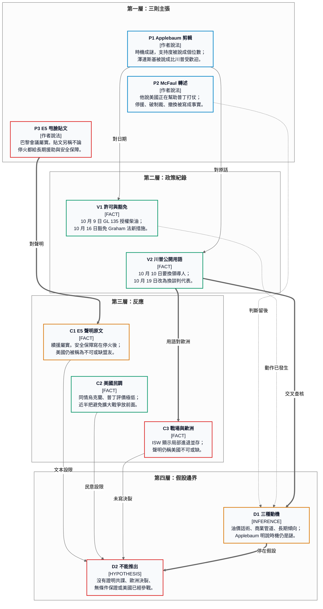

# 20 — 轉向、聲明與兩種國內反應：三則 X 貼文裡的美俄烏政策（L1）

> **分析日期：** 2026-10-29（台北）  
> **資料模式：** 三則貼文已讀；Applebaum 訪談有節目官網校對逐字稿；E5 聯合聲明讀過英國政府頁；OFAC 一般許可讀過許可本文；白宮豁免命令、路透社、ISW、Pew 與民調頁以當日抓取文字為準。Morning Joe 沒有獨立逐字稿，只用 MS NOW 影片的自動字幕片段與 McFaul 本人貼文。  
> **圖：** 單張垂直分層 Mermaid。2026-10-29 已用本機 Chrome Markdown Viewer 5.3（Mermaid 10.8）渲染，自動檢查通過，並已看過審查截圖。截圖底部的 JSON 是驗證器覆疊，不是文章的一部分。  
> **層級：** 政府與 OFAC 原文＝`primary`；路透社、ISW、Pew、智庫與通訊社＝`secondary`；X 貼文與尚未打開的民調交叉表＝`lead`；節目逐字稿中的判斷＝作者說法。  
> **文件角色：** `analysis`。不是投資建議，也不是制裁法意見。未核對的動機、交易條件與傷亡因果維持貝氏框架的 `0 dB`（`Λ = 1`），不拿來改倉位。

---

## 一、這三則貼文其實在講同一週

2026 年 10 月 27 日到 28 日的三則貼文，把同一串已經發生的政策動作編成三種故事。

1. **Tymofiy Mylovanov** 剪了 Anne Applebaum 的話：川普在期中選舉前幾週公開轉向，時機仍然說不通，因為普丁在美國極不受歡迎，而烏克蘭前線與遠程打擊當時並不差。
2. **杰克大山** 把 10 月 26 日巴黎的 E5 國防部長會議寫成歐洲「甩臉」美俄：不論是否停火，都給長期軍援與安全保障，並徹底處理俄羅斯影子船隊。
3. **Santa Patrick** 轉述 Michael McFaul 在 *Morning Joe* 的話：美國正在幫助普丁打烏克蘭，具體是停止援助、打破自己的制裁、要求撤換澤連斯基。

可對上文件的部分是政策動作與聲明用詞。對不上的部分，是動機被收成一個故事，以及歐洲文本被收成決裂。

已對上的動作有四個。10 月 9 日，美國財政部海外資產控制辦公室（OFAC）發出第 135 號一般許可（GL 135），授權與俄羅斯產地柴油的銷售、交付、卸載與進口有關的交易，效期到 2027 年 4 月 7 日美東夏令時間凌晨 12:01。［`FACT`／`primary`］10 月 16 日，白宮行政命令依《Lindsey O. Graham 制裁俄羅斯與伊朗法》第 115 條，豁免該法多數尚未生效的新制裁、限制與關稅；命令寫明，這不影響既有緊急狀態下的制裁。［`FACT`／`primary`］10 月 10 日與 10 月 19 日，川普先後談過換烏克蘭領導人與換談判代表。［`FACT`／`secondary`，路透社引述］10 月 26 日，法、德、義、波、英五國防長在巴黎發聯合聲明，繼續政治、軍事與財政支持，並把「願意結盟」的安全保障寫在停火或和平協議之後。［`FACT`／`primary`］

---

## 二、三則貼文本身

| # | 帳號 | 時間（UTC） | 網址 | 貼文在做的事 | 讀取當下互動 |
|---|---|---|---|---|---|
| P1 | Tymofiy Mylovanov `@Mylovanov`。帳號簡介為基輔經濟學院院長、2019–2020 年烏克蘭經濟部長 | 2026-10-27 21:21 | https://x.com/Mylovanov/status/2115192302373363913 | 三則影片摘要，來源指向 Kristol 訪談 | 主帖瀏覽 19,739；喜歡 988；轉發 229 |
| P2 | 杰克大山 `@2008456abc` | 2026-10-28 22:48 | https://x.com/2008456abc/status/2115576342712308078 | 中文評論，附一張圖。本回合沒有判讀圖裡的文字 | 瀏覽 727；喜歡 31；轉發 3 |
| P3 | Santa Patrick `@PatrickkkkKim`，轉 Michael McFaul `@McFaul` 2026-10-27 19:58 的貼文 | 2026-10-28 04:37 | https://x.com/PatrickkkkKim/status/2115301919224897880 | 把約 64 秒節目片段收成條列警告 | 轉帖瀏覽 1,773；McFaul 原帖瀏覽 17,825 |

Mylovanov 的三則摘要與節目開場高度重合，來源連結就是該集 YouTube。杰克大山的貼文是評論，不是聲明譯文。Patrick 的條列抓住了 McFaul 的規範判斷，也把時間層次壓扁了。

---

## 三、主圖

四層由上到下：貼文主張、已發生的政策用詞、歐洲文本與美國民調、動機假設的邊界。箭頭是查核關係。隱形排序線只固定閱讀順序。細節在後面各節。

---

## 四、背景：選舉前的許可、豁免與談判用語

期中選舉投票日是 2026 年 11 月 3 日。路透社 10 月 22 日的報導把川普這個月的轉向放進生活成本與能源價格：他批評過普丁，近週又改口，並把烏克蘭打擊俄羅斯煉油廠說成柴油價格上升的原因。同一則報導寫，美方以暫時放寬柴油制裁、換莫斯科向市場提供更多柴油；使用者也許在投票前感覺不到和平協議的物價效果。［`secondary`］

法律文本比「達成交易」這四個字窄，也比「制裁已取消」寬。

GL 135 的許可範圍是：在《俄羅斯有害境外活動制裁條例》與烏克蘭／俄羅斯相關制裁條例之下，與俄羅斯聯邦產地柴油之銷售、交付、卸載或進口（含進口美國）有關、原本被禁止的交易，授權至 2027 年 4 月 7 日。許可明確排除對俄羅斯中央銀行、國家財富基金與財政部在美國金融機構帳戶的借記。［`primary`，OFAC，2026-10-09］它是一般許可，不是一份寫明噸數與價格的買賣契約。川普所稱的立即供貨數量，本回合沒有對到白宮原文。［`UNKNOWN`］

一週後的行政命令寫明：Graham 法於 2026 年 9 月 18 日簽署；總統依第 115(a) 條豁免該法多個條款的制裁、限制與關稅，並向國會提交符合國家利益的認證。命令同時寫，這不影響 2026 年 3 月 24 日延續的對俄緊急狀態制裁。［`primary`，白宮，命令日期 2026-10-16］Herbert Smith Freehills Kramer 與大西洋理事會都指出，這張柴油許可與 2022 年《終止進口俄羅斯石油法》之間有未解的法律張力：該法終止進口禁令需要總統向國會認證停火與撤軍等條件。兩份法律評註都沒有把這張許可寫成「舊制裁全部作廢」。［`secondary`］本篇不裁定這項法律爭議。

公開講話分兩層。路透社寫，10 月 19 日川普說，也許該讓澤連斯基以外的人來談判；並註明他在 10 月 10 日曾呼籲烏克蘭更換總統。同日他稱俄羅斯在烏克蘭問題上「還好」、「他們沒做太多」，又說美國仍在與烏克蘭分享情報。［`secondary`，路透社 2026-10-19］RFE/RL 補充：10 月 19 日他沒有重講 10 月 10 日那句「找一個能做成協議的新領導人」。［`secondary`］所以「撤換澤連斯基」對得上 10 月 10 日的報導用語；10 月 19 日留下的原話是換談判代表。兩句都是施壓，強度不同。

戰場不是單向。戰爭研究所（ISW）10 月 22 日的評估寫，自 2026 年 9 月 1 日起觀察到俄軍淨失約 241 平方公里；2026 年迄今日均推進約 0.25 平方公里；烏軍在數個地段爭奪主動，其中包括解放超過 270 平方公里的「Vivaldi」行動。同一機構 10 月 25 日至 28 日的評估同時記錄俄軍在部分方向的推進、烏軍在 Oleksandrivka 與 Hulyaipole 方向的推進，以及烏軍對俄羅斯境內工業設施的遠程打擊仍在繼續。俄軍對烏克蘭城市與能源設施的打擊也沒有停。［`secondary`］「對烏克蘭是個還不錯的時刻」是相對判斷：前線沒有被寫成崩潰，也沒有被寫成烏軍已取得決定性優勢。

---

## 五、Applebaum：剪輯忠實，動機被她自己留白

影片是 *Conversations with Bill Kristol* 第 320 集，標題 *Anne Applebaum: Trump's Predatory Foreign Policy*，2026 年 10 月 27 日發布，官網註明錄於 10 月 26 日星期一。節目提供校對逐字稿。［`primary` 級的節目文本；內容仍是作者說法］

Mylovanov 三則摘要對得上開場，幾乎是逐句縮寫：

- 驚訝的是轉向的公開程度與嚴厲程度。他不喜歡澤連斯基、傾向俄羅斯，她說這已有 40 年，關係也被一再調查，所以傾向本身不是謎。
- 謎是他為何挑在這個時點。她說那是期中選舉前幾週，而且是烏克蘭守住或收復土地、並有效打擊俄國境內煉油廠及其他目標的時候。
- 普丁在美國極不受歡迎，「支持度是個位數」。澤連斯基則受歡迎，而且「比川普本人更受歡迎」。
- 她因此說，為何挑這個時刻做這次硬轉向，「其實仍然是個謎」。

這段之後，剪輯沒有帶出的判斷，才是她對動機的實際說法。［`作者說法`］

她說川普施壓澤連斯基停止打煉油廠，並表示將從俄羅斯進口柴油。她接著說，那個量不足以改變美國價格，她也不認為足以影響選舉；它最多是競選場合的一句話，而且她覺得他已經不大講了。它做到的是給俄羅斯一個心理上的增益：壓力落到烏克蘭身上，要烏克蘭停止作戰，而不是落到俄羅斯身上去結束戰爭。

她把「美國不再給烏克蘭錢、歐洲成了僅有的支持者」說成現狀。本回合沒有打開撥款表，不能把這句收成會計事實。［`作者說法`／`requires_verification`］川普 10 月 19 日對路透社說情報分享仍在繼續。［`secondary`］兩句並陳，情報與資金是否都歸零，目前是衝突敘述，不是已結案的數字。

她把 Starlink／Starshield 的限制說成決策者不清、很可能是 Elon Musk，並說有人因此無法預警而死亡，其後「又回到平衡」。決策者與死亡因果，本回合沒有獨立傷亡統計。ISW 10 月 25 日寫的是限速期間對噴射無人機的攔截率略降、仍相對高。［`作者說法`與 `secondary` 並陳，因果 `requires_verification`］

她對「為什麼是現在」給了一條她認為較可理解的管道，而不是一個已證實的契約：Steve Witkoff 與 Jared Kushner 在談停戰的同時，也碰得到北溪、凍結資產與 Lukoil 資產誰來接手；俄羅斯這邊可以把商業條件理解成「讓美國停止幫助烏克蘭」的對價。她 10 月 4 日的通訊把 Lukoil 討論溯及《紐約時報》。本回合沒有打開那則報導，也沒有合同。［`作者說法`／`requires_verification`］

同一集裡，她把 2016 年民主黨全國委員會材料外洩說成已記錄的俄羅斯行為，並說這不是陰謀論。她沒有在這段開場宣佈川普是俄羅斯的代理人。Kristol 猜選舉前換不到對價、兩年內也許還有交換；她的回應是「他被提供了什麼」。這是假設，不是發現。

### 5.1 民調對得上哪一句，對不上哪一句

「個位數」要看題目。

Pew 2026 年春季美國樣本：對普丁「有信心」合計 10%（很多 2%、有一些 9%），「沒信心」85%。［`primary` 級的調查表］10% 不是個位數。Pew 2026 年 7 月的跨國報告也寫美國對普丁的信心為 10%。

更接近個位數的是 10 月中、下旬的其他題目，而且題目不是「普丁支持度」這五個字：

- Napolitan News Service／RMG，2026 年 10 月 19–20 日，登記選民 1,000 人，公開頁寫誤差 ±3.1 個百分點：9% 認為美國應支持俄羅斯；46% 認為應支持烏克蘭，較 6 月下降 11 個百分點；30% 說兩邊都不支持。［`secondary`，會員牆後的全文未讀］
- YouGov 的「俄國是盟友或敵人」追蹤，頁面標示 2026 年 10 月 20 日：盟友 9.2%、敵人 77.6%、不確定 13.2%。這題的三個選項加總為 100，「不友好」沒有單獨列出。［`secondary`］
- The Gaze 與 *Il Foglio* 都轉述 10 月 19–20 日 Economist/YouGov：登記選民中 66% 更同情烏克蘭，3% 更同情俄羅斯。交叉表 PDF 本回合沒有打開，兩家轉述同向。［`secondary`／`partially_verified`］

「澤連斯基在美國比川普更受歡迎」沒有被同一份問卷的同一題證明。可分開看的數字是：Pew 2026 年 4 月，50% 對澤連斯基處理國際事務有信心、40% 沒有；Pew 2026 年 10 月 22 日通訊寫，68% 不贊成川普的總統工作。兩題不能相減。YouGov 澤連斯基知名度追蹤在 2026 年 10 月 1 日給出受歡迎度 52.6%，本回合沒有打開同一追蹤器上的川普數字。基輔國際社會學研究所 10 月 8–16 日的 54% 信任、以及 10 月 10 日後子樣本 57%，是烏克蘭境內電話調查，不是美國民調。［`secondary`］用 KIIS 證明「在美國更受歡迎」會張冠李戴。

所以：Applebaum 的人氣對比是她的判斷，方向與「普丁極不受歡迎、川普這項政策評價差」相容，頭對頭人氣本篇未核成事實。個位數用在「同情／應支持俄羅斯」說得通，用在 Pew 的「對普丁有信心」則是 10%。

「40 年」留在她的人物判斷。本篇沒有重做傳記查核。［`作者說法`］

---

## 六、E5：會議屬實，文本不是決裂

英國政府 2026 年 10 月 26 日刊登五國防長聯合聲明。簽署格式是法國、德國、義大利、波蘭、英國。［`primary`］波蘭國防部同一則公布寫，巴黎會議還有歐盟外交與安全政策高級代表、國防與航太委員、北約副秘書長，並與烏克蘭國防部長視訊。［`primary`］人名 Kaja Kallas、Andrius Kubilius、Radmila Shekerinska 出現在 UA.NEWS 的轉述，不在本回合讀過的英國文本裡。［`secondary`］

聲明裡與貼文有關的句子是：

- 五國評估，俄羅斯是歐洲—大西洋安全最急迫、也是長期的威脅。侵略戰爭、盟友領空、破壞與混合行動，被寫成強化而不是削弱團結的因素。
- 歐洲要為自己的安全承擔更多責任，並且「決心與美國及所有盟友密切協調」。下一句寫：美國現在是、未來仍是不可或缺的盟友，美國持續參與歐洲安全，對可信的北約是必要的。
- 對烏克蘭：「我們將維持堅定承諾」，以一切可用手段繼續政治、軍事與財政支持。烏克蘭現在與未來的自衛能力，被寫成對集體安全很重要。
- 影子船隊：重申將繼續依國際法、並與相關夥伴協調，處理這些活動。動詞是繼續處理，不是清剿完畢，也沒有新的攔截授權清單。
- 和平與保證：「願意結盟」（Coalition of the Willing）在停火或和平協議到位之後，貢獻有力且可信的安全保障。

杰克大山貼文裡，會議發生、五國、巴黎、繼續挺烏、點名影子船隊，這四點對得上。對不上的是強度與對象。

「不論是否停火都給長期安全保障」與文本相反：安全保障那一句把時點寫在停火或協議之後。繼續軍援的句子沒有寫「首次」，也沒有寫新的金額或年限。Meduza 轉彭博社：會後沒有宣布新的軍事或財政包裹，只是重申既有承諾。［`secondary`］

「甩臉美國」「不伺候了」「這世界歐洲依然可以說不」不是聲明的語氣。聲明把更大的歐洲責任放在北約裡，並寫明要與美國協調。德國防長 Boris Pistorius 的會外話，由 Al Jazeera 轉 dpa、Meduza 轉彭博：五國正準備冬季援助包，與烏克蘭做一套補充愛國者的防空，並會設法讓華盛頓繼續提供物資、情報與衛星資料。［`secondary`］這是在留美國能力，不是在宣布替代美國。

Al Jazeera 標題級的「加強防空」來自部長發言，不是聯合聲明的條文。聲明本身沒有防空系統的型號、數量或交期。

Applebaum 在 10 月 26 日錄製的同一天說，英、法、德、義、波以及北歐、波羅的海與荷蘭，目前有一個她認為很穩的挺烏政治聯盟，至少能撐過這個冬天；同時，美國還算可靠夥伴的感覺正在消退。［`作者說法`］政治判斷與外交文本可以同時成立：文本拒絕決裂，判斷承認信任下降。

---

## 七、McFaul：核心判斷是他的，條列把時間壓扁了

McFaul 本人 10 月 27 日 19:58 UTC 寫：今天上 *Morning Joe*，談「我們美國如何正在幫助普丁打他的對烏戰爭」。［`lead`，本人貼文］MS NOW 同日影片標題是主持人的措辭。自動字幕裡，他的段落大意是：政策本身以前改變沒有那麼多，因為身邊有人不同意；現在看到的是回報。援助走到零，美國從最大資助者變成沒有。近幾週則是在打破經營多年的制裁。川普還說他們必須換領導人、換澤連斯基，那是普丁的談話要點。然後是：「此刻，我們美利堅合眾國，正在幫助普丁打他對烏克蘭的戰爭。我覺得這既悲慘，又特別惡劣。」［`secondary`，自動字幕，可能有聽寫誤差］

中文貼文的「悲慘」「令人髮指」對得上 tragic / atrocious 這一組詞。結尾「美國人民选出的是美國總統，不是普丁的代理人」是貼文作者的問句，不是字幕裡的句子。

三條「事實」要拆開：

| 貼文條列 | 對得上的材料 | 誇大或遺漏 |
|---|---|---|
| 停止援助烏克蘭 | McFaul 把「資助歸零」說成已經發生、且早於「近幾週」；Applebaum 也說美國不再給錢 | 沒有撥款表。川普同週說情報仍在分享。Patriot 轉運延遲、Starshield 限速是被多個 `secondary` 報導的部分限制，不是一張「援助歸零」的官方命令 |
| 破壞美國自己的對俄制裁 | GL 135 與 Graham 法豁免都是白宮自己的筆 | 法律形式是許可與法定豁免，既有緊急狀態制裁被命令保留。大西洋理事會寫，10 月 27 日仍有一批柴油找不到買方與港口。［`secondary`］「打破」是規範詞，不是罪名 |
| 要求撤換澤連斯基，重複普丁宣傳 | 10 月 10 日路透社所記的換總統；10 月 19 日的換談判代表；McFaul 把換澤連斯基稱為普丁談話要點 | 10 月 19 日的原話窄於「撤換總統」。他是否在那 64 秒裡先講了 2016 年選舉干預，字幕片段從「身邊有人不同意」開始，前面那句本回合未逐秒核對。［`requires_verification`］ |

他 10 月 26 日前後的 *Foreign Affairs* 文章題為 *Putin’s Strategy Is Working*。付費牆後的轉載摘寫：前線受阻之後，普丁改打烏克蘭的能源與民生；川普近週的制裁暫停、援助與情報摩擦、以及壓澤連斯基接受俄方戰爭目標，讓俄羅斯拿下大片領土並實質影響基輔決策的可能性上升。［`作者說法`，摘錄／`partially_verified`］這與 Morning Joe 是同一套判斷，不是另一份證據。

「美國正在幫助普丁作戰」是前大使的規範結論。它描述的是減壓與施壓的方向：對莫斯科減制裁壓力，對基輔加談判壓力。它不是一項「美國已成為交戰方」的法律認定。

---

## 八、歐洲與美國國內各自怎麼反應

歐洲政府文本的反應是續援、把安全保障放在停火之後、並寫下美國不可缺。部長會外話加上兩件沒有進聯合聲明的準備：冬季包裹，以及補充愛國者的防空，同時爭取美國物資、情報與衛星資料不要斷。［`primary`＋`secondary`］沒有看到五國在這份聲明裡宣布替代美國、或宣布新的多年期撥款數字。

美國國內不是一面倒的授權，也不是一面倒的沉默。

Napolitan 同一份 10 月 19–20 日公開結果：28% 認為川普處理烏克蘭「好或極好」，45% 認為「差」；傳統共和黨選民裡 21% 正面、38% 差。34% 認為川普站俄羅斯、24% 認為站烏克蘭、18% 認為兩邊都不站。同時，47% 認為避免與俄羅斯擴大戰爭比幫助烏克蘭更重要，35% 不同意；前一項較 6 月下降 10 個百分點。［`secondary`］

YouGov America 官方帳號公布的 10 月 19–20 日 Economist/YouGov：登記選民中 45% 認為川普更同情俄羅斯，16% 認為更同情烏克蘭。［`lead`，民調機構自己的貼文］

國會方面，本回合讀到的是報導而不是投票紀錄。*Kyiv Post* 10 月 25 日寫共和黨內出現公開批評，並引一名不具名、接近共和黨的華盛頓消息來源說「除非民調全錯，川普這次期中選舉已經完了」。［`secondary`／`lead`，不具名］大西洋理事會 10 月 23 日寫，兩黨議員開始談調查，以及若政策不變，選舉後的跛腳期可能阻擋議程。［`secondary`，分析，不是計票］這些句子說明精英層有摩擦。它們不是民調，也不是已經啟動的調查清單。

普丁在美國公投市場上的位置，與川普這個月的政策位置，因此是分開的。多數題目仍把同情放在烏克蘭、把俄羅斯放在負面；同時有一塊接近半數的選民把「不要捲入更大的戰爭」放在援烏前面。政策評價差，不等於已形成恢復援助的多數授權。

---

## 九、機制：三個層次疊在一起

**法律層。** GL 135 重開的是柴油交易通道，期限約半年，而且排除對俄羅斯主權財政帳戶的直接借記。Graham 法豁免拿掉的是一套尚未生效的新關稅與新制裁，不是 2022 年以來每一條舊名單。對烏克蘭的談判壓力（停止打煉油廠、換談判代表或換領導人）與這兩支筆同一個月出現。莫斯科沒有被這些文件要求先停火。［`FACT` 的文本範圍；「因此普丁會繼續打」是 `INFERENCE`］

**成本交換層。** 烏軍遠程打擊打的是煉油與軍工相關設施，ISW 轉述的市場消息把反覆打擊寫成 Rosneft 維修與利潤的壓力。［`secondary`］川普公開把這些打擊說成油價原因，並要求停手。若遠程打擊停、俄羅斯對烏克蘭城市的打擊不停，烏克蘭失去的是一個讓俄國後方支付成本的槓桿。這是交換比的判斷，不是戰損結算。［`INFERENCE`］

**敘事層。** X 上的三則貼文各自抓一個真物件，再補一個文本裡沒有的結局。Applebaum 的真物件是轉向的時點與公開程度，結局被收成「動機成謎」；她自己後段其實給了柴油量不足與商業管道兩個方向，剪輯沒有帶上。E5 的真物件是五國聲明，結局被收成對美俄決裂。McFaul 的真物件是「方向是在幫助普丁」這句規範話，結局被收成三條已經結案的官方事實。

---

## 十、動機假設並存，本篇不收成一個

三個假設都看得到支持者，沒有一個在本回合被文件獨占。

1. **選舉前的油價話術。** 路透社、*華盛頓郵報》引 Daniel Fried、大西洋理事會都把柴油協議寫成期中選舉前的價格與談話需求，並懷疑數量小到影響不了泵價。［`secondary`］Applebaum 同意數量影響不了選舉，因此她不把這個假設當成充分解釋。［`作者說法`］
2. **談判代表的商業管道。** Applebaum 的說法是，俄羅斯把交易理解成讓美國停手的條件，而 Witkoff、Kushner 周圍的商業討論讓這個理解變得可信。合同與利益分配未讀。［`requires_verification`］
3. **長期傾向，加上第二任期的制約變少。** McFaul 與 Applebaum 都把親俄偏好說成舊的。McFaul 強調以前有官員擋住，現在擋的人少了，所以近週的許可、豁免與換人用語是回報。Applebaum 同意偏好不新，並把「為何是這幾週」繼續稱為謎。［`作者說法`］

三個假設可以同時解釋一部分現象。柴油許可解釋得了「為何能源」、解釋不了「為何同時要求停打煉油廠卻不要求俄方停打城市」。商業管道解釋得了「為何讓步沒有換到停火」，但沒有契約。長期偏好解釋得了方向，解釋不了她自己標成謎的日曆。

未核對的動機與交易，在本庫貝氏規則裡是 `0 dB`。已經發生的許可、豁免、公開講話與 E5 文本是事實，它們更新的是「政策動作存在」，不是「單一動機已證實」。

---

## 十一、適用邊界

這篇可以用來讀 2026 年 10 月最後一週的三則貼文：哪些句子有政府文本，哪些是判斷，哪些被加碼。

它不能用來做這些事：

- 推斷川普或任何談判代表已構成刑事意義上的外國代理人。調查史是 Applebaum 的背景句，本篇沒有重開卷宗。
- 把 E5 聲明算成歐洲已取代美國的安全保證，或算成新的多年期軍援撥款。金額與交期不在文本裡。
- 把 GL 135 或 Graham 法豁免當成 2022 年進口禁令已經合法終止。律師評論指出張力，法院或國會沒有在本篇材料裡做結論。
- 把 ISW 的平方公里當成官方戰損公報。那是公開來源評估，而且同一週雙方都有局部推進。
- 用任一國民調預測 11 月 3 日的席次。題目不同，樣本不同，本篇沒有做模型。
- 指導證券、能源貿易或制裁合規。柴油船是否靠港、OFAC 與 2022 年法律的適用，要看許可本文、貨運單與律師意見，不看這篇文章。

---

## 十二、來源與主張分級

| 主張 | 等級 | 來源 | 狀態 |
|---|---|---|---|
| GL 135，2026-10-09，柴油交易授權至 2027-04-07，排除俄央行等帳戶借記 | `FACT`／`primary` | [OFAC 許可 PDF](https://ofac.treasury.gov/media/937216/download)；[OFAC 發布頁](https://ofac.treasury.gov/recent-actions/20261009_33) | `verified` |
| 2026-10-16 行政命令豁免 Graham 法多數新措施，並保留既有緊急狀態制裁；該法 2026-09-18 簽署 | `FACT`／`primary` | [白宮](https://www.whitehouse.gov/presidential-actions/2026/10/implementing-the-lindsey-o-graham-sanctioning-russia-and-iran-act-of-2026/) | `verified`（頁面抓取） |
| 2022 年進口禁令與 GL 135 的法律關係未解 | `secondary` 的法律評註 | [HSF Kramer](https://www.hsfkramer.com/notes/sanctions/2026-posts/ofac-issues-general-license-135-authorizing-transactions-involving-russian-origin-diesel-fuel)；[大西洋理事會 2026-10-27](https://www.atlanticcouncil.org/dispatches/for-russia-trumps-diesel-deal-was-just-the-first-ask/) | `partially_verified` |
| 10 月 10 日換領導人、10 月 19 日換談判代表；稱俄方「還好」；稱情報仍在分享 | `FACT`（報導所引述的公開話）／`secondary` | [路透社 2026-10-19](https://www.reuters.com/world/trump-says-zelenskiy-should-get-somebody-else-negotiate-end-war-2026-10-19/)；[RFE/RL](https://www.rferl.org/a/ukraine-russia-trump-putin-zelenskyy-war/33878954.html) | `verified` 為報導，不是白宮逐字稿 |
| 期中選舉與油價是轉向的新聞解釋 | `secondary` | [路透社 2026-10-22](https://www.reuters.com/world/us/midterms-reach-kyiv-2026-10-22/)；[華盛頓郵報 2026-10-20](https://washingtonpost.com/world/2026/10/20/russia-sensing-victory-cheers-trumps-latest-shift-against-ukraine/) | 解釋，不是動機證明 |
| E5 聲明全文要點：威脅評估、與美國協調、續援、影子船隊、停火後安全保障 | `FACT`／`primary` | [GOV.UK 2026-10-26](https://www.gov.uk/government/news/e5-defence-ministers-statement-26-october-2026) | `verified` |
| 會中還有歐盟與北約副秘書長、並視訊烏國防部長；沒有新金額；Pistorius 要留住美援並補防空 | 角色為 `primary`；金額與會外話為 `secondary` | [波蘭國防部](https://www.gov.pl/web/obrona-narodowa/europejska-grupa-5-ministrow-obrony-e5-o-dalszym-wzmacnianiu-nato)；[Meduza 轉彭博](https://meduza.io/en/news/2026/10/27/european-countries-with-the-largest-defense-budgets-name-russia-their-main-security-threat-and-pledge-continued-support-for-ukraine)；[Al Jazeera 轉 dpa](https://www.aljazeera.com/news/2026/10/26/key-european-defence-ministers-meet-in-paris-to-discuss-ukraine-support) | 會外話 `partially_verified` |
| Applebaum 開場各句，含「時機仍是謎」「個位數」「比川普受歡迎」「戰場有利時刻」 | `作者說法` | [逐字稿](https://conversationswithbillkristol.org/transcript/anne-applebaum-trumps-predatory-foreign-policy/)；[YouTube](https://www.youtube.com/watch?v=TFRqEsXK82g)；Mylovanov 貼文 | 剪輯忠實；人氣頭對頭 `requires_verification` |
| 普丁信心 10%／無信心 85%（2026 春） | `FACT`／調查表 | [Pew 2026 春 topline PDF](https://www.pewresearch.org/wp-content/uploads/sites/20/2026/04/pg_2026.04.23_russia-ukraine_topline.pdf) | `verified` 為該題 |
| 9% 應支持俄羅斯；28%／45% 的烏克蘭政策評價；47% 優先避免擴大戰爭 | `FACT`（該調查的公開數字） | [Napolitan 2026-10-27](https://napolitannews.org/posts/just-28-percent-give-trump-good-marks-on-ukraine-and-russia) | 公開摘要 `verified`；全文未讀 |
| 45% 認為川普更同情俄羅斯、16% 更同情烏克蘭 | 民調機構貼文 | [YouGov America，2026-10-23](https://x.com/YouGovAmerica/status/2113622254068072565) | `partially_verified`（未開交叉表） |
| 烏克蘭境內對澤連斯基信任，全樣本 54%，10 月 10 日後子樣本 57% | `secondary` 轉述 KIIS | [Kyiv Independent 2026-10-20](https://kyivindependent.com/zelenskys-trust-rating-surges-amid-trumps-pressure-campaign-poll-finds/) | 不是美國人氣 |
| 9 月起俄軍淨失約 241 平方公里；遠程打擊持續；雙方都有局部推進 | `secondary` 評估 | [ISW 2026-10-22](https://understandingwar.org/research/russia-ukraine/russian-offensive-campaign-assessment-october-22-2026/)；[10-25](https://understandingwar.org/research/russia-ukraine/russian-offensive-campaign-assessment-october-25-2026/)；[10-28](https://understandingwar.org/research/russia-ukraine/russian-offensive-campaign-assessment-october-28-2026/) | `partially_verified` |
| McFaul：美國正在幫助普丁打仗；援助歸零；近週打破制裁；換澤連斯基是普丁要點 | 本人判斷；字幕支持後三句的方向 | [McFaul 貼文](https://x.com/McFaul/status/2115171315405701473)；[MS NOW](https://www.youtube.com/watch?v=XojUQPld7_8)；中文轉述 https://x.com/PatrickkkkKim/status/2115301919224897880 | 規範判斷 `verified` 為他說過；「歸零」與 2016 年那一句在該片段中的位置 `requires_verification` |
| Witkoff／Kushner 的 Lukoil、北溪、凍結資產交易條件 | `作者說法` | Applebaum 逐字稿；她 10 月 4 日通訊指向 NYT，本回合未打開 | `requires_verification` |

---

## 附錄：這次查核沒有做的事

- 沒有判讀杰克大山那張配圖裡的字。
- 沒有把 Morning Joe 整段重看一遍。64 秒之後 Katty Kay 的提問不在本篇。
- 沒有打開 Economist/YouGov 的交叉表 PDF、KIIS 原始表、Gallup 的世界領袖好感度、以及《紐約時報》關於 Lukoil 的報導。
- 沒有把本庫更早的柴油與 Starshield 筆記當成這三則貼文的證據。那些筆記若與本篇衝突，以這次打開的政府頁與節目逐字稿為準。
- 主圖於 2026-10-29 經本機 Chrome 渲染，`verify_mermaid_md.py` 回報通過。閱讀器縮放與拖曳是 Markdown Viewer 5.3 的功能，其他閱讀器不一定相同。
