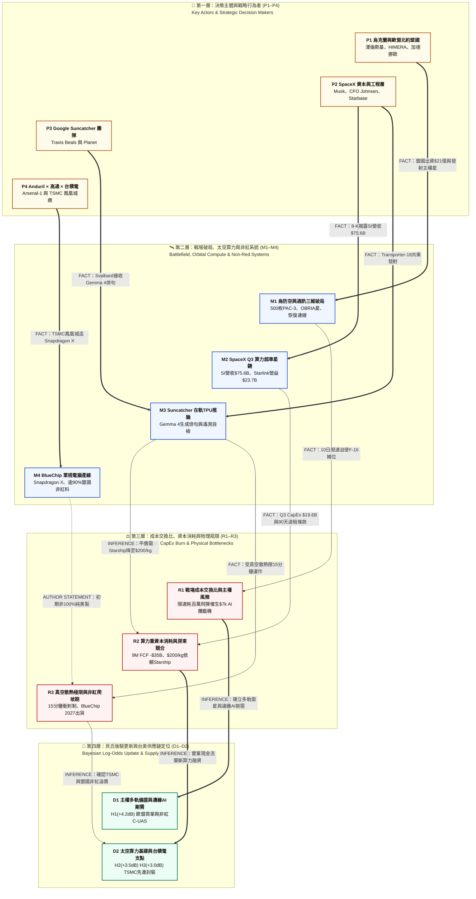

# 21 — 烏克蘭戰場主權破局、SpaceX Q3 算力財報與 Google Suncatcher 在軌 TPU 推論實證（L1 權威研究基底）

> **分析基準日**：2026-10-31（台北時間 UTC+8）  
> **專案定位**：[`74_aerospace_defense_research`](README.md) 航太、國防工業與雙用技術研究庫（Capture $\to$ Analysis 階段）  
> **方法論與合約版本**：共用工作背景 `2026.10.22-candidate.2` · `user:knowledge-publication-l1-l2-v15`（直式 Mermaid 硬性合約）· `user:web-search-synthesizer` · 全面遵循 [`AGENTS.md`](AGENTS.md) 認識論五維標籤、禁詞令與貝氏決策評分規範  
> **權重配置**：**(I) 烏克蘭戰場通訊主權與防空補給破局（最高權重）** $\times$ **(II) SpaceX (`SPCX`) Q3 財報與 Google × SpaceX 軌道算力競合（核心主軸，含第 7 則 Suncatcher 在軌 TPU 生成俳句完整報導）** $\times$ **(III) Anduril × Qualcomm × TSMC「BlueChip」非紅供應鏈軍規電腦產線（次要權重）**  
> **跨報告錨點**：串聯本庫 [《報告 10：Starlink 降速風暴》](10_starlink_ukraine_zalenskyy_trump_musk_report.md) · [《報告 11：Google Suncatcher 太空軌道算力》](11_google_suncatcher_orbital_compute_report.md) · [《報告 14：大歷史東印度公司與 SpaceX/NVIDIA 雙軌博弈》](14_mobius_history_spacex_nvda_ukraine_taiwan_l1.md) · [《報告 16：資本負向迴路與 Neocloud 高息債務》](16_negative_capital_loop_credit_collapse_ai_capex_l1.md) · [《報告 17：SpaceX 400 億 GPU 債務與 Starshield C-UAS 解構》](17_spacex_40b_gpu_debt_starshield_cuas_24h_digest_l1.md) · [《報告 20：OFAC 柴油許可與 E5 聯合聲明查核》](20_x_posts_applebaum_e5_mcfaul_ukraine_l1.md)

---

## 一、核心問題與貝氏執行摘要（Problem & Executive Thesis）

### 1.1 核心問題（Problem Statement）
2026 年 10 月下旬至月底（10 月 20 日至 10 月 31 日），橫跨「烏克蘭戰場主權通訊與防空補給」、「SpaceX (`SPCX`) 第三季財報結構翻轉」、「Google Project Suncatcher 在軌 TPU 首度生成式 AI 推論驗證」以及「Anduril × 高通 × 台積電 BlueChip 本土軍規電腦產線」的四組事件，表面上分屬地緣衝突、太空商業財報與科技研發，但實質上共同收斂於同一個核心結構問題：

**當單一商業巨頭（SpaceX）同時壟斷低軌入軌運力（Falcon 9 / Starship）與戰區高頻寬衛星通訊（Starlink / Starshield），並將龐大實業現金流轉化為地面與軌道 AI 算力霸權時，主權國家（如烏克蘭與歐洲盟友）、雲端全棧巨頭（如 Google）與新興防務整合商（如 Anduril）如何透過「去單點依賴」、「跨國融資買單」與「台美非紅供應鏈晶圓在地化」重塑各自的成本交換比與戰略自主邊界？**

### 1.2 核心結論（Executive Thesis）
依據一手官方公報、SEC 8-K 財報揭露與同儕審查期刊數據，本報告提煉出四大具實質財務與工程檢驗力之結構結論 `[INFERENCE]`：

1. **烏克蘭戰場的「三重去單點依賴」：從 Starshield 限速震撼到歐盟出資 21 億美元買單 PAC-3 MSE 與 `OBRIA NANO` 主權衛星入軌**：
   2026 年 10 月 14 日至 24 日，烏軍使用的五角大廈合約軍用級 **Starshield** 終端遭施加約 **60 至 160 km/h（37–100 mph）** 的移動速度上限，導致追擊俄軍噴射動力無人機的高速攔截無人機與「中程縱深打擊（Middle Strike）」載具斷線失效，迫使烏軍動用單價約 **100 萬美元**的 F-16 空對空飛彈補位（攔截率由 77% 微降至 74%）`[FACT]`。儘管該限速已於 10 月 24 日解除並恢復 **>400 km/h（250 mph）** 穩定連線，且引發美國參議員 Blumenthal 與 Schiff 要求國防部長 Hegseth 宣誓作證調查決策鏈 `[FACT]`，但這十天的單點斷網震撼已觸發烏克蘭與歐洲盟國三項結構性突圍：
   - **防空彈藥跨國出資破局**：在澤倫斯基公開點名五角大廈壓件近一個月後，美國國務院於 **10 月 30 日正式批准向烏克蘭出售 500 枚愛國者 PAC-3 MSE 攔截飛彈（總值 21 億美元）**；關鍵轉折在於**「零美國聯邦資金」**——全案由加拿大、德國、挪威透過 JUMPSTART 機制及歐盟烏克蘭支援貸款（Ukraine Support Loan）全額出資向洛克希德·馬丁採購（[Defence Industry Europe](https://defence-industry.eu/u-s-department-of-state-approves-potential-2-1-billion-sale-of-500-patriot-pac-3-mse-missiles-to-ukraine/)、[Denkstrom / Tagesschau](https://denkstrom.org/artikel/usa-genehmigen-moeglichen-verkauf-von-500-patriot-raketen/)）`[FACT]`。
   - **主權通訊衛星在軌運作**：烏克蘭戰術通訊商 **HIMERA** 與丹麥衛星製造商 **GomSpace**（NASDAQ: `GOMX`）於 10 月 27–29 日正式確認，烏克蘭首顆主權通訊試驗衛星 **`OBRIA NANO`**（於 10 月 1 日搭乘 SpaceX Transporter-18 入軌）已啟動在軌運作並由烏克蘭營運商獨立控制，長期規劃於烏國本土建立衛星與地面終端產線，降低對單一外國商業星系的戰略脆弱性（[GomSpace 官方公告](https://gomspace.com/ukraines-sovereign-satellite-now-operating-in-orbit/)、[Defense Express](https://en.defence-ua.com/news/independent_ukrainian_satellite_communications_within_reach_himera_gomspace_launch_first_obria_nano_satellite-20248.html)）`[FACT]`。
   - **終端邊緣 AI 導引替代衛星鏈路**：烏軍工加速測試單價僅 **7,000 美元**的 **F-Jet 80** 噴射攔截無人機，以機載邊緣 AI 視覺導引取代末端衛星遙控，將反無人機（C-UAS）成本交換比優化逾兩個數量級（[ISW](https://understandingwar.org/research/russia-ukraine/russian-offensive-campaign-assessment-october-25-2026/)）`[FACT / INFERENCE]`。

2. **SpaceX (`SPCX`) Q3 財報的「雙面實相」：AI 算力營收首度超車 Starlink，但 45% 高毛利星鏈仍是支撐每年近 800 億美元重資本支出的唯一真金白銀壓艙石**：
   根據 SpaceX 於 2026 年 10 月 20 日提交之 SEC Form 8-K 財報，Q3 單季總營收達 **145.8 億美元（YoY +161%）**，首次實現上市後單季 GAAP 淨利 **44.04 億美元（稀釋 EPS $0.35）** `[FACT]`。其中原 AI 部門更名為 **Super Intelligence (SI)**，單季營收暴增至 **75.6 億美元**（含第三方算力租賃 **70.2 億美元**及 8 月 14 日以 600 億美元收購 AI 程式開發商 **Cursor** 後併表貢獻之 **6.08 億美元**），首度超越 **Connectivity（Starlink）部門的 52.5 億美元** `[FACT]`。然而拆解損益表與現金流量表可見：
   - **獲利品質與折舊重擔**：SI 部門在扣除 **24.7 億美元單季折舊攤銷**與 **12.2 億美元 Cursor 相關股份基礎給付（SBC）** 後，營業利益僅 **4.31 億美元**（營業利益率 5.7%），且 S-1 招股書揭露其與 Anthropic 簽訂之雲端算力合約在滿 3 個月後僅需 **90 天通知即可終止**；反觀 Starlink 連線部門貢獻高達 **23.7 億美元營業利益（營業利益率 45.1%）**，佔全集團營業利益（27.9 億美元）的 **84.9%**（[Complete Trader's Edge 8-K 拆解](https://completetradersedge.com/spacex-q3-2026-earnings-results/)）`[FACT]`。
   - **營業外收益與現金流消耗**：Q3 淨利 44.04 億美元中有 **16.1 億美元（36.6%）來自營業外項目**（含 IPO 現金池利息收入 8.73 億、關聯方與比特幣回升等其他收入 10.3 億、稅務利益 3.9 億，抵減利息支出 6.75 億）；而前三季累計資本支出高達 **481 億美元**（營業現金流僅 131 億美元，前三季自由現金流缺口達 **-349.7 億美元**），Q3 單季 CapEx **195.9 億美元**中更有 **164.4 億美元（83.9%）** 投入 SI 算力基建（Colossus II 銘牌算力達 **1.7 GW**），搭配 Q4 高達 **350 億至 400 億美元**的 CapEx 指引與 **400 億美元 GPU 債務融資**，證明 SpaceX 本質上是以「火箭發射壟斷＋Starlink 獨佔現金流」交叉補貼一場高槓桿的 AI 算力豪賭 `[FACT / INFERENCE]`。

3. **Google「Project Suncatcher」在軌 TPU 首度生成俳句（Haiku）完整解構，以及 Google × SpaceX「房東即對手」的軌道算力競合**：
   2026 年 10 月 30 日，Google 智慧範式資深總監 Travis Beals 宣布 Project Suncatcher 原型衛星完成「Hello World」里程碑——搭載於衛星上的資料中心級 **Trillium TPU（v6e）** 在軌道上成功執行預載之 **Gemma 4** 開源模型，並在飛越**挪威斯瓦爾巴群島（Svalbard）**地面站時下傳人類史上首則太空資料中心級 AI 晶片生成的俳句：*"Blue marble below / Data streams in silent grace / Starlight feeds my core."*，隨後更完成太空打油詩（limericks）與回報酬載自身系統狀態的**遙測提示詞（telemetry prompts）**測試（[Unite.AI 完整報導](https://www.unite.ai/project-suncatchers-orbiting-tpu-delivers-its-first-ai-generated-haiku/)、[HWBusters](https://hwbusters.com/news/project-suncatchers-orbiting-tpu-sends-back-its-first-ai-ai-answer-and-its-a-haiku/)）`[FACT]`。
   - **工程邊界誠實檢驗**：此次「Hello World」僅證明商用 TPU 與衛星匯流排（Planet 製造）熬過了 Falcon 9 發射時 10G 持續加速與晶片局部 **50–100G 三軸震動**並成功冷開機通訊；根據同步發表於《Joule》期刊的論文，地面質子束測試雖確認 Trillium TPU 可承受 **15 krad(Si)** 總游離劑量（為 5 年任務預期 750 rad(Si) 之 **20 倍**，HBM 為 2 krad(Si)），但**真正的物理硬牆——真空熱輻射散熱極限（目前受限於約 15 分鐘衝刺工作週期）與在軌長期熱應力測試——才剛要開始**，且 2027 年雙星雷射互聯（1.6 Tbps OISL）仍有待驗證 `[FACT / INFERENCE]`。
   - **Google × SpaceX 結構性矛盾**：Suncatcher 欲達成與地面資料中心電費（~$810/kW-yr）平價，必須依賴 SpaceX **Starship** 將入軌成本由 Falcon 9 的 **$3,600/kg** 壓低 94% 至 **$200/kg**（需年發射 180 次）；這使 Google 處於「向最大算力與軌道競爭對手（SpaceX SI）購買發射船票來驗證自身太空 TPU 期權」的微妙雙軌競合關係 `[INFERENCE]`。

4. **Anduril × Qualcomm × TSMC「BlueChip」：非紅供應鏈深入軍規運算底層，台積電亞利桑那廠成為核心支點**：
   10 月 27–28 日，國防科技獨角獸 Anduril 與高通（Qualcomm）聯合發表 **BlueChip** 全美電腦硬體產線，首款軍規強固筆電預計 2027 年接單出貨，於俄亥俄州 **Arsenal-1** 廠組裝電路板，原型機逾 **90% 零件採購成本**來自美國與盟國供應商；高通發言人更向《Manufacturing Dive》證實，其核心 **Snapdragon X 系列處理器（負責通用運算與端側 AI）將於台積電（TSMC）亞利桑那州鳳凰城晶圓廠製造**（[Anduril 官方新聞稿](https://www.anduril.com/news/anduril-and-qualcomm-unveil-bluechip-to-rebuild-american-computer-manufacturing)、[Manufacturing Dive](https://www.manufacturingdive.com/news/anduril-qualcomm-blue-chip-tsmc-snapdragon-reshoring-computer-hardware/872925/)）`[FACT]`。創辦人 Palmer Luckey 坦言初期無法做到 100% 純美製造，印證了美軍「非紅供應鏈（NDAA 合規）」的真實工程路徑是**「台積電在地晶圓代工＋盟國非紅零組件＋美國本土終端組裝」** `[INFERENCE]`。

---

## 二、權重矩陣與五大核心議題認識論總表（Weighted Epistemic Matrix）

| 權重排序與主題模組 | 核心量化指標與工程／政策進展 | 認識論五維標籤 (`claim_type` / `source_tier` / `document_role` / `verification_status` / `workflow_disposition`) | 主要驗證來源 |
| :--- | :--- | :--- | :--- |
| **權重 I（最高）：烏克蘭問題** 1A. Starshield 限速解除與國會調查 1B. 21 億美元 500 枚 PAC-3 MSE 軍售 1C. `OBRIA NANO` 主權衛星在軌運作 | • 10/14–24 限速 **60–160 km/h** 致攔截率由 **77% 降至 74%**，現已恢復 **>400 km/h**；F-Jet 80 單價 **$7,000** 對比 F-16 飛彈 **$100 萬**。 • 10/30 美國務院批准 **500 枚 PAC-3 MSE（$2.1B）**，由加、德、挪威與歐盟貸款全額買單（零美資金）。 • HIMERA 與 GomSpace 啟動 **`OBRIA NANO`**（10/1 Transporter-18 入軌）在軌測試。 | `fact` / `primary` & `secondary` / `analysis` / `verified`（限速政治指令來源屬 `conflicting`） / `promote` | [UNITED24](https://united24media.com/war-in-ukraine/ukraines-drones-were-hit-by-a-10-day-starlink-speed-limit-what-happened-and-why-it-matters-23813) · [ISW](https://understandingwar.org/research/russia-ukraine/russian-offensive-campaign-assessment-october-25-2026/) · [Defence Industry Europe](https://defence-industry.eu/u-s-department-of-state-approves-potential-2-1-billion-sale-of-500-patriot-pac-3-mse-missiles-to-ukraine/) · [GomSpace](https://gomspace.com/ukraines-sovereign-satellite-now-operating-in-orbit/) |
| **權重 II-A（核心）：SpaceX Q3 財報** `SPCX` Form 8-K 算力營收超車與現金流結構 | • Q3 營收 **$14.58B**（YoY +161%），GAAP 淨利 **$4.40B**（營業利益 **$2.79B** + 業外 **$1.61B**）。 • **Super Intelligence (SI)** 營收 **$7.56B**（算力租賃 **$7.02B** + Cursor **$608M**），營業利益 **$431M**（折舊 **$2.47B**、SBC **$1.22B**），CapEx **$16.44B**（算力達 **1.7 GW**）。 • **Connectivity (Starlink)** 營收 **$5.25B**，營業利益 **$2.37B**（營業利益率 **45%**），用戶 **1,360 萬**。 • 9M OCF **$13.1B** vs. CapEx **$48.1B**（FCF **-$35.0B**）；Q4 CapEx 指引 **$35B–$40B**，敲定 **$40B GPU 債**。 | `fact` / `primary` (SEC Form 8-K) & `secondary` / `analysis` / `verified`（$40B GPU 債細節屬 `partially_verified`） / `promote` | [Complete Trader's Edge (8-K 解析)](https://completetradersedge.com/spacex-q3-2026-earnings-results/) · [SpaceQ](https://spaceq.ca/spacex-q3-2026-ai-passes-starlink-profit/) · [Reuters](https://www.investing.com/news/stock-market-news/musk-says-spacex-raised-40-billion-in-debt-for-gpus-4971248) |
| **權重 II-B（核心）：Google × SpaceX 軌道算力** 第 7 則：Project Suncatcher 在軌 TPU 首度生成俳句完整報導 | • 10/30 Travis Beals 宣布在軌 **Trillium TPU (v6e)** 運行 **Gemma 4** 完成「Hello World」推論，飛越挪威 **Svalbard** 下傳俳句與遙測自檢。 • 《Joule》論文驗證 TPU 耐受 **15 krad(Si)**（5 年劑量 750 rad 之 20 倍）與發射 **50–100G** 震動；惟受真空散熱限制採 **15 分鐘衝刺制**。 • 平價門檻需發射成本由 Falcon 9 **$3,600/kg** 降至 Starship **$200/kg**（年發 180 次）。 | `fact` & `estimate` / `primary` & `secondary` / `analysis` / `verified`（長期在軌熱衰減與錯誤率尚屬 `requires_verification`） / `promote` | [Unite.AI 完整報導](https://www.unite.ai/project-suncatchers-orbiting-tpu-delivers-its-first-ai-generated-haiku/) · [HWBusters](https://hwbusters.com/news/project-suncatchers-orbiting-tpu-sends-back-its-first-ai-answer-and-its-a-haiku/) · [Google Research](https://blog.google/innovation-and-ai/models-and-research/google-research/google-project-suncatcher-facts/) · [EE Times](https://www.eetimes.com/in-orbit-useful-life-becomes-a-performance-metric/) |
| **權重 III（次要）：非紅供應鏈硬體** Anduril × Qualcomm × TSMC「BlueChip」軍規電腦產線 | • 10/27 發表 **BlueChip** 軍用強固筆電，預計 **2027 年**接單出貨。 • 核心 **Snapdragon X** 晶片由**台積電亞利桑那州鳳凰城廠**製造；PCB 由 Anduril 俄亥俄州 **Arsenal-1** 組裝。 • 原型機 **>90% 物料採購成本**來自美國與盟國供應商。 | `fact` / `primary` & `secondary` / `analysis` / `verified`（目前為功能原型機，量產交期屬 2027 計畫值） / `keep` | [Anduril 官方新聞稿](https://www.anduril.com/news/anduril-and-qualcomm-unveil-bluechip-to-rebuild-american-computer-manufacturing) · [Manufacturing Dive](https://www.manufacturingdive.com/news/anduril-qualcomm-blue-chip-tsmc-snapdragon-reshoring-computer-hardware/872925/) |

---

## 三、深度實證剖析（Deep-Dive Evidence & Case Studies）

### 3.1 【第一權重：烏克蘭戰場問題】從 Starshield 十日限速風暴到「通訊自主＋防空買單＋終端 AI」的三維破局

#### (1) Starshield 10 月 14–24 日限速事件之技術參數與戰場衝擊
2026 年 10 月中旬，烏克蘭前線與縱深打擊部隊經歷了一場自開戰以來最嚴峻的「盟友通訊鏈路收緊」考驗：
- **雙重限速門檻與「中程打擊（Middle Strike）」失能**：根據烏克蘭國防部情報總局（HUR）、總統國防科技顧問 Serhii Beskrestnov 與《UNITED24 Media》的交叉查核，商用版 Starlink 在烏克蘭戰區境內原本就設有 **70 至 90 km/h** 的移動速度上限，且在俄羅斯領土與佔領區內受地理圍欄（Geofencing）阻斷；因此烏軍用於追擊俄軍目標的高速防空攔截無人機，以及打擊俄軍後方 100–300 公里補給站、防空陣地與指揮所的「中程打擊（Middle Strike）」無人機，實質上仰賴五角大廈合約管轄的軍用級 **Starshield** 終端（原允許速度上限約 **470 km/h**）（[UNITED24 Media](https://united24media.com/war-in-ukraine/ukraines-drones-were-hit-by-a-10-day-starlink-speed-limit-what-happened-and-why-it-matters-23813)、[European Interest](https://www.europeaninterest.eu/ukraine-challenges-elon-musks-allegations-of-military-violations-of-starlink-terms/)）`[FACT]`。然而在 10 月 14 日至 24 日的十天內，該速度上限被無預警驟降至 **60 km/h（部分軍規終端鎖在約 100 mph / 160 km/h）**，導致高速飛行的固定翼與噴射無人機一旦加速即刻斷網失控 `[FACT]`。
- **非對稱作戰成本交換比（Cost-Exchange Ratio）的殘酷惡化**：華府智庫戰爭研究所（ISW）於 10 月 25 日戰報中量化指出，俄軍正大量投入時速達 320–400 km/h 的噴射動力攻擊無人機（如 10 月 24–25 日單夜發射的 153 架無人機中，高達 **92 架、佔比 60%** 為噴射動力型）。在 Starshield 限速十天內，烏軍雖然將噴射無人機攔截率維持在 **74%**（僅較限速前的 **77%** 下滑 3 個百分點），但背後代價是高速防空攔截無人機無法連線，迫使烏克蘭空軍緊急出動 **F-16 戰機**發射單價約 **100 萬美元**的空對空飛彈補位（[ISW 2026-10-25](https://understandingwar.org/research/russia-ukraine/russian-offensive-campaign-assessment-october-25-2026/)）`[FACT]`。以百萬美元級西方戰機飛彈消耗數萬美元的俄製無人機，直接構成嚴重的國防預算與彈藥庫存邊際排擠效應 `[INFERENCE]`。
- **恢復 >400 km/h 連線與美國國會權責調查**：經美烏高層交涉，烏克蘭國防部確認自 10 月 24–25 日起，Starlink 與 Starshield 對時速逾 **400 km/h（250 mph）** 載具的穩定連線已全面恢復（[NPR](https://www.cfpublic.org/2026-10-24/musk-says-spacex-did-restrict-starlink-as-ukraine-says-the-tech-has-been-restored)）`[FACT]`。然而，由於白宮（稱屬 SpaceX 商業決定）與 Elon Musk（先稱 Starshield 由美軍與總統 100% 控制，後又改稱處理商用條款違規）說詞矛盾，美國參議員 Richard Blumenthal 與 Adam Schiff 已正式要求國防部長 Pete Hegseth 赴參議院宣誓作證，徹查私人承包商與白宮在戰時關閉盟友軍規通訊的合約監督漏洞 `[FACT]`。

#### (2) 防空補給破局：美國務院批准 21 億美元 500 枚愛國者 PAC-3 MSE 軍售（盟國全額買單）
與 Starshield 限速幾乎同一時間視窗，烏克蘭防空飛彈補給也經歷了從「行政卡關」到「歐盟與北約盟國出資解套」的關鍵轉折：
- **澤倫斯基公開點名與五角大廈簽署延宕**：根據德國《Tagesschau》、《明鏡周刊（Der Spiegel）》與《ABC News》報導，烏克蘭總統澤倫斯基於 10 月下旬公開指控美國國防部與防長 Pete Hegseth 延宕批准「已由第三國出資為烏克蘭採購」的愛國者（Patriot）與 NASAMS 防空飛彈轉運許可長達近一個月，同時伴隨部分美方預警情資中斷（[Denkstrom 引述 Tagesschau / ABC News](https://denkstrom.org/artikel/usa-genehmigen-moeglichen-verkauf-von-500-patriot-pac-3-mse-missiles-to-ukraine/)）`[AUTHOR STATEMENT / FACT]`。
- **10 月 30 日 21 億美元 FMS 批准與「零美國資金」結構**：在冬季能源保衛戰壓力與歐洲五國防長（E5）巴黎會議協調下（見[報告 20](20_x_posts_applebaum_e5_mcfaul_ukraine_l1.md)），美國國務院於 **2026 年 10 月 30 日正式批准向烏克蘭進行潛在對外軍售（FMS），包含 500 枚洛克希德·馬丁製造之愛國者三型分段增強型（PAC-3 MSE）防空攔截飛彈、機密與非機密備件及後勤支援，預估總值達 21 億美元（折合單枚系統均價約 420 萬美元）**（[Defence Industry Europe](https://defence-industry.eu/u-s-department-of-state-approves-potential-2-1-billion-sale-of-500-patriot-pac-3-mse-missiles-to-ukraine/)）`[FACT]`。
- **財務與地緣政治意涵**：國務院公報明確記載，該筆 21 億美元交易**「不動用任何美國聯邦資金（No U.S. funds would be used）」**，全數由**加拿大、德國、挪威透過 JUMPSTART 計畫捐款**，以及**歐盟「烏克蘭支援貸款（Ukraine Support Loan）」融資之烏克蘭國家資金**共同支付 `[FACT]`。此案目前已送交美國國會進行 30 天審查期。這確立了川普第二任期下美歐援烏的新標準模式：**美國退居「純軍火供應商與出口許可審批者（由洛馬等主承包商受惠積壓訂單）」，歐洲與加拿大則承擔 100% 財政買單責任** `[INFERENCE]`。

#### (3) 通訊與攔截自主化：`OBRIA NANO` 主權衛星入軌與 $7,000 F-Jet 80 邊緣 AI 攔截機
面對美方在衛星訊號與飛彈簽批上的政治槓桿，烏克蘭正從「天基通訊」與「終端導引」雙軌推進去風險化：
- **`OBRIA NANO` 烏克蘭首顆主權通訊試驗衛星啟動在軌運作**：烏克蘭戰術抗干擾電台製造商 **HIMERA**（以 HIMERA G1 PRO 戰術電台與 HIMERA B 中繼器聞名）與丹麥小型衛星製造商 **GomSpace**（NASDAQ: `GOMX`）於 **2026 年 10 月 27 日發布聯合聲明**，確認雙方合作的首顆主權通訊試驗衛星 **`OBRIA NANO`** 已正式在低地球軌道啟動運作（[GomSpace 官方新聞稿](https://gomspace.com/ukraines-sovereign-satellite-now-operating-in-orbit/)、[Defense Express](https://en.defence-ua.com/news/independent_ukrainian_satellite_communications_within_reach_himera_gomspace_launch_first_obria_nano_satellite-20248.html)）`[FACT]`。極具歷史諷刺意味的是，`OBRIA NANO` 正是於 **2026 年 10 月 1 日搭乘 SpaceX 的 Transporter-18 共乘任務**升空 `[FACT]`。該衛星由烏克蘭營運商獨立掌控，旨在驗證未來「OBRIA 國家主權低軌通訊星座」之技術參數，並規劃將衛星製造與地面終端生產逐步在烏克蘭本土化（Localization），以搭配歐洲 IRIS² 與盟國星座，徹底擺脫單一外國商業通訊商在戰時「一鍵限速」的戰略軟肋 `[FACT / INFERENCE]`。
- **F-Jet 80 邊緣 AI 攔截無人機**：依照本庫 `AGENTS.md` 第 2.3 條規範，目前 `OBRIA NANO` 仍屬單顆在軌技術驗證星（PoC），距離完整星座覆蓋尚需數年；因此在短期戰場上，烏克蘭最立即的解方是由本土廠商 **F-Drones** 開發的 **F-Jet 80** 噴射動力攔截無人機（單價僅約 **7,000 美元**），透過機載邊緣 AI 終端視覺導引完成最後一哩撞擊，使防空作業即使在衛星限速或強電磁干擾下仍能維持運作（[ISW](https://understandingwar.org/research/russia-ukraine/russian-offensive-campaign-assessment-october-25-2026/)）`[FACT / INFERENCE]`。

---

### 3.2 【第二權重 A：SpaceX Q3 財報深剖】Super Intelligence 營收 75.6 億美元超車 Starlink 背後的資本帳單

SpaceX（NASDAQ: `SPCX`）於 2026 年 6 月 12 日完成史上最大規模 IPO（募資淨額 857 億美元，市值約 2 兆美元）後，於 **2026 年 10 月 20 日盤後發布截至 9 月 30 日之 2026 年第三季財報（Form 8-K）**。這份財報改寫了外界對這家航太巨頭的財務認知，但也埋藏了極為沉重的資本開支與折舊帳單（[Complete Trader's Edge 8-K 完整拆解](https://completetradersedge.com/spacex-q3-2026-earnings-results/)、[SpaceQ](https://spaceq.ca/spacex-q3-2026-ai-passes-starlink-profit/)）：

#### (1) 三大業務部門損益與資本支出結構對照表（依 SEC Form 8-K 數據）

| 財務與營運指標（單位：十億美元 $B） | 2025 Q3 | 2026 Q2 | **2026 Q3（本季實績）** | LSEG / StreetAccount 共識預期 | 結構拆解與關鍵財務註腳 (`[FACT]`) |
| :--- | :--- | :--- | :--- | :--- | :--- |
| **集團總營收 (Total Revenue)** | $5.58B | $7.81B | **$14.58B** (YoY +161%) | $12.72B (+15% Beat) | 季增高達 $6.77B，其中 **$5.00B 增量來自 AI 部門（SI）**。 |
| **1. Super Intelligence (SI，原 AI 部門)** 　• 部門營收 　• 部門營業利益 (Operating Income) 　• 部門資本支出 (Segment CapEx) |  $0.81B -$1.72B $4.76B |  $2.56B -$1.26B $15.83B |  **$7.56B** (佔比 51.9%) **+$0.43B** ($431M) **$16.44B** (佔比 83.9%) |  $6.47B (+17% Beat) — — | • **首次超車 Starlink**：第三方算力租賃（SI solutions & infra）由 Q2 的 $2.19B 暴增至 **$7.02B**；8/14 以 **$600 億**完成收購 **Cursor** 貢獻 **$608M**；X 廣告佔 **$538M**。 • **折舊與 SBC 壓力**：單季折舊攤銷由 $1.89B 升至 **$2.47B**，並吸收 Cursor 相關股份基礎給付（SBC）**$1.22B**（部門 Adjusted EBITDA 為 **$4.95B**）。 • **算力規模**：Colossus II 擴建推動銘牌算力由 Q2 末 1.4 GW 升至 **1.7 GW**。 |
| **2. Connectivity (Starlink 連線部門)** 　• 部門營收 　• 部門營業利益 (Operating Income) 　• 部門資本支出 (Segment CapEx) |  $3.10B +$1.19B $1.01B |  $4.29B +$1.66B $1.37B |  **$5.25B** (YoY +69%) **+$2.37B** (營益率 **45.1%!**) **$1.54B** |  $4.84B (+8% Beat) — — | • **集團真正的現金牛**：貢獻全集團營業利益（$2.79B）的 **84.9%**！ • 消費者訂戶達 **1,360 萬戶**（預期 1,219 萬），消費者月均 ARPU 由 Q2 的 $66 回升至 **$69**（去年同期 $83）；企業與政府（含 Starshield）營收年增 **91%** 達 **$2.13B**，逾 **3,800 架**飛機安裝；季後協議收購 **800 MHz 頻譜**（預計 2027H1 交割）。 |
| **3. Space (火箭發射與太空運輸部門)** 　• 部門營收 　• 部門營業利益 (Operating Income) 　• 部門資本支出 (Segment CapEx) |  $1.67B +$0.26B $1.11B |  $0.96B -$0.54B $1.17B |  **$1.77B** (YoY +6%) **-$0.01B** (-$7M，近損平) **$1.61B** |  $1.46B (+21% Beat) — — | • 單季執行 **35 次發射**（低於去年同期 44 次，因產能轉向 Starship），部門 R&D 支出 **$1.23B**。 • 包含 9/28 **Starship Flight 14** 首次入軌並部署 26 顆 Starlink V3（單次下傳容量為 F9 之 10 倍），為首趟產生營收之 Starship 任務；宣布新建路易斯安那州 **Starbase, Louisiana**（目標 2029 首飛）。 |
| **集團營業利益 (Group Operating Income)** | -$0.27B | -$0.14B | **+$2.79B** | — | 每 $1 營收對應之集團 CapEx 由 Q2 的 **$2.35** 降至 **$1.34**（SI 部門由 $6.20 降至 **$2.18**）。 |
| **集團 GAAP 淨利 (Net Income) / EPS** | -$1.05B | -$0.54B | **+$4.40B** ($4,404M / **$0.35**) | EPS $0.14 | **超過三分之一（$1.61B）來自營業外項目**：IPO 現金池利息收入 **+$873M** + 其他收入 **+$1.03B**（含關聯方 $561M 與比特幣回升）+ 稅務利益 **+$390M** - 利息費用 **-$675M**（含關聯方 $351M）。 |
| **集團單季資本支出 (Group CapEx)** | $6.88B | $18.37B | **$19.59B** | $19.60B | **前三季（9M 2026）累計 OCF $13.1B vs. CapEx $48.1B（FCF 缺口 -$35.0B）**；Q3 末現金與有價證券 **$89.9B**（較 Q2 末 $100B 減少 $10.1B），總負債與融資租賃升至 **$38.8B**。 |

#### (2) 財務分析師視角：三項市場尚未完全定價的結構風險 (`[INFERENCE]`)
1. **合約期限錯配風險（90 天終止條款 vs. 多年度折舊）**：SI 部門單季投入 164.4 億美元購買 GPU 與電力設備，每新增 1 GW 算力就會在未來數年產生龐大的固定折舊（Q3 單季折舊已達 24.7 億美元）；然而 SpaceX 在 IPO 前提交的 S-1 文件揭露，其於 2026 年 5 月與主要客戶 **Anthropic** 簽署的雲端算力租賃合約，在初始三個月期滿後，**任一方僅需提前 90 天通知即可終止合約**（[Complete Trader's Edge](https://completetradersedge.com/spacex-q3-2026-earnings-results/)）`[FACT]`。以長天期債務（如 10 月 25 日宣布的 **400 億美元可贖回 GPU 債務**，見[報告 17](17_spacex_40b_gpu_debt_starshield_cuas_24h_digest_l1.md)）與重資產折舊去匹配可於 90 天內退租的短期算力合約，一旦前沿模型訓練需求放緩或算力租金下跌，自由現金流缺口將急速擴大 `[INFERENCE]`。
2. **資本消耗速度與債務膨脹曲線**：2026 年前九個月，SpaceX 營業現金流（131 億美元，其中部分受惠於預收遞延收入由 121 億增至 175 億美元）完全無法覆蓋 481 億美元的資本支出，高達 **350 億美元的自由現金流赤字**全靠 6 月 IPO 募得的 857 億美元與新增借款填補；加上 CFO 指引 Q4 單季 CapEx 將躍升至 **350 億至 400 億美元**，Visible Alpha 共識更預估其年度 CapEx 將由 2026 年的約 700–880 億美元攀升至 **2028 財年的 1,974 億美元**，總負債預計於 **2029 年達到 3,500 億美元** `[FACT / ESTIMATE]`。
3. **籌碼面閉鎖期解禁（Lock-up Expiration）衝擊**：依 IPO 招股書階梯式解禁條款，Q3 財報公布後第二個完整交易日（**10 月 22 日**）有高達 **28%（約 13 億股、市值約 1,920 億美元）** 解禁，**10 月 26 日**再解禁 **7%（約 3.28 億股、約 490 億美元）**，而主閉鎖期剩餘 **17%（約 7.98 億股、約 1,180 億美元）** 將於 **2026 年 12 月 8 日（Day 180）** 解禁（Musk 個人持股則鎖至 2027 年 6 月）`[FACT]`。這解釋了為何即便財報大幅優於預期，籌碼供給洪峰仍是壓抑股價彈性的核心變數 `[INFERENCE]`。

---

### 3.3 【第二權重 B：Google × SpaceX 軌道算力競合】第 7 則重點完整報導展開：Google「Project Suncatcher」在軌 TPU 首度生成俳句與工程極限實證

針對使用者特別指定展開之第 7 則事件——**「Google『Project Suncatcher』在軌 TPU 首度完成生成式 AI 推論驗證」**，本節結合 2026 年 10 月 30–31 日發布之完整報導（[Unite.AI](https://www.unite.ai/project-suncatchers-orbiting-tpu-delivers-its-first-ai-generated-haiku/)、[HWBusters](https://hwbusters.com/news/project-suncatchers-orbiting-tpu-sends-back-its-first-ai-answer-and-its-a-haiku/)、[Infobae / TechCrunch](https://www.infobae.com/tecno/2026/10/30/el-satelite-de-centro-de-datos-de-google-ya-se-comunica-con-la-tierra-este-fue-su-primer-mensaje/?outputType=amp-type)）、《EE Times》在軌效能評估（[EE Times](https://www.eetimes.com/in-orbit-useful-life-becomes-a-performance-metric/)）以及本庫[《報告 11》](11_google_suncatcher_orbital_compute_report.md)之《Joule》論文基底，進行全維度拆解：

#### (1) 10 月 30 日「Hello World」在軌推論里程碑完整還原 (`[FACT]`)
- **發布主體與時間**：2026 年 10 月 30 日，Google Research「智慧範式（Paradigms of Intelligence）」資深總監 **Travis Beals** 於 Google 官方部落格正式宣布，於 2026 年 10 月 1 日搭乘 **SpaceX Falcon 9 Transporter-18 共乘任務**自加州范登堡升空的 Project Suncatcher 首顆原型衛星（MVP，由 **Planet** 合作打造衛星平台），在歷經約三週的入軌初期系統檢整（Commissioning checklist，包含開啟主機電腦與 4 顆 **Trillium TPU v6e** 托盤電源、執行初步機器學習自檢）後，成功回傳首則在軌 AI 推論結果，被團隊定義為任務的 **「Hello World」里程碑**——這也是人類史上首次由「資料中心級（data-center-class）TPU」在太空軌道上產出生成式 AI 回應（[Unite.AI](https://www.unite.ai/project-suncatchers-orbiting-tpu-delivers-its-first-ai-generated-haiku/)）`[FACT]`。
- **執行模型與俳句（Haiku）原文**：在一次地面站飛越通訊窗口期間，Google 工程團隊向衛星上傳了第一個提示詞（Prompt），要求發射前即預載於衛星上的 Google DeepMind 開源權重模型 **Gemma 4** 撰寫一首關於「身處太空（about being in space）」的俳句。當衛星飛越北極圈內的**挪威斯瓦爾巴群島（Svalbard, Norway）地面接收站**時，成功將生成結果下傳回地球，原文如下 `[FACT]`：
  > **"Blue marble below / Data streams in silent grace / Starlight feeds my core."**  
  > （下方藍色彈珠／資料流靜謐優雅穿梭／星光哺育吾核。）
- **後續打油詩與「酬載遙測自檢提示詞（Telemetry Prompts）」**：在首則俳句成功下傳後，工程團隊緊接著測試了數首太空主題的五行打油詩（space-themed limericks），並進一步向 Gemma 4 發送**「遙測提示詞（telemetry prompts）」**——要求模型直接讀取並回報運算酬載自身的技術健康狀態（technical status of the payload systems）（[HWBusters](https://hwbusters.com/news/project-suncatchers-orbiting-tpu-sends-back-its-first-ai-answer-and-its-a-haiku/)）`[FACT]`。這一步在系統工程上極具巧思：它不僅驗證了 Trillium TPU 本身的矩陣乘法推論功能正常，更證明了**「商用 AI 加速器晶片 $\leftrightarrow$ 主機控制器 $\leftrightarrow$ Planet 衛星匯流排（Spacecraft Bus）感測器與通訊次系統」之間的雙向匯流排介面與資料鏈路完全暢通** `[INFERENCE]`。

#### (2) 工程硬牆與《Joule》同儕審查論文實證：從「發射震動、輻射容錯」到「真空散熱與在軌可用壽命（Useful Life）」
儘管媒體標題紛紛以「Google 首座軌道 AI 資料中心正式運作」形容此次測試，但依據本庫 `AGENTS.md` 第 2.3 條規範與《HWBusters》、《EE Times》的硬體工程分析，必須將「已驗證項目」與「尚未開始的真正考驗」嚴格區分：

1. **已跨過的第一關：火箭發射力學衝擊（10G 加速與 50–100G 局部震動）**：
   商用伺服器晶片原本設計安放於地面恆溫防震機房。在搭乘 Falcon 9 升空的約 10 分鐘過程中，衛星需承受高達 **10 倍重力（10G）** 的持續加速負載，而個別元件如 Trillium TPU 晶片更面臨高頻聲學與結構共振帶來的 **50G 至 100G 瞬時應力**（[Unite.AI](https://www.unite.ai/project-suncatchers-orbiting-tpu-delivers-its-first-ai-generated-haiku/)）`[FACT]`。Google 團隊在發射前對衛星進行了嚴苛的三軸震動測試（Three-axis vibration testing），而 10 月 30 日成功執行 Gemma 4 推論，正式在實證上確認商用先進封裝 TPU 未因發射高 G 值震動發生焊球脫落或封裝碎裂 `[FACT]`。
2. **地面已驗證、在軌剛啟動的第二關：高能質子輻射與位元翻轉（Bit-flip）容錯**：
   Google 在加州大學戴維斯分校（UC Davis）**Crocker 核子實驗室（Crocker Nuclear Laboratory）**以質子束直接轟擊正在執行 AI 工作負載的 Trillium TPU。發表於《Joule》期刊的數據顯示：在預期 5 年低軌任務約 **750 rad(Si)** 的總游離劑量（TID）基準下，Trillium TPU 單晶片承受高達 **15 krad(Si)**（**20 倍安全餘裕**）仍無硬性失效；最脆弱的高頻寬記憶體（**HBM**）則在約 **2 krad(Si)**（近 **3 倍安全餘裕**）後開始出現不規則現象，換算下來約**每一千萬次推論（1 in 10 million inferences）才可能發生一次無法校正的靜默錯誤（Silent Data Corruption）**（[報告 11](11_google_suncatcher_orbital_compute_report.md)、[Unite.AI](https://www.unite.ai/project-suncatchers-orbiting-tpu-delivers-its-first-ai-generated-haiku/)）`[FACT]`。這證明商用 AI 晶片在太空執行**「推論（Inference，如 Gemma 4 生成與遙測分析）」**高度可行，但對單一位元翻轉極度敏感的**「大型模型長週期訓練（Training）」**仍具風險；且《EE Times》於 10 月 22 日專文指出，太空 AI 硬體的核心性能指標已從單純的峰值算力（TOPS）轉向**「在軌有效可用壽命（In-orbit Useful Life）」**——即在宇宙射線單粒子效應（SEE）與熱循環疲勞下，晶片在不更換的情況下能維持幾年不降級運作（[EE Times](https://www.eetimes.com/in-orbit-useful-life-becomes-a-performance-metric/)）`[INFERENCE]`。
3. **最硬的物理牆：真空熱輻射散熱與 2027 年雙星雷射互聯（OISL）**：
   如同《HWBusters》直指：*"The hard tests, heat and radiation, have not started yet."* 在太空中沒有空氣對流、也無法取用冷卻水，TPU 在微小面積內產生的高密度廢熱只能透過熱導管（heat pipes）傳導至衛星外部的輻射散熱板（radiators），以紅外線向深空輻射排熱 `[FACT]`。受限於散熱面積（約 1 MW 算力需高達 2,500 平方公尺散熱板），目前這顆冰箱大小、太陽能功率僅 **1 kW** 的 MVP 原型星，只能採取**「約 15 分鐘衝刺運算、隨後停機冷卻」**的低占空比模式（[報告 11](11_google_suncatcher_orbital_compute_report.md)）`[FACT]`。Beals 確認，在完成「Hello World」後，團隊接下來才要開始執行一系列高負載熱應力（thermal stress）與在軌輻射累積測試，以為 **2027 年發射兩顆專用衛星測試星間超高速雷射光學互聯（目標雙向 1.6 Tbps，距離 100–200 公尺緊密編隊飛行）與挑戰全天候連續運轉**鋪路 `[FACT]`。

#### (3) Google × SpaceX (`SPCX`) 的核心權重交集：太空算力賽道上的「房東即最大對手」
將「Google Project Suncatcher 在軌驗證」與「SpaceX Q3 財報（SI 營收 75.6 億美元）」放在同一個分析框架下，可以洞察 2026–2035 年全球算力基礎設施最深層的競合結構 `[INFERENCE]`：

| 比較維度 | **Google (Project Suncatcher)** | **SpaceX (`SPCX` Super Intelligence & Orbital Data Center)** | 競合結構與貝氏投資啟示 (`[INFERENCE]`) |
| :--- | :--- | :--- | :--- |
| **核心解決方案（電力瓶頸）** | **黎明—黃昏太陽同步軌道（Dawn-Dusk SSO）**：全年近乎連續日照，太陽能板年發電量達地面 **8 倍**，免除地面電網併網排隊與冷卻水限制。 | **地面火箭渦輪自發電＋未來百萬星軌道算力**：短期以 Raptor 超合金鑄造產線自製燃氣渦輪發電機（繞過電網 18 個月交期，支撐 Colossus II **1.7 GW**）；長期向 FCC 申請 **100 萬顆**軌道資料中心衛星（目標 2027 底首發）。 | 雙方皆認定「地面電網與土地許可」是 AI 擴張的最大物理瓶頸；SpaceX 靠重工業渦輪在地面先收割現金流（Q3 SI 營收 **$7.56B**），Google 則以嚴謹學術與在軌實驗卡位長天期軌道期權。 |
| **AI 晶片與垂直整合路線** | **100% 自研商用 ASIC（Trillium TPU v6e $\to$ TPU v7/v8）**＋自研開源/閉源模型（Gemma 4 / Gemini），具備晶片底層容錯與編譯器全棧微調能力。 | **外購商用 GPU（Nvidia GB300 / Vera Rubin，單季 CapEx $16.44B、鎖定 $40B GPU 債）**＋德州奧斯汀合資晶圓廠 **Terafab**（預計 2027/5–6 首產測試片、2028Q3 量產）。 | 在 2028Q3 Terafab 證明良率前，SpaceX 100% 依賴 **Nvidia 與台積電 CoWoS**；Google 則以自研 TPU 避開「Nvidia 稅」，並在軌道輻射測試中取得領先的 ASIC 實測數據集。 |
| **入軌運力與成本依賴（$200/kg 門檻）** | **無自有火箭（100% 外購運力）**：《Joule》論文證明軌道算力平價需發射成本由 Falcon 9 的 **$3,600/kg** 降至 **$200/kg**（需 Starship 年發 180 次、10 年運載 37 萬噸）。本次 MVP 正是付費搭乘 SpaceX Transporter-18 升空。 | **全球唯一可重複使用重型運載壟斷者**：Falcon 9 已達單枚推進器 **26 次飛行**；**Starship Flight 14** 已入軌部署 V3 衛星，**Flight 15（B22+S42）** 預計 11 月挑戰發射塔雙重捕捉回收。 | **極致的不對稱依賴**：Google Suncatcher 若要商業化（匹配 1 GW 地面機房需約 **10,000 顆衛星**），其最大的外部控制變數正是最大競爭對手 SpaceX 的 Starship 降本曲線與艙位定價權。 |

---

### 3.4 【第三權重：非紅供應鏈與邊緣軍規運算】Anduril × Qualcomm × TSMC「BlueChip」產線解構

在太空與雲端算力之外，過去一週國防工業在「地面邊緣運算與非紅供應鏈（NDAA 合規）」領域最重要的實質突破，是 **Anduril Industries** 與 **高通（Qualcomm Technologies）** 於 2026 年 10 月 27 日正式發表的 **「BlueChip」全美本土電腦硬體產線**（[Anduril 官方新聞稿](https://www.anduril.com/news/anduril-and-qualcomm-unveil-bluechip-to-rebuild-american-computer-manufacturing)、[Manufacturing Dive](https://www.manufacturingdive.com/news/anduril-qualcomm-blue-chip-tsmc-snapdragon-reshoring-computer-hardware/872925/)）：

1. **產品定位與技術規格（端側 AI 強固型筆電）**：
   BlueChip 旨在重建美國早已外移數十年的個人與工業電腦端對端製造能力，優先供應國防部、聯邦政府、第一線應變人員與關鍵基礎設施。首款產品為軍規強固型筆記型電腦（已完成功能原型機，預計 **2027 年開放接單並於同年出貨**），搭載高通 **Snapdragon X 系列處理器**，提供低功耗高效能通用運算、繪圖與**離線端側 AI 推論（On-device AI）** `[FACT]`。高通提前向 Anduril 開放 Snapdragon X 處理器與參考設計文件（Reference-design documentation），由雙方自有研發資金全額出資 `[FACT]`。
2. **關鍵供應鏈查核：台積電亞利桑那州鳳凰城廠代工核心晶片，Arsenal-1 負責電路板組裝**：
   根據《Manufacturing Dive》於 10 月 28 日向高通官方確認的獨家細節，BlueChip 筆電搭載的 **Snapdragon X 系列晶片將在台積電（TSMC）位於美國亞利桑那州鳳凰城（Phoenix）的晶圓廠製造**；而印刷電路板組裝（PCBA）則在 Anduril 位於俄亥俄州 Ashville 的 **Arsenal-1 超級工廠**執行（[Manufacturing Dive](https://www.manufacturingdive.com/news/anduril-qualcomm-blue-chip-tsmc-snapdragon-reshoring-computer-hardware/872925/)）`[FACT]`。此外，Anduril 正重新設計鋁鎂合金機殼以適應美國本土 CNC 切削產能、開發適配美國現有電池技術的電源管理系統（BMS），並自研美國製顯示面板玻璃的光學貼合製程（Bonding process）`[FACT]`。
3. **「90% 美與盟國物料」的誠實邊界與台灣供應鏈定位**：
   目前 BlueChip 原型機中，**來自美國與盟國（Allied countries）供應商的零組件佔總採購成本逾 90%** `[FACT]`。Anduril 創辦人 Palmer Luckey 在接受彭博社訪問時坦率表示，初期出貨的筆電「極可能不會是 100% 純美國製造」，因為美國目前的產業環境尚無法在第一天就完全自給自足所有顯示器、被動元件與電池材料（*"I can't let the perfect be the enemy of the good"*）`[AUTHOR STATEMENT]`。這項聲明極具實業參考價值：它證明在嚴格的國防去風險化（De-risking）要求下，**「台積電美國廠先進製程晶圓 ＋ 台灣／日韓等非紅盟國高階零組件（超過 90% 成本門檻）＋ 美國本土 Arsenal-1 最終組裝」**，才是 2026–2028 年美軍非紅供應鏈最務實且具量產可行性的工業路徑 `[INFERENCE]`。

---

## 四、方法與架構：權重事件傳導與貝氏決策圖（v15 直式規範）

依據 `user:knowledge-publication-l1-l2-v15` 硬性合約，下方採用單欄直式有向依賴圖（Vertical-Only Directed Graph），透過「上層最後節點 `~~~` 下層 spacer」固定由上而下四層結構（行為者與觀察者 $\to$ 戰場、算力與非紅硬體系統 $\to$ 財務現金流與作戰風險監督 $\to$ 貝氏後驗決策更新），每條有向邊皆標明證據等級與關係名稱：

### 4.1 節點表（Node Registry）

| 節點 ID | 節點名稱 | 架構角色與核心內容 | 認識論五維標籤 (`claim_type` / `source_tier` / `verification_status`) | 驗證來源 |
| :--- | :--- | :--- | :--- | :--- |
| **P1** | **烏克蘭與歐盟北約盟國** | 主權與出資行為者：澤倫斯基政府、戰術通訊商 HIMERA，以及全額出資 21 億美元採購 PAC-3 之加拿大、德國、挪威與歐盟 | `fact` / `primary` & `secondary` / `verified` | [Defence Industry Europe](https://defence-industry.eu/u-s-department-of-state-approves-potential-2-1-billion-sale-of-500-patriot-pac-3-mse-missiles-to-ukraine/)、[GomSpace](https://gomspace.com/ukraines-sovereign-satellite-now-operating-in-orbit/) |
| **P2** | **SpaceX 資本與工程層** | 雙寡頭與發射壟斷者：執行長 Musk 與 CFO Johnsen 主導 Q3 財報、$40B GPU 債務與 Transporter-18 / Starship 發射排程 | `fact` / `primary` (Form 8-K) / `verified` | [Complete Trader's Edge](https://completetradersedge.com/spacex-q3-2026-earnings-results/)、[SpaceQ](https://spaceq.ca/spacex-q3-2026-ai-passes-starlink-profit/) |
| **P3** | **Google Suncatcher 團隊** | 軌道算力研發主體：Google Research 資深總監 Travis Beals 團隊與衛星平台夥伴 Planet，主導在軌 TPU 實驗 | `fact` / `primary` & `secondary` / `verified` | [Unite.AI](https://www.unite.ai/project-suncatchers-orbiting-tpu-delivers-its-first-ai-generated-haiku/)、[Google Research](https://blog.google/innovation-and-ai/models-and-research/google-research/google-project-suncatcher-facts/) |
| **P4** | **Anduril × 高通 × 台積電** | 非紅硬體聯盟：Anduril 俄亥俄州 Arsenal-1 工廠、高通（Snapdragon X 設計）與台積電亞利桑那州鳳凰城晶圓廠 | `fact` / `primary` & `secondary` / `verified` | [Anduril](https://www.anduril.com/news/anduril-and-qualcomm-unveil-bluechip-to-rebuild-american-computer-manufacturing)、[Manufacturing Dive](https://www.manufacturingdive.com/news/anduril-qualcomm-blue-chip-tsmc-snapdragon-reshoring-computer-hardware/872925/) |
| **M1** | **烏防空與通訊三維破局** | 戰場系統能力：10/30 獲批 500 枚 PAC-3 MSE（$2.1B）；`OBRIA NANO` 主權衛星在軌運作；Starshield 恢復 >400 km/h 連線 | `fact` / `primary` & `secondary` / `verified` | [Defence Industry Europe](https://defence-industry.eu/u-s-department-of-state-approves-potential-2-1-billion-sale-of-500-patriot-pac-3-mse-missiles-to-ukraine/)、[Defense Express](https://en.defence-ua.com/news/independent_ukrainian_satellite_communications_within_reach_himera_gomspace_launch_first_obria_nano_satellite-20248.html) |
| **M2** | **SpaceX Q3 算力超車星鏈** | 實業與算力財報：Q3 營收 $14.58B（SI 算力佔 $7.56B 超越 Starlink 的 $5.25B），惟 Starlink 貢獻 $2.37B 營業利益（佔比 85%） | `fact` / `primary` (Form 8-K) / `verified` | [Complete Trader's Edge](https://completetradersedge.com/spacex-q3-2026-earnings-results/) |
| **M3** | **Suncatcher 在軌 TPU 推論** | 太空 AI 驗證里程碑：10/30 宣布在軌 Trillium TPU 運行 Gemma 4 生成俳句並於 Svalbard 下傳，完成遙測自檢提示詞 | `fact` / `primary` & `secondary` / `verified` | [Unite.AI](https://www.unite.ai/project-suncatchers-orbiting-tpu-delivers-its-first-ai-generated-haiku/)、[HWBusters](https://hwbusters.com/news/project-suncatchers-orbiting-tpu-sends-back-its-first-ai-answer-and-its-a-haiku/) |
| **M4** | **BlueChip 軍規電腦產線** | 本土非紅運算硬體：首款強固筆電採用 TSMC 鳳凰城廠製造之 Snapdragon X，原型機逾 90% 物料採購自美與盟國 | `fact` / `primary` & `secondary` / `verified` | [Anduril](https://www.anduril.com/news/anduril-and-qualcomm-unveil-bluechip-to-rebuild-american-computer-manufacturing)、[Manufacturing Dive](https://www.manufacturingdive.com/news/anduril-qualcomm-blue-chip-tsmc-snapdragon-reshoring-computer-hardware/872925/) |
| **R1** | **戰場成本交換比與主權風險** | 作戰與治理監督：10 日限速使攔截率降至 74% 並消耗百萬美元 F-16 飛彈，催生 $7,000 F-Jet 80 邊緣 AI 攔截機與參院調查 | `fact` & `inference` / `secondary` / `verified` | [ISW 2026-10-25](https://understandingwar.org/research/russia-ukraine/russian-offensive-campaign-assessment-october-25-2026/)、[UNITED24](https://united24media.com/war-in-ukraine/ukraines-drones-were-hit-by-a-10-day-starlink-speed-limit-what-happened-and-why-it-matters-23813) |
| **R2** | **算力重資本消耗與房東競合** | 財務與結構矛盾：SpaceX 前三季 FCF 缺口 -$35B、Anthropic 合約具 90 天終止權；Google 軌道平價（$200/kg）依賴對手 Starship | `fact` & `inference` / `primary` & `secondary` / `verified` | [Complete Trader's Edge](https://completetradersedge.com/spacex-q3-2026-earnings-results/)、[報告 11](11_google_suncatcher_orbital_compute_report.md) |
| **R3** | **真空散熱極限與非紅爬坡期** | 物理與量產邊界：Suncatcher 受真空輻射散熱限制僅能衝刺 15 分鐘；BlueChip 仍處功能原型階段，預計 2027 方能出貨 | `fact` / `primary` & `secondary` / `verified` | [HWBusters](https://hwbusters.com/news/project-suncatchers-orbiting-tpu-sends-back-its-first-ai-answer-and-its-a-haiku/)、[Manufacturing Dive](https://www.manufacturingdive.com/news/anduril-qualcomm-blue-chip-tsmc-snapdragon-reshoring-computer-hardware/872925/) |
| **D1** | **主權多軌備援與邊緣 AI 剛需** | 貝氏決策更新 I：$H_1 (+4.2\text{ dB})$ 確認歐洲出資買單防空、主權衛星去單點依賴與終端 AI 導引 C-UAS 結構剛需 | `inference` / `internal` / `verified` | 本庫 `BAYESIAN_DECISION_FRAMEWORK.md` |
| **D2** | **太空算力基建與台積電支點** | 貝氏決策更新 II：$H_2 (+3.5\text{ dB})$ 確認 Starlink 現金流支撐算力霸權、$H_3 (+3.0\text{ dB})$ 確認 TSMC 亞利桑那與先進封裝支點 | `inference` / `internal` / `verified` | 本庫 `BAYESIAN_DECISION_FRAMEWORK.md` |

### 4.2 關係表（Edge Registry）

| 起點 | 關係名稱與證據標籤 | 終點 | 關係類型與實證依據 |
| :--- | :--- | :--- | :--- |
| **P1** | `FACT：盟國出資$21億與發射主權星`（實線） | **M1** | **政策與工程執行**：加、德、挪威與歐盟貸款全額出資 $2.1B 採購 500 枚 PAC-3 MSE（10/30 批准）；HIMERA 與 GomSpace 啟動 `OBRIA NANO` 在軌運作。 |
| **P2** | `FACT：8-K揭露SI營收$75.6B`（實線） | **M2** | **財報揭露**：SpaceX 10/20 提交之 Form 8-K 確認 Q3 Super Intelligence 營收達 $7.56B，首度超越 Starlink ($5.25B)。 |
| **P2** | `FACT：Transporter-18共乘發射`（實線） | **M3** | **運力供給**：SpaceX 於 10/1 以 Falcon 9 Transporter-18 共乘任務同時將 Google Suncatcher MVP 與烏克蘭 `OBRIA NANO` 送入低軌。 |
| **P3** | `FACT：Svalbard接收Gemma 4俳句`（實線） | **M3** | **在軌驗證**：Travis Beals 宣布團隊上傳提示詞至在軌 Trillium TPU，飛越挪威 Svalbard 時成功下傳 Gemma 4 生成之俳句與遙測自檢。 |
| **P4** | `FACT：TSMC鳳凰城造Snapdragon X`（實線） | **M4** | **供應鏈製造**：高通發言人證實 BlueChip 筆電之 Snapdragon X 處理器由台積電亞利桑那州鳳凰城廠製造，Arsenal-1 負責電路板組裝。 |
| **M1** | `FACT：10日限速迫使F-16補位`（實線） | **R1** | **戰場因果**：10/14–24 Starshield 限速 60–160 km/h 期間，烏軍高速攔截無人機斷線，被迫派 F-16 發射百萬美元飛彈以維持 74% 攔截率。 |
| **M2** | `FACT：Q3 CapEx $19.6B與90天退租條款`（實線） | **R2** | **財務風險**：SpaceX 單季投入 $16.44B 於 SI 資本支出（9M FCF -$35B），但 S-1 揭露 Anthropic 雲端合約具 90 天通知終止權。 |
| **M3** | `INFERENCE：平價需Starship降至$200/kg`（實線） | **R2** | **經濟依賴**：《Joule》論文模型顯示軌道算力需發射成本降至 $200/kg 方能與地面電費平價，使 Google 高度依賴對手 SpaceX 之 Starship 爬坡。 |
| **M3** | `FACT：受真空散熱限15分鐘運作`（實線） | **R3** | **物理約束**：真空無對流環境下僅能靠熱導管與輻射板排熱，使 MVP 原型星目前受限於約 15 分鐘衝刺工作制，熱應力測試剛要展開。 |
| **M4** | `AUTHOR STATEMENT：初期非100%純美製`（虛線） | **R3** | **量產邊界**：Palmer Luckey 坦言初期出貨無法達成 100% 純美製造（目前逾 90% 採購自美與盟國），且預計 2027 年方開始接單出貨。 |
| **R1** | `INFERENCE：確立多軌衛星與邊緣AI剛需`（實線） | **D1** | **決策收斂 I**：單一外國衛星限速風險與防空消耗戰，直接驗證主權多軌衛星備援與低成本邊緣 AI 自主導引（C-UAS）之結構性剛需。 |
| **R2** | `INFERENCE：實業現金流壟斷算力融資`（實線） | **D2** | **決策收斂 II**：唯有具備 Starlink $23.7B 季度營業利益之實業巨頭能承擔每年近千億美元算力 CapEx，持續擠壓純算力二房東（Neoclouds）。 |
| **R3** | `INFERENCE：確認TSMC與盟國非紅溢價`（實線） | **D2** | **決策收斂 III**：無論是太空 Trillium TPU、SpaceX 採購之 Nvidia GPU 或 BlueChip 搭載之 Snapdragon X，底層均收斂至台積電先進製程與非紅供應鏈。 |

---

## 五、貝氏決策評分與台灣非紅供應鏈策略定位（Bayesian Scoring & Strategy）

### 5.1 貝氏對數勝算更新表（Bayesian Log-Odds Update）
依據 [`AGENTS.md`](AGENTS.md) 與 `BAYESIAN_DECISION_FRAMEWORK.md`，將本報告四大權重實證輸入貝氏決策框架，執行對稱檢驗與共模雜訊濾除：

| 評估假設 $H$ | 先驗底數 $P(H)$ | 本次實證輸入 $E$（分子 $P(E\mid H)$ vs. 分母競爭假設 $P(E\mid\neg H)$） | 似然比更新 $\Delta\text{dB}$ 與後驗勝算 | 狀態機倉位與台美供應鏈決策定位 |
| :--- | :--- | :--- | :--- | :--- |
| **$H_1$：烏克蘭與歐洲將強制推進「防空歐洲買單＋主權衛星去單點依賴＋終端 AI 導引」** | $50\%$ ($0\text{ dB}$) | • **分子支持**：10/14–24 Starshield 限速 60–160 km/h 實質衝擊烏軍中程打擊與防空成本交換比；10/27 `OBRIA NANO` 主權試驗星啟動在軌運作；10/30 美國務院批准 21 億美元 500 枚 PAC-3 MSE 由加、德、挪威與歐盟貸款 100% 買單。 • **分母制衡**：`OBRIA NANO` 仍處單星驗證階段，短期高頻寬傳輸仍無法取代 Starlink/Starshield（故仍須爭取恢復 >400 km/h 連線）。 | **$+4.2\text{ dB}$** （後驗機率升至 **$\approx 72.5\%$**；一手官方公報與戰場實證高度收斂） | **State 2（結構性配置）**： 1. 鎖定美國防空主承包商 **Lockheed Martin (`LMT`)** 與 **RTX (`RTX`)** 之歐洲外銷積壓訂單（Backlog）變現。 2. 強化台灣「LEO+MEO+GEO 多軌異質地面終端（相控陣列 PCB、高頻 RF）」與非紅無人機光學／邊緣 AI 模組評估基線。 |
| **$H_2$：SpaceX 憑藉 Starlink 實業現金流壟斷地面與軌道算力資本，擠壓純 Neocloud 二房東** | $50\%$ ($0\text{ dB}$) | • **分子支持**：SEC Form 8-K 確認 Q3 SI 算力營收達 $7.56B 首超 Starlink ($5.25B)，且 Starlink 貢獻 $2.37B 營業利益（營益率 45%）支撐 $19.59B 單季 CapEx 與 $40B GPU 債；同時 SpaceX 掌握 Google Suncatcher 唯一發射降本鑰匙（Transporter-18 / Starship）。 • **分母制衡**：SI 部門折舊高達 $2.47B/季、Anthropic 合約具 90 天退租權，且 9M FCF 赤字達 -$35B，疊加 10–12 月逾 24 億股閉鎖期解禁賣壓。 | **$+3.5\text{ dB}$** （後驗機率升至 **$\approx 69.1\%$**；對上游晶片訂單為強正訊號，對 `SPCX` 次級市場股價則受解禁與折舊壓抑） | **雙軌分化策略**： 1. **上游賣鏟人（State 2）**：SpaceX Q4 $35–40B CapEx 與 Google TPU 雙雙確立 **Nvidia (`NVDA`)** 與 **台積電 (`2330.TW`)** 2027H1 產能滿載。 2. **算力二房東（迴避/對沖）**：維持對高息舉債且無實業現金流之 **CoreWeave (`CRWV`)** 迴避評級。 3. **`SPCX` 本體（State 1 觀察）**：待 12 月 8 日 180 天主閉鎖期解禁消化完畢後再評估。 |
| **$H_3$：軌道算力（Suncatcher）與美軍非紅硬體（BlueChip）雙雙確立台積電先進製程與亞利桑那廠之不可替代性** | $50\%$ ($0\text{ dB}$) | • **分子支持**：Google 在軌實證商用 **Trillium TPU（台積電先進製程）** 無須傳統航太降規即可耐受 20 倍 5 年太空輻射劑量並完成 Gemma 4 推論；Anduril × 高通 **BlueChip** 軍規筆電明確指定由 **TSMC 亞利桑那州鳳凰城廠**製造 Snapdragon X，且 >90% 成本採購自美與盟國。 • **分母制衡**：Suncatcher 仍受制於 15 分鐘真空散熱瓶頸與 $3,600/kg 發射成本（屬 2030 年代長天期期權）；BlueChip 預計 2027 年方出貨。 | **$+3.0\text{ dB}$** （後驗機率升至 **$\approx 66.6\%$**；依 `AGENTS.md` 2.3 條扣除原型階段折價後仍具顯著正似然比） | **State 2（核心實業底座）**： 證實無論是「商用 AI 晶片直接上太空（COTS-in-Space）」或「美國國防硬體本土化（BlueChip）」，均無法繞開 **台積電 (`2330.TW`)**（含台灣先進封裝與美國亞利桑那廠）及台灣非紅零組件（高階 PCB、散熱、電源管理）生態系。 |

### 5.2 適用邊界與限制條件（Scope Boundaries & Limitations）
1. **嚴格區分「在軌技術驗證（Hello World）」與「商業化太空資料中心」**：
   Google Project Suncatcher 於 10 月 30 日回傳之 Gemma 4 俳句與遙測自檢，證明的是「單顆冰箱大小衛星、1 kW 太陽能、4 顆 Trillium TPU 在低占空比（約 15 分鐘衝刺）下可存活並執行推論」`[FACT]`。它**尚未**解決數十千瓦級陣列的連續真空熱輻射散熱問題，也**尚未**驗證 2027 年雙星 1.6 Tbps 雷射動態指向互聯，更不會在未來 3–5 年內分擔地面雲端資料中心的商業算力負載 `[INFERENCE]`。
2. **嚴格區分「FMS 國務院批准」與「實際交付到貨時程」**：
   美國務院於 10 月 30 日批准之 21 億美元、500 枚 PAC-3 MSE 對烏軍售案，法定程序上屬行政部門完成審查並通知國會（30 天審查期），並非已完成最終合約簽署（Letter of Offer and Acceptance, LOA）或全數現貨交付 `[FACT]`。儘管部分彈藥可透過美軍庫存調撥或盟國轉交先行抵烏，但洛克希德·馬丁新產線爬坡（Production Ramp）仍受固態火箭發動機（如 L3Harris 產能擴充）等長週期前導期（Lead Time）制約 `[INFERENCE]`。
3. **資訊缺口標示（`[UNKNOWN]`）**：
   - SpaceX Q3 財報中 $10.3 億美元「其他收入（含關聯方 $5.61 億）」與 $3.51 億美元「關聯方利息支出」之具體交易對手名稱，Form 8-K 摘要未具名揭露 `[UNKNOWN]`。
   - Google Suncatcher MVP 自 10 月 1 日升空以來之具體位元翻轉（Bit-flip）發生頻率與晶片核心峰值溫度曲線，Google 僅表示「運作符合預期並展開熱與輻射測試」，尚未發布量化遙測數據表 `[UNKNOWN]`。
   - Anduril 與高通對 BlueChip 產線之具體共同投資金額，雙方發言人拒絕揭露 `[UNKNOWN]`。

---

## 六、驗證來源清單（Verified Primary & Secondary Sources）

1. **Unite.AI** (2026-10-30/31)：[Project Suncatcher's Orbiting TPU Delivers Its First AI-Generated Haiku](https://www.unite.ai/project-suncatchers-orbiting-tpu-delivers-its-first-ai-generated-haiku/)（完整記載 Travis Beals 10/30 部落格公告、Gemma 4 模型、Svalbard 地面站下傳俳句原文、limericks 與遙測提示詞、UC Davis 質子束測試與《Joule》論文）
2. **HWBusters** (2026-10-31)：[Project Suncatcher's Orbiting TPU Sends Back Its First AI Answer, and It's a Haiku](https://hwbusters.com/news/project-suncatchers-orbiting-tpu-sends-back-its-first-ai-answer-and-its-a-haiku/)（深入分析 TPU 托盤通電檢整、酬載與衛星匯流排雙向通訊驗證，以及尚未開始的熱與輻射硬仗）
3. **Infobae / TechCrunch** (2026-10-30/31)：[El satélite de centro de datos de Google ya se comunica con la Tierra: este fue su primer mensaje](https://www.infobae.com/tecno/2026/10/30/el-satelite-de-centro-de-datos-de-google-ya-se-comunica-con-la-tierra-este-fue-su-primer-mensaje/?outputType=amp-type)
4. **Google Research Official Blog** (Travis Beals, 2026-09-24 & 2026-10-30 updates)：[Behind Project Suncatcher, our moonshot to put AI in space](https://blog.google/innovation-and-ai/models-and-research/google-research/google-project-suncatcher-facts/) · [Google Newsroom Homepage ("Our first response from the Project Suncatcher satellite")](https://blog.google/)
5. **EE Times** (2026-10-22)：[In-Orbit Useful Life Becomes a Performance Metric](https://www.eetimes.com/in-orbit-useful-life-becomes-a-performance-metric/)（剖析軌道 AI 硬體散熱面積需求與在軌有效壽命指標）
6. **Complete Trader's Edge** (2026-10-20/21)：[SpaceX Q3 Earnings: The First Real Profit, and the Bill Underneath It](https://completetradersedge.com/spacex-q3-2026-earnings-results/)（完整拆解 SpaceX 2026-10-20 SEC Form 8-K 三大部門營收、營業利益、折舊、Cursor 收購併表、Anthropic 90 天終止條款、9M 現金流與 IPO 閉鎖期解禁時程表）
7. **SpaceQ** (2026-10-21)：[SpaceX Q3 2026: AI Passes Starlink Profit / Revenue](https://spaceq.ca/spacex-q3-2026-ai-passes-starlink-profit/)
8. **Reuters / Investing.com** (2026-10-25)：[Musk says SpaceX raised $40 billion in debt deal, predicts neocloud shakeout](https://www.investing.com/news/stock-market-news/musk-says-spacex-raised-40-billion-in-debt-for-gpus-4971248)
9. **Defence Industry Europe** (2026-10-30/31)：[U.S. Department of State approves potential $2.1 billion sale of 500 Patriot PAC-3 MSE missiles to Ukraine](https://defence-industry.eu/u-s-department-of-state-approves-potential-2-1-billion-sale-of-500-patriot-pac-3-mse-missiles-to-ukraine/)（確認加、德、挪威 JUMPSTART 與歐盟貸款全額出資、零美國資金）
10. **Denkstrom / Tagesschau / Der Spiegel** (2026-10-31)：[USA genehmigen möglichen Verkauf von 500 Patriot-Raketen](https://denkstrom.org/artikel/usa-genehmigen-moeglichen-verkauf-von-500-patriot-raketen/)（記載澤倫斯基先前公開點名防長 Hegseth 延宕批准近一個月之背景）
11. **GomSpace Official Press Release** (2026-10-27)：[Ukraine's Sovereign Satellite Now Operating in Orbit](https://gomspace.com/ukraines-sovereign-satellite-now-operating-in-orbit/)（確認 HIMERA 與 GomSpace 合作之 `OBRIA NANO` 於 10/1 Transporter-18 入軌並啟動運作）
12. **Defense Express (Ukraine)** (2026-10-29)：[Independent Ukrainian Satellite Communications Within Reach: HIMERA, GomSpace Launch First OBRIA NANO Satellite](https://en.defence-ua.com/news/independent_ukrainian_satellite_communications_within_reach_himera_gomspace_launch_first_obria_nano_satellite-20248.html)
13. **UNITED24 Media** (2026-10-26)：[Ukraine's Drones Were Hit by a 10-Day Starlink Speed Limit. What Happened and Why It Matters](https://united24media.com/war-in-ukraine/ukraines-drones-were-hit-by-a-10-day-starlink-speed-limit-what-happened-and-why-it-matters-23813)（詳述 10/14–24 60 km/h 限速對 Middle Strike 無人機之影響與參院調查）
14. **Institute for the Study of War (ISW)** (2026-10-25)：[Russian Offensive Campaign Assessment, October 25, 2026](https://understandingwar.org/research/russia-ukraine/russian-offensive-campaign-assessment-october-25-2026/)（量化 77% $\to$ 74% 攔截率、F-16 百萬美元飛彈消耗與 $7,000 F-Jet 80 AI 攔截無人機）
15. **Anduril Industries Official Newsroom** (2026-10-27)：[Anduril and Qualcomm Unveil BlueChip to Rebuild American Computer Manufacturing](https://www.anduril.com/news/anduril-and-qualcomm-unveil-bluechip-to-rebuild-american-computer-manufacturing)
16. **Manufacturing Dive** (2026-10-28/29)：[Anduril, Qualcomm partner on BlueChip computer hardware line (TSMC Phoenix fab confirmation)](https://www.manufacturingdive.com/news/anduril-qualcomm-blue-chip-tsmc-snapdragon-reshoring-computer-hardware/872925/)（高通發言人確認 Snapdragon X 於台積電亞利桑那州鳳凰城廠製造，以及 Palmer Luckey 彭博專訪引語）
