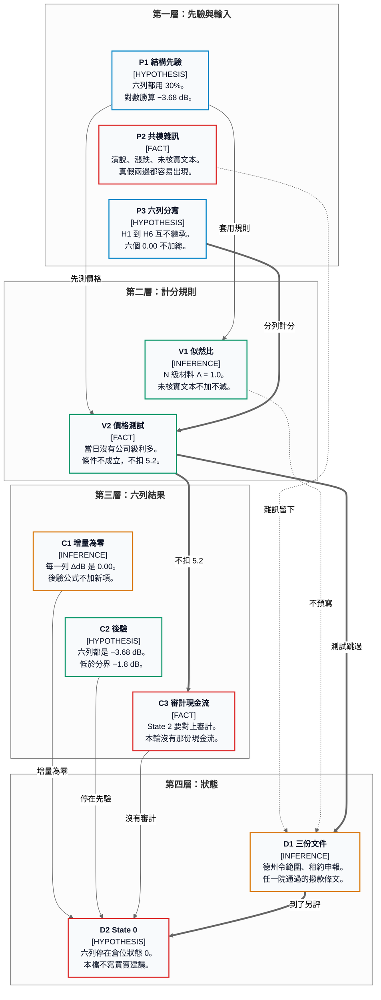

# 30 — 正式貝氏評分

> **基準時間**：2026-11-05（Asia/Taipei）  
> **document_role**：`analysis`  
> **本檔是評分，不是證券買賣建議。**  
> **本檔不寫入主張表。**

評分只處理報告 26 至 29、31 至 33 已經寫下的證據。開票是中斷，不是先驗。六個假設分開列，互不繼承 ΔdB，也不把六個 0.00 加成另一個假設。

本輪對 CLM-74-001 至 CLM-74-006 的新增 ΔdB 都是 0.00。表內原欄不改。CLM-74-002 至 CLM-74-006 的 `delta_db` 本來就是 0.00。CLM-74-001 的既有 `delta_db` 是 +3.01、後驗是 −0.67，那是 2026-10-19 的舊列；本輪不覆寫，也不把選舉證據疊上去。

---

## 1. 先驗與三條不計分規則

先驗用框架的結構分化：P(H) = 30%，對數勝算 −3.68 dB。國防預算擴張順風的 0 dB 不套到雲端現金流，也不套到下面六列。H4 的句子是經費被切斷，不是預算擴張；用 0 dB 會把擴張的基準率誤當成切斷的基準率。

後驗公式：先驗 dB + ΔdB。本輪每一列的 ΔdB 都是 0.00，所以後驗維持 −3.68 dB。

1. **N 級共模雜訊。** 勝選演說，以及 Vance、Musk、Thiel、Karp 已讀到的話，還有單日漲跌，證據等級是 N 級時，似然比強制 1.0，ΔdB = 0.00。這些句子在假設為真或為假時都容易出現。
2. **未核實文本不加不減。** 騰訊租約取消、Thiel 10 月音檔、川普 Truth Social 句子，維持 `requires_verification`。不得加分，也不得扣分。Gulf 匿名消息、未打開的 8-K、只看到標題的發行，同樣不進似然比。
3. **價格彈性測試條件不成立。** −5.2 dB 只在「已核實重大利多公布當日，股價爆量收黑」時使用。2026-11-04 沒有這種公司級利多。測試記在第 4 節，不扣 5.2 dB。

State 2 需要後驗 ≥ +4.8 dB，而且要有審計現金流。六列後驗都是 −3.68 dB，低於 −1.8 dB，也沒有對上的審計現金流。全部停在 State 0。本檔不討論資金配置。

出處彼此衝突的價格維持 `conflicting`，不另編一個收盤價。衝突本身也不另給一筆 ΔdB。

---

## 2. 分數總表

| 假設 | 先驗 | Λ | ΔdB | 後驗 | 狀態 |
|---|---:|---:|---:|---:|---|
| H1　雲端四家自由現金流因少蓋新廠而改善 | −3.68 dB | 1.0 | 0.00 | −3.68 dB | State 0 |
| H2　Oracle 增量租約已受損 | −3.68 dB | 1.0 | 0.00 | −3.68 dB | State 0 |
| H3　對中出口管制放寬 | −3.68 dB | 1.0 | 0.00 | −3.68 dB | State 0 |
| H4　伊朗戰爭經費在 2027-01-03 前被切斷 | −3.68 dB | 1.0 | 0.00 | −3.68 dB | State 0 |
| H5　烏克蘭援助文本已改變 | −3.68 dB | 1.0 | 0.00 | −3.68 dB | State 0 |
| H6　Palantir 政府合約已被取消 | −3.68 dB | 1.0 | 0.00 | −3.68 dB | State 0 |

證據與競爭假設分列如下。Λ = 1.0 的理由都是：這批材料在 H 與具體的 ¬H 下同樣容易出現。

---

## 3. 分列

### H1　雲端四家自由現金流因少蓋新廠而改善

| 欄 | 內容 |
|---|---|
| 先驗 | −3.68 dB。結構分化。不用國防預算順風 0 dB。 |
| 證據 | 報告 26 的 2026-11-04 收盤簇：Microsoft +6.7%，Amazon +6.1%，Alphabet +3.2%，Meta +1.4%。Reuters 另寫 Amazon +7.4%、其餘在 +2% 至 +6.3%，該檔標 `conflicting`，本檔不覆蓋收盤簇，也不另編股價。當日沒有一家雲端公司下修資本支出指引。Hinojosa 的暫停仍是當選承諾，就職日 2027-01-19。Abbott 任內已暫停新增大負載併網並暫時停止核發空氣許可，但沒有正式的全面暫停令。Microsoft 現金流 186 億美元，出處沒有寫明是自由現金流還是營業現金流，不改名。Alphabet 前一次財報現金流比預期更差約 64 億美元，是先前財報的次級復述，不是 11 月 4 日的新審計。演說與這根陽線為 N 級。 |
| 競爭假設 | 同一根陽線同時符合三件事：既有產能變貴、未來資本支出變慢、油價下跌緩衝折現率。Brent 結算跌 8.7% 至 94.62 美元／桶，WTI 跌 8.3% 至 88.12 美元／桶。十年期殖利率約降 5 個基點至 4.90%，不足以單獨解釋 Microsoft +6.7%。三個故事都能產生上漲，所以上漲不能單獨證實自由現金流已經改善。 |
| Λ | 1.0 |
| ΔdB | 0.00 |
| 後驗 | −3.68 dB |
| 狀態 | State 0 |

### H2　Oracle 增量租約已受損

| 欄 | 內容 |
|---|---|
| 先驗 | −3.68 dB。結構分化。 |
| 證據 | CNBC：2026-11-04 約 9:43 美東，Oracle 上漲約 2%。Motley Fool 一處寫收盤 123.77 美元、−1.92%，另一處寫 123.73 美元、−1.95%；報告 27 另以約 −1.9% 簡寫。兩組並列為 `conflicting`，本檔不選邊。成交量約 1.114 億股，約為三個月均量 3,270 萬股的 241%。FT 可見段落稱五年、東南亞、最多約 10 萬顆、估計約 70 億美元的騰訊租約被取消；Oracle、騰訊與白宮當時沒有立即回應。這則取消維持 `requires_verification`。200 億美元發行只保留標題，未讀申報，不進金額。Stargate 的 10 GW 與 5,000 億美元未核對合約附件，不進金額。 |
| 競爭假設 | 收跌可以是新建園區的許可折價、籌資標題，或增量擴張敘事被重新定價，而租約仍在，自由現金流也尚未被審計改寫。11 月 5 日亞洲早盤騰訊約 +6.4% 是上午快照，不是官方收盤。租約損失有限、消息未確認、買盤來自別的催化劑，三種讀法都能產生那根陽線。未核實租約不得用來加分或扣分。單日路徑是 N 級。 |
| Λ | 1.0 |
| ΔdB | 0.00 |
| 後驗 | −3.68 dB |
| 狀態 | State 0 |

### H3　對中出口管制放寬

| 欄 | 內容 |
|---|---|
| 先驗 | −3.68 dB。結構分化。報告 28 說放寬假設維持低先驗、本次證據 0 dB；本檔不另編一個更低的分貝數。 |
| 證據 | 選舉夜沒有先進晶片許可的放寬清單。貿易權與出口許可是兩套工具。否決門檻是參院 67 票、眾院 290 票，以報告 28 所記的目前席次達不到。新國會 2027-01-03 才就任。領導層演說是 N 級。騰訊租約若日後被公司確認，方向是現任行政部門把境外租賃納入管制射程，不是國會放寬出口；確認前維持 `requires_verification`，不加不減。Karp 開票前的競爭判斷不更新本列。上海、恆生與騰訊的上午漲幅記在中國市場風險偏好，不記成美國算力搬遷。 |
| 競爭假設 | 許可證繼續由白宮與主管機關執行。11 月 4 日沒有新許可，在「已經放寬」與「沒有放寬」兩邊都容易出現，因為新國會尚未就任，當天也沒有放寬清單。這條沒有檢驗力。不把「沒有看到放寬」另記成一筆負向 ΔdB。 |
| Λ | 1.0 |
| ΔdB | 0.00 |
| 後驗 | −3.68 dB |
| 狀態 | State 0 |

### H4　伊朗戰爭經費在 2027-01-03 前被切斷

| 欄 | 內容 |
|---|---|
| 先驗 | −3.68 dB。結構分化。不用 0 dB 順風。 |
| 證據 | 油價見 H1 那組 Reuters 結算。川普經 Reuters 轉述 Financial Times：沒有立即打擊伊朗的計畫，並承認戰爭影響敗選；報告 32 未打開 FT 原文。Vance 長文把敗選原因寫成這場戰爭，不是停火公告，N 級。Schumer 的撥款施壓沒有條文，N 級。Gulf 匿名兩句維持 `requires_verification`，不進入後驗。川普 Truth Social 句子，以及未經本人貼文核對的 “I don’t think about it. I did the right thing. I would have done it again.”，維持 `requires_verification`，不加不減。國防股：Reuters 記 Lockheed Martin −6.9%、RTX −3.1%、L3Harris −6.9%；韓聯社轉美聯社另記 Northrop Grumman −4.6%、General Dynamics −2.5%。百分比依出處略有差異，只採方向，不併成一個收盤。川普曾要求 2027 年軍事預算 1.5 兆美元，高於當時已核准的 9,010 億美元。另一則準備過程報導把請求從 1.5 兆寫到 1.1 兆。兩筆都不是已通過的撥款。2027-01-03 前，撥款權仍在本屆國會。 |
| 競爭假設 | 油價可以在戰鬥繼續時下跌。它定的是升級機率，不是經費條文。沒有任一院通過的限制條文。國防股下跌交易的是「未來撥款可能沒有 1.5 兆那麼高」，不改寫 10 月已公告的積壓訂單。價格彈性條件不成立，不扣 5.2 dB。本列不繼承給 H1 或 H5。 |
| Λ | 1.0 |
| ΔdB | 0.00 |
| 後驗 | −3.68 dB |
| 狀態 | State 0 |

### H5　烏克蘭援助文本已改變

| 欄 | 內容 |
|---|---|
| 先驗 | −3.68 dB。結構分化。 |
| 證據 | Reuters 選後分析預期民主黨國會推動援助烏克蘭、限制對俄制裁鬆綁。這是 `inference`，不是法案。澤倫斯基 2026-11-05 稱與 Witkoff、Kushner 通話一個半小時，準備三方團隊會談，並再次提出 Patriot 不足；傷亡與提案內容是單方說法。財政部一般許可 GL 135 允許俄羅斯來源柴油交易至 2027-04-07；報告 29 本次沒有重開 PDF，也沒有看到改寫。Benzinga 的烏克蘭債券標題沒有漲幅與代號，不進似然比。Blumenthal 2026-10-22 函的書面期限是 2026-11-05、簡報期限是 2026-11-12；公開回函狀態維持 `unknown`。Jeffries 與 Schumer 勝選演說的主句是生活成本，N 級。 |
| 競爭假設 | 援助與制裁的法令文本尚未改寫。選舉至多改變 2027-01-03 之後的議程速度，那不是「文本已經改變」。總統否決權仍在。烏克蘭變量不解釋 Microsoft 11 月 4 日 +6.7%，也不接收 H4 的油價。CLM-74-005、CLM-74-006 的本輪 ΔdB 維持 0.00，且本檔不寫回主張表。 |
| Λ | 1.0 |
| ΔdB | 0.00 |
| 後驗 | −3.68 dB |
| 狀態 | State 0 |

### H6　Palantir 政府合約已被取消

| 欄 | 內容 |
|---|---|
| 先驗 | −3.68 dB。結構分化。 |
| 證據 | 2026-11-01 起 `from:peterthiel` 沒有新帖；2026-11-03 起 `from:PalantirTech` 沒有新帖。沒有公司名義的選後聲明。Thiel 9 月原話是選前預測；後來民主黨領先只核對那段話的方向，不是 11 月 4 日的新指令，N 級。10 月 12 日納許維爾演講的音檔本輪沒有聽，`requires_verification`，不加不減。Karp 的話在 2026-11-02 至 11-03，開票前。他說國防部約占業務 30%，並給出美國商業運行率目標；那是業務組合與管理層目標，不是取消通知。TheStreet 所引合約數字未核 8-K，`requires_verification`，不加分。PLTR 早盤跌逾 6%，上午 11:15 美東約 −1%，標題區 −2.11%；三個時點不同，不自訂收盤價。1.5 兆降至 1.1 兆的準備報導不是 Palantir 的訂單取消。 |
| 競爭假設 | 已簽署的政府合約不會被勝選演說取消。盤中下跌與預算請求仍在準備，可以和合約繼續有效同時成立。沒有 11 月 4 日之後的 8-K，也沒有法說對政府合約續約的具體修正。 |
| Λ | 1.0 |
| ΔdB | 0.00 |
| 後驗 | −3.68 dB |
| 狀態 | State 0 |

---

## 4. 價格彈性測試

條件是兩件事同時成立：當日有已核實的公司級重大利多，而且該股爆量收黑。10×log₁₀(0.3) 對應的扣分是 −5.2 dB。2026-11-04 第一件事沒有成立，所以第二件事即使看起來像放量下跌，也不觸發扣分。

| 對象 | 當日價格在報告裡怎麼寫 | 有沒有已核實的公司級利多 | 測試 |
|---|---|---|---|
| Amazon、Microsoft、Alphabet、Meta | 收漲。Amazon 的百分比在收盤簇與 Reuters 之間 `conflicting` | 沒有資本支出指引下修或上修 | 條件不成立。上漲本身也不加分 |
| 資料中心供應鏈 | 方向為跌。個股百分比在出處之間有差 | 沒有這些公司當日的已核實利多 | 條件不成立 |
| Oracle | 早盤約 +2%，收盤為跌；收盤價兩說並存。成交量約為三個月均量的 241% | 騰訊租約取消未核實，不是已核實利多 | 條件不成立。不把未核實消息下的下跌改記成利多背離 |
| Lockheed Martin、RTX、L3Harris、Northrop Grumman、General Dynamics | 方向為跌。百分比依出處略有差異 | 沒有國防公司當日發布已核實利多 | 條件不成立。報告 29 已寫明不扣 5.2 dB |
| Palantir | 只有盤中路徑，沒有本檔採用的收盤價 | 沒有選後聲明或 8-K | 條件不成立 |

ΔdB_price = 0.00。不扣 5.2 dB。

---

## 5. 狀態

六列後驗都是 −3.68 dB。這低於 State 0 與下一階的分界 −1.8 dB，也低於 State 2 的 +4.8 dB。六列都沒有對上的審計現金流。價格出處有 `conflicting` 的，也不能靠本輪材料離開 State 0。

因此 H1 至 H6 全部停在 State 0。本檔不提出買賣建議。

本圖已用 Markdown Viewer 5.3 渲染，並看過截圖。方塊比例、分層與文字邊界通過檢查。

---

## 6. 下一筆才改後驗的三份文件

1. 德州暫停令適用範圍。要寫明是否涵蓋已核准負載，H1 才有新的證據可評。
2. Oracle 對騰訊租約的公司說明或申報。沒有這份文件，不把約 70 億美元寫成已消失的收入，H2 維持本列。
3. 任一院通過的伊朗或烏克蘭撥款條文。通過之前，H4 與 H5 維持本列，也不把條文不存在拿來改 H6。

這三份文件出現時另評。本檔不預寫它們的 ΔdB。

自檢：本檔已寫在指定路徑，沒有改主張表，沒有 commit。
