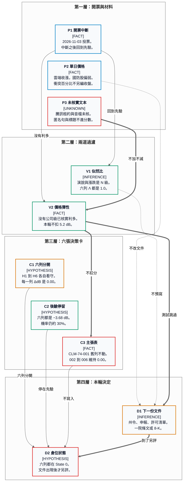

# 34 — 期中選舉後的決策分析

> **基準時間**：2026-11-05（Asia/Taipei）  
> **document_role**：`analysis`  
> **claim_type**：`hypothesis`（六句分開看守）  
> **source_tier**：`secondary`  
> **verification_status**：`partially_verified`  
> **workflow_disposition**：`keep`  
> **本檔是決策說明，不是證券買賣建議。**  
> **本檔不寫入主張表。分數只引用報告 30，不另評一次。**

這份報告回答一件事：2026-11-03 的開票，對六個已寫下的假設，今天做什麼決定。事件細節在報告 26 至 29、31 至 33。算術在報告 30。可重複使用的看守對象是六張決策卡。三份文件的角色不同，本檔把它們接成一條決策。

---

## 1. 今天的決定

六個假設都維持結構分化先驗：30%，對數勝算 −3.68 dB。每一列的似然比是 1.0，ΔdB 是 0.00，後驗仍是 −3.68 dB。倉位狀態是 State 0。

State 0 是倉位狀態。後驗約 30%，沒有被寫成 0% 或 100%。本檔不寫資金比例，也不授權探針倉。State 2 要後驗 ≥ +4.8 dB，而且要有對得上的審計現金流。六列都還沒有。

開票在框架裡是中斷。中斷之後先回到先驗，再用有檢驗力的證據更新。本輪的演說、單日漲跌和未核實文本，在假設為真或為假時都容易出現，所以似然比停在 1.0。

六個 0.00 各自獨立。它們不加總，也不產生第七個假設。CLM-74-001 的舊列（`delta_db` +3.01，後驗 −0.67）留在 2026-10-19。CLM-74-002 至 CLM-74-006 的 `delta_db` 維持 0.00。主張表本輪不改。

價格彈性的 −5.2 dB 本輪不使用。條件是當日已有核實的公司級重大利多，而且該股爆量收黑。2026-11-04 沒有這種利多。

| 卡 | 看守的句子 | 後驗 | 狀態 | 下一份文件 |
|---|---|---:|---|---|
| [H1 雲端現金流](../75_bayesian_analysis/decision_cards/DC_20261105_HYPERSCALER_FCF_CAPEX_CEILING.md) | 四家自由現金流因少蓋新廠而改善 | −3.68 dB | State 0 | 德州暫停令是否涵蓋已核准負載 |
| [H2 Oracle 租約](../75_bayesian_analysis/decision_cards/DC_20261105_ORACLE_TENCENT_LEASE.md) | 增量租約已受損 | −3.68 dB | State 0 | Oracle 或騰訊的公司說明或申報 |
| [H3 出口管制](../75_bayesian_analysis/decision_cards/DC_20261105_CHINA_EXPORT_CONTROL_CLOCK.md) | 對中出口管制已放寬 | −3.68 dB | State 0 | 許可清單或出口規則 |
| [H4 伊朗撥款](../75_bayesian_analysis/decision_cards/DC_20261105_IRAN_APPROPRIATIONS_BEFORE_20270103.md) | 2027-01-03 前經費被切斷 | −3.68 dB | State 0 | 任一院通過的限制條文 |
| [H5 烏克蘭文本](../75_bayesian_analysis/decision_cards/DC_20261105_UKRAINE_AID_TEXT.md) | 援助或制裁文本已改變 | −3.68 dB | State 0 | 任一院通過的援助或制裁條文 |
| [H6 Palantir](../75_bayesian_analysis/decision_cards/DC_20261105_PALANTIR_GOVERNMENT_CONTRACTS.md) | 政府合約已被取消 | −3.68 dB | State 0 | 8-K、續約修正或取消通知 |

本圖已用 Markdown Viewer 5.3 渲染，並看過截圖。方塊比例、分層與文字邊界通過檢查。

---

## 2. 六張卡怎麼分開用

### H1　既有雲端產能

Amazon、Microsoft、Alphabet、Meta 在 2026-11-04 收漲。收盤簇是 Microsoft +6.7%、Amazon +6.1%、Alphabet +3.2%、Meta +1.4%。Reuters 的另一組百分比維持 `conflicting`，決策不另編一個收盤價。

這根陽線同時符合三條機制。賣算力的公司手裡已有產能，新廠許可變慢時，既有產能的租金可以變貴。市場也可以預期未來資本支出變慢，即使公司還沒有下修指引。油價當天大跌，折現率有一點緩衝；十年期殖利率約降 5 個基點至 4.90%，這個幅度單獨對不上 Microsoft 的漲幅。三條機制都能產生上漲，所以上漲不證實自由現金流已經改善。

當日沒有一家公司下修資本支出指引。Hinojosa 的資料中心暫停是當選承諾，就職日是 2027-01-19。Abbott 任內已暫停新增大負載併網，並暫時停止核發空氣許可。正式全面暫停令還沒有。下一筆要看的是暫停令文本是否涵蓋已核准負載。

資料中心供應鏈同日偏弱，方向與雲端四家相反。那個分裂留在報告 26。它不給 H1 加分，也不觸發 −5.2 dB。

### H2　Oracle 的增量容量

Oracle 早盤約 +2%，收盤為跌。收盤價有 123.77 美元、−1.92% 與 123.73 美元、−1.95% 兩說，維持 `conflicting`。成交量約為三個月均量的 241%。

FT 可見段落描述一筆五年、東南亞、最多約 10 萬顆、估計約 70 億美元的騰訊租約被取消。Oracle、騰訊與白宮當時沒有立即回應。這則取消維持 `requires_verification`。70 億美元不記入已消失的收入。200 億美元發行只保留標題。Stargate 的 10 GW 與 5,000 億美元未核對合約附件，不進金額。

Oracle 在這張卡裡是增量容量的承租與建設方。雲端四家的既有產能租金記在 H1。兩張卡的 ΔdB 互不借用。

11 月 5 日上午騰訊股價上漲，是風險偏好的快照。它可以和租約仍在、損失有限，或其他催化劑同時成立。重開 H2 的文件是公司說明或申報。

### H3　三個時鐘

中國 AI 競賽在本輪分成三本帳。

電力與許可管的是美國新容量何時併網。出口許可管的是先進晶片與境外租賃。關稅立法權管的是國會席次與總統否決。否決門檻是參議院 67 票、眾議院 290 票。以目前已呼叫的席次達不到。新國會 2027-01-03 就任。

選舉夜沒有放寬清單。領導層談貿易權的句子是 N 級。美國許可變慢，不把吉瓦記到中國帳上。上海、恆生與騰訊的上午漲幅記在當日風險偏好。

騰訊租約若日後被公司確認，方向是境外租賃仍在現任行政部門的管制射程裡。確認前不加不減，金額仍留在 H2。重開 H3 的文件是許可清單、出口規則，或申報裡寫明的許可變更。

### H4　伊朗：油價與撥款分帳

2026-11-04 結算，Brent −8.7% 至 94.62 美元／桶，WTI −8.3% 至 88.12 美元／桶。油價記的是升級機率。它在戰鬥繼續時也可以下跌。

川普經 Reuters 轉述，沒有立即打擊計畫，並承認戰爭影響敗選。FT 原文未打開。Vance 的長文把敗選原因寫成這場戰爭。兩則都是政治陳述，似然比 1.0。Gulf 匿名消息與未經核對的 Truth Social 句子維持 `requires_verification`。

國防股當天方向為跌。10 月已公告的積壓訂單沒有被這根陰線改寫。1.5 兆美元是請求，約 9,010 億美元是當時已核准的水準。1.1 兆美元是準備過程的報導，不是已通過的撥款。2027-01-03 之前，撥款權在本屆國會。

H4 的句子有截止日期。2027-01-03 之後若仍要問經費是否被切斷，另立新假設。

### H5　烏克蘭：文本與議程分帳

Reuters 的選後分析預期援助與制裁會被排上日程。那是 `inference`。法令文本還沒有改寫。

澤倫斯基 11 月 5 日稱與 Witkoff、Kushner 通話約 90 分鐘，並再次提出 Patriot 不足。這是單方說法。GL 135 仍寫到 2027-04-07；本輪沒有重開 PDF，也沒有看到改寫。Blumenthal 函的書面期限是 11 月 5 日、簡報期限是 11 月 12 日。公開回函狀態是 `unknown`。沒有看到公開回函，不證明沒有回函。

Jeffries 與 Schumer 勝選演說的主句是生活成本。生活成本句子留在 N 級，不改寫援助文本。烏克蘭變量不進入 H1 的雲端模型，也不接收 H4 的油價。

台廠要有可核對的長約、預付款或毛利率，CLM-74-002 才有非零似然比。本輪沒有那種 primary 觀測。

### H6　Palantir：合約文本

2026-11-01 起沒有新的 `@peterthiel` 公開帖。2026-11-03 起沒有新的 `@PalantirTech` 公開帖。沒有公司名義的選後聲明。查詢沒有結果，只覆蓋這兩次公開帖查詢。

Thiel 9 月的話是選前預測。民主黨領先只核對那段預測的方向。10 月 12 日納許維爾演講的音檔沒有聽，轉述維持 `requires_verification`。Karp 在 11 月 2 日、開票前說話。國防部約占業務 30% 是業務組合。TheStreet 所引數字未核 8-K。

PLTR 只有三個不同時點的盤中路徑，本檔不自訂收盤價。1.1 兆美元的準備報導不是 Palantir 的訂單取消。已簽署的合約留在合約裡，直到 8-K、續約修正或取消通知出現。

10 月 31 日的 Thiel／Karp 決策卡有另一組分貝與倉位文字。那組數字留在那張卡的日期。本輪不把那些分貝搬進 H6。

---

## 3. 舊卡留在舊日期

`DC_20261019`、`DC_20261025`、`DC_20261030`、`DC_20261031` 討論的是 10 月的財報、資本支出與人物網絡。它們的後驗、State 2／State 3 文字與倉位比例，都是那些日期的研究材料。

2026-11-04 的股價不重評那些卡。那些卡也不為本輪的六個假設提供 ΔdB。兩套材料並陳：10 月的現金流討論仍在 10 月的卡裡；11 月 5 日的開票決策只使用上面六張新卡與報告 30。

---

## 4. 日曆裡哪些日子仍只是觀察

下列日子出現在事件報告裡。它們更新觀察狀態。它們不預寫 ΔdB。

| 日期 | 觀察什麼 | 對應的卡 |
|---|---|---|
| 2026-11-12 | SpaceX 簡報期限。公開回函目前是 `unknown` | H5。簡報公開後只更新這一條的觀察 |
| 2026-11 月下旬 | 阿拉斯加順位投票計票時程，席次快照仍會變 | 否決算術仍看 67 與 290。席次認證不單獨改六張卡 |
| 2026-12 至 2027-01 | 委員會主席與跛鴨會期的議程 | H4、H5 仍看有沒有一院通過的條文 |
| 2027-01-03 | 新國會就任。H4 這句假設在此日截止 | H4 到期後另立句子。H5 改看新會期的文本 |
| 2027-01-12 | 德州議會與 Nathan Johnson 的檢察長任期時點 | H1 仍看暫停令文本。Starlink 調查是當選承諾，不是已立案 |
| 2027-01-19 | Hinojosa 就職 | 就職日前的暫停話術維持當選承諾 |
| 2027-04-07 | GL 135 的現行截止日期 | 要先重開許可 PDF，才談有沒有改寫 |
| 2027 年下半年 | 債務上限時程 | 本輪沒有新文本，不進似然比 |

---

## 5. 限度

本檔的價格來自次級出處，而且有 `conflicting` 的收盤百分比。衝突不另編一個官方收盤，也不另給一筆 ΔdB。

FT 的騰訊租約只使用付費牆外看得到的段落。8-K、招股說明書與 GL 135 的 PDF 本輪沒有重開。Vance 長文的原帖編號沒有捕捉到，決策使用已讀到的引文，不補一個網址。

Gate 1 政策報告裡尚未重開的連結，維持該檔自己的信心等級。Hamilton、Turek、Goodwin、Acton 沒有被推斷出政策立場。

六張卡未經 `75_bayesian_analysis` 的獨立證據審查。它們是研究材料，不是 `70_investment_hub` 的策略結論。本檔不修改 `70`、`71`、`72`、`73`。正文在 `96d4c71` 提交。2026-11-11 只把狀態句改成帶 SHA 的紀錄。功能分支尚未合併 `main`。

---

## 6. 出處

分數表：[`30_formal_bayesian_decision_l1.md`](30_formal_bayesian_decision_l1.md)。

事件：[`26_hyperscaler_rally_data_center_split_l1.md`](26_hyperscaler_rally_data_center_split_l1.md)、[`27_oracle_reaction_tencent_lease_l1.md`](27_oracle_reaction_tencent_lease_l1.md)、[`28_china_ai_race_accounting_l1.md`](28_china_ai_race_accounting_l1.md)、[`29_iran_ukraine_separate_tracks_l1.md`](29_iran_ukraine_separate_tracks_l1.md)、[`31_democratic_winners_statements_l1.md`](31_democratic_winners_statements_l1.md)、[`32_trump_vance_musk_reactions_l1.md`](32_trump_vance_musk_reactions_l1.md)、[`33_thiel_palantir_statements_l1.md`](33_thiel_palantir_statements_l1.md)、[`24_us_midterm_2026_results_and_defense_impact_l1.md`](24_us_midterm_2026_results_and_defense_impact_l1.md)。

閱讀順序：[`25_midterm_ai_reports_index_l1.md`](25_midterm_ai_reports_index_l1.md)。

框架：`75_bayesian_analysis/docs/BAYESIAN_DECISION_FRAMEWORK.md`。
