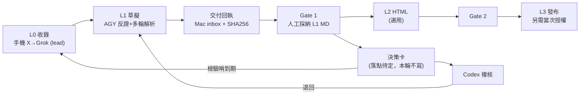

# LOOP 設計 v3：X 收錄 → Grok 初解 → AGY 多輪解析 → 報告 MD → 決策卡（Codex 複核）

> - **日期**：2026-11-06
> - **文件角色**：`analysis`（流程復盤＋閉環設計草案），狀態 `DRAFT`／`PROPOSED`，待本機 Codex review 與人工採納
> - **版本**：v3。v1 自創了狀態檔，v2 引用了私有 repo 的規則原文；v3 改為**公開安全版**（本 repo 為 public 且發布 Pages）。
> - **私有規則不抄錄**：`00_agent_control_plane`（ACP）與 `75_bayesian_analysis` 為 private。本文只以**名稱**對映，規則原文、Job 細節、排程／接收器狀態、Mac 路徑一律由 Codex 在本機讀取，**不在此複製**。
> - **未能讀到**：`70_investment_hub`（雲端 VM 無權限）。決策卡實際落點與格式**未驗證**。
> - **UNKNOWN**：Mac 本機狀態、WIP、排程與接收器實際運作，我都沒讀。本文不宣稱任何 runtime 已通過驗收。

## 0. 使用者本輪決策（2026-11-06）

| # | 決定 | 本文如何處理 |
|---|---|---|
| 1 | **先不寫決策卡，只做計劃** | 本文與 PR 不含任何決策卡 |
| 2 | **main merge 由 AGY 做** | 僅限本 repo（74）這一個 PR；不碰 ACP／75／70 |
| 3 | **HODIO 檔案保留並標註** | 已於該檔加入「核對狀態標註」，內文未改 |
| 4 | **只核會進決策卡的條目** | 核對範圍縮小；其餘條目維持「未驗證」標示即可 |
| 5 | **由本機 Codex 用 Computer Use 建 LOOP** | 見第 4 節交付給 Codex 的任務 |

## 1. 復盤與缺口

### 1.1 本次實際路徑

| # | 步驟 | 執行者／裝置 | 產物 |
|---|---|---|---|
| 0 | 手機收 X → Grok App 初解 | Grok／手機 | Grok 解析 MD 進 74 `inbox/`；Palantir 關聯評 9/10 |
| 1 | 找漏洞 | AGY（雲端） | 5 項漏洞；對照 74 `AGENTS.md`（`0 dB` 鉗制、MOU≠獲利） |
| 2 | 補概念、前因後果、串聯主題 | AGY＋網搜＋**使用者追問** | Ontology 解析、桑切斯 vs 馬斯克時間軸、雙重基礎設施框架 |
| 3 | 寫回 repo | AGY | `3bd28d9`（**直推 `main`，違反 74 `AGENTS.md`；已揭露**） |
| 4 | 設計閉環 | AGY → Codex | 本文件 |

有效、值得保留：
1. **Grok 第一輪只當 `lead`**：AGY 先反證，再延伸。
2. **使用者追問是品質關鍵**：兩次最大修正都來自追問。閉環要保留人工插問，不要全自動。
3. **用 `AGENTS.md` 當檢查表**，把空泛批評變成可驗收項。

### 1.2 缺口

| 缺口 | 具體表現 |
|---|---|
| 引述未核實 | 馬斯克「全球開火清單」中，僅西班牙、波蘭兩條原話經搜尋摘要多處互證；澳洲、德國、英國、巴西、委內瑞拉屬記憶引述 |
| 數字未核實 | 歐盟罰款、Maldita 觀看數等來自搜尋摘要，未開原文 |
| 事實／推論混寫 | 期中選舉主因屬推論，語氣偏肯定 |
| 評分未落地 | Palantir 9→1 只是文字判斷，未登錄 `sources/claim_register.csv` |
| 無交付回執 | 雲端成果只在 GitHub 分支，Mac 未回報收到與 hash |
| 證據等級 | 本 session 只讀過搜尋摘要、未開頁面，**沒有任何條目達 OBSERVED** |

證據標示沿用 74 既有報告慣例：`OBSERVED`（直接看到原文）／`INFERRED`（推理，附信心）／`未驗證`（單一來源）。

## 2. 閉環對映（只用既有機制，不新建任何東西）



| 階段 | 對應 ACP 層級（僅名稱） | 建議執行者 | 落地位置 | 人工關卡 |
|---|---|---|---|---|
| 收錄 | L0 | Grok／手機 | 74 `inbox/`，原文保留 | 無 |
| 反證＋多輪解析 | L1 | AGY（雲端） | 同一 inbox 檔追加；成果為 DRAFT | 使用者插問 |
| 核對與登錄 | L1 品質 | AGY／Codex | `sources/claim_register.csv` | 抽查 |
| 採納 | Gate 1 | **人類** | 本機採納紀錄 | 必須 |
| 決策卡 | 74／投資 Hub 流程 | 待定 | 待定（70 或其他，未驗證） | 必須；74 禁止未授權改 70–73 |
| HTML | L2 | Codex／渲染器 | 74 既有 `*_l2_light.html` 慣例 | Gate 2 |
| 發布 | L3 | 人類授權 | GitHub Pages | 當次授權 |

設計原則（皆為保守假設，Codex 需對照本機正本確認）：
- 不新增 daemon、佇列、router、runner、第二份任務資料庫、新狀態值；狀態只放既有任務正本（74 `plans/ACTIVE_PLAN.md`，或 ACP 既有任務單）。
- 本機 Mac repo 為正本，GitHub 為備份與查核快照。
- 回流（Codex 退回→L1、檢驗哨到期→L0）**預設人工觸發**；若要排程，須走既有原生排程驗收，不自建。
- 本 session 最多只算單一 session 內的流程（`SESSION_LOOP_PASS` 層級），**未驗證任何跨 Conversation 自動接續**。

## 3. 交付回執（補缺口）

雲端 AGY 每次收尾附：

```text
delivery_id:      <producer>-<YYYYMMDD>-<NNN>
producer:         agy-cloud
target_repo:      74_aerospace_defense_research
target_path:      <path>
branch@commit:    <branch>@<sha>
sha256:           <hash>
cloud_produced:   yes
mac_received:     UNKNOWN   # 由 Mac 端 Codex 讀回後填
human_accepted:   NO
github_backup:    yes
```

本表是 AGY 端的提案；Mac 端自動收件尚未驗收前，「Mac 讀 GitHub 分支＋核對 hash」是唯一可說明的路徑，`mac_received` 維持 `UNKNOWN`。

## 4. 交給本機 Codex 的任務（Computer Use）

> Codex 請先在本機 `git fetch`，**不要覆蓋任何本機 WIP**。ACP 規則與任務單格式請讀本機正本，不以本文為準。任務單（若需要）由 **Codex 在本機建立**，ID 先檢查唯一性；AGY 沒有對 ACP 寫入。

**Goal**：產出「本流程對映既有控制規則」的差異審查，並以 HODIO 案做一次 dry-run（只核會進決策卡的條目），指出哪些缺口需要新規則或小工具。

**Inputs**
- 本檔；`inbox/spain_hodio_palantir_dual_use_analysis.md`（含核對狀態標註）；74 `AGENTS.md`；`sources/claim_register.csv`
- 本機的 ACP repo（Local-first、Cloud-to-Local 交付、PR 治理、持久迴圈驗收等文件）
- 本機的 75 與 70（決策卡落點與格式；雲端 AGY 讀不到 70）

**Questions**
1. 決策卡正式落點與欄位為何？在 70 的 `decision_cards/`，還是別處？
2. 第 2 節對映有無與 ACP 規則衝突？
3. 手機 Grok 輸出能否合規進入 74 `inbox/`（路徑、delivery ID、hash）？不能的話，維持手動貼上是否可接受？
4. 檢驗哨回流要人工觸發，還是申請 ACP 既有原生排程？

**Deliverables**
- 差異審查（本檔 vs 實際規則），每項附來源檔與章節
- HODIO dry-run 紀錄：逐條標 OBSERVED／INFERRED／未驗證；列出未登錄於 `claim_register.csv` 的 claim
- 如確有需要：離線、唯讀、標準庫的小檢查工具（沿用 ACP 既有類似先例）；否則明寫「不需要工具」
- 以 PR（Draft）提交；不直推 `main`

**Constraints**
- 不新增 daemon、佇列、router、runner、第二份任務資料庫、新狀態值
- 不改 70／71／72／73；未經明確授權不寫 70
- 不直推 `main`；只 stage 本任務檔案；不 merge、不發布、不改 Pages
- 不得把 Grok 初稿或搜尋摘要當 verified；未核實者維持 0 dB
- 無法讀取者標 UNKNOWN，不得猜測
- Gate 1 由人類採納，Codex 不得代為採納
- Computer Use 只操作使用者已授權的 App／視窗

**Done When**
- [ ] 差異審查列出所有衝突／缺漏，附來源
- [ ] HODIO dry-run 逐條標示證據等級並列出未登錄 claim
- [ ] 決策卡落點與欄位由實際檔案確認，或標為 BLOCKED 並說明缺什麼
- [ ] PR 範圍乾淨；`git diff --check`、`git status --short --branch` 乾淨
- [ ] 交付回執四狀態（雲端產出／本機收到／人工接受／GitHub 備份）已回報

## 5. 已知限制
1. 我沒讀 Mac 本機；ACP 內容只是 GitHub 備份快照，可能落後本機正本。
2. 手機 Grok App 能否分享到 Git、能否帶 delivery ID：未驗證。
3. 70 讀不到，決策卡部分只依 74 `AGENTS.md` 的已知規則。
4. 回流設計未經任何排程驗收，不得視為已運作。

## 6. 仍待使用者決定
1. 決策卡最終落點（70 或其他）；若用 70 需先授權。
2. 是否把 Palantir 9→1 等判斷登錄成 `claim_register.csv` 的 claim。
3. 是否核實 HODIO 檔案中標為未驗證的引述（只在要進決策卡時才做）。
4. 本 PR merge 後，是否刪除遠端分支 `loop/x-grok-agy-codex-design`。
