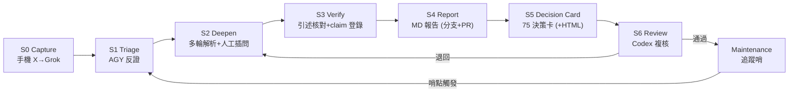

# LOOP 設計：X 收錄 → Grok 初解 → AGY 多輪解析 → 報告 MD → 決策卡（含 Codex 複核）

> - **日期**：2026-11-06
> - **文件角色**：`analysis`（流程復盤＋閉環設計草案），待 Codex review
> - **範圍**：先復盤本次 HODIO session 的實際過程，再抽象成可重複的小閉環
> - **重要限制**：撰寫時**無法讀取** `/Users/arislee/0_project_mac/00_agent_control_plane` 與 `/Users/arislee/0_project_mac/75_bayesian_analysis`（雲端 VM 看不到 Mac 本機路徑；GitHub 側也未確認可存取）。因此本文件中所有「對接 75／control plane」的欄位名稱都是**佔位假設**，必須由 Codex 在 Mac 上對照實際檔案後修正（見第 5 節）。

---

## 1. 本次 Session 實際走過的路徑（復盤）

| # | 步驟 | 執行者／裝置 | 產物 | 實際發生了什麼 |
|---|---|---|---|---|
| 0 | 收錄 | 手機 X → Grok App | Grok 解析 MD | Grok 把西班牙 HODIO 與 Palantir 關聯評 9/10，commit `cf3250a` 進 `inbox/` |
| 1 | 找漏洞 | AGY（雲端） | 5 大漏洞清單 | 對照 `AGENTS.md`（`0 dB` 鉗制、禁 MOU 當獲利）與網路查證，Palantir 下修 1/10 |
| 2 | 補概念 | AGY | Ontology 解析 | 使用者追問名詞，補「Objects / Links / Actions」與技術層次對照 |
| 3 | 補前因後果 | AGY＋網搜 | 桑切斯 vs 馬斯克時間軸 | 使用者質疑「政治修辭」說法缺脈絡，需搜尋才補齊 |
| 4 | 串聯主題 | AGY | 雙重基礎設施壟斷框架 | 使用者把烏克蘭 Starlink、期中選舉、美伊戰爭連起來 |
| 5 | 寫回 repo | AGY | `3bd28d9` | 6 個 Part 寫進 `inbox/`，更新 `00_inbox.md` 索引 |
| 6 | 設計閉環 | AGY → Codex | 本文件 | — |

### 1.1 這次流程中有效的部分（要保留成固定動作）
1. **第一輪（Grok）只當 `lead`**：不給它分數權威，AGY 第二輪必須先做反證，而不是延伸。
2. **使用者插問是品質關鍵**：兩次最有價值的修正（補 Musk 前因後果、串聯烏克蘭）都來自使用者追問，不是 AI 自發。閉環要保留「人工插問」入口，而不是全自動。
3. **用 `AGENTS.md` 當檢查表**：貝氏鉗制、禁詞、MOU≠獲利，能把空泛批評變成可驗收項。

### 1.2 這次流程中的缺口（閉環要補）
| 缺口 | 具體表現 | 閉環中的補法 |
|---|---|---|
| 無狀態檔 | 每輪靠對話記憶，換裝置（手機→Mac）會斷 | 每個案子一個 `case.yaml` 紀錄階段與下一步 |
| 事實未全數核對 | 馬斯克「全球開火清單」中澳洲、德國、英國、巴西、委內瑞拉等條目，本 session 只有西班牙、波蘭的原話經搜尋核實，其餘為記憶引述 | 第 S3 關卡要求每條引述標 `verified` / `requires_verification` |
| 部分數字未核對 | 例如「歐盟罰款 X 1.2 億歐元」「Maldita 2,800 萬次觀看」來自搜尋摘要，未開原文 | 同上，且記錄 `source_url` |
| 報告混了「已證事實」與「推論」 | Part V 的期中選舉三大主因屬推論，文中語氣偏肯定 | 報告模板強制 `claim_type` 欄；決策卡只吃 `verified` 項 |
| 直接 push `main` | 本 session 的 `3bd28d9` 直接推到 `main`，違反 `AGENTS.md` §3.1「禁止直接 push main」 | 閉環一律走分支＋PR，見 S4 |
| 評分無正式落地 | Palantir 9→1 是文字判斷，未進 `claim_register.csv` | S3 把評分轉成 claim 列與 dB |

> [!WARNING]
> 上表最後兩列代表**目前 repo 上已有的 HODIO 文件含有未逐條核實的引述**，且寫入方式不符本庫規則。建議 Codex／你下一輪先處理，再談決策卡。

---

## 2. 閉環總覽



兩個回流點才是「閉環」的意義：
- **S6→S2**：Codex 退回，帶具體缺項。
- **Maintenance→S1**：決策卡內預先寫好「檢驗哨」（見第 4 節），到期或觸發時，自動變成新的 IRQ 回到 triage。

### 2.1 各階段合約

| 階段 | 輸入 | 輸出（落地檔） | 通過條件 | 人工介入 |
|---|---|---|---|---|
| S0 Capture | X 貼文 URL、Grok 初解 | `inbox/<slug>.md`（原文原樣保留）＋ `cases/<slug>/case.yaml` | 有 URL、有日期、原文未改 | 手機上只做這步 |
| S1 Triage | S0 檔 | 同檔追加「漏洞審查」節 | 至少列出：技術主張、政策主張、評分主張各自的反證；對照 `AGENTS.md` | 可跳過 |
| S2 Deepen | S1 結果＋使用者追問 | 同檔追加分節，每節標註來源 | 每次追問結果標 `claim_type` | **使用者插問為主** |
| S3 Verify | S2 所有可驗證陳述 | 追加至 `sources/claim_register.csv` | 引述有 `source_url`；未核實者強制 `0 dB` | 抽查 |
| S4 Report | S3 後的案件檔 | `NN_<slug>_report.md`（正式報告） | 通過格式檢查；已證事實與推論分區 | 合併 PR 需人工 |
| S5 Decision Card | S4 報告＋claim 列 | 75 repo 決策卡（＋可選 HTML） | 欄位齊全；所有信念更新只引用 `verified` | 人工簽核 |
| S6 Review | S4／S5 產物 | review 註記 | Codex 逐項檢核清單全勾 | Codex 自動、結果給人看 |

---

## 3. 狀態檔：`cases/<slug>/case.yaml`（最小可行版）

目的：手機與 Mac 之間不靠對話記憶，靠檔案交接。以下欄位為建議，**Codex 需對照 control plane 既有狀態格式後取代**。

```yaml
case_id: 2026-11-06-spain-hodio
title: 西班牙 HODIO 與國防雙用 AI 關聯
source:
  url: ""            # X 貼文 URL（待補）
  captured_at: 2026-11-06
  captured_on: mobile   # mobile | mac | cloud
stage: S2             # S0..S6 | maintenance
next_action: "核對馬斯克全球開火清單各條原話並登錄 claim_register"
owner_next: agy       # agy | codex | human
artifacts:
  inbox: inbox/spain_hodio_palantir_dual_use_analysis.md
  report: null
  decision_card: null
open_questions:
  - "Grok 初稿中其餘平台/國家引述是否皆可由一手來源證實？"
gates:
  s3_verified: false
  s4_pr_merged: false
  s5_human_signoff: false
watchpoints: []       # 決策卡的檢驗哨，S5 填入
```

規則：
1. 任何 agent 動手前**先讀** `case.yaml`；完成後**必須更新** `stage`、`next_action`、`owner_next`。
2. 一個案件同時只有一個 `owner_next`，避免手機端與雲端 agent 同時改同一檔。
3. `stage` 只能前進一格或退回到 S2；跳級視為違規。

---

## 4. 決策卡（草案欄位，待與 75 對齊）

以下是**我推測**需要的最小欄位；75 實際格式未驗證，請 Codex 以現有決策卡為準。

| 欄位 | 內容規則 |
|---|---|
| 事件（IRQ） | 一句話，附 `source_url`；不得直接當作信心 |
| 多頭假設 $H_A$／空頭劇本 $H_B$ | 兩邊都要寫（符合 `AGENTS.md` 對稱檢驗） |
| 證據清單 | 只列 `verified` 的 claim_id；其餘列「未核實，Λ=1.0」 |
| 先驗／似然／後驗（dB） | 數字須能追溯到 `claim_register.csv`，不得憑空新增 |
| 狀態機位置 | State 0–3，附理由 |
| 殺手開關 | 什麼事發生就清零 |
| 檢驗哨（watchpoints） | 日期或可觀測事件，到期回 S1 |
| 關聯報告 | 連到 S4 報告與 `case.yaml` |

### 4.1 以本次 HODIO 案為例，決策卡可以長什麼樣（僅示意，不含任何新數字）
- 事件：西班牙宣布 HODIO 與平台監管五項措施（2026-02-03 峰會、2026-03-11 工具發布）。
- 結論方向：對「Palantir／Scale AI 雙用外溢」假說，現有證據不足以更新信念，維持 `0 dB`；Palantir 關聯評分 9/10 → 1/10 為本庫審查意見，**尚需登錄為 claim 才算正式**。
- 較有研究價值的主題轉向：馬斯克「軌道通訊＋輿論演算法」雙重壟斷與各國監管反撲，應該另開案件追蹤，而不是掛在 Palantir 下。
- 可能的檢驗哨（需你決定）：HODIO 是否出現正式採購公報、歐盟對 X 的後續處置、烏克蘭 Starshield 事件五角大廈是否公開說明。

---

## 5. 給 Codex 的任務說明（可直接貼過去）

### 5.1 目標
在 Mac 上做一個**最小**的 CLI／腳本閉環，讓上述 S0–S6 可以用檔案交接，並能用 Computer Use 跑一次完整 dry-run。不要追求全自動；人工閘門保留。

### 5.2 先做的事（只讀，不改）
1. 讀 `/Users/arislee/0_project_mac/00_agent_control_plane`：找出既有的 agent 任務／狀態／交接格式、排程與 review 機制。
2. 讀 `/Users/arislee/0_project_mac/75_bayesian_analysis`：找出決策卡實際欄位、檔名規則、HTML 產出方式、驗證器。
3. 讀本 repo 的 `AGENTS.md`、`sources/claim_register.csv`、`plans/ACTIVE_PLAN.md`。
4. 輸出一份**差異表**：本文件第 3、4 節的佔位欄位 vs 實際欄位，哪些要改。

### 5.3 再做的事（有限度地改）
1. 在能重用 control plane 現有機制時就重用，**不要另起一套狀態系統**；若沒有，才實作第 3 節的 `case.yaml`。
2. 提供 3 個動作即可：`new <slug> --url ...`（S0）、`status`（列出所有案件階段與 `owner_next`）、`check <slug>`（跑對應階段通過條件，輸出缺項清單）。
3. `check` 要能自動檢出：S3 缺 `source_url`、S4 報告把 `requires_verification` 當事實、S5 引用了未登錄的 claim。
4. 所有寫入走**分支＋PR**，不得直接 push `main`；不得修改 70／71／72／73。
5. 完成後執行 `git diff --check` 與 `git status --short --branch`。

### 5.4 驗收（用 HODIO 案跑一遍）
- [ ] `case.yaml` 建立並反映 `stage: S2`
- [ ] `check` 能列出第 1.2 節的缺口（未核實引述、未登錄評分）
- [ ] 補完後可推進到 S4，產出正式報告檔
- [ ] 產出一張 75 格式的決策卡草稿（欄位以實際為準），不含編造數值
- [ ] 一次退回 S2 的路徑有測過

### 5.5 Codex 請特別 review 的點
1. 上面所有「佔位假設」是否與兩個 Mac 專案衝突。
2. 手機端（Grok App）能做到的只有 S0；是否有辦法讓 S0 的輸出自動變成 `inbox/` 檔（例如分享到 Git 的 shortcut），還是維持手動貼上。這點我無法判斷。
3. 檢驗哨回流（Maintenance→S1）要靠排程還是人工觸發。
4. HTML 產出是否沿用 75 現有模板。

---

## 6. 未解事項（需要你決定）
1. 案件目錄放 74 repo 還是 control plane？本文件暫放 `plans/`，只是因為這是唯一確定可寫的位置。
2. S3 的核對強度：全部逐條核，還是只核會進決策卡的條目？
3. HODIO 現有檔案是否要先拆成「正式報告」與「附錄」，並把未核實引述標記清楚？
