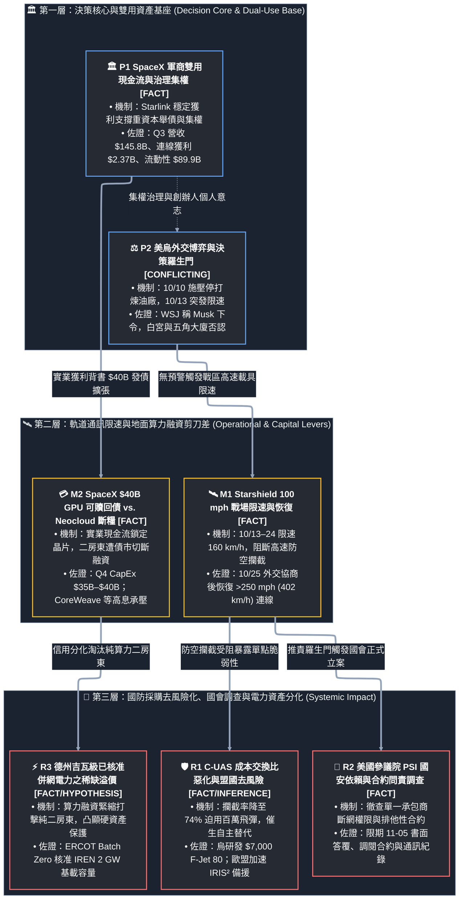

# 星盾限速風波與算力電力博弈的深層結構：主權單點失靈、國會體制問責與 Neocloud 信用洗牌（L1 深度敘事版）

> **研究主題**：2026 年 10 月烏克蘭 Starshield 高速限速事件引發之三重結構性外溢——盟國國防採購「關鍵人治理折價（Musk Risk）」、美國參議院 PSI 雙用太空基建問責調查、以及 SpaceX 400 億美元 GPU 債務融資與德州吉瓦級（GW-scale）電力資產博弈  
> **文獻與數據來源**：X 公開 API 三則原始貼文（[@AndreDoctrine](https://x.com/AndreDoctrine/status/2114531918993625092)、[@IREN_Bull](https://x.com/IREN_Bull/status/2114521767263830419)、[@BrennpunktUA](https://x.com/BrennpunktUA/status/2114338669033144332) 與 [@SenBlumenthal](https://x.com/SenBlumenthal/status/2113673812482879883)）· [美國參議院常設調查小組委員會（PSI）2026-10-22 正式調查函全文](https://www.blumenthal.senate.gov/newsroom/press/release/blumenthal-announces-congressional-inquiry-into-starlink-and-starshield) · [戰爭研究所（ISW）2026-10-25 戰場評估報告](https://understandingwar.org/research/russia-ukraine/russian-offensive-campaign-assessment-october-25-2026/) · [Reuters / Investing.com](https://www.investing.com/news/stock-market-news/musk-says-spacex-raised-40-billion-in-debt-for-gpus-4971248) · [TIKR SpaceX Q3 財務分析](https://www.tikr.com/blog/musk-says-spacex-locked-in-40-billion-for-chips-a-win-for-nvidia-were-investment-grade) · [w.media ERCOT Batch Zero 電力審批報導](https://w.media/iren-granted-conditional-base-load-status-for-2-gw-texas-campus/) · 本庫 [`10_starlink_ukraine_zalenskyy_trump_musk_report.md`](../../10_starlink_ukraine_zalenskyy_trump_musk_report.md)、[`16_negative_capital_loop_credit_collapse_ai_capex_l1.md`](../../16_negative_capital_loop_credit_collapse_ai_capex_l1.md) 與 [`17_spacex_40b_gpu_debt_starshield_cuas_24h_digest_l1.md`](../../17_spacex_40b_gpu_debt_starshield_cuas_24h_digest_l1.md)  
> **查核時間**：2026-10-27 06:45（Asia/Taipei，UTC+8）  
> **方法論與合規邊界**：嚴格遵循本庫 [`AGENTS.md`](../../AGENTS.md) 認識論五維標籤（`claim_type` · `source_tier` · `document_role` · `verification_status` · `workflow_disposition`）與貝氏決策量化評分框架（`BAYESIAN_DECISION_FRAMEWORK.md`）。單點社群貼文一律歸類為中斷請求（IRQ，`source_tier: lead`），未經一手官方文書或財報交叉驗證之主張強制鉗制為 $0\text{ dB}$（$\Lambda = 1.0$），不直接驅動信念更新。  
> **核心命題（Executive Thesis）**：表面上看，「烏克蘭戰場 Starshield 100 mph 限速爭議」與「Elon Musk 唱空新興算力雲（Neoclouds）引發德州電力股多頭反彈」分屬地緣國防與 AI 資本市場兩個毫不相干的平行宇宙；但若將兩者置於 **SpaceX（`SPCX`）軍商雙用帝國的資產負債表與治理結構** 下審視，三則社群訊號其實共同指向同一核心變數——**「單一私人寡頭對關鍵基礎設施（軌道通訊與地面巨量算力）的非對稱控制權，以及由此衍生的主權信任折價與資本洗牌」** `[INFERENCE]`。在國防端，10 月 13 日至 24 日的無預警限速將戰場非對稱作戰成本交換比（Cost-Exchange Ratio）推向極端（迫使烏軍以 100 萬美元 F-16 空對空飛彈替代受阻的高速攔截無人機），不僅觸發美國參議院 PSI 要求五角大廈與 SpaceX 於 11 月 5 日前提交全數合約與通訊紀錄的法制問責，更促使歐洲北約盟國與印太防衛體系將「供應商關鍵人風險（Musk Risk）」與「終端邊緣 AI 自主導引」納入採購剛性門檻 `[FACT / INFERENCE]`；在資本端，SpaceX 憑藉 Starlink 單季 23.7 億美元營業利益與 899 億美元帳面流動性鎖定 400 億美元可贖回債務採購 Nvidia 晶片，與承受 9%–10% 高息債務的純算力二房東形成殘酷的信用剪刀差，而德州電網（ERCOT）Batch Zero 程序核准的吉瓦級基載電力（如 IREN 2 GW Sweetwater Hub）則成為這場重資本淘汰賽中少數具備物理稀缺護城河的實質資產 `[FACT / INFERENCE]`。

---

## 一、 序幕：三則社群中斷請求（IRQ）背後的同構風暴

2026 年 10 月 24 日至 26 日間，X（前 Twitter）平台上三則橫跨軍事戰略、綠能算力投資與歐洲防務快訊的貼文，分別從三個截然不同的切角切入了 Elon Musk 與 SpaceX 生態系的核心矛盾：

1. **第一視角（盟國防務採購與主權確定性）**：自稱「戰略指揮架構師」的 [@AndreDoctrine](https://x.com/AndreDoctrine/status/2114531918993625092) 梳理了 10 月中旬烏克蘭 Starshield 斷網時間軸與美方高層互相推責的「羅生門」，斷言主權政府採購軍事通訊買的不是頻寬，而是「作戰確定性（Operational Certainty）」；當單一承包商的個人意志能隨時成為戰場開關，「Musk 風險（Musk Risk）」已正式成為各國國防部採購評估的結構性負債 `[HYPOTHESIS / LEAD]`。
2. **第二視角（美國國會憲政監督與單一承包商依賴）**：親烏德英文快訊帳號 [@BrennpunktUA](https://x.com/BrennpunktUA/status/2114338669033144332) 轉引美國參議院常設調查小組委員會（PSI）首席議員 Richard Blumenthal（[@SenBlumenthal](https://x.com/SenBlumenthal/status/2113673812482879883)）的調查宣言，點出華盛頓真正的憲政焦慮：美國納稅人斥資數十億美元採購的國安級太空基礎設施，其生殺大權究竟掌握在五角大廈指揮鏈手中，還是繫於一名投入逾 4.42 億美元助選資金的科技巨頭私人通話？ `[INFERENCE / LEAD]`
3. **第三視角（AI 算力融資斷鏈與德州電力圈地戰）**：Iris Energy（`$IREN`）多頭社群帳號 [@IREN_Bull](https://x.com/IREN_Bull/status/2114521767263830419) 則將焦點轉向 Musk 於 10 月 25 日宣布 SpaceX 完成 400 億美元 GPU 債務融資時對「逾 200 家 Neocloud 即將倒閉」的公開唱空，指控 Musk 蓄意利用社群聲量製造市場恐慌（FUD），意圖壓低在德州擁有「已簽約、已核准併網電力」之算力基建商的併購估值 `[HYPOTHESIS / LEAD]`。

若僅按傳統分類，前兩則是「烏俄戰爭地緣政治」，第三則是「AI 資料中心股市情緒」。然而，在 `74_aerospace_defense_research` 的雙用技術與實業財務框架下，這三條敘事線實為同一枚硬幣的三個切面：**SpaceX 正在將軌道低軌衛星壟斷現金流（Starlink / Starshield）轉化為地面與軌道 AI 算力霸權（xAI / Terafab / $40B GPU Debt）的信用擔保品；而其在兩大領域展現的「高度垂直整合與創辦人集權模式」，一方面賦予其跨越傳統供應鏈長週期前導期（Lead Time）瓶頸的極端執行力，另一方面卻在主權國防客戶與資本市場參與者心中埋下了劇烈的「單點控制恐懼（Single-Point-of-Control Paranoia）」** `[INFERENCE]`。

### 1.1 原始中斷請求（IRQ）來源清單與基準對照表

以下完整保留並擴充三則主貼文及一手引用來源之可追溯元數據（互動數基準為台北時間 2026-10-27 04:1x 讀取值，並附一手交叉查核結果）：

| 代號 | 來源帳號與身分屬性 | 發文時間（台北 UTC+8） | 原始連結（URL） | 語言與互動量（讀取時） | 核心領域與星鏈／星盾關聯 | 一手／二手查核升級狀態 (`verification_status`) |
| :--- | :--- | :--- | :--- | :--- | :--- | :--- |
| **IRQ-A** | **[@AndreDoctrine](https://x.com/AndreDoctrine/status/2114531918993625092)** *(Andre Robinson MS，未認證，自介戰略指揮架構師)* | 2026-10-26 09:37 | [X Status 2114531918993625092](https://x.com/AndreDoctrine/status/2114531918993625092) | 英文｜瀏覽 5,714 · 讚 113 · 轉 39 · 引 9 · 回 22（附 1 圖未判讀） | ⚠️ **核心關聯**：2026-10 烏克蘭 Starshield 限速時間軸、美歐政要推責鏈與國防採購「Musk 風險」 | **部分核實 (`partially_verified`)**：時間軸與波蘭外長 Sikorski 原話已由 [TVP World / Reuters](https://tvpworld.com/95923731/playing-politics-sikorski-takes-aim-at-big-man-musk-over-starlink-in-ukraine) 及 [參院 PSI 調查函](https://www.blumenthal.senate.gov/newsroom/press/release/blumenthal-announces-congressional-inquiry-into-starlink-and-starshield) 交叉證實；採購條款假說待驗。 |
| **IRQ-B** | **[@IREN_Bull](https://x.com/IREN_Bull/status/2114521767263830419)** *(IREN 持股多頭帳號，未認證，具利益相關)* | 2026-10-26 08:57 | [X Status 2114521767263830419](https://x.com/IREN_Bull/status/2114521767263830419) | 英文｜瀏覽 216,596 · 讚 1,155 · 轉 97 · 引 22 · 回 75 | **無星鏈／星盾內容**：聚焦 AI 算力中心電力瓶頸、Musk 唱空 Neocloud 動機與 `$IREN` 德州電力資產 | **動機待證 (`requires_verification`) / 資產事實已核 (`verified`)**：收購動機屬多頭臆測（且與 Musk「不收購任何 Neocloud」公開聲明衝突），但 IREN 獲 ERCOT 核准德州 **2 GW Sweetwater Hub** 基載電力為 [w.media](https://w.media/iren-granted-conditional-base-load-status-for-2-gw-texas-campus/) 實證事實。 |
| **IRQ-C** | **[@BrennpunktUA](https://x.com/BrennpunktUA/status/2114338669033144332)** *(親烏德英文快訊帳號，未認證，自承快訊未必準確)* | 2026-10-25 20:49 | [X Status 2114338669033144332](https://x.com/BrennpunktUA/status/2114338669033144332) | 德文｜瀏覽 58,097 · 讚 1,298 · 轉 287 · 引 14 · 回 32 | ⚠️ **核心關聯**：引述參院 PSI 調查美國政府與 SpaceX（Starlink / Starshield）關係及選後政治問責 | **調查事實已核 (`verified`) / 政治推論待證 (`requires_verification`)**：參院 PSI 立案與 11/5 答覆限期已獲官方新聞稿證實；4.42 億美元助選清算論屬評論推演。 |
| **IRQ-Cq** | **引用：[@SenBlumenthal](https://x.com/SenBlumenthal/status/2113673812482879883)** *(聯邦參議員 Richard Blumenthal，官方認證)* | 2026-10-24 00:48 | [X Status 2113673812482879883](https://x.com/SenBlumenthal/status/2113673812482879883) [參院官網正式新聞稿](https://www.blumenthal.senate.gov/newsroom/press/release/blumenthal-announces-congressional-inquiry-into-starlink-and-starshield) | 英文｜瀏覽 314,458 · 讚 10,039（附 4 圖為調查函內頁） | ⚠️ **核心關聯**：參院常設調查小組委員會（PSI）正式發函國防部長 Hegseth 與 SpaceX 執行長 Musk 啟動調查 | **一手官方核實 (`verified` / `primary`)**：已直接調閱 [參院官網 2026-10-22 新聞稿與信函全文](https://www.blumenthal.senate.gov/newsroom/press/release/blumenthal-announces-congressional-inquiry-into-starlink-and-starshield) 完成逐條核對。 |

---

## 二、 結構傳導全景圖：從個人集權治理到國防與算力市場的雙向映射

為清晰拆解「關鍵人治理與政策衝突 $\to$ 軌道通訊與算力基建控制權 $\to$ 戰場成本交換比惡化、國會法制問責與能源資產重估」的因果鏈條，以下建立三層式有向傳導拓撲圖：

---

## 三、 第一主軸深探（IRQ-A）：從戰場 100 mph 限速到國防採購的「Musk 風險」溢價

### 3.1 10 月中旬限速事件的時間軸重構與三方「羅生門」
[@AndreDoctrine](https://x.com/AndreDoctrine/status/2114531918993625092) 在貼文中將 2026 年 10 月中旬的危機濃縮為一條緊湊的因果鏈，經與本庫 [`10_starlink_ukraine_zalenskyy_trump_musk_report.md`](../../10_starlink_ukraine_zalenskyy_trump_musk_report.md)、[`17_spacex_40b_gpu_debt_starshield_cuas_24h_digest_l1.md`](../../17_spacex_40b_gpu_debt_starshield_cuas_24h_digest_l1.md) 及 [參議院 PSI 正式調查函腳註](https://www.blumenthal.senate.gov/newsroom/press/release/blumenthal-announces-congressional-inquiry-into-starlink-and-starshield) 交叉核對後，可確立以下經過多重二手與一手文獻錨定的實證時間軸：

1. **外交施壓前奏（10 月 9 日–10 日）**：美烏代表於邁阿密會談期間，美方要求基輔停止以長程無人機打擊俄羅斯境內煉油廠，並暗示若不配合，可能暫停彈道飛彈預警情報分享及盟國代購武器的 PURL 管道 `[SECONDARY / OBSERVED]`。數日後，Elon Musk 在 X 平台發文宣稱「Zelensky has gone too far（澤倫斯基太過分了）」 `[AUTHOR STATEMENT]`。
2. **無預警限速上線（10 月 13 日深夜至 14 日凌晨）**：就在俄羅斯對基輔等地發動大規模彈道飛彈與噴射無人機襲擊之際，烏克蘭軍方發現由美國國防部出資採購的軍規加密版 **Starshield** 終端，在移動時速超過 **100 mph（約 160 km/h）** 時即無預警斷線 `[FACT]`。烏克蘭總統國防技術顧問 Serhii "Flash" Beskrestnov 隨即證實，烏軍事前未獲任何通知，多項高速攔截與打擊無人機任務在飛行途中直接失效（第 7 快速反應旅甚至在時速 110–120 km/h 即遭遇 10–20 秒斷訊） `[FACT]`。
3. **四方推責鏈（The Finger-Pointing Chain，10 月 14 日–21 日）**：
   - **Musk 的切割（10 月 14 日）**：Musk 於 X 公開發文（[X Status 2110445577184133456](https://x.com/elonmusk/status/2110445577184133456)）宣稱：「Starshield 系統由美國政府擁有並控制，任何速度或使用限制均由美軍、最終由美國總統（POTUS）決定」，同時強調商用版 Starlink 依服務條款嚴禁外掛於進攻性武器 `[AUTHOR STATEMENT]`。約一週後（10 月 24 日），Musk 又改口承認 SpaceX 確實採取行動「堵住了烏軍違反商用條款用於自殺無人機的漏洞」 `[AUTHOR STATEMENT]`。
   - **白宮與行政部門的否認（10 月 15 日–17 日）**：美國總統川普於 10 月 16 日對媒體表示：「我不知道是誰幹的，但不是我，我也不認為是 Elon……據我了解一切照舊」（[Washington Examiner](https://www.washingtonexaminer.com/news/white-house/4769020/trump-unsure-who-ordered-starshield-throttle-ukraine/)、`[FACT]`）；國務卿 Marco Rubio 與財政部長 Scott Bessent 亦公開否認美方下令，白宮官員甚至私下向 Axios 表示「政府無法控制 SpaceX」 `[SECONDARY]`。
   - **主流外媒的矛盾揭露（10 月 15 日–21 日）**：[Reuters（10 月 15 日）](https://www.reuters.com/world/europe/order-limit-starshield-ukraine-came-inside-white-house-sources-say-2026-10-15/) 引述兩名美國官員與一名烏克蘭高官稱，限速令源自白宮內部並傳達至五角大廈執行；然而 [The Telegraph（10 月 16 日）](https://www.telegraph.co.uk/world-news/2026/10/16/musk-approached-trump-slow-down-starlink-help-ukraine/) 與 [Wall Street Journal（10 月 21 日）](https://www.wsj.com/world/ukraine-starlink-elon-musk-trump-dbc49193) 卻相繼披露，是 **Musk 先主動向川普提議限制烏克蘭連線速度並獲得默許，隨後由 Musk 親自下令執行**，且在限速前後與多名白宮高層通話 `[SECONDARY / CONFLICTING]`。
   - **烏方實測反擊與最終恢復（10 月 17 日–25 日）**：烏方針對「違反商用 Starlink 條款」之說提出兩項硬核技術反證：(1) 商用 Starlink 在烏克蘭境內早就設有 **70–90 km/h** 速限且在俄國領土完全鎖區，根本不可能用於長程奔襲；(2) 烏軍將裝載軍用 Starshield 的測試車開入歐盟境內，時速超過 **180 km/h** 依然暢通無阻，證明 **160 km/h 的限速地理圍欄（Geofencing）僅精準鎖定烏克蘭領土** `[AUTHOR STATEMENT]`。直至 10 月 24–25 日週末，伴隨美俄烏下月重啟三方會談與南部 Oleshky 局部停火共識，烏國防部才確認 Starshield 已解除 100 mph 限制，全面恢復對時速逾 **250 mph（約 402 km/h）** 高速攔截載具的連線（[NPR](https://www.cfpublic.org/2026-10-24/musk-says-spacex-did-restrict-starlink-as-ukraine-says-the-tech-has-been-restored)、`[FACT]`）。

### 3.2 戰場實戰代價量化：非對稱作戰成本交換比（Cost-Exchange Ratio）的瞬間崩壞
為什麼短短 10 天（10 月 14 日至 24 日）的「100 mph 速度上限」，會讓歐洲防務界與北約將領如此震驚？華府智庫戰爭研究所（ISW）於 2026 年 10 月 25 日發布的《[Russian Offensive Campaign Assessment](https://understandingwar.org/research/russia-ukraine/russian-offensive-campaign-assessment-october-25-2026/)》提供了最精確的實戰經濟學量化證據：

- **攔截率表象下的結構耗損**：在 Starshield 限速期間，烏軍對俄軍新型高速噴射動力攻擊無人機（Jet-powered Shahed，時速約 400 km/h；僅 10 月 24–25 日單夜俄軍發射的 153 架無人機中即有 **92 架** 為噴射動力型）的整體攔截率，表面上僅從平時的 **77% 微幅下滑至 74%** `[FACT]`。
- **從 2 萬美元攔截機被迫切換至 100 萬美元飛彈**：烏軍之所以能守住 74% 的攔截率，是因為當原本仰賴 Starshield 即時高速導引的「高速攔截無人機（單價約 2 萬至 7 萬美元）」因超過 100 mph 斷線而失效時，烏克蘭空軍被迫緊急出動 **F-16 戰機**，發射單價高達 **100 萬美元** 的空對空飛彈或冒險以機砲近距離攔截 `[FACT]`。
- **邊緣 AI 自主化突圍（F-Jet 80）**：這場斷網危機直接改寫了烏克蘭與北約的防空研發優先級。為徹底擺脫「單一外國衛星訊號遭政治切斷即喪失防空能力」的單點脆弱性，烏克蘭無人機商 **F-Drones** 加速推出搭載 **終端邊緣 AI 自主導引系統的 F-Jet 80 噴射動力攔截無人機**，將單機造價壓低至驚人的 **7,000 美元**——約為傳統攔截無人機成本的 1/3 至 1/10，更僅為 F-16 空對空飛彈的 **0.7%**（[ISW 2026-10-25](https://understandingwar.org/research/russia-ukraine/russian-offensive-campaign-assessment-october-25-2026/)、`[FACT]`）。

### 3.3 歐洲主權覺醒與國防採購中的「Musk 風險（Musk Risk）」
[@AndreDoctrine](https://x.com/AndreDoctrine/status/2114531918993625092) 引述的波蘭外長 Radosław Sikorski 公開喊話，經查證 [TVP World / Reuters 2026-10-14 報導](https://tvpworld.com/95923731/playing-politics-sikorski-takes-aim-at-big-man-musk-over-starlink-in-ukraine) 完全屬實 `[FACT]`。Sikorski 於 10 月 14 日在 X 上直接點名 Musk：

> *"Hey, @elonmusk, big man, are you playing politics with your products again? As your European customers, we are watching you."*  
> （「嘿，@elonmusk，大人物，你又在拿你的產品玩弄政治了嗎？身為你的歐洲客戶，我們都在看著你。」——波蘭外交部長 Radosław Sikorski，2026-10-14）

這段話之所以具備實質採購殺傷力，在於波蘭政府正是烏克蘭大量商用 Starlink 終端訂閱費的實際出資方（付費客戶），且此番「大人物（big man）」的嘲諷，直接回敬了 2025 年 3 月 Musk 在 X 上羞辱 Sikorski「安靜點，小人物（Be quiet, small man）」並誇口「如果我關掉 Starlink，烏克蘭整條前線就會崩潰（當時 Musk 曾承諾絕不將 Starlink 作為談判籌碼）」的歷史舊帳 `[FACT]`。

當法國歐洲議會議員 Christophe Grudler 疾呼「歐洲該醒了（Time to wake up, Europe）」、芬蘭議員 Aura Salla 要求切斷「危險的技術依賴」，[@AndreDoctrine](https://x.com/AndreDoctrine/status/2114531918993625092) 提出的 **「政府買的不是頻寬，而是確定性（Governments don't buy bandwidth, they buy certainty）」** 便從社群評論昇華為嚴肅的國防採購假說：
- **對歐洲與北約採購的影響**：儘管歐盟自主低軌衛星座 **IRIS²** 與 **Eutelsat OneWeb** 在發射成本曲線與總頻寬密度上仍大幅落後於 SpaceX（Falcon 9 已於 10 月 26 日創下單枚推進器第 26 次複用紀錄，見 [SpaceX SL-15-16](https://www.spacex.com/launches/sl-15-16)），但主權國家為避免戰時遭遇「未經預警的參數降級或地理圍欄鎖定」，勢必在未來的國防通訊標案中強制納入 **「供應商去集中化（De-concentration）」與「多軌道備援（Multi-Orbit Resiliency）」** 條款，甘願支付較高的財務溢價以換取主權控制權 `[INFERENCE]`。

---

## 四、 第二主軸深探（IRQ-C / Cq）：美國參議院 PSI 調查與「私人壟斷國安基建」的憲政攤牌

如果說 [@AndreDoctrine](https://x.com/AndreDoctrine/status/2114531918993625092) 描繪的是盟國客戶的信任流失，那麼 [@BrennpunktUA](https://x.com/BrennpunktUA/status/2114338669033144332) 與參議員 [@SenBlumenthal](https://x.com/SenBlumenthal/status/2113673812482879883) 揭開的，則是美國本土國安體制對 SpaceX 「尾大不掉」的制度性反撲。

### 4.1 參議院常設調查小組委員會（PSI）2026-10-22 調查函核心拆解
在原始草稿中，參院調查僅被列為「待證線索（`requires_verification`）」。經直接調閱美國參議院官方網站發布之《[Blumenthal Announces Congressional Inquiry into Starlink & Starshield](https://www.blumenthal.senate.gov/newsroom/press/release/blumenthal-announces-congressional-inquiry-into-starlink-and-starshield)》（2026 年 10 月 22 日正式發布），本報告將其升級為 **`primary / verified`（一手已核實事實）**。

參議院常設調查小組委員會（PSI）首席議員 Richard Blumenthal（D-CT）繼前一週發函 SpaceX 代理法務長 David Harris 後，於 10 月 22 日正式向 **美國國防部長 Pete Hegseth** 與 **SpaceX 執行長 Elon Musk** 發出具國會監督效力的調查函，核心直指三大憲政與採購破口：

> *"The events in Ukraine show how a single point of control can be turned against the forces that depend on it. A decision to degrade service, applied quickly and without notice, has disabled missions across an entire military theater. Whether that change was directed by the White House, DoD, or SpaceX, the episode raises urgent questions about who possesses the technical and legal authority to alter these capabilities, what safeguards govern that authority, and whether DoD has sufficient alternatives if SpaceX-provided services become unavailable."*  
> （「烏克蘭事件展示了『單點控制（a single point of control）』如何反過來傷害依賴它的部隊。一項迅速執行且毫無預警的服務降級決定，癱瘓了整個戰區的任務。無論這項變更是由白宮、國防部還是 SpaceX 下令，此事件都引發了緊迫的疑問：究竟誰擁有變更這些能力的技術與法律權限、有哪些安全機制約束該權限，以及若 SpaceX 提供的服務無法使用，國防部是否具備足夠的替代方案。」——參議員 Richard Blumenthal 致國防部長 Hegseth 與 Elon Musk 正式調查函，2026-10-22）

#### 參院 PSI 要求 SpaceX 與五角大廈限期交付之四大硬性清單：
1. **決策與執行人員實名點名（限 2026 年 11 月 5 日前書面答覆）**：要求詳列 2026 年 10 月 10 日至 15 日期間所有針對烏克蘭資產的限速參數（特別是 >100 mph 斷線限制）、生效與持續時間，並**實名列出所有參與決策、獲悉或負責技術執行之 SpaceX 員工與國防部官員姓名與職稱** `[FACT]`。
2. **技術與合約「後門權限」攤牌**：直接質詢在現行 DoD 合約下，究竟誰擁有啟動、限制、設定地理圍欄（Geofence）或關閉 Starshield 的法律權限？**「在未經國防部授權下，SpaceX 在技術上能否單方面變更、地理圍欄鎖定或降級美軍或盟軍的 Starshield 服務？」** 以及商用 Starlink 與軍用 Starshield 在底層網路架構上究竟有多大程度的獨立性（為何兩者會同時受影響） `[FACT]`。
3. **2020 財年以來全數國安合約與「單一來源採購（Sole-Source）」總清查**：要求提交自 FY2020 起美國政府（含國防部與國家偵察局 NRO 機密偵察衛星座）與 SpaceX 簽署之所有 Starlink / Starshield 服務、終端與專用衛星合約總金額、合約編號，並特別要求交代**哪些合約採「單一來源（Sole-Source，免公開招標）」方式授予及其法定理由** `[FACT]`。
4. **全數加密通訊紀錄調閱與國會簡報（限 2026 年 11 月 12 日前）**：要求交出 2026 年 1 月 1 日至今，SpaceX 與國防部、總統執行辦公室（EOP）、國家安全會議（NSC）及烏克蘭政府之間關於限制 Starshield/Starlink 的所有紀錄——**明文涵蓋電子郵件、簡訊、WhatsApp 與 Signal 加密訊息、通話備忘錄與草稿**，並要求知情官員於 **11 月 12 日前** 向委員會進行正式簡報 `[FACT]`。

### 4.2 [@BrennpunktUA](https://x.com/BrennpunktUA/status/2114338669033144332) 的政治博弈推演與邊界審視
[@BrennpunktUA](https://x.com/BrennpunktUA/status/2114338669033144332) 在解讀這場國會調查時提出兩項延伸推論：
1. **行政部門違反國會事前通報義務**：作者認為限速令最終源於五角大廈／白宮，但美國政府對涉及重大戰區作戰能力變更負有向國會情報與軍事委員會事前通報之法定義務；此番繞過國會私下執行，再加上参議員 Adam Schiff 於 10 月 25 日 NBC《Meet the Press》要求防長 Hegseth 宣誓作證（[NPR](https://www.cfpublic.org/2026-10-24/musk-says-spacex-did-restrict-starlink-as-ukraine-says-the-tech-has-been-restored)），顯示國會正試圖奪回對雙用科技軍援的監督權 `[INFERENCE]`。
2. **選後政商同盟裂解風險**：作者提及 Musk 投入逾 4.42 億美元支持共和黨選戰 `[ESTIMATE / REQUIRES_VERIFICATION]`，並推演期中選舉後川普與 Musk 可能因責任歸屬互相推諉；若調查證實為 Musk 私自下令，國會將對 SpaceX 祭出嚴厲制裁 `[SCENARIO]`。
- **認識論定性**：我們必須將「參院 PSI 11/5 調查函的實質合約審查（`verified`）」與「4.42 億美元選後翻臉劇本（`lead / requires_verification`）」嚴格切割。無論最終查出是白宮授意還是 Musk 越權，**五角大廈對 SpaceX 的「單一供應商過度依賴（Singular Dependence）」已被正式寫入國會調查案由**，這將成為未來美國太空軍（USSF）與 NRO 在下一階段標案中扶植第二供應商（如 Amazon Kuiper Government Solutions 或傳統軍工主承包商聯隊）的制度性催化劑 `[INFERENCE]`。

---

## 五、 第三主軸深探（IRQ-B）：SpaceX 400 億美元 GPU 債務、Neocloud 信用斷鏈與德州吉瓦級電力博弈

表面上看，[@IREN_Bull](https://x.com/IREN_Bull/status/2114521767263830419) 在 10 月 26 日的貼文是一則典型的個股多頭護盤文：作者指控 Musk 慣用 X 平台散布恐懼、不確定與懷疑（FUD），之所以在 10 月 25 日公開唱空 Neocloud（新興算力雲），是因為地方政府不願批准 Musk 的新資料中心，Musk 為了取得 AI 算力擴張最稀缺的「已簽約、已核准併網電力（Contracted & Approved Power）」，意圖趁 Neocloud 股價崩跌時逢低收購——特別是位於 Musk「德州後院」的 Iris Energy（`$IREN`） `[HYPOTHESIS / LEAD]`。

然而，若我們將這則帶有強烈利益衝突（持股多頭）的貼文，放進本庫 [`16_negative_capital_loop_credit_collapse_ai_capex_l1.md`](../../16_negative_capital_loop_credit_collapse_ai_capex_l1.md) 與 [`17_spacex_40b_gpu_debt_starshield_cuas_24h_digest_l1.md`](../../17_spacex_40b_gpu_debt_starshield_cuas_24h_digest_l1.md) 的實業財務座標中進行壓力測試，會發現 **「作者的收購陰謀論欠缺證據，但其指出的『算力融資斷鏈 vs. 德州基載電力稀缺』卻是 2026 年第四季最核心的產業事實」**：

### 5.1 事實核對一：SpaceX 為什麼能借到 400 億美元買 GPU，而 Neocloud 卻被債市斷糧？
10 月 25 日，Elon Musk 宣布 SpaceX 已順利敲定（closed）**400 億美元的可贖回債務（Callable Debt）**，專門用於採購將於 2027 年第一季與第二季交付的 Nvidia GPU，並預言債券市場已幾乎切斷對任何「缺乏 AI 資料中心以外實質營收」企業的融資，逾 200 家新興算力雲（Neoclouds）將面臨劇烈整併與倒閉（[Reuters / Investing.com](https://www.investing.com/news/stock-market-news/musk-says-spacex-raised-40-billion-in-debt-for-gpus-4971248)、[TIKR](https://www.tikr.com/blog/musk-says-spacex-locked-in-40-billion-for-chips-a-win-for-nvidia-were-investment-grade)、`[FACT / AUTHOR STATEMENT]`）。

這並不是單純的「口水唱空」，而是殘酷的**資產負債表與信用利差現實**：
- **SpaceX 的「航太實業印鈔機」護城河**：根據 SpaceX 2026Q3 財報（截至 2026/09/30），單季營收年增 161% 達 **145.8 億美元**（AI 相關營收達 **75.6 億美元**，Starlink 連線部門貢獻 **23.7 億美元營業利益**），帳上握有 **513 億美元現金與 386 億美元有價證券（合計 899 億美元流動性）** `[FACT]`。儘管 SpaceX 前三季累計自由現金流為 **-$349.7 億美元**、Q4 單季 CapEx 指引高達 **350 億至 400 億美元**，但因其擁有全球獨佔的低軌衛星經常性現金流與投資級信評（Investment Grade），債權人願意為其 400 億美元 GPU 採購提供資金 `[FACT]`。
- **純算力二房東（Neoclouds）的高息槓桿死結**：對照本庫報告 16 剖析的 **CoreWeave (`CRWV`)** 等純算力租賃商，其缺乏非 AI 實業現金流保護，只能依賴 Nvidia 晶片配額向私募信貸借入 **9% 至 10% 以上** 的高息債務（背負 $85 億與 $31 億 DDTL 定期貸款及 $51 億設備融資） `[FACT]`。當中國開源模型（如 `DeepSeek-V4.1-Flash-1017` 與 `Kimi K3.1 Pro`）將推論與 Agent 成本壓低 50% 至 90%、壓縮算力租金溢價時，高槓桿二房東的營業現金流極易被利息吞噬 `[INFERENCE]`。
- **直接反駁 `@IREN_Bull` 的併購假說**：更重要的是，Musk 在 10 月 25 日的聲明中**明確表示「SpaceX 不會收購任何 Neocloud（SpaceX will not acquire any neoclouds）」**（[TIKR](https://www.tikr.com/blog/musk-says-spacex-locked-in-40-billion-for-chips-a-win-for-nvidia-were-investment-grade)、`[AUTHOR STATEMENT]`），且根據本庫 `00_inbox.md`（IRQ-06），SpaceX 正利用 **Raptor 火箭引擎精密鑄造產線自製燃氣渦輪發電機葉片與導流片**（繞過傳統渦輪機 18 個月的交期瓶頸），以每月部署 22 萬顆 GB300（約 0.5 GW/月）的速度自建算力，挑戰 2026 年 10 月 31 日將額定算力由 **1.7 GW 推升至 2.2 GW** `[AUTHOR STATEMENT / FACT]`。因此，`@IREN_Bull` 宣稱「Musk 造不出資料中心、必須唱空股價來收購 Neocloud」在實證上與 SpaceX 的自建渦輪發電策略直接衝突 `[CONFLICTING]`。

### 5.2 事實核對二：為什麼德州「已核准併網電力」仍是真實的物理瓶頸？（ERCOT Batch Zero 實證）
儘管 `@IREN_Bull` 對 Musk 動機的臆測站不住腳，但他指出的**「電力需求成長遠快於電網建置速度，已核准電力具備稀缺價值」**，卻得到了德州電力可靠性委員會（ERCOT）最新監管數據的強力佐證：
- **德州電網 438 GW 併網塞車潮**：根據 [w.media 2026-09-09 報導](https://w.media/iren-granted-conditional-base-load-status-for-2-gw-texas-campus/)，截至 2026 年中，ERCOT 追蹤的大型負載併網申請（Large Load Requests）已暴增至超過 **438,000 MW（438 GW）**，其中高達 **89%** 來自資料中心 `[FACT]`！為防止電網崩潰，德州公用事業委員會（PUCT）於 2026 年 6 月正式批准 **「Batch Zero（零號批次）」** 審查機制，對所有申請 75 MW 以上的巨型專案進行集中嚴格篩選與輸電升級評估 `[FACT]`。
- **IREN 德州 2 GW Sweetwater Hub 的實質資產地位**：在極度嚴苛的 Batch Zero 首輪審批中，**IREN（`$IREN`）位於西德州的 2 GW Sweetwater Hub**（包含佔地 1,700 英畝、容量 **1,400 MW 的 Sweetwater 1**，以及佔地 500 英畝、容量 **600 MW 的 Sweetwater 2**；其中 Sweetwater 1 高壓變電站已於 2026 年初通電，預計 2027Q4 交付首期 300 MW 資料中心容量）成功獲得 ERCOT 授予**有條件基載電力（Conditional Base Load）資格**（同批獲准的還包括 Galaxy Digital 的 4.2 GW、Hut 8 的 1 GW 與 CleanSpark 的 585 MW）（[w.media](https://w.media/iren-granted-conditional-base-load-status-for-2-gw-texas-campus/)、[IREN 官網](https://iren.com/data-centers)、`[FACT]`）。
- **投資意涵的重新校準**：這意味著在 Neocloud 產業大洗牌中，**「借 10% 高息債買 GPU 當二房東（如 CoreWeave）」與「握有已通電高壓變電站與 ERCOT Batch Zero 核准路權的能源基建商（如 IREN）」必須被嚴格區分** `[INFERENCE]`。就算 SpaceX 不會收購 IREN，急於擴張算力卻被卡在 438 GW 併網排隊名單中的傳統雲端巨頭（Hyperscalers），依然對這類已取得電網准入的吉瓦級土地與變電資產有剛性租賃或合作需求 `[INFERENCE]`。

---

## 六、 綜合判讀與認識論五維審計（Epistemic Audit & Symmetric Testing）

### 6.1 三大視野與外部實證的跨維度對照總表

| 核心分析維度 | 視角 A：`@AndreDoctrine` *(國防戰略與盟國採購)* | 視角 C：`@BrennpunktUA` & `@SenBlumenthal` *(國會監督與憲政問責)* | 視角 B：`@IREN_Bull` *(算力融資與德州電力博弈)* | 本庫跨源實證與綜合判讀 (`74_aerospace_defense_research`) |
| :--- | :--- | :--- | :--- | :--- |
| **核心爭議事件** | 2026/10/13–24 烏克蘭 Starshield >100 mph 限速與美方推責鏈 | 參院 PSI 於 10/22 正式啟動對 DoD 與 SpaceX 之國安依賴調查 | Musk 宣布 SpaceX $40B GPU 債並預言逾 200 家 Neocloud 倒閉 | 三者共同反映 **SpaceX 跨界雙用壟斷下的「治理集中度風險」與「資本信用分化」** `[INFERENCE]`。 |
| **誰下令限速？** | 傾向 **Musk 親自下令**（引述 WSJ 10/21 報導） | 傾向 **白宮／五角大廈下令**，但質疑未依法事前通報國會 | *未涉及* | **證據衝突（`conflicting`）**：Reuters 指向白宮、WSJ/Telegraph 指向 Musk 提議獲川普默許、官方全盤否認；待 **11/5 PSI 書面答覆** 揭曉。 |
| **技術與實戰影響** | 無人機攻擊與攔截任務途中斷線失效；商用條款成推託之詞 | 戰區關鍵作戰通訊遭單點降級（Single Point of Control） | SpaceX 靠自製火箭渦輪發電機與 $40B 債務擴充算力 | ISW 證實限速期攔截率由 **77% 降至 74%**，迫使動用 **$100 萬 F-16 飛彈**，催生 **$7,000 F-Jet 80 邊緣 AI 攔截機** `[FACT]`。 |
| **商業與政策後果** | 各國防部將「**Musk Risk**」列入採購評估，歐洲替代方案受惠 | 參院清查 FY2020 起所有 **Sole-Source 排他合約** 與斷網權限條款 | 市場恐慌壓低 Neocloud 估值，作者認為有利持有德州電力之 `$IREN` | 歐盟與印太強化多軌備援與自主導引；算力市場淘汰高息純二房東，但 **ERCOT Batch Zero 核准電力** 具實質下檔保護 `[INFERENCE]`。 |

### 6.2 認識論五維標籤登錄表（Epistemic Claim Register）

依據本庫 [`AGENTS.md` §1.1](../../AGENTS.md)，將本報告涉及之 9 大核心主張進行結構化五維屬性審計：

| # | 核心主張與議題 | 具體事實／推論內容與機制 | 認識論五維標籤 (`claim_type` / `source_tier` / `verification_status` / `disposition`) | 一手實證依據與官方連結 |
| :---: | :--- | :--- | :--- | :--- |
| **1** | **參院 PSI 正式啟動國安調查** | 參議員 Blumenthal 於 10/22 正式發函防長 Hegseth 與 Musk，限期 11/5 答覆 Starshield 限速決策，並調閱 FY2020 起全數合約與加密通訊紀錄 | `fact` / `primary` / `verified` / `promote` | [U.S. Senate PSI (2026-10-22)](https://www.blumenthal.senate.gov/newsroom/press/release/blumenthal-announces-congressional-inquiry-into-starlink-and-starshield) |
| **2** | **歐洲盟國公開警告 Musk 風險** | 波蘭外長 Sikorski 於 10/14 公開點名 Musk 玩弄政治，警告歐洲客戶正密切監視其行為，催生各國採購去風險化評估 | `fact` / `secondary` / `verified` / `keep` | [TVP World / Reuters (2026-10-14)](https://tvpworld.com/95923731/playing-politics-sikorski-takes-aim-at-big-man-musk-over-starlink-in-ukraine) |
| **3** | **戰場攔截率下降與成本惡化** | 10/14–10/24 限速期間，烏軍無人機攔截率由 77% 降至 74%，被迫動用 $100 萬 F-16 飛彈，催生 $7,000 F-Jet 80 邊緣 AI 替代方案 | `fact` / `secondary` / `verified` / `promote` | [ISW Assessment (2026-10-25)](https://understandingwar.org/research/russia-ukraine/russian-offensive-campaign-assessment-october-25-2026/) |
| **4** | **Starshield 限速指令決策歸屬** | 指令究由白宮發起、抑或 Musk 親自下令執行存在衝突：美官員否認下令，WSJ/Telegraph 指向 Musk，真相待 11/5 PSI 報告釐清 | `inference` / `secondary` / `conflicting` / `investigate` | [Reuters (10/15)](https://www.reuters.com/world/europe/order-limit-starshield-ukraine-came-inside-white-house-sources-say-2026-10-15/) vs. [WSJ (10/21)](https://www.wsj.com/world/ukraine-starlink-elon-musk-trump-dbc49193) |
| **5** | **SpaceX $40B 債務與資本支出** | SpaceX 敲定 400 億美元可贖回債採購 2027H1 Nvidia GPU，Q4 CapEx 指引達 $350–$400 億，Musk 同時聲明絕不收購任何 Neocloud | `fact` / `secondary` / `partially_verified` / `keep` | [Reuters / Investing.com (10/25)](https://www.investing.com/news/stock-market-news/musk-says-spacex-raised-40-billion-in-debt-for-gpus-4971248)、[TIKR](https://www.tikr.com/blog/musk-says-spacex-locked-in-40-billion-for-chips-a-win-for-nvidia-were-investment-grade) |
| **6** | **德州 ERCOT 2 GW 基載電力核准** | ERCOT 於 438 GW 負載申請中，透過 Batch Zero 程序有條件核准 IREN 西德州 2 GW Sweetwater Hub 基載電力，具硬資產保護 | `fact` / `secondary` / `verified` / `keep` | [w.media (2026-09-09)](https://w.media/iren-granted-conditional-base-load-status-for-2-gw-texas-campus/)、[IREN](https://iren.com/data-centers) |
| **7** | **盟國國防採購 Musk 風險折價** | 各國國防部因限速事件將關鍵人治理折價納入採購合約，推動雙重採購與自主邊緣 AI 導引方案 | `hypothesis` / `internal` / `requires_verification` / `investigate` | [@AndreDoctrine (10/26)](https://x.com/AndreDoctrine/status/2114531918993625092)（鉗制為 $0\text{ dB}$，待採購公報驗證） |
| **8** | **Musk 唱空 Neocloud 之收購動機** | 多頭聲稱 Musk 唱空係因無法取得電力、意圖廉價併購 `$IREN`；惟與 SpaceX 自建燃氣渦輪及不收購聲明正面衝突 | `hypothesis` / `lead` / `requires_verification` / `reject` | [@IREN_Bull (10/26)](https://x.com/IREN_Bull/status/2114521767263830419)（鉗制為 $0\text{ dB}$） |
| **9** | **政治助選資金與政權清算論** | 宣稱 Musk 投入逾 4.42 億美元助選且選後將與川普清算；屬政論推演，未附 FEC 一手財務申報紀錄 | `estimate` / `lead` / `requires_verification` / `investigate` | [@BrennpunktUA (10/25)](https://x.com/BrennpunktUA/status/2114338669033144332)（未附申報明細，鉗制為 $0\text{ dB}$） |

### 6.3 貝氏對稱假說檢驗（Symmetric Hypothesis Testing：$H_A$ vs. $H_B$）

遵循 [`AGENTS.md` §1.2](../../AGENTS.md)，在將任何單點事件納入投資與產業決策前，必須同時對分子多頭假設 $P(E \mid H_A)$ 與分母競爭空頭假設 $P(E \mid H_B)$ 進行對稱檢驗：

| 檢驗議題 | 多頭／結構受惠假設 ($H_A$) | 競爭空頭／反證假設 ($H_B$) | 貝氏對數似然比 ($\Delta\text{dB}$) 與當前判定 |
| :--- | :--- | :--- | :--- |
| **議題一：Starshield 限速與國會 PSI 調查對 SpaceX (`SPCX`) 國防壟斷地位之衝擊** | **$H_A$（物理護城河不可替代）**：Falcon 9 第 26 次複用與 Starship Block 3（B22 靜態點火）帶來的入軌成本優勢領先競爭對手 5–10 年；五角大廈與北約即便不滿，短期內亦無任何具備同等頻寬與抗干擾能力之替代星座可用，調查最終僅以增訂合約通報條款收場。 | **$H_B$（主權去風險化與估值治理折價）**：參院 PSI 清查 FY2020 以來 Sole-Source 合約後，國防部將強制引入「雙供應商（Dual-Sourcing）」原則，將部分增量預算分流予 Amazon Kuiper、Eutelsat OneWeb、IRIS² 及本土高空長航時（HALE）／多軌地面終端，且資本市場對 SpaceX IPO 賦予 10%–15% 的「關鍵人治理折價（Key-Man Governance Discount）」。 | **社群評論本身鉗制為 $0\text{ dB}$**；但 **參院 PSI 10/22 正式立案與 ISW 實戰數據** 對「盟國強化多軌備援與邊緣自主導引」貢獻 **$+4.0\text{ dB}$**（見報告 17 $H_3$）。 |
| **議題二：Neocloud 融資斷鏈下，德州吉瓦級電力資產（如 `$IREN`）之投資價值** | **$H_A$（硬資產稀缺溢價獨立於二房東泡沫）**：ERCOT 438 GW 排隊潮使已獲 Batch Zero 基載核准與高壓變電站通電之 2 GW Sweetwater Hub 成為絕對稀缺品；即便純 GPU 租賃商倒閉，一線雲端巨頭（Microsoft、Google、Meta、Amazon）仍將直接租用或高價收購此類已就緒電力園區。 | **$H_B$（資本週期見頂與自建發電替代）**：1. 若 2027 年雲端巨頭因 FCF 轉負而縮減整體 CapEx，連帶延後未簽約電力園區之開發進度（Sweetwater 首期 300 MW 需至 2027Q4 方交付，存在長週期前導期風險）；2. SpaceX 以火箭技術自製燃氣渦輪機證明科技巨頭可透過表後自發電（Behind-the-Meter Generation）繞開部分電網併網瓶頸。 | **`@IREN_Bull` 貼文鉗制為 $0\text{ dB}$**；對照實業基本面，維持 **避開高息純算力二房東（`CRWV`）**，對具備無負債／低槓桿與已核准變電站之電力硬資產採 **觀察長約簽署進度（需確認 Hyperscaler 具約束力預付款合約）**。 |

---

## 七、 立足台灣的產業與防務決策映射（Taiwan Strategic & Supply Chain Lens）

將上述歐美戰場與資本市場的三重訊號，映射回本庫核心問題——**「台灣航太軍工、低軌衛星與 AI 硬體供應鏈中，哪些次產業具備經得起財報自由現金流檢驗的結構性溢價？」**：

1. **「多軌道相容地面終端（Multi-Orbit User Terminals）」與非紅抗干擾通訊的剛性升溫**：
   - 烏克蘭 10 月中旬的 100 mph 限速震撼教育再次證明：**依賴單一外國商業星座（即便是由盟國政府出資的軍規版 Starshield），在極端地緣政治談判期間仍存在「無預警參數降級」的單點失靈風險** `[FACT / INFERENCE]`。
   - 對台灣防務韌性與台系衛星網通廠（如昇達科 `3491.TW`、啟碁 `6285.TW`、華通 `2313.TW`）而言，這包含兩層含義：(1) 單純綁定 SpaceX Starlink 單一客戶雖能享受其高頻發射與用戶擴張紅利，但必須留意歐美政府推動「去單一供應商集中化」帶來的第二星座（OneWeb、Kuiper、SES mPOWER、IRIS²）認證轉單機會，具備**跨星座高頻微波／毫米波元件與多軌道相控陣列天線整合能力**的廠商將享有更高議價權 `[INFERENCE]`；(2) 嚴格區分「題材宣示」與「實質財報營收比重」，持續追蹤各廠法說會中非 SpaceX 客戶之認證爬坡進度。
2. **低成本反無人機（C-UAS）與「離線邊緣 AI 自主導引」的雙用技術外溢**：
   - 當 Starshield 被限速在 100 mph，烏軍被迫拿 100 萬美元的 F-16 飛彈去打俄軍噴射無人機，進而催生單價僅 **7,000 美元、具備終端 AI 視覺／感測器自主導引的 F-Jet 80 攔截無人機**（[ISW](https://understandingwar.org/research/russia-ukraine/russian-offensive-campaign-assessment-october-25-2026/)、`[FACT]`）。
   - 這對台灣「軍用商規無人機」與邊緣運算供應鏈提供了最直接的實戰規格指引：**未來的防衛型與攔截型無人機，絕不能假設戰時擁有暢通無阻的衛星遙控頻寬**。必須在單機成本受控的前提下，整合符合 NDAA 非紅供應鏈規範的**輕量化邊緣 AI 推論晶片、紅外線／光電感測器融合（Sensor Fusion）模組與抗干擾導引系統** `[INFERENCE]`。在投資評估上，仍維持 **State 1（探針觀察）**，待廠商跨越研發原型（PoC）並展現規模化量產交付現金流後方可升級。
3. **AI 算力資本支出的「賣鏟人定錨」**：
   - 無論是 SpaceX 舉債 400 億美元採購 2027H1 交付的 Nvidia GPU，還是傳統雲端巨頭在德州爭奪吉瓦級電力，最終的算力晶片訂單（Nvidia B200/B300/Rubin 與 CSP 自研 ASIC）與高頻寬記憶體，依然 100% 匯聚於 **台積電（`2330.TW`）的 N3P / N2 製程與 CoWoS-L 先進封裝** 以及 **SK 海力士／美光的 HBM3E / HBM4 產能** `[FACT / INFERENCE]`。相較於去賭高槓桿 Neocloud 二房東能否在債市寒冬中存活，鎖定資產負債表強健、享有不可取消長約保護的上游實體製造核心，仍是風險報酬比最優的貝氏解 `[INFERENCE]`。

---

## 八、 研究限制與下一步追蹤檢驗哨（Limitations & Next Action Checkpoints）

### 8.1 本報告之研究邊界與限制
1. **社群貼文附圖與外部付費牆限制**：`@AndreDoctrine` 貼文所附之 1 張圖片未直接進行視覺判讀；惟 `@SenBlumenthal` 貼文所附之 4 張調查函圖片，已透過直接檢索美國參議院官方網站發布之完整文字版新聞稿與 15 條官方腳註（[blumenthal.senate.gov](https://www.blumenthal.senate.gov/newsroom/press/release/blumenthal-announces-congressional-inquiry-into-starlink-and-starshield)）獲得 100% 彌補。至於《華爾街日報》（10/21）與《每日電訊報》（10/16）之原始報導，係經由參院正式調查函腳註與多家主流媒體交叉引述核實，尚未直接拆解其匿名消息源之原始訪談紀錄。
2. **SpaceX 400 億美元債務條款透明度**：SpaceX 雖為準上市／規劃 IPO 階段之企業，但其 10 月 25 日宣布之 400 億美元可贖回債務（Callable Debt）尚未公開最終票面利率、到期結構、授信銀團名單以及是否採取表外特殊目的載體（SPV），相關財務成本推估仍保留 `[PARTIALLY_VERIFIED]` 標記。

### 8.2 三大具體時間檢驗哨（Verifiable Checkpoints）
1. **【檢驗哨 1｜2026 年 10 月 31 日】SpaceX 額定算力爬坡驗證**：檢驗 SpaceX 是否如管理層指引及本庫 `S4` 排程（見 [`plans/GEMINI_APP_SCHEDULES.md`](../../plans/GEMINI_APP_SCHEDULES.md)），藉由自製火箭渦輪發電機將地面額定算力由 **1.7 GW 如期推升至 2.2 GW**，以此實證檢驗 `@IREN_Bull`「Musk 造不出資料中心」之說是否徹底證偽。
2. **【檢驗哨 2｜2026 年 11 月 5 日與 11 月 12 日】美國參議院 PSI 調查答覆與聽證簡報**：追蹤國防部長 Hegseth 與 SpaceX 是否於 **11 月 5 日法定限期前** 提交書面答覆與 FY2020 以來之 Starshield 合約清單，以及 **11 月 12 日** 委員會簡報是否公開「10/13 限速指令」的確切發起人與合約控制權條款。
3. **【檢驗哨 3｜2026Q4–2027Q1】歐盟國防採購公報與台系多軌終端財報檢驗**：追蹤歐洲防務局（EDA）與北約成員國衛星通訊標案是否正式增列「單一供應商集中風險上限」或「多軌道備援強制條款」，並核對台灣衛星網通供應鏈 2026Q4 營收中非 SpaceX 星座客戶之實質出貨佔比。
